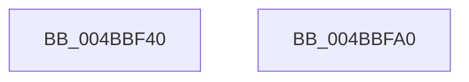

# VslCloseSecureHandle

- RVA: `0x004BBF40`–`0x004BBFA1` (길이 `97` bytes)
- VA: `0x00000001404BBF40`
- 실행 섹션: `.text`
- PDB 이름 있음: `예`; PDB Function 태그: `아니요`
- unwind 정보 RVA: `0x000AF554`
- 디코드: `23`개 명령, `97/97` bytes 표시
- 미해석 바이트: `0` (있으면 어셈블리에 `.byte`로 보존)

> 이 문서는 커널 이미지의 기계어와 PDB 기호를 분석해 생성했습니다. 4번과 5번은 함수 원형과 자료형을 바이너리 사용 방식에서 추정한 C 해석이며 원본 소스 복구 결과는 아닙니다.

## 1. Dependencies

- 직접 호출 지점: **3**; 고유 호출 대상: **3**
- 직접 호출자로 확인된 함수: **3**
- RIP 상대 이미지 참조: **1**

### Outgoing calls
- `0x004BBF69` → [memset](../6C/memset_function_006C6C40.md) (function, `0x006C6C40`)
- `0x004BBF82` → [VslpEnterIumSecureMode](../23/VslpEnterIumSecureMode_function_00235E50.md) (function, `0x00235E50`)
- `0x004BBF92` → [_security_check_cookie](../6A/_security_check_cookie_function_006AC640.md) (function, `0x006AC640`)

### Direct callers
- [KeUnsecureProcess](../5B/KeUnsecureProcess_function_005B9960.md) at `0x005B997E`
- [PsDereferenceVsmEnclave](../../page/A0/PsDereferenceVsmEnclave_function_00A0D7D4.md) at `0x00A0D80F`
- [VslCreateEnclave](../../page/A9/VslCreateEnclave_function_00A9C18C.md) at `0x00A9C2CA`

### Static image references
- `0x004BBF49` → RVA `0x00E0A740` (`.data`; read)

## 2. Other-region calls and transfers

- 다른 실행 섹션으로 향하는 call: **0**
- 별도 외부 분기/꼬리 이동을 확인하지 못했습니다.

## 3. Assembly (complete function range)

```asm
004BBF40  40 53                           push rbx
004BBF42  48 81 EC A0 00 00 00            sub rsp, 0xa0
004BBF49  48 8B 05 F0 E7 94 00            mov rax, qword ptr [rip + 0x94e7f0]
004BBF50  48 33 C4                        xor rax, rsp
004BBF53  48 89 84 24 90 00 00 00         mov qword ptr [rsp + 0x90], rax
004BBF5B  33 D2                           xor edx, edx
004BBF5D  48 8B D9                        mov rbx, rcx
004BBF60  48 8D 4C 24 20                  lea rcx, [rsp + 0x20]
004BBF65  44 8D 42 68                     lea r8d, [rdx + 0x68]
004BBF69  E8 D2 AC 20 00                  call 0x1406c6c40
004BBF6E  BA 1F 00 00 00                  mov edx, 0x1f
004BBF73  48 89 5C 24 28                  mov qword ptr [rsp + 0x28], rbx
004BBF78  4C 8D 4C 24 20                  lea r9, [rsp + 0x20]
004BBF7D  45 33 C0                        xor r8d, r8d
004BBF80  B1 02                           mov cl, 2
004BBF82  E8 C9 9E D7 FF                  call 0x140235e50
004BBF87  48 8B 8C 24 90 00 00 00         mov rcx, qword ptr [rsp + 0x90]
004BBF8F  48 33 CC                        xor rcx, rsp
004BBF92  E8 A9 06 1F 00                  call 0x1406ac640
004BBF97  48 81 C4 A0 00 00 00            add rsp, 0xa0
004BBF9E  5B                              pop rbx
004BBF9F  C3                              ret
004BBFA0  CC                              int3
```

## 4. C-style interpretation (structured pseudocode)

```c
__int64 __fastcall VslCloseSecureHandle(__int64 a1, int a2)
{
    __int64 result;
    __int64 v_rsp;
    unsigned __int64 v_stack_m18;
    unsigned __int64 v_stack_m80;
    unsigned __int64 v_stack_m88;

    v_rsp = (v_rsp) - (160);
    result = (*(unsigned __int64 *)(v_rip + 9758704)) ^ (v_rsp);
    v_stack_m18 = result;
    a2 = 0;
    result = memset(v_stack_m88, a2, a2 + 104, a4);
    v_stack_m80 = a1;
    a3 = 0;
    result = VslpEnterIumSecureMode(2, 31, a3, v_stack_m88);
    a1 = (v_stack_m18) ^ (v_rsp);
    result = _security_check_cookie(a1, 31, a3, v_stack_m88);
    v_rsp = (v_rsp) + (160);
    return result;
}
```

## 5. (Beta) C Style

```c
int64_t VslCloseSecureHandle(int64_t Arg1, int32_t Arg2)
{
    int64_t result;
    int64_t local_rsp;
    uint64_t v_stack_m18;
    uint64_t v_stack_m80;
    uint64_t v_stack_m88;

    local_rsp = (local_rsp) - (160);
    result = (*(uint64_t *)(v_rip + 0x94E7F0)) ^ (local_rsp);
    v_stack_m18 = result;
    Arg2 = 0;
    result = memset(v_stack_m88, Arg2, Arg2 + 104, a4);
    v_stack_m80 = Arg1;
    a3 = 0;
    result = VslpEnterIumSecureMode(2, 31, a3, v_stack_m88);
    Arg1 = (v_stack_m18) ^ (local_rsp);
    result = _security_check_cookie(Arg1, 31, a3, v_stack_m88);
    local_rsp = (local_rsp) + (160);
    return result;
}
```

## 6. Execution-region graph

[열기: 2D/3D 그래프와 함수 탐색 컨트롤 패널](../../../control-panel.html?section=text&rva=0x004BBF40&view=graph)

- 2D 그래프는 위에서 아래로 흐르고, 3D 그래프는 빈 공간을 드래그해 회전합니다. Shift+드래그는 이동, 휠은 확대·축소, 함수 노드 선택은 대상 보고서 이동입니다.

### Static fallback


