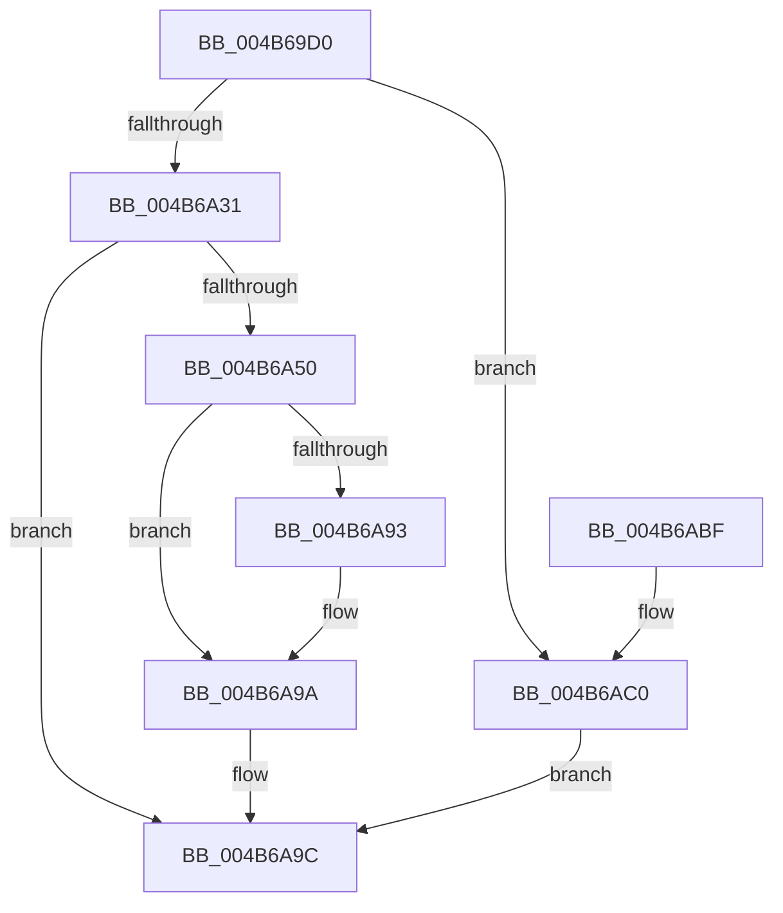

# VslCreateSecureImageSection

- RVA: `0x004B69D0`–`0x004B6AC7` (길이 `247` bytes)
- VA: `0x00000001404B69D0`
- 실행 섹션: `.text`
- PDB 이름 있음: `예`; PDB Function 태그: `아니요`
- unwind 정보 RVA: `0x000BA760`
- 디코드: `70`개 명령, `247/247` bytes 표시
- 미해석 바이트: `0` (있으면 어셈블리에 `.byte`로 보존)

> 이 문서는 커널 이미지의 기계어와 PDB 기호를 분석해 생성했습니다. 4번과 5번은 함수 원형과 자료형을 바이너리 사용 방식에서 추정한 C 해석이며 원본 소스 복구 결과는 아닙니다.

## 1. Dependencies

- 직접 호출 지점: **6**; 고유 호출 대상: **5**
- 직접 호출자로 확인된 함수: **0**
- RIP 상대 이미지 참조: **1**

### Outgoing calls
- `0x004B6A10` → [memset](../6C/memset_function_006C6C40.md) (function, `0x006C6C40`)
- `0x004B6A20` → [memset](../6C/memset_function_006C6C40.md) (function, `0x006C6C40`)
- `0x004B6A47` → [VslpLockPagesForTransfer](../29/VslpLockPagesForTransfer_function_0029E0FC.md) (function, `0x0029E0FC`)
- `0x004B6A7E` → [VslpEnterIumSecureMode](../23/VslpEnterIumSecureMode_function_00235E50.md) (function, `0x00235E50`)
- `0x004B6A8A` → [VslpUnlockPagesForTransfer](../29/VslpUnlockPagesForTransfer_function_0029EE4C.md) (function, `0x0029EE4C`)
- `0x004B6AA3` → [_security_check_cookie](../6A/_security_check_cookie_function_006AC640.md) (function, `0x006AC640`)

### Direct callers
- 이 함수 시작 RVA로 연결되는 직접 call은 확인되지 않았습니다. 간접 호출은 완전히 역산할 수 없습니다.

### Static image references
- `0x004B69E8` → RVA `0x00E0A740` (`.data`; read)

## 2. Other-region calls and transfers

- 다른 실행 섹션으로 향하는 call: **0**
- 별도 외부 분기/꼬리 이동을 확인하지 못했습니다.

## 3. Assembly (complete function range)

```asm
004B69D0  48 89 5C 24 18                  mov qword ptr [rsp + 0x18], rbx
004B69D5  55                              push rbp
004B69D6  56                              push rsi
004B69D7  57                              push rdi
004B69D8  41 56                           push r14
004B69DA  41 57                           push r15
004B69DC  48 8D 6C 24 D9                  lea rbp, [rsp - 0x27]
004B69E1  48 81 EC 00 01 00 00            sub rsp, 0x100
004B69E8  48 8B 05 51 3D 95 00            mov rax, qword ptr [rip + 0x953d51]
004B69EF  48 33 C4                        xor rax, rsp
004B69F2  48 89 45 17                     mov qword ptr [rbp + 0x17], rax
004B69F6  48 8B 7D 7F                     mov rdi, qword ptr [rbp + 0x7f]
004B69FA  48 8B F2                        mov rsi, rdx
004B69FD  33 D2                           xor edx, edx
004B69FF  45 0F B6 F8                     movzx r15d, r8b
004B6A03  8B D9                           mov ebx, ecx
004B6A05  45 8B F1                        mov r14d, r9d
004B6A08  48 8D 4D A7                     lea rcx, [rbp - 0x59]
004B6A0C  44 8D 42 68                     lea r8d, [rdx + 0x68]
004B6A10  E8 2B 02 21 00                  call 0x1406c6c40
004B6A15  33 D2                           xor edx, edx
004B6A17  48 8D 4C 24 30                  lea rcx, [rsp + 0x30]
004B6A1C  44 8D 42 48                     lea r8d, [rdx + 0x48]
004B6A20  E8 1B 02 21 00                  call 0x1406c6c40
004B6A25  81 FB FA 01 00 00               cmp ebx, 0x1fa
004B6A2B  0F 87 8F 00 00 00               ja 0x1404b6ac0
004B6A31  83 64 24 20 00                  and dword ptr [rsp + 0x20], 0
004B6A36  48 8D 4C 24 30                  lea rcx, [rsp + 0x30]
004B6A3B  C1 E3 0C                        shl ebx, 0xc
004B6A3E  45 33 C9                        xor r9d, r9d
004B6A41  44 8B C3                        mov r8d, ebx
004B6A44  48 8B D6                        mov rdx, rsi
004B6A47  E8 B0 76 DE FF                  call 0x14029e0fc
004B6A4C  85 C0                           test eax, eax
004B6A4E  78 4C                           js 0x1404b6a9c
004B6A50  48 8B 44 24 30                  mov rax, qword ptr [rsp + 0x30]
004B6A55  4C 8D 4D A7                     lea r9, [rbp - 0x59]
004B6A59  48 89 45 AF                     mov qword ptr [rbp - 0x51], rax
004B6A5D  BA 19 00 00 00                  mov edx, 0x19
004B6A62  48 8B 45 8F                     mov rax, qword ptr [rbp - 0x71]
004B6A66  45 33 C0                        xor r8d, r8d
004B6A69  48 89 45 B7                     mov qword ptr [rbp - 0x49], rax
004B6A6D  B1 02                           mov cl, 2
004B6A6F  8B 45 77                        mov eax, dword ptr [rbp + 0x77]
004B6A72  48 89 45 CF                     mov qword ptr [rbp - 0x31], rax
004B6A76  4C 89 7D BF                     mov qword ptr [rbp - 0x41], r15
004B6A7A  4C 89 75 C7                     mov qword ptr [rbp - 0x39], r14
004B6A7E  E8 CD F3 D7 FF                  call 0x140235e50
004B6A83  48 8D 4C 24 30                  lea rcx, [rsp + 0x30]
004B6A88  8B D8                           mov ebx, eax
004B6A8A  E8 BD 83 DE FF                  call 0x14029ee4c
004B6A8F  85 DB                           test ebx, ebx
004B6A91  78 07                           js 0x1404b6a9a
004B6A93  48 8B 4D B7                     mov rcx, qword ptr [rbp - 0x49]
004B6A97  48 89 0F                        mov qword ptr [rdi], rcx
004B6A9A  8B C3                           mov eax, ebx
004B6A9C  48 8B 4D 17                     mov rcx, qword ptr [rbp + 0x17]
004B6AA0  48 33 CC                        xor rcx, rsp
004B6AA3  E8 98 5B 1F 00                  call 0x1406ac640
004B6AA8  48 8B 9C 24 40 01 00 00         mov rbx, qword ptr [rsp + 0x140]
004B6AB0  48 81 C4 00 01 00 00            add rsp, 0x100
004B6AB7  41 5F                           pop r15
004B6AB9  41 5E                           pop r14
004B6ABB  5F                              pop rdi
004B6ABC  5E                              pop rsi
004B6ABD  5D                              pop rbp
004B6ABE  C3                              ret
004B6ABF  CC                              int3
004B6AC0  B8 0D 00 00 C0                  mov eax, 0xc000000d
004B6AC5  EB D5                           jmp 0x1404b6a9c
```

## 4. C-style interpretation (structured pseudocode)

```c
__int64 __fastcall VslCreateSecureImageSection(int a1, __int64 a2, unsigned __int8 a3, int a4, unsigned int a5, __int64 a6)
{
    __int64 result;
    __int64 v_rbx;
    __int64 v_rsp;
    unsigned int v_stack_m108;
    unsigned __int64 v_stack_m38;
    unsigned __int64 v_stack_m4F;
    unsigned __int64 v_stack_m80;
    unsigned __int64 v_stack_m88;
    unsigned __int64 v_stack_m90;
    unsigned __int64 v_stack_m98;
    unsigned __int64 v_stack_mA0;
    unsigned __int64 v_stack_mA8;
    unsigned __int64 v_stack_mC0;
    unsigned __int64 v_stack_mF8;
    unsigned __int64 v_stack_p18;

    v_stack_p18 = v_rbx;
    v_rsp = (v_rsp) - (256);
    result = (*(unsigned __int64 *)(v_rip + 9780561)) ^ (v_rsp);
    v_stack_m38 = result;
    a2 = 0;
    result = memset(v_stack_mA8, a2, a2 + 104, a4);
    a2 = 0;
    result = memset(v_stack_mF8, a2, a2 + 72, a4);
    if (((unsigned int)((unsigned int)(a1))) > 506) goto loc_004B6AC0;
    v_rbx = (unsigned int)(((unsigned int)(a1)) << (12));
    a4 = 0;
    result = VslpLockPagesForTransfer(v_stack_mF8, 0, (unsigned int)((unsigned int)(v_rbx)), a4);
    if (sign_flag) goto loc_004B6A9C;
    v_stack_mA0 = v_stack_mF8;
    a3 = 0;
    v_stack_m98 = v_stack_mC0;
    v_stack_m80 = (unsigned int)(a5);
    v_stack_m90 = 0;
    v_stack_m88 = (unsigned int)(a4);
    result = VslpEnterIumSecureMode(2, 25, a3, v_stack_mA8);
    result = VslpUnlockPagesForTransfer(v_stack_mF8, 25, a3, v_stack_mA8);
    if (!(sign_flag)) {
        a1 = v_stack_m98;
        *(unsigned __int64 *)(a6) = a1;
    }
loc_004B6A9C:
    a1 = (v_stack_m38) ^ (v_rsp);
    result = _security_check_cookie(a1, 25, a3, v_stack_mA8);
    v_rsp = (v_rsp) + (256);
    return result;
loc_004B6AC0:
    goto loc_004B6A9C;
}
```

## 5. (Beta) C Style

```c
int64_t VslCreateSecureImageSection(int32_t Arg1, int64_t Arg2, uint8_t Arg3, int32_t Arg4, uint32_t Arg5, void *Arg6)
{
    uint8_t *arg6 = (uint8_t *)Arg6;

    int64_t result;
    int64_t local_rbx;
    int64_t local_rsp;
    uint32_t v_stack_m108;
    uint64_t v_stack_m38;
    uint64_t v_stack_m4F;
    uint64_t v_stack_m80;
    uint64_t v_stack_m88;
    uint64_t v_stack_m90;
    uint64_t v_stack_m98;
    uint64_t v_stack_mA0;
    uint64_t v_stack_mA8;
    uint64_t v_stack_mC0;
    uint64_t v_stack_mF8;
    uint64_t v_stack_p18;

    v_stack_p18 = local_rbx;
    local_rsp = (local_rsp) - (256);
    result = (*(uint64_t *)(v_rip + 0x953D51)) ^ (local_rsp);
    v_stack_m38 = result;
    Arg2 = 0;
    result = memset(v_stack_mA8, Arg2, Arg2 + 104, Arg4);
    Arg2 = 0;
    result = memset(v_stack_mF8, Arg2, Arg2 + 72, Arg4);
    if (((uint32_t)((uint32_t)(Arg1))) > 506) goto loc_004B6AC0;
    local_rbx = (uint32_t)(((uint32_t)(Arg1)) << (12));
    Arg4 = 0;
    result = VslpLockPagesForTransfer(v_stack_mF8, 0, (uint32_t)((uint32_t)(local_rbx)), Arg4);
    if (sign_flag) goto loc_004B6A9C;
    v_stack_mA0 = v_stack_mF8;
    Arg3 = 0;
    v_stack_m98 = v_stack_mC0;
    v_stack_m80 = (uint32_t)(Arg5);
    v_stack_m90 = 0;
    v_stack_m88 = (uint32_t)(Arg4);
    result = VslpEnterIumSecureMode(2, 25, Arg3, v_stack_mA8);
    result = VslpUnlockPagesForTransfer(v_stack_mF8, 25, Arg3, v_stack_mA8);
    if (!(sign_flag)) {
        Arg1 = v_stack_m98;
        *(uint64_t *)(arg6) = Arg1;
    }
loc_004B6A9C:
    Arg1 = (v_stack_m38) ^ (local_rsp);
    result = _security_check_cookie(Arg1, 25, Arg3, v_stack_mA8);
    local_rsp = (local_rsp) + (256);
    return result;
loc_004B6AC0:
    goto loc_004B6A9C;
}
```

### 관측된 메모리 오프셋

구조체 형식이 확인되지 않은 접근은 인자 기준의 오프셋으로만 기록했습니다.

| 기준 인자 | 오프셋 표현 | 폭 (bit) | 접근 |
|---|---:|---:|---|
| `Arg6` | `+ 0x0` | `64` | `W` |

## 6. Execution-region graph

[열기: 2D/3D 그래프와 함수 탐색 컨트롤 패널](../../../control-panel.html?section=text&rva=0x004B69D0&view=graph)

- 2D 그래프는 위에서 아래로 흐르고, 3D 그래프는 빈 공간을 드래그해 회전합니다. Shift+드래그는 이동, 휠은 확대·축소, 함수 노드 선택은 대상 보고서 이동입니다.

### Static fallback


