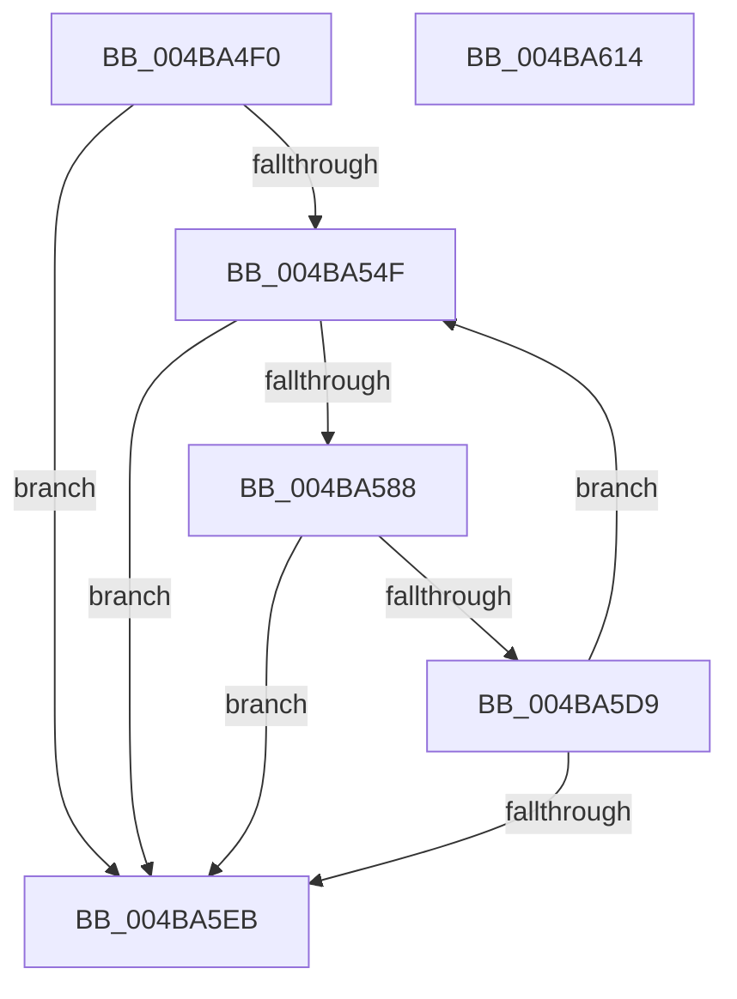

# VslFillSecureAllocation

- RVA: `0x004BA4F0`–`0x004BA615` (길이 `293` bytes)
- VA: `0x00000001404BA4F0`
- 실행 섹션: `.text`
- PDB 이름 있음: `예`; PDB Function 태그: `아니요`
- unwind 정보 RVA: `0x000BB458`
- 디코드: `76`개 명령, `293/293` bytes 표시
- 미해석 바이트: `0` (있으면 어셈블리에 `.byte`로 보존)

> 이 문서는 커널 이미지의 기계어와 PDB 기호를 분석해 생성했습니다. 4번과 5번은 함수 원형과 자료형을 바이너리 사용 방식에서 추정한 C 해석이며 원본 소스 복구 결과는 아닙니다.

## 1. Dependencies

- 직접 호출 지점: **6**; 고유 호출 대상: **5**
- 직접 호출자로 확인된 함수: **0**
- RIP 상대 이미지 참조: **1**

### Outgoing calls
- `0x004BA52F` → [memset](../6C/memset_function_006C6C40.md) (function, `0x006C6C40`)
- `0x004BA53F` → [memset](../6C/memset_function_006C6C40.md) (function, `0x006C6C40`)
- `0x004BA57D` → [VslpLockPagesForTransfer](../29/VslpLockPagesForTransfer_function_0029E0FC.md) (function, `0x0029E0FC`)
- `0x004BA5C4` → [VslpEnterIumSecureMode](../23/VslpEnterIumSecureMode_function_00235E50.md) (function, `0x00235E50`)
- `0x004BA5D0` → [VslpUnlockPagesForTransfer](../29/VslpUnlockPagesForTransfer_function_0029EE4C.md) (function, `0x0029EE4C`)
- `0x004BA5F8` → [_security_check_cookie](../6A/_security_check_cookie_function_006AC640.md) (function, `0x006AC640`)

### Direct callers
- 이 함수 시작 RVA로 연결되는 직접 call은 확인되지 않았습니다. 간접 호출은 완전히 역산할 수 없습니다.

### Static image references
- `0x004BA503` → RVA `0x00E0A740` (`.data`; read)

## 2. Other-region calls and transfers

- 다른 실행 섹션으로 향하는 call: **0**
- 별도 외부 분기/꼬리 이동을 확인하지 못했습니다.

## 3. Assembly (complete function range)

```asm
004BA4F0  48 89 5C 24 08                  mov qword ptr [rsp + 8], rbx
004BA4F5  55                              push rbp
004BA4F6  56                              push rsi
004BA4F7  57                              push rdi
004BA4F8  41 56                           push r14
004BA4FA  41 57                           push r15
004BA4FC  48 81 EC 00 01 00 00            sub rsp, 0x100
004BA503  48 8B 05 36 02 95 00            mov rax, qword ptr [rip + 0x950236]
004BA50A  48 33 C4                        xor rax, rsp
004BA50D  48 89 84 24 F0 00 00 00         mov qword ptr [rsp + 0xf0], rax
004BA515  48 8B EA                        mov rbp, rdx
004BA518  49 8B F8                        mov rdi, r8
004BA51B  33 D2                           xor edx, edx
004BA51D  4C 8B F9                        mov r15, rcx
004BA520  48 8D 8C 24 80 00 00 00         lea rcx, [rsp + 0x80]
004BA528  49 8B F1                        mov rsi, r9
004BA52B  44 8D 42 68                     lea r8d, [rdx + 0x68]
004BA52F  E8 0C C7 20 00                  call 0x1406c6c40
004BA534  33 D2                           xor edx, edx
004BA536  48 8D 4C 24 30                  lea rcx, [rsp + 0x30]
004BA53B  44 8D 42 48                     lea r8d, [rdx + 0x48]
004BA53F  E8 FC C6 20 00                  call 0x1406c6c40
004BA544  33 DB                           xor ebx, ebx
004BA546  48 85 FF                        test rdi, rdi
004BA549  0F 84 9C 00 00 00               je 0x1404ba5eb
004BA54F  8B CE                           mov ecx, esi
004BA551  B8 00 A0 1F 00                  mov eax, 0x1fa000
004BA556  81 E1 FF 0F 00 00               and ecx, 0xfff
004BA55C  44 8B F7                        mov r14d, edi
004BA55F  2B C1                           sub eax, ecx
004BA561  48 8B D6                        mov rdx, rsi
004BA564  8B C8                           mov ecx, eax
004BA566  48 3B CF                        cmp rcx, rdi
004BA569  48 8D 4C 24 30                  lea rcx, [rsp + 0x30]
004BA56E  44 0F 46 F0                     cmovbe r14d, eax
004BA572  83 64 24 20 00                  and dword ptr [rsp + 0x20], 0
004BA577  45 8B C6                        mov r8d, r14d
004BA57A  45 33 C9                        xor r9d, r9d
004BA57D  E8 7A 3B DE FF                  call 0x14029e0fc
004BA582  8B D8                           mov ebx, eax
004BA584  85 C0                           test eax, eax
004BA586  78 63                           js 0x1404ba5eb
004BA588  48 8B 44 24 30                  mov rax, qword ptr [rsp + 0x30]
004BA58D  4C 8D 8C 24 80 00 00 00         lea r9, [rsp + 0x80]
004BA595  48 89 84 24 98 00 00 00         mov qword ptr [rsp + 0x98], rax
004BA59D  BA 17 00 00 00                  mov edx, 0x17
004BA5A2  48 8B 44 24 68                  mov rax, qword ptr [rsp + 0x68]
004BA5A7  45 33 C0                        xor r8d, r8d
004BA5AA  B1 02                           mov cl, 2
004BA5AC  48 89 84 24 A0 00 00 00         mov qword ptr [rsp + 0xa0], rax
004BA5B4  4C 89 BC 24 88 00 00 00         mov qword ptr [rsp + 0x88], r15
004BA5BC  48 89 AC 24 90 00 00 00         mov qword ptr [rsp + 0x90], rbp
004BA5C4  E8 87 B8 D7 FF                  call 0x140235e50
004BA5C9  48 8D 4C 24 30                  lea rcx, [rsp + 0x30]
004BA5CE  8B D8                           mov ebx, eax
004BA5D0  E8 77 48 DE FF                  call 0x14029ee4c
004BA5D5  85 DB                           test ebx, ebx
004BA5D7  78 12                           js 0x1404ba5eb
004BA5D9  41 8B C6                        mov eax, r14d
004BA5DC  48 03 F0                        add rsi, rax
004BA5DF  48 03 E8                        add rbp, rax
004BA5E2  48 2B F8                        sub rdi, rax
004BA5E5  0F 85 64 FF FF FF               jne 0x1404ba54f
004BA5EB  8B C3                           mov eax, ebx
004BA5ED  48 8B 8C 24 F0 00 00 00         mov rcx, qword ptr [rsp + 0xf0]
004BA5F5  48 33 CC                        xor rcx, rsp
004BA5F8  E8 43 20 1F 00                  call 0x1406ac640
004BA5FD  48 8B 9C 24 30 01 00 00         mov rbx, qword ptr [rsp + 0x130]
004BA605  48 81 C4 00 01 00 00            add rsp, 0x100
004BA60C  41 5F                           pop r15
004BA60E  41 5E                           pop r14
004BA610  5F                              pop rdi
004BA611  5E                              pop rsi
004BA612  5D                              pop rbp
004BA613  C3                              ret
004BA614  CC                              int3
```

## 4. C-style interpretation (structured pseudocode)

```c
__int64 __fastcall VslFillSecureAllocation(__int64 a1, __int64 a2, __int64 a3, __int64 a4)
{
    __int64 result;
    __int64 v_r14;
    __int64 v_rbp;
    __int64 v_rbx;
    __int64 v_rdi;
    __int64 v_rsi;
    __int64 v_rsp;
    unsigned int v_stack_m108;
    unsigned __int64 v_stack_m38;
    unsigned __int64 v_stack_m88;
    unsigned __int64 v_stack_m90;
    unsigned __int64 v_stack_m98;
    unsigned __int64 v_stack_mA0;
    unsigned __int64 v_stack_mA8;
    unsigned __int64 v_stack_mC0;
    unsigned __int64 v_stack_mF8;
    unsigned __int64 v_stack_p8;

    v_stack_p8 = v_rbx;
    v_rsp = (v_rsp) - (256);
    result = (*(unsigned __int64 *)(v_rip + 9765430)) ^ (v_rsp);
    v_stack_m38 = result;
    a2 = 0;
    result = memset(v_stack_mA8, a2, a2 + 104, a4);
    a2 = 0;
    result = memset(v_stack_mF8, a2, a2 + 72, a4);
    v_rbx = 0;
    if (a3 == 0) goto loc_004BA5EB;
loc_004BA54F:
    a1 = (unsigned int)(((unsigned int)((unsigned int)(a4))) & (0xFFFULL));
    result = (unsigned int)(((unsigned int)(0x1FA000ULL)) - ((unsigned int)(a1)));
    v_r14 = (unsigned int)((unsigned int)(a3));
    if (((unsigned int)((unsigned int)(result))) <= a3) { v_r14 = (unsigned int)(result); }
    a4 = 0;
    result = VslpLockPagesForTransfer(v_stack_mF8, a4, (unsigned int)((unsigned int)(v_r14)), a4);
    if (sign_flag) goto loc_004BA5EB;
    v_stack_m90 = v_stack_mF8;
    a3 = 0;
    v_stack_m88 = v_stack_mC0;
    v_stack_mA0 = a1;
    v_stack_m98 = 0;
    result = VslpEnterIumSecureMode(2, 23, a3, v_stack_mA8);
    result = VslpUnlockPagesForTransfer(v_stack_mF8, 23, a3, v_stack_mA8);
    if (sign_flag) goto loc_004BA5EB;
    v_rsi = (a4) + ((unsigned int)((unsigned int)(v_r14)));
    v_rbp = (a2) + ((unsigned int)((unsigned int)(v_r14)));
    v_rdi = (a3) - ((unsigned int)((unsigned int)(v_r14)));
    if (condition_is_not_equal) goto loc_004BA54F;
loc_004BA5EB:
    a1 = (v_stack_m38) ^ (v_rsp);
    result = _security_check_cookie(a1, 23, a3, v_stack_mA8);
    v_rsp = (v_rsp) + (256);
    return result;
}
```

## 5. (Beta) C Style

```c
int64_t VslFillSecureAllocation(int64_t Arg1, int64_t Arg2, int64_t Arg3, int64_t Arg4)
{
    int64_t result;
    int64_t local_r14;
    int64_t local_rbp;
    int64_t local_rbx;
    int64_t local_rdi;
    int64_t local_rsi;
    int64_t local_rsp;
    uint32_t v_stack_m108;
    uint64_t v_stack_m38;
    uint64_t v_stack_m88;
    uint64_t v_stack_m90;
    uint64_t v_stack_m98;
    uint64_t v_stack_mA0;
    uint64_t v_stack_mA8;
    uint64_t v_stack_mC0;
    uint64_t v_stack_mF8;
    uint64_t v_stack_p8;

    v_stack_p8 = local_rbx;
    local_rsp = (local_rsp) - (256);
    result = (*(uint64_t *)(v_rip + 0x950236)) ^ (local_rsp);
    v_stack_m38 = result;
    Arg2 = 0;
    result = memset(v_stack_mA8, Arg2, Arg2 + 104, Arg4);
    Arg2 = 0;
    result = memset(v_stack_mF8, Arg2, Arg2 + 72, Arg4);
    local_rbx = 0;
    if (Arg3 == 0) goto loc_004BA5EB;
loc_004BA54F:
    Arg1 = (uint32_t)(((uint32_t)((uint32_t)(Arg4))) & (0xFFFULL));
    result = (uint32_t)(((uint32_t)(0x1FA000ULL)) - ((uint32_t)(Arg1)));
    local_r14 = (uint32_t)((uint32_t)(Arg3));
    if (((uint32_t)((uint32_t)(result))) <= Arg3) { local_r14 = (uint32_t)(result); }
    Arg4 = 0;
    result = VslpLockPagesForTransfer(v_stack_mF8, Arg4, (uint32_t)((uint32_t)(local_r14)), Arg4);
    if (sign_flag) goto loc_004BA5EB;
    v_stack_m90 = v_stack_mF8;
    Arg3 = 0;
    v_stack_m88 = v_stack_mC0;
    v_stack_mA0 = Arg1;
    v_stack_m98 = 0;
    result = VslpEnterIumSecureMode(2, 23, Arg3, v_stack_mA8);
    result = VslpUnlockPagesForTransfer(v_stack_mF8, 23, Arg3, v_stack_mA8);
    if (sign_flag) goto loc_004BA5EB;
    local_rsi = (Arg4) + ((uint32_t)((uint32_t)(local_r14)));
    local_rbp = (Arg2) + ((uint32_t)((uint32_t)(local_r14)));
    local_rdi = (Arg3) - ((uint32_t)((uint32_t)(local_r14)));
    if (condition_is_not_equal) goto loc_004BA54F;
loc_004BA5EB:
    Arg1 = (v_stack_m38) ^ (local_rsp);
    result = _security_check_cookie(Arg1, 23, Arg3, v_stack_mA8);
    local_rsp = (local_rsp) + (256);
    return result;
}
```

## 6. Execution-region graph

[열기: 2D/3D 그래프와 함수 탐색 컨트롤 패널](../../../control-panel.html?section=text&rva=0x004BA4F0&view=graph)

- 2D 그래프는 위에서 아래로 흐르고, 3D 그래프는 빈 공간을 드래그해 회전합니다. Shift+드래그는 이동, 휠은 확대·축소, 함수 노드 선택은 대상 보고서 이동입니다.

### Static fallback


