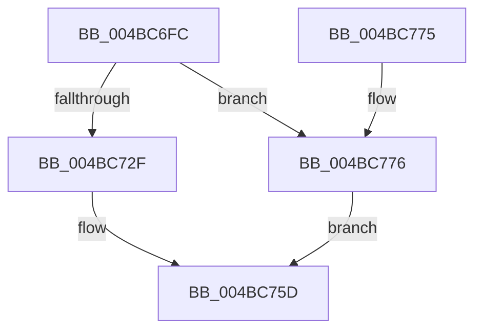

# VslFlushSecureAddressSpace

- RVA: `0x004BC6FC`–`0x004BC77D` (길이 `129` bytes)
- VA: `0x00000001404BC6FC`
- 실행 섹션: `.text`
- PDB 이름 있음: `예`; PDB Function 태그: `아니요`
- unwind 정보 RVA: `0x000BB9C8`
- 디코드: `28`개 명령, `129/129` bytes 표시
- 미해석 바이트: `0` (있으면 어셈블리에 `.byte`로 보존)

> 이 문서는 커널 이미지의 기계어와 PDB 기호를 분석해 생성했습니다. 4번과 5번은 함수 원형과 자료형을 바이너리 사용 방식에서 추정한 C 해석이며 원본 소스 복구 결과는 아닙니다.

## 1. Dependencies

- 직접 호출 지점: **3**; 고유 호출 대상: **3**
- 직접 호출자로 확인된 함수: **3**
- RIP 상대 이미지 참조: **1**

### Outgoing calls
- `0x004BC720` → [memset](../6C/memset_function_006C6C40.md) (function, `0x006C6C40`)
- `0x004BC758` → [VslpEnterIumSecureMode](../23/VslpEnterIumSecureMode_function_00235E50.md) (function, `0x00235E50`)
- `0x004BC768` → [_security_check_cookie](../6A/_security_check_cookie_function_006AC640.md) (function, `0x006AC640`)

### Direct callers
- [sub_00314667](../31/Unknown_function_00314667.md) at `0x0031474C`
- [sub_006E10B0](../6E/Unknown_function_006E10B0.md) at `0x006E1123`
- [sub_006FB0BC](../6F/Unknown_function_006FB0BC.md) at `0x006FB1BB`

### Static image references
- `0x004BC703` → RVA `0x00E0A740` (`.data`; read)

## 2. Other-region calls and transfers

- 다른 실행 섹션으로 향하는 call: **0**
- 별도 외부 분기/꼬리 이동을 확인하지 못했습니다.

## 3. Assembly (complete function range)

```asm
004BC6FC  48 81 EC A8 00 00 00            sub rsp, 0xa8
004BC703  48 8B 05 36 E0 94 00            mov rax, qword ptr [rip + 0x94e036]
004BC70A  48 33 C4                        xor rax, rsp
004BC70D  48 89 84 24 90 00 00 00         mov qword ptr [rsp + 0x90], rax
004BC715  33 D2                           xor edx, edx
004BC717  48 8D 4C 24 20                  lea rcx, [rsp + 0x20]
004BC71C  44 8D 42 68                     lea r8d, [rdx + 0x68]
004BC720  E8 1B A5 20 00                  call 0x1406c6c40
004BC725  44 0F 20 C0                     mov rax, cr8
004BC729  B1 02                           mov cl, 2
004BC72B  3A C1                           cmp al, cl
004BC72D  77 47                           ja 0x1404bc776
004BC72F  65 48 8B 04 25 88 01 00 00      mov rax, qword ptr gs:[0x188]
004BC738  4C 8D 4C 24 20                  lea r9, [rsp + 0x20]
004BC73D  45 33 C0                        xor r8d, r8d
004BC740  48 8B 90 B8 00 00 00            mov rdx, qword ptr [rax + 0xb8]
004BC747  48 8B 82 70 01 00 00            mov rax, qword ptr [rdx + 0x170]
004BC74E  BA F0 00 00 00                  mov edx, 0xf0
004BC753  48 89 44 24 28                  mov qword ptr [rsp + 0x28], rax
004BC758  E8 F3 96 D7 FF                  call 0x140235e50
004BC75D  48 8B 8C 24 90 00 00 00         mov rcx, qword ptr [rsp + 0x90]
004BC765  48 33 CC                        xor rcx, rsp
004BC768  E8 D3 FE 1E 00                  call 0x1406ac640
004BC76D  48 81 C4 A8 00 00 00            add rsp, 0xa8
004BC774  C3                              ret
004BC775  CC                              int3
004BC776  B8 FF 00 00 00                  mov eax, 0xff
004BC77B  EB E0                           jmp 0x1404bc75d
```

## 4. C-style interpretation (structured pseudocode)

```c
__int64 __fastcall VslFlushSecureAddressSpace(__int64 a1, int a2)
{
    __int64 result;
    __int64 v_rsp;
    unsigned __int64 v_stack_m18;
    unsigned __int64 v_stack_m80;
    unsigned __int64 v_stack_m88;

    v_rsp = (v_rsp) - (168);
    result = (*(unsigned __int64 *)(v_rip + 9756726)) ^ (v_rsp);
    v_stack_m18 = result;
    a2 = 0;
    result = memset(v_stack_m88, a2, a2 + 104, a4);
    if (((unsigned __int8)(v_cr8)) > 2) goto loc_004BC776;
    a3 = 0;
    v_stack_m80 = *(unsigned __int64 *)(*(unsigned __int64 *)(*(unsigned __int64 *)(gs_base + (0 + 392)) + 184) + 368);
    result = VslpEnterIumSecureMode(2, 240, a3, v_stack_m88);
loc_004BC75D:
    a1 = (v_stack_m18) ^ (v_rsp);
    result = _security_check_cookie(a1, 240, a3, v_stack_m88);
    v_rsp = (v_rsp) + (168);
    return result;
loc_004BC776:
    goto loc_004BC75D;
}
```

## 5. (Beta) C Style

```c
int64_t VslFlushSecureAddressSpace(int64_t Arg1, int32_t Arg2)
{
    int64_t result;
    int64_t local_rsp;
    uint64_t v_stack_m18;
    uint64_t v_stack_m80;
    uint64_t v_stack_m88;

    local_rsp = (local_rsp) - (168);
    result = (*(uint64_t *)(v_rip + 0x94E036)) ^ (local_rsp);
    v_stack_m18 = result;
    Arg2 = 0;
    result = memset(v_stack_m88, Arg2, Arg2 + 104, a4);
    if (((uint8_t)(v_cr8)) > 2) goto loc_004BC776;
    a3 = 0;
    v_stack_m80 = *(uint64_t *)(*(uint64_t *)(*(uint64_t *)(gs_base + (0 + 0x188)) + 0xB8) + 0x170);
    result = VslpEnterIumSecureMode(2, 240, a3, v_stack_m88);
loc_004BC75D:
    Arg1 = (v_stack_m18) ^ (local_rsp);
    result = _security_check_cookie(Arg1, 240, a3, v_stack_m88);
    local_rsp = (local_rsp) + (168);
    return result;
loc_004BC776:
    goto loc_004BC75D;
}
```

## 6. Execution-region graph

[열기: 2D/3D 그래프와 함수 탐색 컨트롤 패널](../../../control-panel.html?section=text&rva=0x004BC6FC&view=graph)

- 2D 그래프는 위에서 아래로 흐르고, 3D 그래프는 빈 공간을 드래그해 회전합니다. Shift+드래그는 이동, 휠은 확대·축소, 함수 노드 선택은 대상 보고서 이동입니다.

### Static fallback


