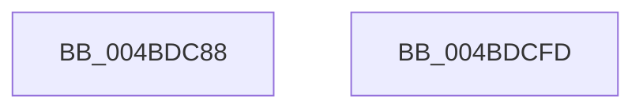

# VslIsTrustletRunning

- RVA: `0x004BDC88`–`0x004BDCFE` (길이 `118` bytes)
- VA: `0x00000001404BDC88`
- 실행 섹션: `.text`
- PDB 이름 있음: `예`; PDB Function 태그: `아니요`
- unwind 정보 RVA: `0x000B53F0`
- 디코드: `28`개 명령, `118/118` bytes 표시
- 미해석 바이트: `0` (있으면 어셈블리에 `.byte`로 보존)

> 이 문서는 커널 이미지의 기계어와 PDB 기호를 분석해 생성했습니다. 4번과 5번은 함수 원형과 자료형을 바이너리 사용 방식에서 추정한 C 해석이며 원본 소스 복구 결과는 아닙니다.

## 1. Dependencies

- 직접 호출 지점: **3**; 고유 호출 대상: **3**
- 직접 호출자로 확인된 함수: **1**
- RIP 상대 이미지 참조: **1**

### Outgoing calls
- `0x004BDCB8` → [memset](../6C/memset_function_006C6C40.md) (function, `0x006C6C40`)
- `0x004BDCD1` → [VslpEnterIumSecureMode](../23/VslpEnterIumSecureMode_function_00235E50.md) (function, `0x00235E50`)
- `0x004BDCE7` → [_security_check_cookie](../6A/_security_check_cookie_function_006AC640.md) (function, `0x006AC640`)

### Direct callers
- [ExpQuerySystemInformation](../../page/A5/ExpQuerySystemInformation_function_00A57858.md) at `0x00A5A44A`

### Static image references
- `0x004BDC95` → RVA `0x00E0A740` (`.data`; read)

## 2. Other-region calls and transfers

- 다른 실행 섹션으로 향하는 call: **0**
- 별도 외부 분기/꼬리 이동을 확인하지 못했습니다.

## 3. Assembly (complete function range)

```asm
004BDC88  48 89 5C 24 08                  mov qword ptr [rsp + 8], rbx
004BDC8D  57                              push rdi
004BDC8E  48 81 EC A0 00 00 00            sub rsp, 0xa0
004BDC95  48 8B 05 A4 CA 94 00            mov rax, qword ptr [rip + 0x94caa4]
004BDC9C  48 33 C4                        xor rax, rsp
004BDC9F  48 89 84 24 90 00 00 00         mov qword ptr [rsp + 0x90], rax
004BDCA7  48 8B FA                        mov rdi, rdx
004BDCAA  48 8B D9                        mov rbx, rcx
004BDCAD  33 D2                           xor edx, edx
004BDCAF  48 8D 4C 24 20                  lea rcx, [rsp + 0x20]
004BDCB4  44 8D 42 68                     lea r8d, [rdx + 0x68]
004BDCB8  E8 83 8F 20 00                  call 0x1406c6c40
004BDCBD  BA 15 00 00 00                  mov edx, 0x15
004BDCC2  48 89 5C 24 28                  mov qword ptr [rsp + 0x28], rbx
004BDCC7  4C 8D 4C 24 20                  lea r9, [rsp + 0x20]
004BDCCC  45 33 C0                        xor r8d, r8d
004BDCCF  B1 02                           mov cl, 2
004BDCD1  E8 7A 81 D7 FF                  call 0x140235e50
004BDCD6  8A 4C 24 30                     mov cl, byte ptr [rsp + 0x30]
004BDCDA  88 0F                           mov byte ptr [rdi], cl
004BDCDC  48 8B 8C 24 90 00 00 00         mov rcx, qword ptr [rsp + 0x90]
004BDCE4  48 33 CC                        xor rcx, rsp
004BDCE7  E8 54 E9 1E 00                  call 0x1406ac640
004BDCEC  48 8B 9C 24 B0 00 00 00         mov rbx, qword ptr [rsp + 0xb0]
004BDCF4  48 81 C4 A0 00 00 00            add rsp, 0xa0
004BDCFB  5F                              pop rdi
004BDCFC  C3                              ret
004BDCFD  CC                              int3
```

## 4. C-style interpretation (structured pseudocode)

```c
__int64 __fastcall VslIsTrustletRunning(__int64 a1, __int64 a2)
{
    __int64 result;
    __int64 v_rsp;
    unsigned __int64 v_stack_m18;
    unsigned __int8 v_stack_m78;
    unsigned __int64 v_stack_m80;
    unsigned __int64 v_stack_m88;
    unsigned __int64 v_stack_p8;

    v_stack_p8 = v_rbx;
    v_rsp = (v_rsp) - (160);
    result = (*(unsigned __int64 *)(v_rip + 9751204)) ^ (v_rsp);
    v_stack_m18 = result;
    a2 = 0;
    result = memset(v_stack_m88, a2, a2 + 104, a4);
    v_stack_m80 = a1;
    a3 = 0;
    result = VslpEnterIumSecureMode(2, 21, a3, v_stack_m88);
    *(unsigned __int8 *)(a2) = (unsigned __int8)(v_stack_m78);
    a1 = (v_stack_m18) ^ (v_rsp);
    result = _security_check_cookie(a1, 21, a3, v_stack_m88);
    v_rsp = (v_rsp) + (160);
    return result;
}
```

## 5. (Beta) C Style

```c
int64_t VslIsTrustletRunning(int64_t Arg1, void *Arg2)
{
    uint8_t *arg2 = (uint8_t *)Arg2;

    int64_t result;
    int64_t local_rsp;
    uint64_t v_stack_m18;
    uint8_t v_stack_m78;
    uint64_t v_stack_m80;
    uint64_t v_stack_m88;
    uint64_t v_stack_p8;

    v_stack_p8 = local_rbx;
    local_rsp = (local_rsp) - (160);
    result = (*(uint64_t *)(v_rip + 0x94CAA4)) ^ (local_rsp);
    v_stack_m18 = result;
    Arg2 = 0;
    result = memset(v_stack_m88, Arg2, Arg2 + 104, a4);
    v_stack_m80 = Arg1;
    a3 = 0;
    result = VslpEnterIumSecureMode(2, 21, a3, v_stack_m88);
    *(uint8_t *)(arg2) = (uint8_t)(v_stack_m78);
    Arg1 = (v_stack_m18) ^ (local_rsp);
    result = _security_check_cookie(Arg1, 21, a3, v_stack_m88);
    local_rsp = (local_rsp) + (160);
    return result;
}
```

### 관측된 메모리 오프셋

구조체 형식이 확인되지 않은 접근은 인자 기준의 오프셋으로만 기록했습니다.

| 기준 인자 | 오프셋 표현 | 폭 (bit) | 접근 |
|---|---:|---:|---|
| `Arg2` | `+ 0x0` | `8` | `W` |

## 6. Execution-region graph

[열기: 2D/3D 그래프와 함수 탐색 컨트롤 패널](../../../control-panel.html?section=text&rva=0x004BDC88&view=graph)

- 2D 그래프는 위에서 아래로 흐르고, 3D 그래프는 빈 공간을 드래그해 회전합니다. Shift+드래그는 이동, 휠은 확대·축소, 함수 노드 선택은 대상 보고서 이동입니다.

### Static fallback


