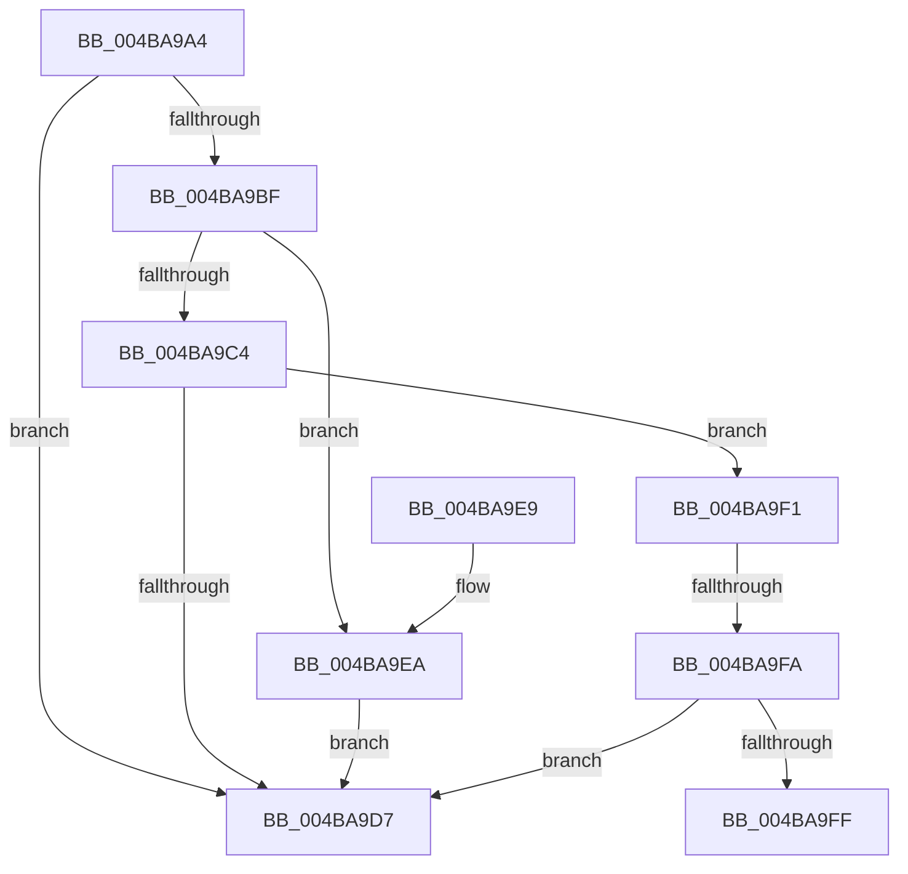

# WdipSemCaptureState

- RVA: `0x004BA9A4`–`0x004BAA10` (길이 `108` bytes)
- VA: `0x00000001404BA9A4`
- 실행 섹션: `.text`
- PDB 이름 있음: `예`; PDB Function 태그: `예`
- unwind 정보 RVA: `0x00092C4C`
- 디코드: `32`개 명령, `108/108` bytes 표시
- 미해석 바이트: `0` (있으면 어셈블리에 `.byte`로 보존)

> 이 문서는 커널 이미지의 기계어와 PDB 기호를 분석해 생성했습니다. 4번과 5번은 함수 원형과 자료형을 바이너리 사용 방식에서 추정한 C 해석이며 원본 소스 복구 결과는 아닙니다.

## 1. Dependencies

- 직접 호출 지점: **0**; 고유 호출 대상: **0**
- 직접 호출자로 확인된 함수: **1**
- RIP 상대 이미지 참조: **2**

### Outgoing calls
- 직접 디코드된 call 명령이 없습니다.

### Direct callers
- [WdipSemDisableContextProvider](../../page/A5/WdipSemDisableContextProvider_function_00A5C184.md) at `0x00A5C1FE`

### Static image references
- `0x004BA9C4` → RVA `0x00F02454` (`.data`; read)
- `0x004BA9CA` → RVA `0x00F02454` (`.data`; read/write)

## 2. Other-region calls and transfers

- 다른 실행 섹션으로 향하는 call: **0**
- call이 아닌 외부 분기/꼬리 이동: **2**
  - `0x004BA9F4` → [sub_006FC598](../6F/Unknown_function_006FC598.md) (`tail-transfer`)
  - `0x004BAA0B` → [sub_006FC598 + 0x7D](../6F/Unknown_function_006FC598.md) (`tail-transfer`)

## 3. Assembly (complete function range)

```asm
004BA9A4  48 89 5C 24 08                  mov qword ptr [rsp + 8], rbx
004BA9A9  48 89 74 24 10                  mov qword ptr [rsp + 0x10], rsi
004BA9AE  57                              push rdi
004BA9AF  48 83 EC 30                     sub rsp, 0x30
004BA9B3  48 8B D9                        mov rbx, rcx
004BA9B6  40 32 F6                        xor sil, sil
004BA9B9  33 C9                           xor ecx, ecx
004BA9BB  84 D2                           test dl, dl
004BA9BD  75 18                           jne 0x1404ba9d7
004BA9BF  48 85 DB                        test rbx, rbx
004BA9C2  74 26                           je 0x1404ba9ea
004BA9C4  8B 3D 8A 7A A4 00               mov edi, dword ptr [rip + 0xa47a8a]
004BA9CA  87 3D 84 7A A4 00               xchg dword ptr [rip + 0xa47a84], edi
004BA9D0  8B 53 20                        mov edx, dword ptr [rbx + 0x20]
004BA9D3  85 D2                           test edx, edx
004BA9D5  75 1A                           jne 0x1404ba9f1
004BA9D7  48 8B 5C 24 40                  mov rbx, qword ptr [rsp + 0x40]
004BA9DC  8B C1                           mov eax, ecx
004BA9DE  48 8B 74 24 48                  mov rsi, qword ptr [rsp + 0x48]
004BA9E3  48 83 C4 30                     add rsp, 0x30
004BA9E7  5F                              pop rdi
004BA9E8  C3                              ret
004BA9E9  CC                              int3
004BA9EA  B9 0D 00 00 C0                  mov ecx, 0xc000000d
004BA9EF  EB E6                           jmp 0x1404ba9d7
004BA9F1  83 EA 01                        sub edx, 1
004BA9F4  0F 84 9E 1B 24 00               je 0x1406fc598
004BA9FA  83 FA 01                        cmp edx, 1
004BA9FD  75 D8                           jne 0x1404ba9d7
004BA9FF  C7 44 24 28 02 00 00 00         mov dword ptr [rsp + 0x28], 2
004BAA07  21 4C 24 20                     and dword ptr [rsp + 0x20], ecx
004BAA0B  E9 05 1C 24 00                  jmp 0x1406fc615
```

## 4. C-style interpretation (structured pseudocode)

```c
__int64 __fastcall WdipSemCaptureState(__int64 a1, unsigned __int8 a2)
{
    __int64 v_rsi;
    __int64 v_rsp;
    unsigned __int64 v_stack_p10;
    unsigned int v_stack_p20;
    unsigned int v_stack_p28;
    unsigned __int64 v_stack_p8;

    v_stack_p8 = v_rbx;
    v_stack_p10 = v_rsi;
    v_rsp = (v_rsp) - (48);
    v_rsi = 0;
    a1 = 0;
    if (a2 != 0) goto loc_004BA9D7;
    if (0 == 0) goto loc_004BA9EA;
    if ((unsigned int)((unsigned int)(*(unsigned int *)(a1 + 32))) != 0) goto loc_004BA9F1;
loc_004BA9D7:
    v_rsp = (v_rsp) + (48);
    return 0;
loc_004BA9EA:
    goto loc_004BA9D7;
loc_004BA9F1:
    a2 = (unsigned int)(((unsigned int)(*(unsigned int *)(a1 + 32))) - (1));
    if (a2 != 1) goto loc_004BA9D7;
    v_stack_p28 = 2;
}
```

## 5. (Beta) C Style

```c
int64_t WdipSemCaptureState(int64_t Arg1, uint8_t Arg2)
{
    int64_t local_rsi;
    int64_t local_rsp;
    uint64_t v_stack_p10;
    uint32_t v_stack_p20;
    uint32_t v_stack_p28;
    uint64_t v_stack_p8;

    v_stack_p8 = local_rbx;
    v_stack_p10 = local_rsi;
    local_rsp = (local_rsp) - (48);
    local_rsi = 0;
    Arg1 = 0;
    if (Arg2 != 0) goto loc_004BA9D7;
    if (0 == 0) goto loc_004BA9EA;
    if ((uint32_t)((uint32_t)(*(uint32_t *)(Arg1 + 0x20))) != 0) goto loc_004BA9F1;
loc_004BA9D7:
    local_rsp = (local_rsp) + (48);
    return 0;
loc_004BA9EA:
    goto loc_004BA9D7;
loc_004BA9F1:
    Arg2 = (uint32_t)(((uint32_t)(*(uint32_t *)(Arg1 + 0x20))) - (1));
    if (Arg2 != 1) goto loc_004BA9D7;
    v_stack_p28 = 2;
}
```

## 6. Execution-region graph

[열기: 2D/3D 그래프와 함수 탐색 컨트롤 패널](../../../control-panel.html?section=text&rva=0x004BA9A4&view=graph)

- 2D 그래프는 위에서 아래로 흐르고, 3D 그래프는 빈 공간을 드래그해 회전합니다. Shift+드래그는 이동, 휠은 확대·축소, 함수 노드 선택은 대상 보고서 이동입니다.

### Static fallback


