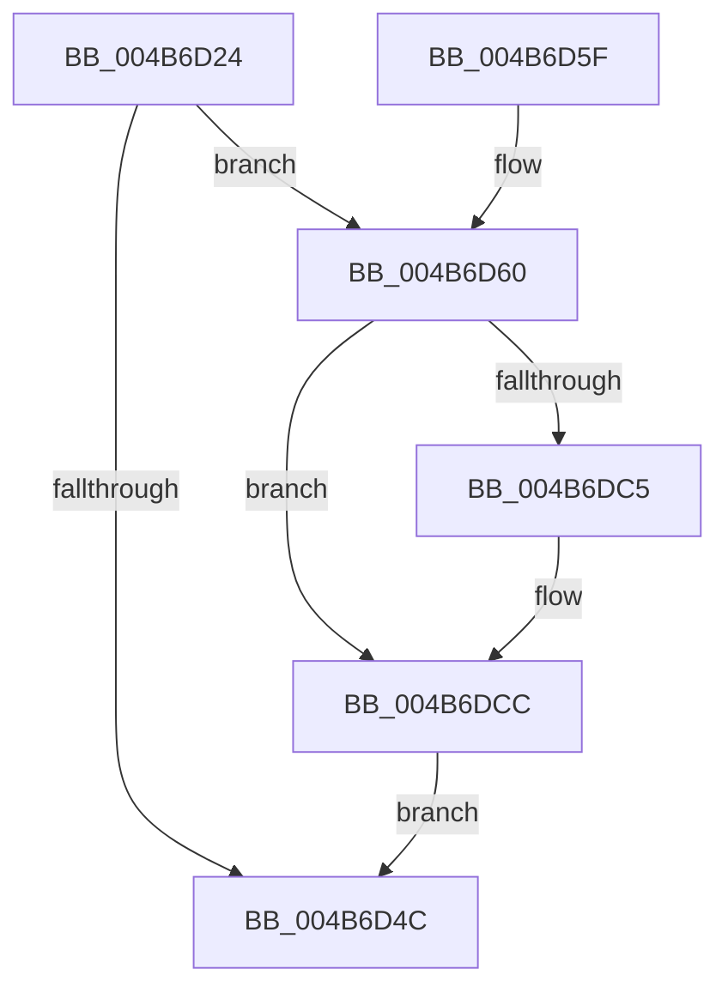

# WmipAllocRegEntry

- RVA: `0x004B6D24`–`0x004B6E0A` (길이 `230` bytes)
- VA: `0x00000001404B6D24`
- 실행 섹션: `.text`
- PDB 이름 있음: `예`; PDB Function 태그: `아니요`
- unwind 정보 RVA: `0x000BA7B8`
- 디코드: `56`개 명령, `230/230` bytes 표시
- 미해석 바이트: `0` (있으면 어셈블리에 `.byte`로 보존)

> 이 문서는 커널 이미지의 기계어와 PDB 기호를 분석해 생성했습니다. 4번과 5번은 함수 원형과 자료형을 바이너리 사용 방식에서 추정한 C 해석이며 원본 소스 복구 결과는 아닙니다.

## 1. Dependencies

- 직접 호출 지점: **7**; 고유 호출 대상: **7**
- 직접 호출자로 확인된 함수: **2**
- RIP 상대 이미지 참조: **7**

### Outgoing calls
- `0x004B6D3F` → [ExAllocateFromNPagedLookasideList](../38/ExAllocateFromNPagedLookasideList_function_0038E6C0.md) (function, `0x0038E6C0`)
- `0x004B6D69` → [memset](../6C/memset_function_006C6C40.md) (function, `0x006C6C40`)
- `0x004B6D7E` → [WmipAllocProviderId](../../page/AB/WmipAllocProviderId_function_00AB81AC.md) (function, `0x00AB81AC`)
- `0x004B6D9B` → [KeWaitForSingleObject](../20/KeWaitForSingleObject_function_0020E6B0.md) (function, `0x0020E6B0`)
- `0x004B6DA7` → [KeAcquireSpinLockRaiseToDpc](../20/KeAcquireSpinLockRaiseToDpc_function_00208470.md) (function, `0x00208470`)
- `0x004B6DE6` → [KeReleaseSpinLock](../39/KeReleaseSpinLock_function_00392BA0.md) (function, `0x00392BA0`)
- `0x004B6E00` → [KeReleaseMutantEx](../39/KeReleaseMutantEx_function_00396850.md) (function, `0x00396850`)

### Direct callers
- [WmipRegisterDevice](../../page/9E/WmipRegisterDevice_function_009E2808.md) at `0x009E28BA`
- [WmipInitializeDataStructs](../../init/C4/WmipInitializeDataStructs_function_00C4D6BC.md) at `0x00C4D760`

### Static image references
- `0x004B6D38` → RVA `0x00E28D00` (`.data`; read)
- `0x004B6D89` → RVA `0x00EFFA60` (`.data`; read)
- `0x004B6DA0` → RVA `0x00EFFC28` (`.data`; read)
- `0x004B6DAC` → RVA `0x00E09150` (`.data`; read)
- `0x004B6DB3` → RVA `0x00E09148` (`.data`; read)
- `0x004B6DBA` → RVA `0x00E68450` (`.data`; read/write)
- `0x004B6DDF` → RVA `0x00E09150` (`.data`; write)

## 2. Other-region calls and transfers

- 다른 실행 섹션으로 향하는 call: **1**
  - `0x004B6D7E` → [WmipAllocProviderId](../../page/AB/WmipAllocProviderId_function_00AB81AC.md) (`.text` → `PAGE`)
- 별도 외부 분기/꼬리 이동을 확인하지 못했습니다.

## 3. Assembly (complete function range)

```asm
004B6D24  48 89 5C 24 08                  mov qword ptr [rsp + 8], rbx
004B6D29  48 89 74 24 10                  mov qword ptr [rsp + 0x10], rsi
004B6D2E  57                              push rdi
004B6D2F  48 83 EC 30                     sub rsp, 0x30
004B6D33  48 8B F1                        mov rsi, rcx
004B6D36  8B FA                           mov edi, edx
004B6D38  48 8D 0D C1 1F 97 00            lea rcx, [rip + 0x971fc1]
004B6D3F  E8 7C 79 ED FF                  call 0x14038e6c0
004B6D44  48 8B D8                        mov rbx, rax
004B6D47  48 85 C0                        test rax, rax
004B6D4A  75 14                           jne 0x1404b6d60
004B6D4C  48 8B 74 24 48                  mov rsi, qword ptr [rsp + 0x48]
004B6D51  48 8B C3                        mov rax, rbx
004B6D54  48 8B 5C 24 40                  mov rbx, qword ptr [rsp + 0x40]
004B6D59  48 83 C4 30                     add rsp, 0x30
004B6D5D  5F                              pop rdi
004B6D5E  C3                              ret
004B6D5F  CC                              int3
004B6D60  33 D2                           xor edx, edx
004B6D62  48 8B CB                        mov rcx, rbx
004B6D65  44 8D 42 40                     lea r8d, [rdx + 0x40]
004B6D69  E8 D2 FE 20 00                  call 0x1406c6c40
004B6D6E  81 E7 01 00 00 FF               and edi, 0xff000001
004B6D74  48 89 73 10                     mov qword ptr [rbx + 0x10], rsi
004B6D78  83 CF 01                        or edi, 1
004B6D7B  89 7B 30                        mov dword ptr [rbx + 0x30], edi
004B6D7E  E8 29 14 60 00                  call 0x140ab81ac
004B6D83  48 83 64 24 20 00               and qword ptr [rsp + 0x20], 0
004B6D89  48 8D 0D D0 8C A4 00            lea rcx, [rip + 0xa48cd0]
004B6D90  45 33 C9                        xor r9d, r9d
004B6D93  89 43 38                        mov dword ptr [rbx + 0x38], eax
004B6D96  45 33 C0                        xor r8d, r8d
004B6D99  33 D2                           xor edx, edx
004B6D9B  E8 10 79 D5 FF                  call 0x14020e6b0
004B6DA0  48 8D 0D 81 8E A4 00            lea rcx, [rip + 0xa48e81]
004B6DA7  E8 C4 16 D5 FF                  call 0x140208470
004B6DAC  48 8B 0D 9D 23 95 00            mov rcx, qword ptr [rip + 0x95239d]
004B6DB3  48 8D 15 8E 23 95 00            lea rdx, [rip + 0x95238e]
004B6DBA  FF 05 90 16 9B 00               inc dword ptr [rip + 0x9b1690]
004B6DC0  48 39 11                        cmp qword ptr [rcx], rdx
004B6DC3  74 07                           je 0x1404b6dcc
004B6DC5  B9 03 00 00 00                  mov ecx, 3
004B6DCA  CD 29                           int 0x29
004B6DCC  48 89 13                        mov qword ptr [rbx], rdx
004B6DCF  8A D0                           mov dl, al
004B6DD1  48 89 4B 08                     mov qword ptr [rbx + 8], rcx
004B6DD5  48 89 19                        mov qword ptr [rcx], rbx
004B6DD8  48 8D 0D 49 8E A4 00            lea rcx, [rip + 0xa48e49]
004B6DDF  48 89 1D 6A 23 95 00            mov qword ptr [rip + 0x95236a], rbx
004B6DE6  E8 B5 BD ED FF                  call 0x140392ba0
004B6DEB  BA 01 00 00 00                  mov edx, 1
004B6DF0  4C 8D 4C 24 50                  lea r9, [rsp + 0x50]
004B6DF5  48 8D 0D 64 8C A4 00            lea rcx, [rip + 0xa48c64]
004B6DFC  44 8D 42 03                     lea r8d, [rdx + 3]
004B6E00  E8 4B FA ED FF                  call 0x140396850
004B6E05  E9 42 FF FF FF                  jmp 0x1404b6d4c
```

## 4. C-style interpretation (structured pseudocode)

```c
__int64 __fastcall WmipAllocRegEntry(__int64 a1, int a2, __int64 a3, int a4)
{
    __int64 result;
    __int64 v_rdi;
    __int64 v_rsp;
    unsigned __int64 v_stack_p10;
    unsigned __int64 v_stack_p20;
    unsigned __int64 v_stack_p50;
    unsigned __int64 v_stack_p8;

    v_stack_p8 = v_rbx;
    v_stack_p10 = v_rsi;
    v_rsp = (v_rsp) - (48);
    result = ExAllocateFromNPagedLookasideList(v_rip + 9904065, a2, a3, a4);
    if (result != 0) goto loc_004B6D60;
loc_004B6D4C:
    v_rsp = (v_rsp) + (48);
    return result;
loc_004B6D60:
    a2 = 0;
    result = memset(v_stack_p8, a2, a2 + 64, a4);
    v_rdi = (unsigned int)(((unsigned int)(a2)) & (0xFF000001ULL));
    *(unsigned __int64 *)(v_stack_p8 + 16) = v_stack_p10;
    v_rdi = (unsigned int)((v_rdi) | (1));
    *(unsigned int *)(v_stack_p8 + 48) = (unsigned int)(v_rdi);
    result = WmipAllocProviderId(v_stack_p8, a2, a2 + 64, a4);
    a4 = 0;
    *(unsigned int *)(v_stack_p8 + 56) = (unsigned int)(result);
    a3 = 0;
    a2 = 0;
    result = KeWaitForSingleObject(v_rip + 10783952, a2, a3, a4);
    result = KeAcquireSpinLockRaiseToDpc(v_rip + 10784385, a2, a3, a4);
    if ((*(unsigned __int64 *)(*(unsigned __int64 *)(v_rip + 9773981))) != (v_rip + 9773966)) {
        a1 = 3;
    }
    *(unsigned __int64 *)(v_stack_p8) = v_rip + 9773966;
    *(unsigned __int64 *)(v_stack_p8 + 8) = a1;
    *(unsigned __int64 *)(a1) = v_stack_p8;
    *(unsigned __int64 *)(v_rip + 9773930) = v_stack_p8;
    result = KeReleaseSpinLock(v_rip + 10784329, (unsigned __int8)(result), a3, a4);
    result = KeReleaseMutantEx(v_rip + 10783844, 1, 1 + 3, v_stack_p50);
    goto loc_004B6D4C;
}
```

## 5. (Beta) C Style

```c
int64_t WmipAllocRegEntry(int64_t Arg1, int32_t Arg2, int64_t Arg3, int32_t Arg4)
{
    int64_t result;
    int64_t local_rdi;
    int64_t local_rsp;
    uint64_t v_stack_p10;
    uint64_t v_stack_p20;
    uint64_t v_stack_p50;
    uint64_t v_stack_p8;

    v_stack_p8 = local_rbx;
    v_stack_p10 = local_rsi;
    local_rsp = (local_rsp) - (48);
    result = ExAllocateFromNPagedLookasideList(v_rip + 9904065, Arg2, Arg3, Arg4);
    if (result != 0) goto loc_004B6D60;
loc_004B6D4C:
    local_rsp = (local_rsp) + (48);
    return result;
loc_004B6D60:
    Arg2 = 0;
    result = memset(v_stack_p8, Arg2, Arg2 + 64, Arg4);
    local_rdi = (uint32_t)(((uint32_t)(Arg2)) & (0xFF000001ULL));
    *(uint64_t *)(v_stack_p8 + 0x10) = v_stack_p10;
    local_rdi = (uint32_t)((local_rdi) | (1));
    *(uint32_t *)(v_stack_p8 + 0x30) = (uint32_t)(local_rdi);
    result = WmipAllocProviderId(v_stack_p8, Arg2, Arg2 + 64, Arg4);
    Arg4 = 0;
    *(uint32_t *)(v_stack_p8 + 0x38) = (uint32_t)(result);
    Arg3 = 0;
    Arg2 = 0;
    result = KeWaitForSingleObject(v_rip + 10783952, Arg2, Arg3, Arg4);
    result = KeAcquireSpinLockRaiseToDpc(v_rip + 10784385, Arg2, Arg3, Arg4);
    if ((*(uint64_t *)(*(uint64_t *)(v_rip + 0x95239D))) != (v_rip + 9773966)) {
        Arg1 = 3;
    }
    *(uint64_t *)(v_stack_p8) = v_rip + 9773966;
    *(uint64_t *)(v_stack_p8 + 0x8) = Arg1;
    *(uint64_t *)(Arg1) = v_stack_p8;
    *(uint64_t *)(v_rip + 0x95236A) = v_stack_p8;
    result = KeReleaseSpinLock(v_rip + 10784329, (uint8_t)(result), Arg3, Arg4);
    result = KeReleaseMutantEx(v_rip + 10783844, 1, 1 + 3, v_stack_p50);
    goto loc_004B6D4C;
}
```

## 6. Execution-region graph

[열기: 2D/3D 그래프와 함수 탐색 컨트롤 패널](../../../control-panel.html?section=text&rva=0x004B6D24&view=graph)

- 2D 그래프는 위에서 아래로 흐르고, 3D 그래프는 빈 공간을 드래그해 회전합니다. Shift+드래그는 이동, 휠은 확대·축소, 함수 노드 선택은 대상 보고서 이동입니다.

### Static fallback


