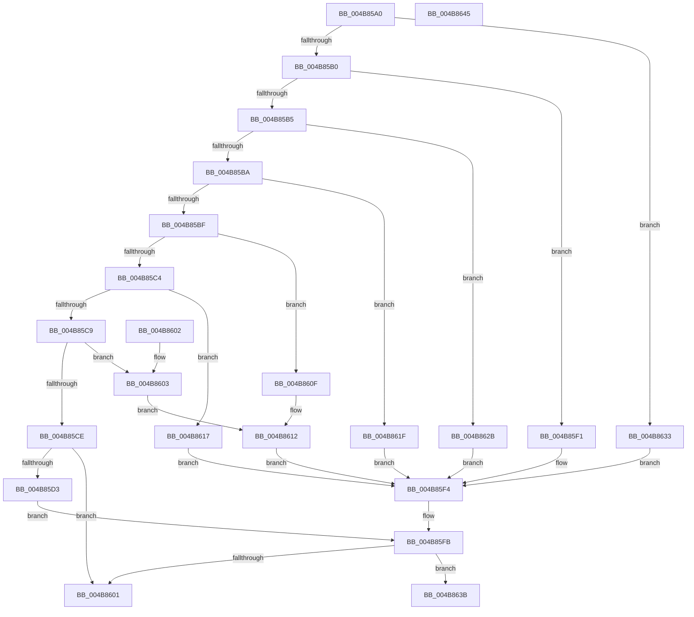

# XmJxxOp

- RVA: `0x004B85A0`–`0x004B8646` (길이 `166` bytes)
- VA: `0x00000001404B85A0`
- 실행 섹션: `.text`
- PDB 이름 있음: `예`; PDB Function 태그: `아니요`
- unwind 정보 RVA: `0x000DB714`
- 디코드: `64`개 명령, `166/166` bytes 표시
- 미해석 바이트: `0` (있으면 어셈블리에 `.byte`로 보존)

> 이 문서는 커널 이미지의 기계어와 PDB 기호를 분석해 생성했습니다. 4번과 5번은 함수 원형과 자료형을 바이너리 사용 방식에서 추정한 C 해석이며 원본 소스 복구 결과는 아닙니다.

## 1. Dependencies

- 직접 호출 지점: **0**; 고유 호출 대상: **0**
- 직접 호출자로 확인된 함수: **0**
- RIP 상대 이미지 참조: **0**

### Outgoing calls
- 직접 디코드된 call 명령이 없습니다.

### Direct callers
- 이 함수 시작 RVA로 연결되는 직접 call은 확인되지 않았습니다. 간접 호출은 완전히 역산할 수 없습니다.

### Static image references
- 디코드된 RIP-relative 메모리 참조가 없습니다.

## 2. Other-region calls and transfers

- 다른 실행 섹션으로 향하는 call: **0**
- 별도 외부 분기/꼬리 이동을 확인하지 못했습니다.

## 3. Assembly (complete function range)

```asm
004B85A0  8B 51 6C                        mov edx, dword ptr [rcx + 0x6c]
004B85A3  4C 8B C1                        mov r8, rcx
004B85A6  8B C2                           mov eax, edx
004B85A8  D1 E8                           shr eax, 1
004B85AA  0F 84 83 00 00 00               je 0x1404b8633
004B85B0  83 E8 01                        sub eax, 1
004B85B3  74 3C                           je 0x1404b85f1
004B85B5  83 E8 01                        sub eax, 1
004B85B8  74 71                           je 0x1404b862b
004B85BA  83 E8 01                        sub eax, 1
004B85BD  74 60                           je 0x1404b861f
004B85BF  83 E8 01                        sub eax, 1
004B85C2  74 4B                           je 0x1404b860f
004B85C4  83 E8 01                        sub eax, 1
004B85C7  74 4E                           je 0x1404b8617
004B85C9  83 E8 01                        sub eax, 1
004B85CC  74 35                           je 0x1404b8603
004B85CE  83 F8 01                        cmp eax, 1
004B85D1  75 2E                           jne 0x1404b8601
004B85D3  8B 41 10                        mov eax, dword ptr [rcx + 0x10]
004B85D6  8B C8                           mov ecx, eax
004B85D8  C1 E9 04                        shr ecx, 4
004B85DB  33 C8                           xor ecx, eax
004B85DD  83 E0 40                        and eax, 0x40
004B85E0  D1 E9                           shr ecx, 1
004B85E2  83 E1 40                        and ecx, 0x40
004B85E5  0B C8                           or ecx, eax
004B85E7  B8 01 00 00 00                  mov eax, 1
004B85EC  C1 E9 06                        shr ecx, 6
004B85EF  EB 0A                           jmp 0x1404b85fb
004B85F1  8B 49 10                        mov ecx, dword ptr [rcx + 0x10]
004B85F4  B8 01 00 00 00                  mov eax, 1
004B85F9  23 C8                           and ecx, eax
004B85FB  23 D0                           and edx, eax
004B85FD  3B CA                           cmp ecx, edx
004B85FF  75 3A                           jne 0x1404b863b
004B8601  C3                              ret
004B8602  CC                              int3
004B8603  8B 41 10                        mov eax, dword ptr [rcx + 0x10]
004B8606  8B C8                           mov ecx, eax
004B8608  C1 E9 04                        shr ecx, 4
004B860B  33 C8                           xor ecx, eax
004B860D  EB 03                           jmp 0x1404b8612
004B860F  8B 49 10                        mov ecx, dword ptr [rcx + 0x10]
004B8612  C1 E9 07                        shr ecx, 7
004B8615  EB DD                           jmp 0x1404b85f4
004B8617  8B 49 10                        mov ecx, dword ptr [rcx + 0x10]
004B861A  C1 E9 02                        shr ecx, 2
004B861D  EB D5                           jmp 0x1404b85f4
004B861F  8B 41 10                        mov eax, dword ptr [rcx + 0x10]
004B8622  8B C8                           mov ecx, eax
004B8624  C1 E9 06                        shr ecx, 6
004B8627  0B C8                           or ecx, eax
004B8629  EB C9                           jmp 0x1404b85f4
004B862B  8B 49 10                        mov ecx, dword ptr [rcx + 0x10]
004B862E  C1 E9 06                        shr ecx, 6
004B8631  EB C1                           jmp 0x1404b85f4
004B8633  8B 49 10                        mov ecx, dword ptr [rcx + 0x10]
004B8636  C1 E9 0B                        shr ecx, 0xb
004B8639  EB B9                           jmp 0x1404b85f4
004B863B  41 0F B7 40 68                  movzx eax, word ptr [r8 + 0x68]
004B8640  41 89 40 14                     mov dword ptr [r8 + 0x14], eax
004B8644  C3                              ret
004B8645  CC                              int3
```

## 4. C-style interpretation (structured pseudocode)

```c
__int64 __fastcall XmJxxOp(__int64 a1)
{
    __int64 result;

    result = (unsigned int)(((unsigned int)((unsigned int)((unsigned int)(*(unsigned int *)(a1 + 108))))) >> (1));
    if (condition_is_equal) goto loc_004B8633;
    result = (unsigned int)((result) - (1));
    if (condition_is_equal) goto loc_004B85F1;
    result = (unsigned int)((result) - (1));
    if (condition_is_equal) goto loc_004B862B;
    result = (unsigned int)((result) - (1));
    if (condition_is_equal) goto loc_004B861F;
    result = (unsigned int)((result) - (1));
    if (condition_is_equal) goto loc_004B860F;
    result = (unsigned int)((result) - (1));
    if (condition_is_equal) goto loc_004B8617;
    result = (unsigned int)((result) - (1));
    if (condition_is_equal) goto loc_004B8603;
    if (((unsigned int)(result)) != 1) goto loc_004B8601;
    a1 = (unsigned int)(((unsigned int)((unsigned int)((unsigned int)(*(unsigned int *)(a1 + 16))))) >> (4));
    a1 = (unsigned int)((a1) ^ ((unsigned int)((unsigned int)(*(unsigned int *)(a1 + 16)))));
    result = (unsigned int)(((unsigned int)(*(unsigned int *)(a1 + 16))) & (64));
    a1 = (unsigned int)((a1) >> (1));
    a1 = (unsigned int)((a1) & (64));
    a1 = (unsigned int)((a1) | ((unsigned int)(result)));
    a1 = (unsigned int)((a1) >> (6));
    goto loc_004B85FB;
loc_004B85F1:
loc_004B85F4:
    a1 = (unsigned int)(((unsigned int)(*(unsigned int *)(a1 + 16))) & (1));
loc_004B85FB:
    a2 = (unsigned int)(((unsigned int)(*(unsigned int *)(a1 + 108))) & (1));
    if (((unsigned int)(a1)) != ((unsigned int)(a2))) goto loc_004B863B;
loc_004B8601:
    return 1;
loc_004B8603:
    a1 = (unsigned int)(((unsigned int)((unsigned int)((unsigned int)(*(unsigned int *)(a1 + 16))))) >> (4));
    a1 = (unsigned int)((a1) ^ ((unsigned int)((unsigned int)(*(unsigned int *)(a1 + 16)))));
    goto loc_004B8612;
loc_004B860F:
loc_004B8612:
    a1 = (unsigned int)(((unsigned int)(*(unsigned int *)(a1 + 16))) >> (7));
    goto loc_004B85F4;
loc_004B8617:
    a1 = (unsigned int)(((unsigned int)(*(unsigned int *)(a1 + 16))) >> (2));
    goto loc_004B85F4;
loc_004B861F:
    a1 = (unsigned int)(((unsigned int)((unsigned int)((unsigned int)(*(unsigned int *)(a1 + 16))))) >> (6));
    a1 = (unsigned int)((a1) | ((unsigned int)((unsigned int)(*(unsigned int *)(a1 + 16)))));
    goto loc_004B85F4;
loc_004B862B:
    a1 = (unsigned int)(((unsigned int)(*(unsigned int *)(a1 + 16))) >> (6));
    goto loc_004B85F4;
loc_004B8633:
    a1 = (unsigned int)(((unsigned int)(*(unsigned int *)(a1 + 16))) >> (11));
    goto loc_004B85F4;
loc_004B863B:
    *(unsigned int *)(a1 + 20) = (unsigned int)(*(unsigned __int16 *)(a1 + 104));
    return *(unsigned __int16 *)(a1 + 104);
}
```

## 5. (Beta) C Style

```c
int64_t XmJxxOp(void *Arg1)
{
    uint8_t *arg1 = (uint8_t *)Arg1;

    int64_t result;

    result = (uint32_t)(((uint32_t)((uint32_t)((uint32_t)(*(uint32_t *)(arg1 + 0x6C))))) >> (1));
    if (condition_is_equal) goto loc_004B8633;
    result = (uint32_t)((result) - (1));
    if (condition_is_equal) goto loc_004B85F1;
    result = (uint32_t)((result) - (1));
    if (condition_is_equal) goto loc_004B862B;
    result = (uint32_t)((result) - (1));
    if (condition_is_equal) goto loc_004B861F;
    result = (uint32_t)((result) - (1));
    if (condition_is_equal) goto loc_004B860F;
    result = (uint32_t)((result) - (1));
    if (condition_is_equal) goto loc_004B8617;
    result = (uint32_t)((result) - (1));
    if (condition_is_equal) goto loc_004B8603;
    if (((uint32_t)(result)) != 1) goto loc_004B8601;
    Arg1 = (uint32_t)(((uint32_t)((uint32_t)((uint32_t)(*(uint32_t *)(arg1 + 0x10))))) >> (4));
    Arg1 = (uint32_t)((Arg1) ^ ((uint32_t)((uint32_t)(*(uint32_t *)(arg1 + 0x10)))));
    result = (uint32_t)(((uint32_t)(*(uint32_t *)(arg1 + 0x10))) & (64));
    Arg1 = (uint32_t)((Arg1) >> (1));
    Arg1 = (uint32_t)((Arg1) & (64));
    Arg1 = (uint32_t)((Arg1) | ((uint32_t)(result)));
    Arg1 = (uint32_t)((Arg1) >> (6));
    goto loc_004B85FB;
loc_004B85F1:
loc_004B85F4:
    Arg1 = (uint32_t)(((uint32_t)(*(uint32_t *)(arg1 + 0x10))) & (1));
loc_004B85FB:
    a2 = (uint32_t)(((uint32_t)(*(uint32_t *)(arg1 + 0x6C))) & (1));
    if (((uint32_t)(Arg1)) != ((uint32_t)(a2))) goto loc_004B863B;
loc_004B8601:
    return 1;
loc_004B8603:
    Arg1 = (uint32_t)(((uint32_t)((uint32_t)((uint32_t)(*(uint32_t *)(arg1 + 0x10))))) >> (4));
    Arg1 = (uint32_t)((Arg1) ^ ((uint32_t)((uint32_t)(*(uint32_t *)(arg1 + 0x10)))));
    goto loc_004B8612;
loc_004B860F:
loc_004B8612:
    Arg1 = (uint32_t)(((uint32_t)(*(uint32_t *)(arg1 + 0x10))) >> (7));
    goto loc_004B85F4;
loc_004B8617:
    Arg1 = (uint32_t)(((uint32_t)(*(uint32_t *)(arg1 + 0x10))) >> (2));
    goto loc_004B85F4;
loc_004B861F:
    Arg1 = (uint32_t)(((uint32_t)((uint32_t)((uint32_t)(*(uint32_t *)(arg1 + 0x10))))) >> (6));
    Arg1 = (uint32_t)((Arg1) | ((uint32_t)((uint32_t)(*(uint32_t *)(arg1 + 0x10)))));
    goto loc_004B85F4;
loc_004B862B:
    Arg1 = (uint32_t)(((uint32_t)(*(uint32_t *)(arg1 + 0x10))) >> (6));
    goto loc_004B85F4;
loc_004B8633:
    Arg1 = (uint32_t)(((uint32_t)(*(uint32_t *)(arg1 + 0x10))) >> (11));
    goto loc_004B85F4;
loc_004B863B:
    *(uint32_t *)(arg1 + 0x14) = (uint32_t)(*(uint16_t *)(arg1 + 0x68));
    return *(uint16_t *)(arg1 + 0x68);
}
```

### 관측된 메모리 오프셋

구조체 형식이 확인되지 않은 접근은 인자 기준의 오프셋으로만 기록했습니다.

| 기준 인자 | 오프셋 표현 | 폭 (bit) | 접근 |
|---|---:|---:|---|
| `Arg1` | `+ 0x10` | `32` | `R` |
| `Arg1` | `+ 0x14` | `32` | `W` |
| `Arg1` | `+ 0x68` | `16` | `R` |
| `Arg1` | `+ 0x6C` | `32` | `R` |

## 6. Execution-region graph

[열기: 2D/3D 그래프와 함수 탐색 컨트롤 패널](../../../control-panel.html?section=text&rva=0x004B85A0&view=graph)

- 2D 그래프는 위에서 아래로 흐르고, 3D 그래프는 빈 공간을 드래그해 회전합니다. Shift+드래그는 이동, 휠은 확대·축소, 함수 노드 선택은 대상 보고서 이동입니다.

### Static fallback


