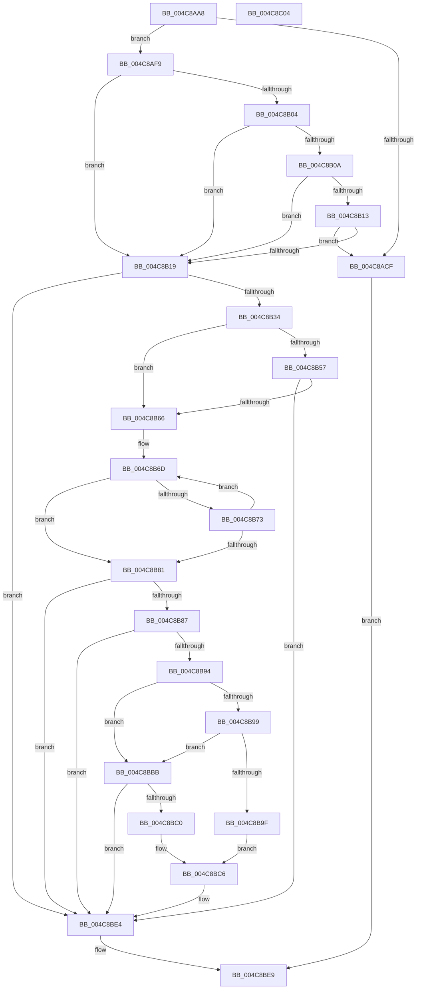

# ApiSetResolveToHost

- RVA: `0x004C8AA8`–`0x004C8C05` (길이 `349` bytes)
- VA: `0x00000001404C8AA8`
- 실행 섹션: `.text`
- PDB 이름 있음: `예`; PDB Function 태그: `아니요`
- unwind 정보 RVA: `0x000B5F04`
- 디코드: `96`개 명령, `349/349` bytes 표시
- 미해석 바이트: `0` (있으면 어셈블리에 `.byte`로 보존)

> 이 문서는 커널 이미지의 기계어와 PDB 기호를 분석해 생성했습니다. 4번과 5번은 함수 원형과 자료형을 바이너리 사용 방식에서 추정한 C 해석이며 원본 소스 복구 결과는 아닙니다.

## 1. Dependencies

- 직접 호출 지점: **3**; 고유 호출 대상: **3**
- 직접 호출자로 확인된 함수: **2**
- RIP 상대 이미지 참조: **0**

### Outgoing calls
- `0x004C8AEF` → [ApiSetpResolveHost](../66/ApiSetpResolveHost_function_006638D0.md) (function, `0x006638D0`)
- `0x004C8B8A` → [ApiSetpSearchForApiSet](../4B/ApiSetpSearchForApiSet_function_004B8048.md) (function, `0x004B8048`)
- `0x004C8BB1` → [ApiSetpSearchForApiSetHost](../66/ApiSetpSearchForApiSetHost_function_006625CC.md) (function, `0x006625CC`)

### Direct callers
- [ExIsMultiSessionSku](../../page/7C/ExIsMultiSessionSku_function_007C7538.md) at `0x007C75A6`
- [MiResolveImageReferences](../../page/A2/MiResolveImageReferences_function_00A23BE4.md) at `0x00A23D55`

### Static image references
- 디코드된 RIP-relative 메모리 참조가 없습니다.

## 2. Other-region calls and transfers

- 다른 실행 섹션으로 향하는 call: **0**
- 별도 외부 분기/꼬리 이동을 확인하지 못했습니다.

## 3. Assembly (complete function range)

```asm
004C8AA8  48 8B C4                        mov rax, rsp
004C8AAB  48 89 58 08                     mov qword ptr [rax + 8], rbx
004C8AAF  48 89 70 10                     mov qword ptr [rax + 0x10], rsi
004C8AB3  48 89 78 18                     mov qword ptr [rax + 0x18], rdi
004C8AB7  4C 89 70 20                     mov qword ptr [rax + 0x20], r14
004C8ABB  41 57                           push r15
004C8ABD  48 83 EC 40                     sub rsp, 0x40
004C8AC1  80 39 07                        cmp byte ptr [rcx], 7
004C8AC4  4D 8B F9                        mov r15, r9
004C8AC7  49 8B F0                        mov rsi, r8
004C8ACA  48 8B D9                        mov rbx, rcx
004C8ACD  75 2A                           jne 0x1404c8af9
004C8ACF  44 0F B7 02                     movzx r8d, word ptr [rdx]
004C8AD3  48 8B 44 24 70                  mov rax, qword ptr [rsp + 0x70]
004C8AD8  48 8B 52 08                     mov rdx, qword ptr [rdx + 8]
004C8ADC  48 89 44 24 30                  mov qword ptr [rsp + 0x30], rax
004C8AE1  4C 89 7C 24 28                  mov qword ptr [rsp + 0x28], r15
004C8AE6  66 41 D1 E8                     shr r8w, 1
004C8AEA  48 89 74 24 20                  mov qword ptr [rsp + 0x20], rsi
004C8AEF  E8 DC AD 19 00                  call 0x1406638d0
004C8AF4  E9 F0 00 00 00                  jmp 0x1404c8be9
004C8AF9  83 39 06                        cmp dword ptr [rcx], 6
004C8AFC  41 B8 08 00 00 00               mov r8d, 8
004C8B02  75 15                           jne 0x1404c8b19
004C8B04  44 39 41 10                     cmp dword ptr [rcx + 0x10], r8d
004C8B08  76 0F                           jbe 0x1404c8b19
004C8B0A  48 83 C1 1C                     add rcx, 0x1c
004C8B0E  80 39 07                        cmp byte ptr [rcx], 7
004C8B11  75 06                           jne 0x1404c8b19
004C8B13  F6 43 1E 04                     test byte ptr [rbx + 0x1e], 4
004C8B17  74 B6                           je 0x1404c8acf
004C8B19  4C 8B 74 24 70                  mov r14, qword ptr [rsp + 0x70]
004C8B1E  0F 57 C0                        xorps xmm0, xmm0
004C8B21  33 FF                           xor edi, edi
004C8B23  41 0F 11 06                     movups xmmword ptr [r14], xmm0
004C8B27  0F B7 0A                        movzx ecx, word ptr [rdx]
004C8B2A  66 41 3B C8                     cmp cx, r8w
004C8B2E  0F 82 B0 00 00 00               jb 0x1404c8be4
004C8B34  48 8B 52 08                     mov rdx, qword ptr [rdx + 8]
004C8B38  49 B8 DF FF DF FF DF FF FF FF   movabs r8, 0xffffffdfffdfffdf
004C8B42  48 8B 02                        mov rax, qword ptr [rdx]
004C8B45  49 23 C0                        and rax, r8
004C8B48  49 B8 41 00 50 00 49 00 2D 00   movabs r8, 0x2d004900500041
004C8B52  49 3B C0                        cmp rax, r8
004C8B55  74 0F                           je 0x1404c8b66
004C8B57  49 B8 45 00 58 00 54 00 2D 00   movabs r8, 0x2d005400580045
004C8B61  49 3B C0                        cmp rax, r8
004C8B64  75 7E                           jne 0x1404c8be4
004C8B66  4C 8B C1                        mov r8, rcx
004C8B69  48 8D 04 0A                     lea rax, [rdx + rcx]
004C8B6D  41 83 F8 01                     cmp r8d, 1
004C8B71  76 0E                           jbe 0x1404c8b81
004C8B73  48 83 E8 02                     sub rax, 2
004C8B77  41 83 C0 FE                     add r8d, -2
004C8B7B  66 83 38 2D                     cmp word ptr [rax], 0x2d
004C8B7F  75 EC                           jne 0x1404c8b6d
004C8B81  66 41 D1 E8                     shr r8w, 1
004C8B85  74 5D                           je 0x1404c8be4
004C8B87  48 8B CB                        mov rcx, rbx
004C8B8A  E8 B9 F4 FE FF                  call 0x1404b8048
004C8B8F  48 85 C0                        test rax, rax
004C8B92  74 50                           je 0x1404c8be4
004C8B94  48 85 F6                        test rsi, rsi
004C8B97  74 22                           je 0x1404c8bbb
004C8B99  83 78 14 01                     cmp dword ptr [rax + 0x14], 1
004C8B9D  76 1C                           jbe 0x1404c8bbb
004C8B9F  44 0F B7 06                     movzx r8d, word ptr [rsi]
004C8BA3  4C 8B CB                        mov r9, rbx
004C8BA6  48 8B 56 08                     mov rdx, qword ptr [rsi + 8]
004C8BAA  48 8B C8                        mov rcx, rax
004C8BAD  66 41 D1 E8                     shr r8w, 1
004C8BB1  E8 16 9A 19 00                  call 0x1406625cc
004C8BB6  48 8B C8                        mov rcx, rax
004C8BB9  EB 0B                           jmp 0x1404c8bc6
004C8BBB  39 78 14                        cmp dword ptr [rax + 0x14], edi
004C8BBE  76 24                           jbe 0x1404c8be4
004C8BC0  8B 48 10                        mov ecx, dword ptr [rax + 0x10]
004C8BC3  48 03 CB                        add rcx, rbx
004C8BC6  8B 41 0C                        mov eax, dword ptr [rcx + 0xc]
004C8BC9  40 B7 01                        mov dil, 1
004C8BCC  48 03 C3                        add rax, rbx
004C8BCF  49 89 46 08                     mov qword ptr [r14 + 8], rax
004C8BD3  0F B7 41 10                     movzx eax, word ptr [rcx + 0x10]
004C8BD7  66 41 89 46 02                  mov word ptr [r14 + 2], ax
004C8BDC  0F B7 41 10                     movzx eax, word ptr [rcx + 0x10]
004C8BE0  66 41 89 06                     mov word ptr [r14], ax
004C8BE4  41 88 3F                        mov byte ptr [r15], dil
004C8BE7  33 C0                           xor eax, eax
004C8BE9  48 8B 5C 24 50                  mov rbx, qword ptr [rsp + 0x50]
004C8BEE  48 8B 74 24 58                  mov rsi, qword ptr [rsp + 0x58]
004C8BF3  48 8B 7C 24 60                  mov rdi, qword ptr [rsp + 0x60]
004C8BF8  4C 8B 74 24 68                  mov r14, qword ptr [rsp + 0x68]
004C8BFD  48 83 C4 40                     add rsp, 0x40
004C8C01  41 5F                           pop r15
004C8C03  C3                              ret
004C8C04  CC                              int3
```

## 4. C-style interpretation (structured pseudocode)

```c
__int64 __fastcall ApiSetResolveToHost(__int64 a1, __int64 a2, __int64 a3, __int64 a4, __int64 a5)
{
    __int64 result;
    __int64 v_rdi;
    __int64 v_rsp;
    unsigned __int64 v_stack_m18;
    unsigned __int64 v_stack_m20;
    unsigned __int64 v_stack_m28;
    unsigned __int64 v_stack_p10;
    unsigned __int64 v_stack_p18;
    unsigned __int64 v_stack_p20;
    unsigned __int64 v_stack_p8;

    *(unsigned __int64 *)(v_rsp + 8) = v_rbx;
    *(unsigned __int64 *)(v_rsp + 16) = v_rsi;
    *(unsigned __int64 *)(v_rsp + 24) = v_rdi;
    *(unsigned __int64 *)(v_rsp + 32) = v_r14;
    v_rsp = (v_rsp) - (64);
    if ((*(unsigned __int8 *)(a1)) != 7) goto loc_004C8AF9;
loc_004C8ACF:
    v_stack_m18 = a5;
    v_stack_m20 = a4;
    a3 = (unsigned __int16)((*(unsigned __int16 *)(a2)) >> (1));
    v_stack_m28 = a3;
    result = ApiSetpResolveHost(a1, *(unsigned __int64 *)(a2 + 8), a3, a4);
    goto loc_004C8BE9;
loc_004C8AF9:
    if ((*(unsigned int *)(a1)) != 6) goto loc_004C8B19;
    if ((*(unsigned int *)(a1 + 16)) <= 8) goto loc_004C8B19;
    a1 = (a1) + (28);
    if ((*(unsigned __int8 *)(a1)) != 7) goto loc_004C8B19;
    if (((*(unsigned __int8 *)(a1 + 30)) & (4)) == 0) goto loc_004C8ACF;
loc_004C8B19:
    v_rdi = 0;
    *(unsigned __int64 *)(a5) = v_xmm0;
    if (((unsigned __int16)(*(unsigned __int16 *)(*(unsigned __int64 *)(a2 + 8)))) < 8) goto loc_004C8BE4;
    result = (*(unsigned __int64 *)(*(unsigned __int64 *)(*(unsigned __int64 *)(a2 + 8) + 8))) & (8);
    if (result == 8) goto loc_004C8B66;
    if (result != 8) goto loc_004C8BE4;
loc_004C8B66:
loc_004C8B6D:
    if (((unsigned int)(*(unsigned __int16 *)(*(unsigned __int64 *)(a2 + 8)))) <= 1) goto loc_004C8B81;
    result = (*(unsigned __int64 *)(*(unsigned __int64 *)(a2 + 8) + 8) + *(unsigned __int16 *)(*(unsigned __int64 *)(a2 + 8)) * 1) - (2);
    a3 = (unsigned int)((*(unsigned __int16 *)(*(unsigned __int64 *)(a2 + 8))) + (-2));
    if ((*(unsigned __int16 *)(result)) != 45) goto loc_004C8B6D;
loc_004C8B81:
    a3 = (unsigned __int16)((a3) >> (1));
    if (condition_is_equal) goto loc_004C8BE4;
    result = ApiSetpSearchForApiSet(a1, *(unsigned __int64 *)(*(unsigned __int64 *)(a2 + 8) + 8), a3, a4);
    if (result == 0) goto loc_004C8BE4;
    if (a3 == 0) goto loc_004C8BBB;
    if ((*(unsigned int *)(result + 20)) <= 1) goto loc_004C8BBB;
    a3 = (unsigned __int16)((*(unsigned __int16 *)(a3)) >> (1));
    result = ApiSetpSearchForApiSetHost(result, *(unsigned __int64 *)(a3 + 8), a3, a1);
    goto loc_004C8BC6;
loc_004C8BBB:
    if ((*(unsigned int *)(result + 20)) <= 0) goto loc_004C8BE4;
    a1 = ((unsigned int)(*(unsigned int *)(result + 16))) + (a1);
loc_004C8BC6:
    result = ((unsigned int)(*(unsigned int *)(a1 + 12))) + (a1);
    *(unsigned __int64 *)(a5 + 8) = result;
    *(unsigned __int16 *)(a5 + 2) = (unsigned __int16)(*(unsigned __int16 *)(a1 + 16));
    *(unsigned __int16 *)(a5) = (unsigned __int16)(*(unsigned __int16 *)(a1 + 16));
loc_004C8BE4:
    *(unsigned __int8 *)(a4) = 1;
    result = 0;
loc_004C8BE9:
    v_rsp = (v_rsp) + (64);
    return result;
}
```

## 5. (Beta) C Style

```c
int64_t ApiSetResolveToHost(void *Arg1, void *Arg2, int64_t Arg3, void *Arg4, void *Arg5)
{
    uint8_t *arg1 = (uint8_t *)Arg1;
    uint8_t *arg2 = (uint8_t *)Arg2;
    uint8_t *arg4 = (uint8_t *)Arg4;
    uint8_t *arg5 = (uint8_t *)Arg5;

    int64_t result;
    int64_t local_rdi;
    int64_t local_rsp;
    uint64_t v_stack_m18;
    uint64_t v_stack_m20;
    uint64_t v_stack_m28;
    uint64_t v_stack_p10;
    uint64_t v_stack_p18;
    uint64_t v_stack_p20;
    uint64_t v_stack_p8;

    *(uint64_t *)(local_rsp + 0x8) = local_rbx;
    *(uint64_t *)(local_rsp + 0x10) = local_rsi;
    *(uint64_t *)(local_rsp + 0x18) = local_rdi;
    *(uint64_t *)(local_rsp + 0x20) = local_r14;
    local_rsp = (local_rsp) - (64);
    if ((*(uint8_t *)(arg1)) != 7) goto loc_004C8AF9;
loc_004C8ACF:
    v_stack_m18 = Arg5;
    v_stack_m20 = Arg4;
    Arg3 = (uint16_t)((*(uint16_t *)(arg2)) >> (1));
    v_stack_m28 = Arg3;
    result = ApiSetpResolveHost(Arg1, *(uint64_t *)(arg2 + 0x8), Arg3, Arg4);
    goto loc_004C8BE9;
loc_004C8AF9:
    if ((*(uint32_t *)(arg1)) != 6) goto loc_004C8B19;
    if ((*(uint32_t *)(arg1 + 0x10)) <= 8) goto loc_004C8B19;
    Arg1 = (Arg1) + (28);
    if ((*(uint8_t *)(arg1)) != 7) goto loc_004C8B19;
    if (((*(uint8_t *)(arg1 + 0x1E)) & (4)) == 0) goto loc_004C8ACF;
loc_004C8B19:
    local_rdi = 0;
    *(uint64_t *)(arg5) = v_xmm0;
    if (((uint16_t)(*(uint16_t *)(*(uint64_t *)(arg2 + 0x8)))) < 8) goto loc_004C8BE4;
    result = (*(uint64_t *)(*(uint64_t *)(*(uint64_t *)(arg2 + 0x8) + 0x8))) & (8);
    if (result == 8) goto loc_004C8B66;
    if (result != 8) goto loc_004C8BE4;
loc_004C8B66:
loc_004C8B6D:
    if (((uint32_t)(*(uint16_t *)(*(uint64_t *)(arg2 + 0x8)))) <= 1) goto loc_004C8B81;
    result = (*(uint64_t *)(*(uint64_t *)(arg2 + 0x8) + 0x8) + *(uint16_t *)(*(uint64_t *)(arg2 + 0x8)) * 1) - (2);
    Arg3 = (uint32_t)((*(uint16_t *)(*(uint64_t *)(arg2 + 0x8))) + (-2));
    if ((*(uint16_t *)(result)) != 45) goto loc_004C8B6D;
loc_004C8B81:
    Arg3 = (uint16_t)((Arg3) >> (1));
    if (condition_is_equal) goto loc_004C8BE4;
    result = ApiSetpSearchForApiSet(Arg1, *(uint64_t *)(*(uint64_t *)(arg2 + 0x8) + 0x8), Arg3, Arg4);
    if (result == 0) goto loc_004C8BE4;
    if (Arg3 == 0) goto loc_004C8BBB;
    if ((*(uint32_t *)(result + 0x14)) <= 1) goto loc_004C8BBB;
    Arg3 = (uint16_t)((*(uint16_t *)(Arg3)) >> (1));
    result = ApiSetpSearchForApiSetHost(result, *(uint64_t *)(Arg3 + 0x8), Arg3, Arg1);
    goto loc_004C8BC6;
loc_004C8BBB:
    if ((*(uint32_t *)(result + 0x14)) <= 0) goto loc_004C8BE4;
    Arg1 = ((uint32_t)(*(uint32_t *)(result + 0x10))) + (Arg1);
loc_004C8BC6:
    result = ((uint32_t)(*(uint32_t *)(arg1 + 0xC))) + (Arg1);
    *(uint64_t *)(arg5 + 0x8) = result;
    *(uint16_t *)(arg5 + 0x2) = (uint16_t)(*(uint16_t *)(arg1 + 0x10));
    *(uint16_t *)(arg5) = (uint16_t)(*(uint16_t *)(arg1 + 0x10));
loc_004C8BE4:
    *(uint8_t *)(arg4) = 1;
    result = 0;
loc_004C8BE9:
    local_rsp = (local_rsp) + (64);
    return result;
}
```

### 관측된 메모리 오프셋

구조체 형식이 확인되지 않은 접근은 인자 기준의 오프셋으로만 기록했습니다.

| 기준 인자 | 오프셋 표현 | 폭 (bit) | 접근 |
|---|---:|---:|---|
| `Arg1` | `+ 0x0` | `8` | `R` |
| `Arg1` | `+ 0x0` | `32` | `R` |
| `Arg1` | `+ 0x10` | `32` | `R` |
| `Arg1` | `+ 0x1E` | `8` | `R` |
| `Arg2` | `+ 0x0` | `16` | `R` |
| `Arg2` | `+ 0x8` | `64` | `R` |
| `Arg4` | `+ 0x0` | `8` | `W` |
| `Arg5` | `+ 0x0` | `16` | `W` |
| `Arg5` | `+ 0x0` | `128` | `R` |
| `Arg5` | `+ 0x2` | `16` | `W` |
| `Arg5` | `+ 0x8` | `64` | `W` |

## 6. Execution-region graph

[열기: 2D/3D 그래프와 함수 탐색 컨트롤 패널](../../../control-panel.html?section=text&rva=0x004C8AA8&view=graph)

- 2D 그래프는 위에서 아래로 흐르고, 3D 그래프는 빈 공간을 드래그해 회전합니다. Shift+드래그는 이동, 휠은 확대·축소, 함수 노드 선택은 대상 보고서 이동입니다.

### Static fallback


