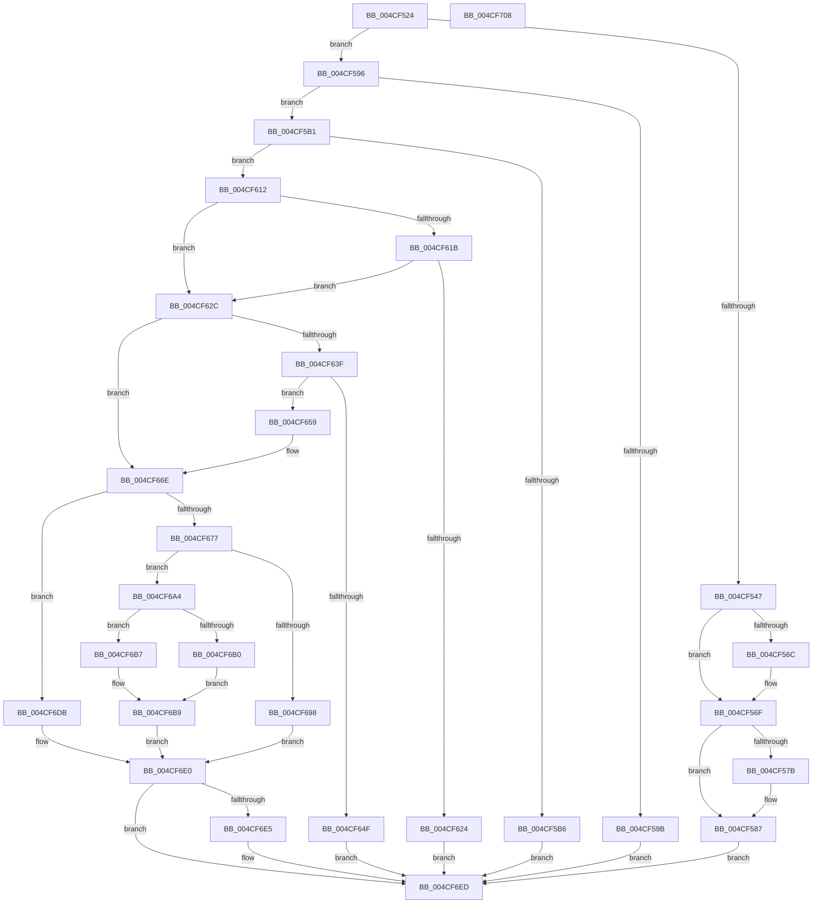

# BgpFwQueryBootGraphicsInformation

- RVA: `0x004CF524`–`0x004CF709` (길이 `485` bytes)
- VA: `0x00000001404CF524`
- 실행 섹션: `.text`
- PDB 이름 있음: `예`; PDB Function 태그: `아니요`
- unwind 정보 RVA: `0x00060300`
- 디코드: `125`개 명령, `485/485` bytes 표시
- 미해석 바이트: `0` (있으면 어셈블리에 `.byte`로 보존)

> 이 문서는 커널 이미지의 기계어와 PDB 기호를 분석해 생성했습니다. 4번과 5번은 함수 원형과 자료형을 바이너리 사용 방식에서 추정한 C 해석이며 원본 소스 복구 결과는 아닙니다.

## 1. Dependencies

- 직접 호출 지점: **8**; 고유 호출 대상: **6**
- 직접 호출자로 확인된 함수: **1**
- RIP 상대 이미지 참조: **15**

### Outgoing calls
- `0x004CF642` → [BgpFwAllocateMemory](../3E/BgpFwAllocateMemory_function_003E4374.md) (function, `0x003E4374`)
- `0x004CF669` → [memcpy](../6C/memcpy_function_006C6840.md) (function, `0x006C6840`)
- `0x004CF679` → [BgpFwReleaseLock](../4B/BgpFwReleaseLock_function_004B357C.md) (function, `0x004B357C`)
- `0x004CF68B` → [ExAllocatePool2](../../poolcode/B8/ExAllocatePool2_function_00B820F0.md) (function, `0x00B820F0`)
- `0x004CF698` → [BgpFwAcquireLock](../4B/BgpFwAcquireLock_function_004B3AA4.md) (function, `0x004B3AA4`)
- `0x004CF6CC` → [memcpy](../6C/memcpy_function_006C6840.md) (function, `0x006C6840`)
- `0x004CF6D1` → [BgpFwAcquireLock](../4B/BgpFwAcquireLock_function_004B3AA4.md) (function, `0x004B3AA4`)
- `0x004CF6E8` → [BgpFwFreeMemory](../3E/BgpFwFreeMemory_function_003E25E0.md) (function, `0x003E25E0`)

### Direct callers
- [BgQueryBootGraphicsInformation](../69/BgQueryBootGraphicsInformation_function_0069EA44.md) at `0x0069EA87`

### Static image references
- `0x004CF547` → RVA `0x00EF0430` (`.data`; read)
- `0x004CF554` → RVA `0x00EF0440` (`.data`; read)
- `0x004CF562` → RVA `0x00EF0450` (`.data`; read)
- `0x004CF56F` → RVA `0x00EF03E2` (`.data`; read)
- `0x004CF5A1` → RVA `0x00EF04A8` (`.data`; read)
- `0x004CF5B6` → RVA `0x00EF0530` (`.data`; read)
- `0x004CF5C0` → RVA `0x00EF0540` (`.data`; read)
- `0x004CF5CB` → RVA `0x00EF0550` (`.data`; read)
- `0x004CF5D6` → RVA `0x00EF0560` (`.data`; read)
- `0x004CF5E1` → RVA `0x00EF0570` (`.data`; read)
- `0x004CF5EC` → RVA `0x00EF0580` (`.data`; read)
- `0x004CF5F7` → RVA `0x00EF0590` (`.data`; read)
- `0x004CF602` → RVA `0x00EF05A0` (`.data`; read)
- `0x004CF612` → RVA `0x00EF0498` (`.data`; read)
- `0x004CF61B` → RVA `0x00EF04A0` (`.data`; read)

## 2. Other-region calls and transfers

- 다른 실행 섹션으로 향하는 call: **1**
  - `0x004CF68B` → [ExAllocatePool2](../../poolcode/B8/ExAllocatePool2_function_00B820F0.md) (`.text` → `POOLCODE`)
- 별도 외부 분기/꼬리 이동을 확인하지 못했습니다.

## 3. Assembly (complete function range)

```asm
004CF524  48 89 5C 24 08                  mov qword ptr [rsp + 8], rbx
004CF529  48 89 6C 24 10                  mov qword ptr [rsp + 0x10], rbp
004CF52E  48 89 74 24 18                  mov qword ptr [rsp + 0x18], rsi
004CF533  57                              push rdi
004CF534  41 56                           push r14
004CF536  41 57                           push r15
004CF538  48 83 EC 20                     sub rsp, 0x20
004CF53C  33 F6                           xor esi, esi
004CF53E  33 ED                           xor ebp, ebp
004CF540  48 8B FA                        mov rdi, rdx
004CF543  85 C9                           test ecx, ecx
004CF545  75 4F                           jne 0x1404cf596
004CF547  0F 10 05 E2 0E A2 00            movups xmm0, xmmword ptr [rip + 0xa20ee2]
004CF54E  8D 4E 01                        lea ecx, [rsi + 1]
004CF551  0F 11 02                        movups xmmword ptr [rdx], xmm0
004CF554  0F 10 0D E5 0E A2 00            movups xmm1, xmmword ptr [rip + 0xa20ee5]
004CF55B  0F 11 4A 10                     movups xmmword ptr [rdx + 0x10], xmm1
004CF55F  21 72 14                        and dword ptr [rdx + 0x14], esi
004CF562  8B 05 E8 0E A2 00               mov eax, dword ptr [rip + 0xa20ee8]
004CF568  A8 02                           test al, 2
004CF56A  74 03                           je 0x1404cf56f
004CF56C  89 4A 14                        mov dword ptr [rdx + 0x14], ecx
004CF56F  8A 05 6D 0E A2 00               mov al, byte ptr [rip + 0xa20e6d]
004CF575  2A C1                           sub al, cl
004CF577  A8 FD                           test al, 0xfd
004CF579  75 0C                           jne 0x1404cf587
004CF57B  8B 4A 08                        mov ecx, dword ptr [rdx + 8]
004CF57E  8B 42 0C                        mov eax, dword ptr [rdx + 0xc]
004CF581  89 42 08                        mov dword ptr [rdx + 8], eax
004CF584  89 4A 0C                        mov dword ptr [rdx + 0xc], ecx
004CF587  0F B6 05 54 0E A2 00            movzx eax, byte ptr [rip + 0xa20e54]
004CF58E  89 42 1C                        mov dword ptr [rdx + 0x1c], eax
004CF591  E9 57 01 00 00                  jmp 0x1404cf6ed
004CF596  83 F9 02                        cmp ecx, 2
004CF599  75 16                           jne 0x1404cf5b1
004CF59B  C7 02 08 00 00 00               mov dword ptr [rdx], 8
004CF5A1  8B 05 01 0F A2 00               mov eax, dword ptr [rip + 0xa20f01]
004CF5A7  83 C0 08                        add eax, 8
004CF5AA  89 02                           mov dword ptr [rdx], eax
004CF5AC  E9 3C 01 00 00                  jmp 0x1404cf6ed
004CF5B1  83 F9 03                        cmp ecx, 3
004CF5B4  75 5C                           jne 0x1404cf612
004CF5B6  0F 10 05 73 0F A2 00            movups xmm0, xmmword ptr [rip + 0xa20f73]
004CF5BD  0F 11 02                        movups xmmword ptr [rdx], xmm0
004CF5C0  0F 10 0D 79 0F A2 00            movups xmm1, xmmword ptr [rip + 0xa20f79]
004CF5C7  0F 11 4A 10                     movups xmmword ptr [rdx + 0x10], xmm1
004CF5CB  0F 10 05 7E 0F A2 00            movups xmm0, xmmword ptr [rip + 0xa20f7e]
004CF5D2  0F 11 42 20                     movups xmmword ptr [rdx + 0x20], xmm0
004CF5D6  0F 10 0D 83 0F A2 00            movups xmm1, xmmword ptr [rip + 0xa20f83]
004CF5DD  0F 11 4A 30                     movups xmmword ptr [rdx + 0x30], xmm1
004CF5E1  0F 10 05 88 0F A2 00            movups xmm0, xmmword ptr [rip + 0xa20f88]
004CF5E8  0F 11 42 40                     movups xmmword ptr [rdx + 0x40], xmm0
004CF5EC  0F 10 0D 8D 0F A2 00            movups xmm1, xmmword ptr [rip + 0xa20f8d]
004CF5F3  0F 11 4A 50                     movups xmmword ptr [rdx + 0x50], xmm1
004CF5F7  0F 10 05 92 0F A2 00            movups xmm0, xmmword ptr [rip + 0xa20f92]
004CF5FE  0F 11 42 60                     movups xmmword ptr [rdx + 0x60], xmm0
004CF602  0F 10 0D 97 0F A2 00            movups xmm1, xmmword ptr [rip + 0xa20f97]
004CF609  0F 11 4A 70                     movups xmmword ptr [rdx + 0x70], xmm1
004CF60D  E9 DB 00 00 00                  jmp 0x1404cf6ed
004CF612  48 39 35 7F 0E A2 00            cmp qword ptr [rip + 0xa20e7f], rsi
004CF619  75 11                           jne 0x1404cf62c
004CF61B  48 39 35 7E 0E A2 00            cmp qword ptr [rip + 0xa20e7e], rsi
004CF622  75 08                           jne 0x1404cf62c
004CF624  48 21 32                        and qword ptr [rdx], rsi
004CF627  E9 C1 00 00 00                  jmp 0x1404cf6ed
004CF62C  4C 8B 3D 6D 0E A2 00            mov r15, qword ptr [rip + 0xa20e6d]
004CF633  44 8B 35 6E 0E A2 00            mov r14d, dword ptr [rip + 0xa20e6e]
004CF63A  4D 85 FF                        test r15, r15
004CF63D  75 2F                           jne 0x1404cf66e
004CF63F  41 8B CE                        mov ecx, r14d
004CF642  E8 2D 4D F1 FF                  call 0x1403e4374
004CF647  48 8B E8                        mov rbp, rax
004CF64A  48 85 C0                        test rax, rax
004CF64D  75 0A                           jne 0x1404cf659
004CF64F  BE 17 00 00 C0                  mov esi, 0xc0000017
004CF654  E9 94 00 00 00                  jmp 0x1404cf6ed
004CF659  48 8B 15 38 0E A2 00            mov rdx, qword ptr [rip + 0xa20e38]
004CF660  4D 8B C6                        mov r8, r14
004CF663  48 8B C8                        mov rcx, rax
004CF666  4C 8B F8                        mov r15, rax
004CF669  E8 D2 71 1F 00                  call 0x1406c6840
004CF66E  41 8D 46 08                     lea eax, [r14 + 8]
004CF672  41 3B C6                        cmp eax, r14d
004CF675  72 64                           jb 0x1404cf6db
004CF677  8B D8                           mov ebx, eax
004CF679  E8 FE 3E FE FF                  call 0x1404b357c
004CF67E  8B D3                           mov edx, ebx
004CF680  B9 00 01 00 00                  mov ecx, 0x100
004CF685  41 B8 42 47 49 4B               mov r8d, 0x4b494742
004CF68B  E8 60 2A 6B 00                  call 0x140b820f0
004CF690  48 8B D8                        mov rbx, rax
004CF693  48 85 C0                        test rax, rax
004CF696  75 0C                           jne 0x1404cf6a4
004CF698  E8 07 44 FE FF                  call 0x1404b3aa4
004CF69D  BE 17 00 00 C0                  mov esi, 0xc0000017
004CF6A2  EB 3C                           jmp 0x1404cf6e0
004CF6A4  F7 05 A2 0D A2 00 00 00 80 00   test dword ptr [rip + 0xa20da2], 0x800000
004CF6AE  74 07                           je 0x1404cf6b7
004CF6B0  B9 01 00 00 00                  mov ecx, 1
004CF6B5  EB 02                           jmp 0x1404cf6b9
004CF6B7  33 C9                           xor ecx, ecx
004CF6B9  89 08                           mov dword ptr [rax], ecx
004CF6BB  4D 8B C6                        mov r8, r14
004CF6BE  48 8D 48 08                     lea rcx, [rax + 8]
004CF6C2  C7 40 04 08 00 00 00            mov dword ptr [rax + 4], 8
004CF6C9  49 8B D7                        mov rdx, r15
004CF6CC  E8 6F 71 1F 00                  call 0x1406c6840
004CF6D1  E8 CE 43 FE FF                  call 0x1404b3aa4
004CF6D6  48 89 1F                        mov qword ptr [rdi], rbx
004CF6D9  EB 05                           jmp 0x1404cf6e0
004CF6DB  BE 95 00 00 C0                  mov esi, 0xc0000095
004CF6E0  48 85 ED                        test rbp, rbp
004CF6E3  74 08                           je 0x1404cf6ed
004CF6E5  48 8B CD                        mov rcx, rbp
004CF6E8  E8 F3 2E F1 FF                  call 0x1403e25e0
004CF6ED  48 8B 5C 24 40                  mov rbx, qword ptr [rsp + 0x40]
004CF6F2  8B C6                           mov eax, esi
004CF6F4  48 8B 74 24 50                  mov rsi, qword ptr [rsp + 0x50]
004CF6F9  48 8B 6C 24 48                  mov rbp, qword ptr [rsp + 0x48]
004CF6FE  48 83 C4 20                     add rsp, 0x20
004CF702  41 5F                           pop r15
004CF704  41 5E                           pop r14
004CF706  5F                              pop rdi
004CF707  C3                              ret
004CF708  CC                              int3
```

## 4. C-style interpretation (structured pseudocode)

```c
__int64 __fastcall BgpFwQueryBootGraphicsInformation(int a1, __int64 a2)
{
    __int64 result;
    __int64 v_rbp;
    __int64 v_rsi;
    __int64 v_rsp;
    unsigned __int64 v_stack_p10;
    unsigned __int64 v_stack_p18;
    unsigned __int64 v_stack_p8;

    v_stack_p8 = v_rbx;
    v_stack_p10 = v_rbp;
    v_stack_p18 = v_rsi;
    v_rsp = (v_rsp) - (32);
    v_rsi = 0;
    v_rbp = 0;
    if (a1 != 0) goto loc_004CF596;
    *(unsigned __int64 *)(a2) = v_xmm0;
    *(unsigned __int64 *)(a2 + 16) = v_xmm1;
    if ((((unsigned __int8)((unsigned int)(*(unsigned int *)(v_rip + 10620648)))) & (2)) != 0) {
        *(unsigned int *)(a2 + 20) = (unsigned int)(v_rsi + 1);
    }
    result = (unsigned __int8)((*(unsigned __int8 *)(v_rip + 10620525)) - ((unsigned __int8)(v_rsi + 1)));
    if ((((unsigned __int8)(result)) & (253)) == 0) {
        a1 = *(unsigned int *)(a2 + 8);
        result = *(unsigned int *)(a2 + 12);
        *(unsigned int *)(a2 + 8) = (unsigned int)(result);
        *(unsigned int *)(a2 + 12) = a1;
    }
    *(unsigned int *)(a2 + 28) = (unsigned int)(*(unsigned __int8 *)(v_rip + 10620500));
    goto loc_004CF6ED;
loc_004CF596:
    if (a1 != 2) goto loc_004CF5B1;
    *(unsigned int *)(a2) = 8;
    result = (unsigned int)(((unsigned int)(*(unsigned int *)(v_rip + 10620673))) + (8));
    *(unsigned int *)(a2) = (unsigned int)(result);
    goto loc_004CF6ED;
loc_004CF5B1:
    if (a1 != 3) goto loc_004CF612;
    *(unsigned __int64 *)(a2) = v_xmm0;
    *(unsigned __int64 *)(a2 + 16) = v_xmm1;
    *(unsigned __int64 *)(a2 + 32) = v_xmm0;
    *(unsigned __int64 *)(a2 + 48) = v_xmm1;
    *(unsigned __int64 *)(a2 + 64) = v_xmm0;
    *(unsigned __int64 *)(a2 + 80) = v_xmm1;
    *(unsigned __int64 *)(a2 + 96) = v_xmm0;
    *(unsigned __int64 *)(a2 + 112) = v_xmm1;
    goto loc_004CF6ED;
loc_004CF612:
    if ((*(unsigned __int64 *)(v_rip + 10620543)) != 0) goto loc_004CF62C;
    if ((*(unsigned __int64 *)(v_rip + 10620542)) != 0) goto loc_004CF62C;
    goto loc_004CF6ED;
loc_004CF62C:
    if (*(unsigned __int64 *)(v_rip + 10620525) != 0) goto loc_004CF66E;
    result = BgpFwAllocateMemory((unsigned int)((unsigned int)((unsigned int)(*(unsigned int *)(v_rip + 10620526)))), a2, a3, a4);
    if (result != 0) goto loc_004CF659;
    goto loc_004CF6ED;
loc_004CF659:
    result = memcpy(result, *(unsigned __int64 *)(v_rip + 10620472), (unsigned int)(*(unsigned int *)(v_rip + 10620526)), a4);
loc_004CF66E:
    if (((unsigned int)((unsigned int)(*(unsigned int *)(v_rip + 10620526)) + 8)) < ((unsigned int)((unsigned int)(*(unsigned int *)(v_rip + 10620526))))) goto loc_004CF6DB;
    result = BgpFwReleaseLock(result, *(unsigned __int64 *)(v_rip + 10620472), (unsigned int)(*(unsigned int *)(v_rip + 10620526)), a4);
    result = ExAllocatePool2(256, (unsigned int)((unsigned int)((unsigned int)((unsigned int)((unsigned int)(*(unsigned int *)(v_rip + 10620526)) + 8)))), (unsigned int)(0x4B494742ULL), a4);
    if (result != 0) goto loc_004CF6A4;
    result = BgpFwAcquireLock(256, (unsigned int)((unsigned int)((unsigned int)((unsigned int)((unsigned int)(*(unsigned int *)(v_rip + 10620526)) + 8)))), (unsigned int)(0x4B494742ULL), a4);
    goto loc_004CF6E0;
loc_004CF6A4:
    if (((*(unsigned int *)(v_rip + 10620322)) & (0x800000ULL)) == 0) goto loc_004CF6B7;
    goto loc_004CF6B9;
loc_004CF6B7:
    a1 = 0;
loc_004CF6B9:
    *(unsigned int *)(result) = 0;
    *(unsigned int *)(result + 4) = 8;
    result = memcpy(result + 8, result, (unsigned int)(*(unsigned int *)(v_rip + 10620526)), a4);
    result = BgpFwAcquireLock(result + 8, result, (unsigned int)(*(unsigned int *)(v_rip + 10620526)), a4);
    *(unsigned __int64 *)(a2) = result;
    goto loc_004CF6E0;
loc_004CF6DB:
loc_004CF6E0:
    if (result != 0) {
        a1 = result;
        result = BgpFwFreeMemory(a1, result, (unsigned int)(*(unsigned int *)(v_rip + 10620526)), a4);
    }
    v_rsp = (v_rsp) + (32);
    return (unsigned int)((unsigned int)((unsigned int)(0xC0000095ULL)));
}
```

## 5. (Beta) C Style

```c
int64_t BgpFwQueryBootGraphicsInformation(int32_t Arg1, void *Arg2)
{
    uint8_t *arg2 = (uint8_t *)Arg2;

    int64_t result;
    int64_t local_rbp;
    int64_t local_rsi;
    int64_t local_rsp;
    uint64_t v_stack_p10;
    uint64_t v_stack_p18;
    uint64_t v_stack_p8;

    v_stack_p8 = local_rbx;
    v_stack_p10 = local_rbp;
    v_stack_p18 = local_rsi;
    local_rsp = (local_rsp) - (32);
    local_rsi = 0;
    local_rbp = 0;
    if (Arg1 != 0) goto loc_004CF596;
    *(uint64_t *)(arg2) = v_xmm0;
    *(uint64_t *)(arg2 + 0x10) = v_xmm1;
    if ((((uint8_t)((uint32_t)(*(uint32_t *)(v_rip + 0xA20EE8)))) & (2)) != 0) {
        *(uint32_t *)(arg2 + 0x14) = (uint32_t)(local_rsi + 1);
    }
    result = (uint8_t)((*(uint8_t *)(v_rip + 0xA20E6D)) - ((uint8_t)(local_rsi + 1)));
    if ((((uint8_t)(result)) & (253)) == 0) {
        Arg1 = *(uint32_t *)(arg2 + 0x8);
        result = *(uint32_t *)(arg2 + 0xC);
        *(uint32_t *)(arg2 + 0x8) = (uint32_t)(result);
        *(uint32_t *)(arg2 + 0xC) = Arg1;
    }
    *(uint32_t *)(arg2 + 0x1C) = (uint32_t)(*(uint8_t *)(v_rip + 0xA20E54));
    goto loc_004CF6ED;
loc_004CF596:
    if (Arg1 != 2) goto loc_004CF5B1;
    *(uint32_t *)(arg2) = 8;
    result = (uint32_t)(((uint32_t)(*(uint32_t *)(v_rip + 0xA20F01))) + (8));
    *(uint32_t *)(arg2) = (uint32_t)(result);
    goto loc_004CF6ED;
loc_004CF5B1:
    if (Arg1 != 3) goto loc_004CF612;
    *(uint64_t *)(arg2) = v_xmm0;
    *(uint64_t *)(arg2 + 0x10) = v_xmm1;
    *(uint64_t *)(arg2 + 0x20) = v_xmm0;
    *(uint64_t *)(arg2 + 0x30) = v_xmm1;
    *(uint64_t *)(arg2 + 0x40) = v_xmm0;
    *(uint64_t *)(arg2 + 0x50) = v_xmm1;
    *(uint64_t *)(arg2 + 0x60) = v_xmm0;
    *(uint64_t *)(arg2 + 0x70) = v_xmm1;
    goto loc_004CF6ED;
loc_004CF612:
    if ((*(uint64_t *)(v_rip + 0xA20E7F)) != 0) goto loc_004CF62C;
    if ((*(uint64_t *)(v_rip + 0xA20E7E)) != 0) goto loc_004CF62C;
    goto loc_004CF6ED;
loc_004CF62C:
    if (*(uint64_t *)(v_rip + 0xA20E6D) != 0) goto loc_004CF66E;
    result = BgpFwAllocateMemory((uint32_t)((uint32_t)((uint32_t)(*(uint32_t *)(v_rip + 0xA20E6E)))), Arg2, a3, a4);
    if (result != 0) goto loc_004CF659;
    goto loc_004CF6ED;
loc_004CF659:
    result = memcpy(result, *(uint64_t *)(v_rip + 0xA20E38), (uint32_t)(*(uint32_t *)(v_rip + 0xA20E6E)), a4);
loc_004CF66E:
    if (((uint32_t)((uint32_t)(*(uint32_t *)(v_rip + 0xA20E6E)) + 8)) < ((uint32_t)((uint32_t)(*(uint32_t *)(v_rip + 0xA20E6E))))) goto loc_004CF6DB;
    result = BgpFwReleaseLock(result, *(uint64_t *)(v_rip + 0xA20E38), (uint32_t)(*(uint32_t *)(v_rip + 0xA20E6E)), a4);
    result = ExAllocatePool2(256, (uint32_t)((uint32_t)((uint32_t)((uint32_t)((uint32_t)(*(uint32_t *)(v_rip + 0xA20E6E)) + 8)))), (uint32_t)(0x4B494742ULL), a4);
    if (result != 0) goto loc_004CF6A4;
    result = BgpFwAcquireLock(256, (uint32_t)((uint32_t)((uint32_t)((uint32_t)((uint32_t)(*(uint32_t *)(v_rip + 0xA20E6E)) + 8)))), (uint32_t)(0x4B494742ULL), a4);
    goto loc_004CF6E0;
loc_004CF6A4:
    if (((*(uint32_t *)(v_rip + 0xA20DA2)) & (0x800000ULL)) == 0) goto loc_004CF6B7;
    goto loc_004CF6B9;
loc_004CF6B7:
    Arg1 = 0;
loc_004CF6B9:
    *(uint32_t *)(result) = 0;
    *(uint32_t *)(result + 0x4) = 8;
    result = memcpy(result + 8, result, (uint32_t)(*(uint32_t *)(v_rip + 0xA20E6E)), a4);
    result = BgpFwAcquireLock(result + 8, result, (uint32_t)(*(uint32_t *)(v_rip + 0xA20E6E)), a4);
    *(uint64_t *)(arg2) = result;
    goto loc_004CF6E0;
loc_004CF6DB:
loc_004CF6E0:
    if (result != 0) {
        Arg1 = result;
        result = BgpFwFreeMemory(Arg1, result, (uint32_t)(*(uint32_t *)(v_rip + 0xA20E6E)), a4);
    }
    local_rsp = (local_rsp) + (32);
    return (uint32_t)((uint32_t)((uint32_t)(0xC0000095ULL)));
}
```

### 관측된 메모리 오프셋

구조체 형식이 확인되지 않은 접근은 인자 기준의 오프셋으로만 기록했습니다.

| 기준 인자 | 오프셋 표현 | 폭 (bit) | 접근 |
|---|---:|---:|---|
| `Arg2` | `+ 0x0` | `32` | `W` |
| `Arg2` | `+ 0x0` | `64` | `R/W` |
| `Arg2` | `+ 0x0` | `64` | `W` |
| `Arg2` | `+ 0x0` | `128` | `R` |
| `Arg2` | `+ 0x8` | `32` | `R` |
| `Arg2` | `+ 0x8` | `32` | `W` |
| `Arg2` | `+ 0xC` | `32` | `R` |
| `Arg2` | `+ 0xC` | `32` | `W` |
| `Arg2` | `+ 0x10` | `128` | `R` |
| `Arg2` | `+ 0x14` | `32` | `R/W` |
| `Arg2` | `+ 0x14` | `32` | `W` |
| `Arg2` | `+ 0x1C` | `32` | `W` |
| `Arg2` | `+ 0x20` | `128` | `R` |
| `Arg2` | `+ 0x30` | `128` | `R` |
| `Arg2` | `+ 0x40` | `128` | `R` |
| `Arg2` | `+ 0x50` | `128` | `R` |
| `Arg2` | `+ 0x60` | `128` | `R` |
| `Arg2` | `+ 0x70` | `128` | `R` |

## 6. Execution-region graph

[열기: 2D/3D 그래프와 함수 탐색 컨트롤 패널](../../../control-panel.html?section=text&rva=0x004CF524&view=graph)

- 2D 그래프는 위에서 아래로 흐르고, 3D 그래프는 빈 공간을 드래그해 회전합니다. Shift+드래그는 이동, 휠은 확대·축소, 함수 노드 선택은 대상 보고서 이동입니다.

### Static fallback


