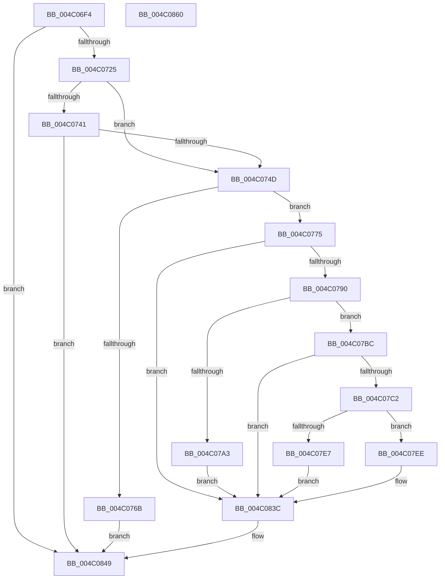

# BiMapEfiDeviceForSpaces

- RVA: `0x004C06F4`–`0x004C0861` (길이 `365` bytes)
- VA: `0x00000001404C06F4`
- 실행 섹션: `.text`
- PDB 이름 있음: `예`; PDB Function 태그: `아니요`
- unwind 정보 RVA: `0x000B384C`
- 디코드: `107`개 명령, `365/365` bytes 표시
- 미해석 바이트: `0` (있으면 어셈블리에 `.byte`로 보존)

> 이 문서는 커널 이미지의 기계어와 PDB 기호를 분석해 생성했습니다. 4번과 5번은 함수 원형과 자료형을 바이너리 사용 방식에서 추정한 C 해석이며 원본 소스 복구 결과는 아닙니다.

## 1. Dependencies

- 직접 호출 지점: **11**; 고유 호출 대상: **7**
- 직접 호출자로 확인된 함수: **1**
- RIP 상대 이미지 참조: **1**

### Outgoing calls
- `0x004C072E` → [SyspartGetSystemPartition](../../page/A9/SyspartGetSystemPartition_function_00A973CC.md) (function, `0x00A973CC`)
- `0x004C075E` → [ExAllocatePool2](../../poolcode/B8/ExAllocatePool2_function_00B820F0.md) (function, `0x00B820F0`)
- `0x004C0781` → [SyspartGetSystemPartition](../../page/A9/SyspartGetSystemPartition_function_00A973CC.md) (function, `0x00A973CC`)
- `0x004C0798` → [SyspartIsSpace](../../page/82/SyspartIsSpace_function_008276F8.md) (function, `0x008276F8`)
- `0x004C07B2` → [BiLogMessage](../../page/A3/BiLogMessage_function_00A3D3A8.md) (function, `0x00A3D3A8`)
- `0x004C07DA` → [ExAllocatePool2](../../poolcode/B8/ExAllocatePool2_function_00B820F0.md) (function, `0x00B820F0`)
- `0x004C07F6` → [memset](../6C/memset_function_006C6C40.md) (function, `0x006C6C40`)
- `0x004C0813` → [memcpy](../6C/memcpy_function_006C6840.md) (function, `0x006C6840`)
- `0x004C0822` → [memcpy](../6C/memcpy_function_006C6840.md) (function, `0x006C6840`)
- `0x004C082F` → [ExFreePoolWithTag](../../poolcode/B8/ExFreePoolWithTag_function_00B82870.md) (function, `0x00B82870`)
- `0x004C0844` → [ExFreePoolWithTag](../../poolcode/B8/ExFreePoolWithTag_function_00B82870.md) (function, `0x00B82870`)

### Direct callers
- [BiUpdateBcdObject](../../page/82/BiUpdateBcdObject_function_008270D0.md) at `0x008272CA`

### Static image references
- `0x004C07A6` → RVA `0x006D0E50` (` ?? ::FNODOBFM::`string'`; read)

## 2. Other-region calls and transfers

- 다른 실행 섹션으로 향하는 call: **8**
  - `0x004C072E` → [SyspartGetSystemPartition](../../page/A9/SyspartGetSystemPartition_function_00A973CC.md) (`.text` → `PAGE`)
  - `0x004C075E` → [ExAllocatePool2](../../poolcode/B8/ExAllocatePool2_function_00B820F0.md) (`.text` → `POOLCODE`)
  - `0x004C0781` → [SyspartGetSystemPartition](../../page/A9/SyspartGetSystemPartition_function_00A973CC.md) (`.text` → `PAGE`)
  - `0x004C0798` → [SyspartIsSpace](../../page/82/SyspartIsSpace_function_008276F8.md) (`.text` → `PAGE`)
  - `0x004C07B2` → [BiLogMessage](../../page/A3/BiLogMessage_function_00A3D3A8.md) (`.text` → `PAGE`)
  - `0x004C07DA` → [ExAllocatePool2](../../poolcode/B8/ExAllocatePool2_function_00B820F0.md) (`.text` → `POOLCODE`)
  - `0x004C082F` → [ExFreePoolWithTag](../../poolcode/B8/ExFreePoolWithTag_function_00B82870.md) (`.text` → `POOLCODE`)
  - `0x004C0844` → [ExFreePoolWithTag](../../poolcode/B8/ExFreePoolWithTag_function_00B82870.md) (`.text` → `POOLCODE`)
- 별도 외부 분기/꼬리 이동을 확인하지 못했습니다.

## 3. Assembly (complete function range)

```asm
004C06F4  48 89 5C 24 10                  mov qword ptr [rsp + 0x10], rbx
004C06F9  55                              push rbp
004C06FA  56                              push rsi
004C06FB  57                              push rdi
004C06FC  41 54                           push r12
004C06FE  41 55                           push r13
004C0700  41 56                           push r14
004C0702  41 57                           push r15
004C0704  48 83 EC 20                     sub rsp, 0x20
004C0708  8B 41 30                        mov eax, dword ptr [rcx + 0x30]
004C070B  33 DB                           xor ebx, ebx
004C070D  88 5C 24 60                     mov byte ptr [rsp + 0x60], bl
004C0711  4D 8B E0                        mov r12, r8
004C0714  89 5C 24 78                     mov dword ptr [rsp + 0x78], ebx
004C0718  4C 8B EA                        mov r13, rdx
004C071B  8B FB                           mov edi, ebx
004C071D  A8 08                           test al, 8
004C071F  0F 85 24 01 00 00               jne 0x1404c0849
004C0725  4C 8D 44 24 78                  lea r8, [rsp + 0x78]
004C072A  33 D2                           xor edx, edx
004C072C  33 C9                           xor ecx, ecx
004C072E  E8 99 6C 5D 00                  call 0x140a973cc
004C0733  8B F8                           mov edi, eax
004C0735  B8 00 00 00 80                  mov eax, 0x80000000
004C073A  8D 0C 07                        lea ecx, [rdi + rax]
004C073D  85 C8                           test eax, ecx
004C073F  75 0C                           jne 0x1404c074d
004C0741  81 FF 23 00 00 C0               cmp edi, 0xc0000023
004C0747  0F 85 FC 00 00 00               jne 0x1404c0849
004C074D  8B 54 24 78                     mov edx, dword ptr [rsp + 0x78]
004C0751  BD 02 01 00 00                  mov ebp, 0x102
004C0756  8B CD                           mov ecx, ebp
004C0758  41 B8 42 43 44 4B               mov r8d, 0x4b444342
004C075E  E8 8D 19 6C 00                  call 0x140b820f0
004C0763  48 8B F0                        mov rsi, rax
004C0766  48 85 C0                        test rax, rax
004C0769  75 0A                           jne 0x1404c0775
004C076B  BF 17 00 00 C0                  mov edi, 0xc0000017
004C0770  E9 D4 00 00 00                  jmp 0x1404c0849
004C0775  8B 54 24 78                     mov edx, dword ptr [rsp + 0x78]
004C0779  4C 8D 44 24 78                  lea r8, [rsp + 0x78]
004C077E  48 8B CE                        mov rcx, rsi
004C0781  E8 46 6C 5D 00                  call 0x140a973cc
004C0786  8B F8                           mov edi, eax
004C0788  85 C0                           test eax, eax
004C078A  0F 88 AC 00 00 00               js 0x1404c083c
004C0790  48 8D 54 24 60                  lea rdx, [rsp + 0x60]
004C0795  48 8B CE                        mov rcx, rsi
004C0798  E8 5B 6F 36 00                  call 0x1408276f8
004C079D  8B F8                           mov edi, eax
004C079F  85 C0                           test eax, eax
004C07A1  79 19                           jns 0x1404c07bc
004C07A3  4C 8B C6                        mov r8, rsi
004C07A6  48 8D 15 A3 06 21 00            lea rdx, [rip + 0x2106a3]
004C07AD  B9 04 00 00 00                  mov ecx, 4
004C07B2  E8 F1 CB 57 00                  call 0x140a3d3a8
004C07B7  E9 80 00 00 00                  jmp 0x1404c083c
004C07BC  38 5C 24 60                     cmp byte ptr [rsp + 0x60], bl
004C07C0  74 7A                           je 0x1404c083c
004C07C2  44 8B 7C 24 78                  mov r15d, dword ptr [rsp + 0x78]
004C07C7  41 B8 42 43 44 4B               mov r8d, 0x4b444342
004C07CD  48 8B CD                        mov rcx, rbp
004C07D0  45 8D 77 14                     lea r14d, [r15 + 0x14]
004C07D4  41 8B D6                        mov edx, r14d
004C07D7  41 8B DE                        mov ebx, r14d
004C07DA  E8 11 19 6C 00                  call 0x140b820f0
004C07DF  48 8B E8                        mov rbp, rax
004C07E2  48 85 C0                        test rax, rax
004C07E5  75 07                           jne 0x1404c07ee
004C07E7  BF 17 00 00 C0                  mov edi, 0xc0000017
004C07EC  EB 4E                           jmp 0x1404c083c
004C07EE  4C 8B C3                        mov r8, rbx
004C07F1  33 D2                           xor edx, edx
004C07F3  48 8B CD                        mov rcx, rbp
004C07F6  E8 45 64 20 00                  call 0x1406c6c40
004C07FB  41 8B 14 24                     mov edx, dword ptr [r12]
004C07FF  45 8B C6                        mov r8d, r14d
004C0802  49 8B 5D 00                     mov rbx, qword ptr [r13]
004C0806  44 3B F2                        cmp r14d, edx
004C0809  48 8B CD                        mov rcx, rbp
004C080C  44 0F 43 C2                     cmovae r8d, edx
004C0810  48 8B D3                        mov rdx, rbx
004C0813  E8 28 60 20 00                  call 0x1406c6840
004C0818  4D 8B C7                        mov r8, r15
004C081B  48 8D 4D 14                     lea rcx, [rbp + 0x14]
004C081F  48 8B D6                        mov rdx, rsi
004C0822  E8 19 60 20 00                  call 0x1406c6840
004C0827  BA 42 43 44 4B                  mov edx, 0x4b444342
004C082C  48 8B CB                        mov rcx, rbx
004C082F  E8 3C 20 6C 00                  call 0x140b82870
004C0834  49 89 6D 00                     mov qword ptr [r13], rbp
004C0838  45 89 34 24                     mov dword ptr [r12], r14d
004C083C  BA 42 43 44 4B                  mov edx, 0x4b444342
004C0841  48 8B CE                        mov rcx, rsi
004C0844  E8 27 20 6C 00                  call 0x140b82870
004C0849  48 8B 5C 24 68                  mov rbx, qword ptr [rsp + 0x68]
004C084E  8B C7                           mov eax, edi
004C0850  48 83 C4 20                     add rsp, 0x20
004C0854  41 5F                           pop r15
004C0856  41 5E                           pop r14
004C0858  41 5D                           pop r13
004C085A  41 5C                           pop r12
004C085C  5F                              pop rdi
004C085D  5E                              pop rsi
004C085E  5D                              pop rbp
004C085F  C3                              ret
004C0860  CC                              int3
```

## 4. C-style interpretation (structured pseudocode)

```c
__int64 __fastcall BiMapEfiDeviceForSpaces(__int64 a1, __int64 a2, __int64 a3)
{
    __int64 result;
    __int64 v_rbx;
    __int64 v_rsp;
    unsigned __int64 v_stack_p10;
    unsigned int v_stack_p20;
    unsigned __int8 v_stack_p8;

    v_stack_p10 = v_rbx;
    v_rsp = (v_rsp) - (32);
    v_rbx = 0;
    v_stack_p8 = 0;
    v_stack_p20 = 0;
    if ((((unsigned __int8)((unsigned int)(*(unsigned int *)(a1 + 48)))) & (8)) != 0) goto loc_004C0849;
    a2 = 0;
    a1 = 0;
    result = SyspartGetSystemPartition(a1, a2, v_stack_p20, a4);
    if ((((unsigned int)((unsigned int)(0x80000000ULL))) & ((unsigned int)((unsigned int)((unsigned int)(result)) + (unsigned int)(0x80000000ULL) * 1))) != 0) goto loc_004C074D;
    if (((unsigned int)((unsigned int)((unsigned int)(result)))) != 0xC0000023ULL) goto loc_004C0849;
loc_004C074D:
    result = ExAllocatePool2(258, (unsigned int)(v_stack_p20), (unsigned int)(0x4B444342ULL), a4);
    if (result != 0) goto loc_004C0775;
    goto loc_004C0849;
loc_004C0775:
    result = SyspartGetSystemPartition(result, (unsigned int)(v_stack_p20), v_stack_p20, a4);
    if (sign_flag) goto loc_004C083C;
    result = SyspartIsSpace(result, v_stack_p8, v_stack_p20, a4);
    if (!sign_flag) goto loc_004C07BC;
    result = BiLogMessage(4, v_rip + 2164387, result, a4);
    goto loc_004C083C;
loc_004C07BC:
    if (v_stack_p8 == 0) goto loc_004C083C;
    result = ExAllocatePool2(258, (unsigned int)((unsigned int)((unsigned int)(v_stack_p20) + 20)), (unsigned int)(0x4B444342ULL), a4);
    if (result != 0) goto loc_004C07EE;
    goto loc_004C083C;
loc_004C07EE:
    a2 = 0;
    result = memset(result, a2, (unsigned int)((unsigned int)((unsigned int)(v_stack_p20) + 20)), a4);
    a3 = (unsigned int)((unsigned int)((unsigned int)(v_stack_p20) + 20));
    if (((unsigned int)((unsigned int)(v_stack_p20) + 20)) >= ((unsigned int)((unsigned int)(*(unsigned int *)(a3))))) { a3 = (unsigned int)((unsigned int)(*(unsigned int *)(a3))); }
    result = memcpy(result, *(unsigned __int64 *)(a2), a3, a4);
    result = memcpy(result + 20, result, (unsigned int)(v_stack_p20), a4);
    result = ExFreePoolWithTag(*(unsigned __int64 *)(a2), (unsigned int)(0x4B444342ULL), (unsigned int)(v_stack_p20), a4);
    *(unsigned __int64 *)(a2) = result;
    *(unsigned int *)(a3) = (unsigned int)((unsigned int)(v_stack_p20) + 20);
loc_004C083C:
    result = ExFreePoolWithTag(result, (unsigned int)(0x4B444342ULL), (unsigned int)(v_stack_p20), a4);
loc_004C0849:
    v_rsp = (v_rsp) + (32);
    return (unsigned int)((unsigned int)((unsigned int)(0xC0000017ULL)));
}
```

## 5. (Beta) C Style

```c
int64_t BiMapEfiDeviceForSpaces(void *Arg1, void *Arg2, void *Arg3)
{
    uint8_t *arg1 = (uint8_t *)Arg1;
    uint8_t *arg2 = (uint8_t *)Arg2;
    uint8_t *arg3 = (uint8_t *)Arg3;

    int64_t result;
    int64_t local_rbx;
    int64_t local_rsp;
    uint64_t v_stack_p10;
    uint32_t v_stack_p20;
    uint8_t v_stack_p8;

    v_stack_p10 = local_rbx;
    local_rsp = (local_rsp) - (32);
    local_rbx = 0;
    v_stack_p8 = 0;
    v_stack_p20 = 0;
    if ((((uint8_t)((uint32_t)(*(uint32_t *)(arg1 + 0x30)))) & (8)) != 0) goto loc_004C0849;
    Arg2 = 0;
    Arg1 = 0;
    result = SyspartGetSystemPartition(Arg1, Arg2, v_stack_p20, a4);
    if ((((uint32_t)((uint32_t)(0x80000000ULL))) & ((uint32_t)((uint32_t)((uint32_t)(result)) + (uint32_t)(0x80000000ULL) * 1))) != 0) goto loc_004C074D;
    if (((uint32_t)((uint32_t)((uint32_t)(result)))) != 0xC0000023ULL) goto loc_004C0849;
loc_004C074D:
    result = ExAllocatePool2(258, (uint32_t)(v_stack_p20), (uint32_t)(0x4B444342ULL), a4);
    if (result != 0) goto loc_004C0775;
    goto loc_004C0849;
loc_004C0775:
    result = SyspartGetSystemPartition(result, (uint32_t)(v_stack_p20), v_stack_p20, a4);
    if (sign_flag) goto loc_004C083C;
    result = SyspartIsSpace(result, v_stack_p8, v_stack_p20, a4);
    if (!sign_flag) goto loc_004C07BC;
    result = BiLogMessage(4, v_rip + 2164387, result, a4);
    goto loc_004C083C;
loc_004C07BC:
    if (v_stack_p8 == 0) goto loc_004C083C;
    result = ExAllocatePool2(258, (uint32_t)((uint32_t)((uint32_t)(v_stack_p20) + 20)), (uint32_t)(0x4B444342ULL), a4);
    if (result != 0) goto loc_004C07EE;
    goto loc_004C083C;
loc_004C07EE:
    Arg2 = 0;
    result = memset(result, Arg2, (uint32_t)((uint32_t)((uint32_t)(v_stack_p20) + 20)), a4);
    Arg3 = (uint32_t)((uint32_t)((uint32_t)(v_stack_p20) + 20));
    if (((uint32_t)((uint32_t)(v_stack_p20) + 20)) >= ((uint32_t)((uint32_t)(*(uint32_t *)(arg3))))) { Arg3 = (uint32_t)((uint32_t)(*(uint32_t *)(arg3))); }
    result = memcpy(result, *(uint64_t *)(arg2), Arg3, a4);
    result = memcpy(result + 20, result, (uint32_t)(v_stack_p20), a4);
    result = ExFreePoolWithTag(*(uint64_t *)(arg2), (uint32_t)(0x4B444342ULL), (uint32_t)(v_stack_p20), a4);
    *(uint64_t *)(arg2) = result;
    *(uint32_t *)(arg3) = (uint32_t)((uint32_t)(v_stack_p20) + 20);
loc_004C083C:
    result = ExFreePoolWithTag(result, (uint32_t)(0x4B444342ULL), (uint32_t)(v_stack_p20), a4);
loc_004C0849:
    local_rsp = (local_rsp) + (32);
    return (uint32_t)((uint32_t)((uint32_t)(0xC0000017ULL)));
}
```

### 관측된 메모리 오프셋

구조체 형식이 확인되지 않은 접근은 인자 기준의 오프셋으로만 기록했습니다.

| 기준 인자 | 오프셋 표현 | 폭 (bit) | 접근 |
|---|---:|---:|---|
| `Arg1` | `+ 0x30` | `32` | `R` |
| `Arg2` | `+ 0x0` | `64` | `R` |
| `Arg2` | `+ 0x0` | `64` | `W` |
| `Arg3` | `+ 0x0` | `32` | `R` |
| `Arg3` | `+ 0x0` | `32` | `W` |

## 6. Execution-region graph

[열기: 2D/3D 그래프와 함수 탐색 컨트롤 패널](../../../control-panel.html?section=text&rva=0x004C06F4&view=graph)

- 2D 그래프는 위에서 아래로 흐르고, 3D 그래프는 빈 공간을 드래그해 회전합니다. Shift+드래그는 이동, 휠은 확대·축소, 함수 노드 선택은 대상 보고서 이동입니다.

### Static fallback


