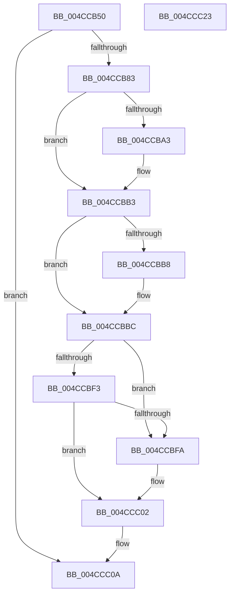

# CcGetNumberOfMappedPages

- RVA: `0x004CCB50`–`0x004CCC24` (길이 `212` bytes)
- VA: `0x00000001404CCB50`
- 실행 섹션: `.text`
- PDB 이름 있음: `예`; PDB Function 태그: `아니요`
- unwind 정보 RVA: `0x0006B074`
- 디코드: `63`개 명령, `212/212` bytes 표시
- 미해석 바이트: `0` (있으면 어셈블리에 `.byte`로 보존)

> 이 문서는 커널 이미지의 기계어와 PDB 기호를 분석해 생성했습니다. 4번과 5번은 함수 원형과 자료형을 바이너리 사용 방식에서 추정한 C 해석이며 원본 소스 복구 결과는 아닙니다.

## 1. Dependencies

- 직접 호출 지점: **4**; 고유 호출 대상: **4**
- 직접 호출자로 확인된 함수: **0**
- RIP 상대 이미지 참조: **0**

### Outgoing calls
- `0x004CCB8F` → [KeAbPreAcquire](../21/KeAbPreAcquire_function_00210230.md) (function, `0x00210230`)
- `0x004CCBAE` → [ExfAcquirePushLockSharedEx](../21/ExfAcquirePushLockSharedEx_function_0021044C.md) (function, `0x0021044C`)
- `0x004CCBFD` → [ExfReleasePushLock](../26/ExfReleasePushLock_function_002638D0.md) (function, `0x002638D0`)
- `0x004CCC05` → [KeAbPostRelease](../2E/KeAbPostRelease_function_002E1600.md) (function, `0x002E1600`)

### Direct callers
- 이 함수 시작 RVA로 연결되는 직접 call은 확인되지 않았습니다. 간접 호출은 완전히 역산할 수 없습니다.

### Static image references
- 디코드된 RIP-relative 메모리 참조가 없습니다.

## 2. Other-region calls and transfers

- 다른 실행 섹션으로 향하는 call: **0**
- 별도 외부 분기/꼬리 이동을 확인하지 못했습니다.

## 3. Assembly (complete function range)

```asm
004CCB50  48 89 5C 24 10                  mov qword ptr [rsp + 0x10], rbx
004CCB55  48 89 6C 24 18                  mov qword ptr [rsp + 0x18], rbp
004CCB5A  48 89 74 24 20                  mov qword ptr [rsp + 0x20], rsi
004CCB5F  57                              push rdi
004CCB60  41 56                           push r14
004CCB62  41 57                           push r15
004CCB64  48 83 EC 20                     sub rsp, 0x20
004CCB68  48 8B 71 08                     mov rsi, qword ptr [rcx + 8]
004CCB6C  33 ED                           xor ebp, ebp
004CCB6E  48 89 2A                        mov qword ptr [rdx], rbp
004CCB71  4D 8B F0                        mov r14, r8
004CCB74  49 89 28                        mov qword ptr [r8], rbp
004CCB77  4C 8B FA                        mov r15, rdx
004CCB7A  48 85 F6                        test rsi, rsi
004CCB7D  0F 84 87 00 00 00               je 0x1404ccc0a
004CCB83  48 8D 5E 68                     lea rbx, [rsi + 0x68]
004CCB87  45 33 C0                        xor r8d, r8d
004CCB8A  48 8B CB                        mov rcx, rbx
004CCB8D  33 D2                           xor edx, edx
004CCB8F  E8 9C 36 D4 FF                  call 0x140210230
004CCB94  48 8B F8                        mov rdi, rax
004CCB97  8D 4D 11                        lea ecx, [rbp + 0x11]
004CCB9A  33 C0                           xor eax, eax
004CCB9C  F0 48 0F B1 0B                  lock cmpxchg qword ptr [rbx], rcx
004CCBA1  74 10                           je 0x1404ccbb3
004CCBA3  4C 8B CB                        mov r9, rbx
004CCBA6  4C 8B C7                        mov r8, rdi
004CCBA9  33 D2                           xor edx, edx
004CCBAB  48 8B CB                        mov rcx, rbx
004CCBAE  E8 99 38 D4 FF                  call 0x14021044c
004CCBB3  48 85 FF                        test rdi, rdi
004CCBB6  74 04                           je 0x1404ccbbc
004CCBB8  C6 47 0A 01                     mov byte ptr [rdi + 0xa], 1
004CCBBC  8B 86 24 02 00 00               mov eax, dword ptr [rsi + 0x224]
004CCBC2  48 C1 E0 06                     shl rax, 6
004CCBC6  49 89 07                        mov qword ptr [r15], rax
004CCBC9  8B 86 28 02 00 00               mov eax, dword ptr [rsi + 0x228]
004CCBCF  48 C1 E0 06                     shl rax, 6
004CCBD3  49 89 06                        mov qword ptr [r14], rax
004CCBD6  0F 0D 0B                        prefetchw byte ptr [rbx]
004CCBD9  48 8B 03                        mov rax, qword ptr [rbx]
004CCBDC  48 8B C8                        mov rcx, rax
004CCBDF  48 83 E1 F0                     and rcx, 0xfffffffffffffff0
004CCBE3  48 83 F9 10                     cmp rcx, 0x10
004CCBE7  48 8D 50 F0                     lea rdx, [rax - 0x10]
004CCBEB  48 0F 46 D5                     cmovbe rdx, rbp
004CCBEF  A8 02                           test al, 2
004CCBF1  75 07                           jne 0x1404ccbfa
004CCBF3  F0 48 0F B1 13                  lock cmpxchg qword ptr [rbx], rdx
004CCBF8  74 08                           je 0x1404ccc02
004CCBFA  48 8B CB                        mov rcx, rbx
004CCBFD  E8 CE 6C D9 FF                  call 0x1402638d0
004CCC02  48 8B CB                        mov rcx, rbx
004CCC05  E8 F6 49 E1 FF                  call 0x1402e1600
004CCC0A  48 8B 5C 24 48                  mov rbx, qword ptr [rsp + 0x48]
004CCC0F  48 8B 6C 24 50                  mov rbp, qword ptr [rsp + 0x50]
004CCC14  48 8B 74 24 58                  mov rsi, qword ptr [rsp + 0x58]
004CCC19  48 83 C4 20                     add rsp, 0x20
004CCC1D  41 5F                           pop r15
004CCC1F  41 5E                           pop r14
004CCC21  5F                              pop rdi
004CCC22  C3                              ret
004CCC23  CC                              int3
```

## 4. C-style interpretation (structured pseudocode)

```c
__int64 __fastcall CcGetNumberOfMappedPages(__int64 a1, __int64 a2, __int64 a3)
{
    __int64 result;
    __int64 v_rbp;
    __int64 v_rsp;
    unsigned __int64 v_stack_p10;
    unsigned __int64 v_stack_p18;
    unsigned __int64 v_stack_p20;

    v_stack_p10 = v_rbx;
    v_stack_p18 = v_rbp;
    v_stack_p20 = v_rsi;
    v_rsp = (v_rsp) - (32);
    v_rbp = 0;
    *(unsigned __int64 *)(a2) = 0;
    *(unsigned __int64 *)(a3) = 0;
    if (*(unsigned __int64 *)(a1 + 8) == 0) goto loc_004CCC0A;
    a3 = 0;
    a2 = 0;
    result = KeAbPreAcquire(*(unsigned __int64 *)(a1 + 8) + 104, a2, a3, a4);
    result = 0;
    if (!(condition_is_equal)) {
        a4 = *(unsigned __int64 *)(a1 + 8) + 104;
        a3 = 0;
        a2 = 0;
        a1 = *(unsigned __int64 *)(a1 + 8) + 104;
        result = ExfAcquirePushLockSharedEx(a1, a2, a3, a4);
    }
    if (result != 0) {
        *(unsigned __int8 *)(result + 10) = 1;
    }
    result = ((unsigned int)(*(unsigned int *)(*(unsigned __int64 *)(a1 + 8) + 548))) << (6);
    *(unsigned __int64 *)(a2) = result;
    result = ((unsigned int)(*(unsigned int *)(*(unsigned __int64 *)(a1 + 8) + 552))) << (6);
    *(unsigned __int64 *)(a3) = result;
    a1 = (*(unsigned __int64 *)(*(unsigned __int64 *)(a1 + 8) + 104)) & (-16);
    a2 = *(unsigned __int64 *)(*(unsigned __int64 *)(a1 + 8) + 104) - 16;
    if (a1 <= 16) { a2 = 0; }
    if ((((unsigned __int8)(*(unsigned __int64 *)(*(unsigned __int64 *)(a1 + 8) + 104))) & (2)) != 0) goto loc_004CCBFA;
    result = *(unsigned __int64 *)(*(unsigned __int64 *)(a1 + 8) + 104);
    if ((((unsigned __int8)(*(unsigned __int64 *)(*(unsigned __int64 *)(a1 + 8) + 104))) & (2)) != 0) {
        a1 = *(unsigned __int64 *)(a1 + 8) + 104;
        result = ExfReleasePushLock(a1, a2, a3, a4);
    }
    result = KeAbPostRelease(*(unsigned __int64 *)(a1 + 8) + 104, a2, a3, a4);
loc_004CCC0A:
    v_rsp = (v_rsp) + (32);
    return result;
}
```

## 5. (Beta) C Style

```c
int64_t CcGetNumberOfMappedPages(void *Arg1, void *Arg2, void *Arg3)
{
    uint8_t *arg1 = (uint8_t *)Arg1;
    uint8_t *arg2 = (uint8_t *)Arg2;
    uint8_t *arg3 = (uint8_t *)Arg3;

    int64_t result;
    int64_t local_rbp;
    int64_t local_rsp;
    uint64_t v_stack_p10;
    uint64_t v_stack_p18;
    uint64_t v_stack_p20;

    v_stack_p10 = local_rbx;
    v_stack_p18 = local_rbp;
    v_stack_p20 = local_rsi;
    local_rsp = (local_rsp) - (32);
    local_rbp = 0;
    *(uint64_t *)(arg2) = 0;
    *(uint64_t *)(arg3) = 0;
    if (*(uint64_t *)(arg1 + 0x8) == 0) goto loc_004CCC0A;
    Arg3 = 0;
    Arg2 = 0;
    result = KeAbPreAcquire(*(uint64_t *)(arg1 + 0x8) + 104, Arg2, Arg3, a4);
    result = 0;
    if (!(condition_is_equal)) {
        a4 = *(uint64_t *)(arg1 + 0x8) + 104;
        Arg3 = 0;
        Arg2 = 0;
        Arg1 = *(uint64_t *)(arg1 + 0x8) + 104;
        result = ExfAcquirePushLockSharedEx(Arg1, Arg2, Arg3, a4);
    }
    if (result != 0) {
        *(uint8_t *)(result + 0xA) = 1;
    }
    result = ((uint32_t)(*(uint32_t *)(*(uint64_t *)(arg1 + 0x8) + 0x224))) << (6);
    *(uint64_t *)(arg2) = result;
    result = ((uint32_t)(*(uint32_t *)(*(uint64_t *)(arg1 + 0x8) + 0x228))) << (6);
    *(uint64_t *)(arg3) = result;
    Arg1 = (*(uint64_t *)(*(uint64_t *)(arg1 + 0x8) + 0x68)) & (-16);
    Arg2 = *(uint64_t *)(*(uint64_t *)(arg1 + 0x8) + 0x68) - 16;
    if (Arg1 <= 16) { Arg2 = 0; }
    if ((((uint8_t)(*(uint64_t *)(*(uint64_t *)(arg1 + 0x8) + 0x68))) & (2)) != 0) goto loc_004CCBFA;
    result = *(uint64_t *)(*(uint64_t *)(arg1 + 0x8) + 0x68);
    if ((((uint8_t)(*(uint64_t *)(*(uint64_t *)(arg1 + 0x8) + 0x68))) & (2)) != 0) {
        Arg1 = *(uint64_t *)(arg1 + 0x8) + 104;
        result = ExfReleasePushLock(Arg1, Arg2, Arg3, a4);
    }
    result = KeAbPostRelease(*(uint64_t *)(arg1 + 0x8) + 104, Arg2, Arg3, a4);
loc_004CCC0A:
    local_rsp = (local_rsp) + (32);
    return result;
}
```

### 관측된 메모리 오프셋

구조체 형식이 확인되지 않은 접근은 인자 기준의 오프셋으로만 기록했습니다.

| 기준 인자 | 오프셋 표현 | 폭 (bit) | 접근 |
|---|---:|---:|---|
| `Arg1` | `+ 0x8` | `64` | `R` |
| `Arg2` | `+ 0x0` | `64` | `W` |
| `Arg3` | `+ 0x0` | `64` | `W` |

## 6. Execution-region graph

[열기: 2D/3D 그래프와 함수 탐색 컨트롤 패널](../../../control-panel.html?section=text&rva=0x004CCB50&view=graph)

- 2D 그래프는 위에서 아래로 흐르고, 3D 그래프는 빈 공간을 드래그해 회전합니다. Shift+드래그는 이동, 휠은 확대·축소, 함수 노드 선택은 대상 보고서 이동입니다.

### Static fallback


