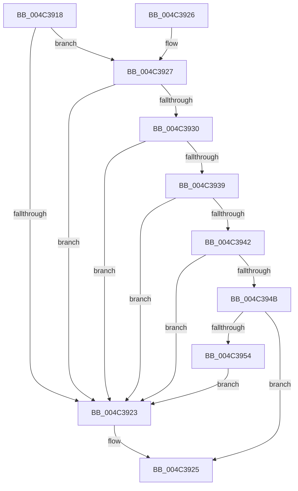

# CcHasVolumeTelemetryChanged

- RVA: `0x004C3918`–`0x004C3956` (길이 `62` bytes)
- VA: `0x00000001404C3918`
- 실행 섹션: `.text`
- PDB 이름 있음: `예`; PDB Function 태그: `아니요`
- unwind 정보 RVA: `0x000DB714`
- 디코드: `17`개 명령, `62/62` bytes 표시
- 미해석 바이트: `0` (있으면 어셈블리에 `.byte`로 보존)

> 이 문서는 커널 이미지의 기계어와 PDB 기호를 분석해 생성했습니다. 4번과 5번은 함수 원형과 자료형을 바이너리 사용 방식에서 추정한 C 해석이며 원본 소스 복구 결과는 아닙니다.

## 1. Dependencies

- 직접 호출 지점: **0**; 고유 호출 대상: **0**
- 직접 호출자로 확인된 함수: **1**
- RIP 상대 이미지 참조: **0**

### Outgoing calls
- 직접 디코드된 call 명령이 없습니다.

### Direct callers
- [CcPostVolumeTelemetry](../42/CcPostVolumeTelemetry_function_00420FF8.md) at `0x00421133`

### Static image references
- 디코드된 RIP-relative 메모리 참조가 없습니다.

## 2. Other-region calls and transfers

- 다른 실행 섹션으로 향하는 call: **0**
- 별도 외부 분기/꼬리 이동을 확인하지 못했습니다.

## 3. Assembly (complete function range)

```asm
004C3918  33 C0                           xor eax, eax
004C391A  48 39 81 70 01 00 00            cmp qword ptr [rcx + 0x170], rax
004C3921  76 04                           jbe 0x1404c3927
004C3923  B0 01                           mov al, 1
004C3925  C3                              ret
004C3926  CC                              int3
004C3927  48 39 81 78 01 00 00            cmp qword ptr [rcx + 0x178], rax
004C392E  77 F3                           ja 0x1404c3923
004C3930  48 39 81 80 01 00 00            cmp qword ptr [rcx + 0x180], rax
004C3937  77 EA                           ja 0x1404c3923
004C3939  48 39 81 50 03 00 00            cmp qword ptr [rcx + 0x350], rax
004C3940  77 E1                           ja 0x1404c3923
004C3942  48 39 81 58 03 00 00            cmp qword ptr [rcx + 0x358], rax
004C3949  77 D8                           ja 0x1404c3923
004C394B  48 39 81 60 03 00 00            cmp qword ptr [rcx + 0x360], rax
004C3952  76 D1                           jbe 0x1404c3925
004C3954  EB CD                           jmp 0x1404c3923
```

## 4. C-style interpretation (structured pseudocode)

```c
__int64 __fastcall CcHasVolumeTelemetryChanged(__int64 a1)
{
    __int64 result;

    result = 0;
    if ((*(unsigned __int64 *)(a1 + 368)) <= 0) goto loc_004C3927;
loc_004C3923:
loc_004C3925:
    return 1;
loc_004C3927:
    if ((*(unsigned __int64 *)(a1 + 376)) > 1) goto loc_004C3923;
    if ((*(unsigned __int64 *)(a1 + 384)) > 1) goto loc_004C3923;
    if ((*(unsigned __int64 *)(a1 + 848)) > 1) goto loc_004C3923;
    if ((*(unsigned __int64 *)(a1 + 856)) > 1) goto loc_004C3923;
    if ((*(unsigned __int64 *)(a1 + 864)) <= 1) goto loc_004C3925;
    goto loc_004C3923;
}
```

## 5. (Beta) C Style

```c
int64_t CcHasVolumeTelemetryChanged(void *Arg1)
{
    uint8_t *arg1 = (uint8_t *)Arg1;

    int64_t result;

    result = 0;
    if ((*(uint64_t *)(arg1 + 0x170)) <= 0) goto loc_004C3927;
loc_004C3923:
loc_004C3925:
    return 1;
loc_004C3927:
    if ((*(uint64_t *)(arg1 + 0x178)) > 1) goto loc_004C3923;
    if ((*(uint64_t *)(arg1 + 0x180)) > 1) goto loc_004C3923;
    if ((*(uint64_t *)(arg1 + 0x350)) > 1) goto loc_004C3923;
    if ((*(uint64_t *)(arg1 + 0x358)) > 1) goto loc_004C3923;
    if ((*(uint64_t *)(arg1 + 0x360)) <= 1) goto loc_004C3925;
    goto loc_004C3923;
}
```

### 관측된 메모리 오프셋

구조체 형식이 확인되지 않은 접근은 인자 기준의 오프셋으로만 기록했습니다.

| 기준 인자 | 오프셋 표현 | 폭 (bit) | 접근 |
|---|---:|---:|---|
| `Arg1` | `+ 0x170` | `64` | `R` |
| `Arg1` | `+ 0x178` | `64` | `R` |
| `Arg1` | `+ 0x180` | `64` | `R` |
| `Arg1` | `+ 0x350` | `64` | `R` |
| `Arg1` | `+ 0x358` | `64` | `R` |
| `Arg1` | `+ 0x360` | `64` | `R` |

## 6. Execution-region graph

[열기: 2D/3D 그래프와 함수 탐색 컨트롤 패널](../../../control-panel.html?section=text&rva=0x004C3918&view=graph)

- 2D 그래프는 위에서 아래로 흐르고, 3D 그래프는 빈 공간을 드래그해 회전합니다. Shift+드래그는 이동, 휠은 확대·축소, 함수 노드 선택은 대상 보고서 이동입니다.

### Static fallback


