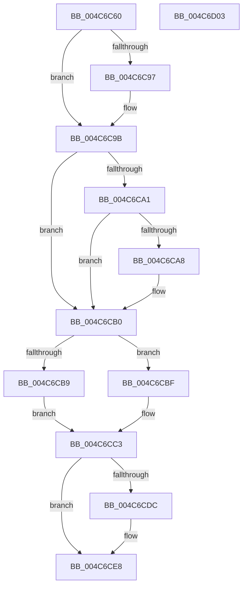

# CcMmLogLostDelayedWriteError

- RVA: `0x004C6C60`–`0x004C6D04` (길이 `164` bytes)
- VA: `0x00000001404C6C60`
- 실행 섹션: `.text`
- PDB 이름 있음: `예`; PDB Function 태그: `아니요`
- unwind 정보 RVA: `0x000BD0B8`
- 디코드: `48`개 명령, `164/164` bytes 표시
- 미해석 바이트: `0` (있으면 어셈블리에 `.byte`로 보존)

> 이 문서는 커널 이미지의 기계어와 PDB 기호를 분석해 생성했습니다. 4번과 5번은 함수 원형과 자료형을 바이너리 사용 방식에서 추정한 C 해석이며 원본 소스 복구 결과는 아닙니다.

## 1. Dependencies

- 직접 호출 지점: **3**; 고유 호출 대상: **3**
- 직접 호출자로 확인된 함수: **2**
- RIP 상대 이미지 참조: **0**

### Outgoing calls
- `0x004C6C89` → [IoQueryFileDosDeviceName](../../page/8A/IoQueryFileDosDeviceName_function_008A6340.md) (function, `0x008A6340`)
- `0x004C6CCE` → [FsRtlLogCcFlushError](../../page/AC/FsRtlLogCcFlushError_function_00ACA170.md) (function, `0x00ACA170`)
- `0x004C6CE3` → [ExFreePoolWithTag](../../poolcode/B8/ExFreePoolWithTag_function_00B82870.md) (function, `0x00B82870`)

### Direct callers
- [CcWriteBehindPostProcess](../35/CcWriteBehindPostProcess_function_00357BB4.md) at `0x00357E4F`
- [MiLdwPopupWorker](../../page/7F/MiLdwPopupWorker_function_007FCFF0.md) at `0x007FD01A`

### Static image references
- 디코드된 RIP-relative 메모리 참조가 없습니다.

## 2. Other-region calls and transfers

- 다른 실행 섹션으로 향하는 call: **3**
  - `0x004C6C89` → [IoQueryFileDosDeviceName](../../page/8A/IoQueryFileDosDeviceName_function_008A6340.md) (`.text` → `PAGE`)
  - `0x004C6CCE` → [FsRtlLogCcFlushError](../../page/AC/FsRtlLogCcFlushError_function_00ACA170.md) (`.text` → `PAGE`)
  - `0x004C6CE3` → [ExFreePoolWithTag](../../poolcode/B8/ExFreePoolWithTag_function_00B82870.md) (`.text` → `POOLCODE`)
- 별도 외부 분기/꼬리 이동을 확인하지 못했습니다.

## 3. Assembly (complete function range)

```asm
004C6C60  48 8B C4                        mov rax, rsp
004C6C63  48 89 58 10                     mov qword ptr [rax + 0x10], rbx
004C6C67  48 89 68 18                     mov qword ptr [rax + 0x18], rbp
004C6C6B  48 89 78 20                     mov qword ptr [rax + 0x20], rdi
004C6C6F  41 56                           push r14
004C6C71  48 83 EC 30                     sub rsp, 0x30
004C6C75  45 33 F6                        xor r14d, r14d
004C6C78  8B EA                           mov ebp, edx
004C6C7A  48 8D 50 08                     lea rdx, [rax + 8]
004C6C7E  4C 89 70 08                     mov qword ptr [rax + 8], r14
004C6C82  48 8B D9                        mov rbx, rcx
004C6C85  41 8D 7E 01                     lea edi, [r14 + 1]
004C6C89  E8 B2 F6 3D 00                  call 0x1408a6340
004C6C8E  48 8B 4C 24 40                  mov rcx, qword ptr [rsp + 0x40]
004C6C93  85 C0                           test eax, eax
004C6C95  74 04                           je 0x1404c6c9b
004C6C97  48 8D 4B 58                     lea rcx, [rbx + 0x58]
004C6C9B  66 44 39 31                     cmp word ptr [rcx], r14w
004C6C9F  74 0F                           je 0x1404c6cb0
004C6CA1  66 44 39 71 02                  cmp word ptr [rcx + 2], r14w
004C6CA6  74 08                           je 0x1404c6cb0
004C6CA8  4C 39 71 08                     cmp qword ptr [rcx + 8], r14
004C6CAC  41 0F 45 FE                     cmovne edi, r14d
004C6CB0  48 8B 43 10                     mov rax, qword ptr [rbx + 0x10]
004C6CB4  48 85 C0                        test rax, rax
004C6CB7  74 06                           je 0x1404c6cbf
004C6CB9  48 8B 50 08                     mov rdx, qword ptr [rax + 8]
004C6CBD  EB 04                           jmp 0x1404c6cc3
004C6CBF  48 8B 53 08                     mov rdx, qword ptr [rbx + 8]
004C6CC3  4C 8B 43 28                     mov r8, qword ptr [rbx + 0x28]
004C6CC7  44 8B CD                        mov r9d, ebp
004C6CCA  89 7C 24 20                     mov dword ptr [rsp + 0x20], edi
004C6CCE  E8 9D 34 60 00                  call 0x140aca170
004C6CD3  8B D8                           mov ebx, eax
004C6CD5  4C 39 74 24 40                  cmp qword ptr [rsp + 0x40], r14
004C6CDA  74 0C                           je 0x1404c6ce8
004C6CDC  48 8B 4C 24 40                  mov rcx, qword ptr [rsp + 0x40]
004C6CE1  33 D2                           xor edx, edx
004C6CE3  E8 88 BB 6B 00                  call 0x140b82870
004C6CE8  48 8B 6C 24 50                  mov rbp, qword ptr [rsp + 0x50]
004C6CED  85 DB                           test ebx, ebx
004C6CEF  48 8B 5C 24 48                  mov rbx, qword ptr [rsp + 0x48]
004C6CF4  48 8B 7C 24 58                  mov rdi, qword ptr [rsp + 0x58]
004C6CF9  0F 94 C0                        sete al
004C6CFC  48 83 C4 30                     add rsp, 0x30
004C6D00  41 5E                           pop r14
004C6D02  C3                              ret
004C6D03  CC                              int3
```

## 4. C-style interpretation (structured pseudocode)

```c
__int64 __fastcall CcMmLogLostDelayedWriteError(__int64 a1, int a2)
{
    __int64 result;
    __int64 v_r14;
    __int64 v_rdi;
    __int64 v_rsp;
    unsigned int v_stack_m18;
    unsigned __int64 v_stack_p10;
    unsigned __int64 v_stack_p18;
    unsigned __int64 v_stack_p20;
    unsigned __int64 v_stack_p8;

    *(unsigned __int64 *)(v_rsp + 16) = v_rbx;
    *(unsigned __int64 *)(v_rsp + 24) = v_rbp;
    *(unsigned __int64 *)(v_rsp + 32) = v_rdi;
    v_rsp = (v_rsp) - (48);
    v_r14 = 0;
    *(unsigned __int64 *)(v_rsp + 8) = 0;
    result = IoQueryFileDosDeviceName(a1, v_rsp + 8, a3, a4);
    if ((unsigned int)(result) != 0) {
        a1 = a1 + 88;
    }
    if ((*(unsigned __int16 *)(a1)) == 0) goto loc_004C6CB0;
    v_rdi = v_r14 + 1;
    if ((*(unsigned __int16 *)(a1 + 2)) != 0) {
        v_rdi = v_r14 + 1;
        if ((*(unsigned __int64 *)(a1 + 8)) != 0) { v_rdi = 0; }
    }
    if (*(unsigned __int64 *)(a1 + 16) == 0) goto loc_004C6CBF;
    goto loc_004C6CC3;
loc_004C6CBF:
loc_004C6CC3:
    v_stack_m18 = (unsigned int)(v_rdi);
    result = FsRtlLogCcFlushError(a1, *(unsigned __int64 *)(a1 + 8), *(unsigned __int64 *)(a1 + 40), (unsigned int)((unsigned int)((unsigned int)(a2))));
    if (v_stack_p8 != 0) {
        a1 = v_stack_p8;
        a2 = 0;
        result = ExFreePoolWithTag(a1, a2, *(unsigned __int64 *)(a1 + 40), (unsigned int)((unsigned int)((unsigned int)(a2))));
    }
    result = ((unsigned int)((unsigned int)((unsigned int)(result))) == 0) ? 1 : 0;
    v_rsp = (v_rsp) + (48);
    return result;
}
```

## 5. (Beta) C Style

```c
int64_t CcMmLogLostDelayedWriteError(void *Arg1, int32_t Arg2)
{
    uint8_t *arg1 = (uint8_t *)Arg1;

    int64_t result;
    int64_t local_r14;
    int64_t local_rdi;
    int64_t local_rsp;
    uint32_t v_stack_m18;
    uint64_t v_stack_p10;
    uint64_t v_stack_p18;
    uint64_t v_stack_p20;
    uint64_t v_stack_p8;

    *(uint64_t *)(local_rsp + 0x10) = local_rbx;
    *(uint64_t *)(local_rsp + 0x18) = local_rbp;
    *(uint64_t *)(local_rsp + 0x20) = local_rdi;
    local_rsp = (local_rsp) - (48);
    local_r14 = 0;
    *(uint64_t *)(local_rsp + 0x8) = 0;
    result = IoQueryFileDosDeviceName(Arg1, local_rsp + 8, a3, a4);
    if ((uint32_t)(result) != 0) {
        Arg1 = Arg1 + 88;
    }
    if ((*(uint16_t *)(arg1)) == 0) goto loc_004C6CB0;
    local_rdi = local_r14 + 1;
    if ((*(uint16_t *)(arg1 + 0x2)) != 0) {
        local_rdi = local_r14 + 1;
        if ((*(uint64_t *)(arg1 + 0x8)) != 0) { local_rdi = 0; }
    }
    if (*(uint64_t *)(arg1 + 0x10) == 0) goto loc_004C6CBF;
    goto loc_004C6CC3;
loc_004C6CBF:
loc_004C6CC3:
    v_stack_m18 = (uint32_t)(local_rdi);
    result = FsRtlLogCcFlushError(Arg1, *(uint64_t *)(arg1 + 0x8), *(uint64_t *)(arg1 + 0x28), (uint32_t)((uint32_t)((uint32_t)(Arg2))));
    if (v_stack_p8 != 0) {
        Arg1 = v_stack_p8;
        Arg2 = 0;
        result = ExFreePoolWithTag(Arg1, Arg2, *(uint64_t *)(arg1 + 0x28), (uint32_t)((uint32_t)((uint32_t)(Arg2))));
    }
    result = ((uint32_t)((uint32_t)((uint32_t)(result))) == 0) ? 1 : 0;
    local_rsp = (local_rsp) + (48);
    return result;
}
```

### 관측된 메모리 오프셋

구조체 형식이 확인되지 않은 접근은 인자 기준의 오프셋으로만 기록했습니다.

| 기준 인자 | 오프셋 표현 | 폭 (bit) | 접근 |
|---|---:|---:|---|
| `Arg1` | `+ 0x8` | `64` | `R` |
| `Arg1` | `+ 0x10` | `64` | `R` |
| `Arg1` | `+ 0x28` | `64` | `R` |
| `Arg1` | `+ 0x58` | `64` | `R` |

## 6. Execution-region graph

[열기: 2D/3D 그래프와 함수 탐색 컨트롤 패널](../../../control-panel.html?section=text&rva=0x004C6C60&view=graph)

- 2D 그래프는 위에서 아래로 흐르고, 3D 그래프는 빈 공간을 드래그해 회전합니다. Shift+드래그는 이동, 휠은 확대·축소, 함수 노드 선택은 대상 보고서 이동입니다.

### Static fallback


