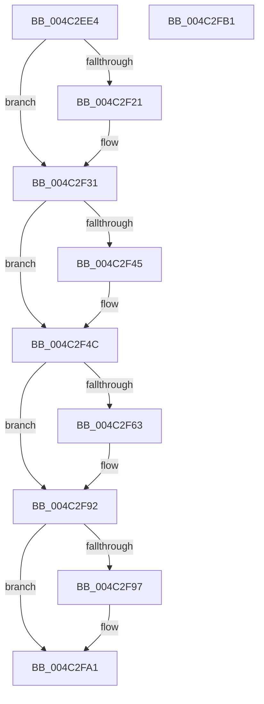

# CcPostPVCMDelayedDelete

- RVA: `0x004C2EE4`–`0x004C2FB2` (길이 `206` bytes)
- VA: `0x00000001404C2EE4`
- 실행 섹션: `.text`
- PDB 이름 있음: `예`; PDB Function 태그: `아니요`
- unwind 정보 RVA: `0x0007F83C`
- 디코드: `50`개 명령, `206/206` bytes 표시
- 미해석 바이트: `0` (있으면 어셈블리에 `.byte`로 보존)

> 이 문서는 커널 이미지의 기계어와 PDB 기호를 분석해 생성했습니다. 4번과 5번은 함수 원형과 자료형을 바이너리 사용 방식에서 추정한 C 해석이며 원본 소스 복구 결과는 아닙니다.

## 1. Dependencies

- 직접 호출 지점: **3**; 고유 호출 대상: **3**
- 직접 호출자로 확인된 함수: **1**
- RIP 상대 이미지 참조: **1**

### Outgoing calls
- `0x004C2F2C` → [KeAcquireInStackQueuedSpinLock](../27/KeAcquireInStackQueuedSpinLock_function_002757A0.md) (function, `0x002757A0`)
- `0x004C2F86` → [KeSetCoalescableTimer](../22/KeSetCoalescableTimer_function_0022FFD0.md) (function, `0x0022FFD0`)
- `0x004C2F9C` → [KeReleaseInStackQueuedSpinLock](../34/KeReleaseInStackQueuedSpinLock_function_00342CE0.md) (function, `0x00342CE0`)

### Direct callers
- [CcPostPVCMForDeleteToPartition](CcPostPVCMForDeleteToPartition_function_004C2DBC.md) at `0x004C2E00`

### Static image references
- `0x004C2F63` → RVA `0x000262F8` (`.rdata`; read)

## 2. Other-region calls and transfers

- 다른 실행 섹션으로 향하는 call: **0**
- 별도 외부 분기/꼬리 이동을 확인하지 못했습니다.

## 3. Assembly (complete function range)

```asm
004C2EE4  4C 8B DC                        mov r11, rsp
004C2EE7  49 89 5B 08                     mov qword ptr [r11 + 8], rbx
004C2EEB  49 89 73 10                     mov qword ptr [r11 + 0x10], rsi
004C2EEF  57                              push rdi
004C2EF0  48 83 EC 50                     sub rsp, 0x50
004C2EF4  33 C0                           xor eax, eax
004C2EF6  0F 57 C0                        xorps xmm0, xmm0
004C2EF9  41 8A F8                        mov dil, r8b
004C2EFC  48 8B F2                        mov rsi, rdx
004C2EFF  48 8B D9                        mov rbx, rcx
004C2F02  0F 11 44 24 30                  movups xmmword ptr [rsp + 0x30], xmm0
004C2F07  49 89 43 E8                     mov qword ptr [r11 - 0x18], rax
004C2F0B  48 A1 20 03 00 00 80 F7 FF FF   movabs rax, qword ptr [0xfffff78000000320]
004C2F15  48 89 82 58 06 00 00            mov qword ptr [rdx + 0x658], rax
004C2F1C  45 84 C0                        test r8b, r8b
004C2F1F  75 10                           jne 0x1404c2f31
004C2F21  48 81 C1 00 03 00 00            add rcx, 0x300
004C2F28  49 8D 53 D8                     lea rdx, [r11 - 0x28]
004C2F2C  E8 6F 28 DB FF                  call 0x1402757a0
004C2F31  48 8D 4B 70                     lea rcx, [rbx + 0x70]
004C2F35  48 8B 51 08                     mov rdx, qword ptr [rcx + 8]
004C2F39  48 8D 86 40 02 00 00            lea rax, [rsi + 0x240]
004C2F40  48 39 0A                        cmp qword ptr [rdx], rcx
004C2F43  74 07                           je 0x1404c2f4c
004C2F45  B9 03 00 00 00                  mov ecx, 3
004C2F4A  CD 29                           int 0x29
004C2F4C  48 89 08                        mov qword ptr [rax], rcx
004C2F4F  48 89 50 08                     mov qword ptr [rax + 8], rdx
004C2F53  48 89 02                        mov qword ptr [rdx], rax
004C2F56  48 89 41 08                     mov qword ptr [rcx + 8], rax
004C2F5A  80 BB E0 05 00 00 00            cmp byte ptr [rbx + 0x5e0], 0
004C2F61  75 2F                           jne 0x1404c2f92
004C2F63  48 8B 15 8E 33 B6 FF            mov rdx, qword ptr [rip - 0x49cc72]
004C2F6A  48 8D 83 A0 05 00 00            lea rax, [rbx + 0x5a0]
004C2F71  48 8D 8B 60 05 00 00            lea rcx, [rbx + 0x560]
004C2F78  48 89 44 24 20                  mov qword ptr [rsp + 0x20], rax
004C2F7D  41 B9 E8 03 00 00               mov r9d, 0x3e8
004C2F83  45 33 C0                        xor r8d, r8d
004C2F86  E8 45 D0 D6 FF                  call 0x14022ffd0
004C2F8B  C6 83 E0 05 00 00 01            mov byte ptr [rbx + 0x5e0], 1
004C2F92  40 84 FF                        test dil, dil
004C2F95  75 0A                           jne 0x1404c2fa1
004C2F97  48 8D 4C 24 30                  lea rcx, [rsp + 0x30]
004C2F9C  E8 3F FD E7 FF                  call 0x140342ce0
004C2FA1  48 8B 5C 24 60                  mov rbx, qword ptr [rsp + 0x60]
004C2FA6  48 8B 74 24 68                  mov rsi, qword ptr [rsp + 0x68]
004C2FAB  48 83 C4 50                     add rsp, 0x50
004C2FAF  5F                              pop rdi
004C2FB0  C3                              ret
004C2FB1  CC                              int3
```

## 4. C-style interpretation (structured pseudocode)

```c
__int64 __fastcall CcPostPVCMDelayedDelete(__int64 a1, __int64 a2, int a3)
{
    __int64 result;
    __int64 v_rsp;
    unsigned __int64 v_stack_m28;
    unsigned __int64 v_stack_m38;
    unsigned __int64 v_stack_p10;
    unsigned __int64 v_stack_p8;

    *(unsigned __int64 *)(v_rsp + 8) = v_rbx;
    *(unsigned __int64 *)(v_rsp + 16) = v_rsi;
    v_rsp = (v_rsp) - (80);
    result = 0;
    v_stack_m28 = v_xmm0;
    *(unsigned __int64 *)(v_rsp - 24) = 0;
    *(unsigned __int64 *)(a2 + 1624) = 0;
    if ((unsigned __int8)(a3) == 0) {
        a1 = (a1) + (768);
        a2 = v_rsp - 40;
        result = KeAcquireInStackQueuedSpinLock(a1, a2, a3, a4);
    }
    if ((*(unsigned __int64 *)(*(unsigned __int64 *)(a1 + 112 + 8))) != (a1 + 112)) {
        a1 = 3;
    }
    *(unsigned __int64 *)(a2 + 576) = a1;
    *(unsigned __int64 *)(a2 + 576 + 8) = *(unsigned __int64 *)(a1 + 112 + 8);
    *(unsigned __int64 *)(*(unsigned __int64 *)(a1 + 112 + 8)) = a2 + 576;
    *(unsigned __int64 *)(a1 + 8) = a2 + 576;
    result = a2 + 576;
    if ((*(unsigned __int8 *)(a1 + 1504)) == 0) {
        a2 = *(unsigned __int64 *)(v_rip - 4836466);
        result = a1 + 1440;
        a1 = a1 + 1376;
        v_stack_m38 = result;
        a4 = 1000;
        a3 = 0;
        result = KeSetCoalescableTimer(a1, a2, a3, a4);
        *(unsigned __int8 *)(a1 + 1504) = 1;
    }
    if ((unsigned __int8)((unsigned __int8)(a3)) == 0) {
        a1 = v_stack_m28;
        result = KeReleaseInStackQueuedSpinLock(a1, a2, a3, a4);
    }
    v_rsp = (v_rsp) + (80);
    return result;
}
```

## 5. (Beta) C Style

```c
int64_t CcPostPVCMDelayedDelete(void *Arg1, void *Arg2, int32_t Arg3)
{
    uint8_t *arg1 = (uint8_t *)Arg1;
    uint8_t *arg2 = (uint8_t *)Arg2;

    int64_t result;
    int64_t local_rsp;
    uint64_t v_stack_m28;
    uint64_t v_stack_m38;
    uint64_t v_stack_p10;
    uint64_t v_stack_p8;

    *(uint64_t *)(local_rsp + 0x8) = local_rbx;
    *(uint64_t *)(local_rsp + 0x10) = local_rsi;
    local_rsp = (local_rsp) - (80);
    result = 0;
    v_stack_m28 = v_xmm0;
    *(uint64_t *)(local_rsp - 0x18) = 0;
    *(uint64_t *)(arg2 + 0x658) = 0;
    if ((uint8_t)(Arg3) == 0) {
        Arg1 = (Arg1) + (768);
        Arg2 = local_rsp - 40;
        result = KeAcquireInStackQueuedSpinLock(Arg1, Arg2, Arg3, a4);
    }
    if ((*(uint64_t *)(*(uint64_t *)(arg1 + 0x70 + 0x8))) != (Arg1 + 112)) {
        Arg1 = 3;
    }
    *(void **)(arg2 + 0x240) = Arg1;
    *(uint64_t *)(arg2 + 0x240 + 0x8) = *(uint64_t *)(arg1 + 0x70 + 0x8);
    *(void **)(*(uint64_t *)(arg1 + 0x70 + 0x8)) = Arg2 + 576;
    *(void **)(arg1 + 0x8) = Arg2 + 576;
    result = Arg2 + 576;
    if ((*(uint8_t *)(arg1 + 0x5E0)) == 0) {
        Arg2 = *(uint64_t *)(v_rip - 0x49CC72);
        result = Arg1 + 1440;
        Arg1 = Arg1 + 1376;
        v_stack_m38 = result;
        a4 = 1000;
        Arg3 = 0;
        result = KeSetCoalescableTimer(Arg1, Arg2, Arg3, a4);
        *(uint8_t *)(arg1 + 0x5E0) = 1;
    }
    if ((uint8_t)((uint8_t)(Arg3)) == 0) {
        Arg1 = v_stack_m28;
        result = KeReleaseInStackQueuedSpinLock(Arg1, Arg2, Arg3, a4);
    }
    local_rsp = (local_rsp) + (80);
    return result;
}
```

### 관측된 메모리 오프셋

구조체 형식이 확인되지 않은 접근은 인자 기준의 오프셋으로만 기록했습니다.

| 기준 인자 | 오프셋 표현 | 폭 (bit) | 접근 |
|---|---:|---:|---|
| `Arg1` | `+ 0x8` | `64` | `R` |
| `Arg1` | `+ 0x70` | `64` | `R` |
| `Arg1` | `+ 0x560` | `64` | `R` |
| `Arg1` | `+ 0x5A0` | `64` | `R` |
| `Arg1` | `+ 0x5E0` | `8` | `R` |
| `Arg1` | `+ 0x5E0` | `8` | `W` |
| `Arg2` | `+ 0x0` | `64` | `W` |
| `Arg2` | `+ 0x8` | `64` | `W` |
| `Arg2` | `+ 0x240` | `64` | `R` |
| `Arg2` | `+ 0x658` | `64` | `W` |

## 6. Execution-region graph

[열기: 2D/3D 그래프와 함수 탐색 컨트롤 패널](../../../control-panel.html?section=text&rva=0x004C2EE4&view=graph)

- 2D 그래프는 위에서 아래로 흐르고, 3D 그래프는 빈 공간을 드래그해 회전합니다. Shift+드래그는 이동, 휠은 확대·축소, 함수 노드 선택은 대상 보고서 이동입니다.

### Static fallback


