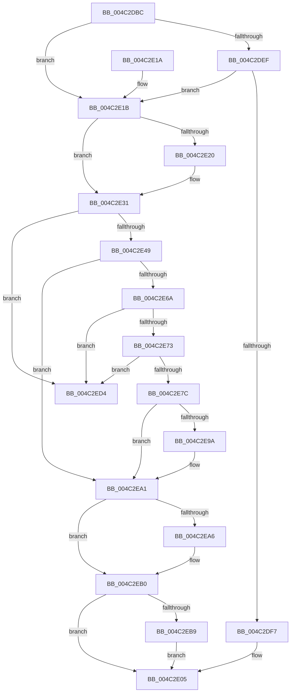

# CcPostPVCMForDeleteToPartition

- RVA: `0x004C2DBC`–`0x004C2EDB` (길이 `287` bytes)
- VA: `0x00000001404C2DBC`
- 실행 섹션: `.text`
- PDB 이름 있음: `예`; PDB Function 태그: `아니요`
- unwind 정보 RVA: `0x000BCB2C`
- 디코드: `78`개 명령, `287/287` bytes 표시
- 미해석 바이트: `0` (있으면 어셈블리에 `.byte`로 보존)

> 이 문서는 커널 이미지의 기계어와 PDB 기호를 분석해 생성했습니다. 4번과 5번은 함수 원형과 자료형을 바이너리 사용 방식에서 추정한 C 해석이며 원본 소스 복구 결과는 아닙니다.

## 1. Dependencies

- 직접 호출 지점: **4**; 고유 호출 대상: **4**
- 직접 호출자로 확인된 함수: **3**
- RIP 상대 이미지 참조: **0**

### Outgoing calls
- `0x004C2E00` → [CcPostPVCMDelayedDelete](CcPostPVCMDelayedDelete_function_004C2EE4.md) (function, `0x004C2EE4`)
- `0x004C2E2C` → [KeAcquireInStackQueuedSpinLock](../27/KeAcquireInStackQueuedSpinLock_function_002757A0.md) (function, `0x002757A0`)
- `0x004C2EAB` → [KeReleaseInStackQueuedSpinLock](../34/KeReleaseInStackQueuedSpinLock_function_00342CE0.md) (function, `0x00342CE0`)
- `0x004C2ECA` → [ExQueueWorkItemToPartition](../35/ExQueueWorkItemToPartition_function_00356E2C.md) (function, `0x00356E2C`)

### Direct callers
- [CcDeleteSharedCacheMap](../38/CcDeleteSharedCacheMap_function_0038A804.md) at `0x0038AB39`
- [CcProcessDelayedDeletePVCM](../57/CcProcessDelayedDeletePVCM_function_0057DCD0.md) at `0x0057DD9F`
- [sub_006E5062](../6E/Unknown_function_006E5062.md) at `0x006E50A3`

### Static image references
- 디코드된 RIP-relative 메모리 참조가 없습니다.

## 2. Other-region calls and transfers

- 다른 실행 섹션으로 향하는 call: **0**
- 별도 외부 분기/꼬리 이동을 확인하지 못했습니다.

## 3. Assembly (complete function range)

```asm
004C2DBC  4C 8B DC                        mov r11, rsp
004C2DBF  49 89 5B 08                     mov qword ptr [r11 + 8], rbx
004C2DC3  49 89 6B 10                     mov qword ptr [r11 + 0x10], rbp
004C2DC7  49 89 73 18                     mov qword ptr [r11 + 0x18], rsi
004C2DCB  57                              push rdi
004C2DCC  48 83 EC 40                     sub rsp, 0x40
004C2DD0  48 8B 79 20                     mov rdi, qword ptr [rcx + 0x20]
004C2DD4  33 C0                           xor eax, eax
004C2DD6  33 DB                           xor ebx, ebx
004C2DD8  0F 57 C0                        xorps xmm0, xmm0
004C2DDB  40 8A EA                        mov bpl, dl
004C2DDE  48 8B F1                        mov rsi, rcx
004C2DE1  0F 11 44 24 20                  movups xmmword ptr [rsp + 0x20], xmm0
004C2DE6  49 89 43 E8                     mov qword ptr [r11 - 0x18], rax
004C2DEA  45 84 C0                        test r8b, r8b
004C2DED  74 2C                           je 0x1404c2e1b
004C2DEF  38 87 0E 05 00 00               cmp byte ptr [rdi + 0x50e], al
004C2DF5  75 24                           jne 0x1404c2e1b
004C2DF7  44 8A C2                        mov r8b, dl
004C2DFA  48 8B D1                        mov rdx, rcx
004C2DFD  48 8B CF                        mov rcx, rdi
004C2E00  E8 DF 00 00 00                  call 0x1404c2ee4
004C2E05  48 8B 5C 24 50                  mov rbx, qword ptr [rsp + 0x50]
004C2E0A  48 8B 6C 24 58                  mov rbp, qword ptr [rsp + 0x58]
004C2E0F  48 8B 74 24 60                  mov rsi, qword ptr [rsp + 0x60]
004C2E14  48 83 C4 40                     add rsp, 0x40
004C2E18  5F                              pop rdi
004C2E19  C3                              ret
004C2E1A  CC                              int3
004C2E1B  40 84 ED                        test bpl, bpl
004C2E1E  75 11                           jne 0x1404c2e31
004C2E20  48 8D 8F 00 03 00 00            lea rcx, [rdi + 0x300]
004C2E27  48 8D 54 24 20                  lea rdx, [rsp + 0x20]
004C2E2C  E8 6F 29 DB FF                  call 0x1402757a0
004C2E31  48 8D 47 50                     lea rax, [rdi + 0x50]
004C2E35  48 8B 50 08                     mov rdx, qword ptr [rax + 8]
004C2E39  48 8D 8E 40 02 00 00            lea rcx, [rsi + 0x240]
004C2E40  48 39 02                        cmp qword ptr [rdx], rax
004C2E43  0F 85 8B 00 00 00               jne 0x1404c2ed4
004C2E49  48 89 01                        mov qword ptr [rcx], rax
004C2E4C  48 89 51 08                     mov qword ptr [rcx + 8], rdx
004C2E50  48 89 0A                        mov qword ptr [rdx], rcx
004C2E53  48 89 48 08                     mov qword ptr [rax + 8], rcx
004C2E57  48 8D 47 60                     lea rax, [rdi + 0x60]
004C2E5B  83 8E 50 06 00 00 04            or dword ptr [rsi + 0x650], 4
004C2E62  48 8B 08                        mov rcx, qword ptr [rax]
004C2E65  48 3B C8                        cmp rcx, rax
004C2E68  74 37                           je 0x1404c2ea1
004C2E6A  48 8B D9                        mov rbx, rcx
004C2E6D  48 39 41 08                     cmp qword ptr [rcx + 8], rax
004C2E71  75 61                           jne 0x1404c2ed4
004C2E73  48 8B 09                        mov rcx, qword ptr [rcx]
004C2E76  48 39 59 08                     cmp qword ptr [rcx + 8], rbx
004C2E7A  75 58                           jne 0x1404c2ed4
004C2E7C  48 89 08                        mov qword ptr [rax], rcx
004C2E7F  48 89 41 08                     mov qword ptr [rcx + 8], rax
004C2E83  B8 01 00 00 00                  mov eax, 1
004C2E88  F0 48 0F C1 87 10 05 00 00      lock xadd qword ptr [rdi + 0x510], rax
004C2E91  48 FF C0                        inc rax
004C2E94  48 83 F8 01                     cmp rax, 1
004C2E98  7F 07                           jg 0x1404c2ea1
004C2E9A  B9 0E 00 00 00                  mov ecx, 0xe
004C2E9F  CD 29                           int 0x29
004C2EA1  40 84 ED                        test bpl, bpl
004C2EA4  75 0A                           jne 0x1404c2eb0
004C2EA6  48 8D 4C 24 20                  lea rcx, [rsp + 0x20]
004C2EAB  E8 30 FE E7 FF                  call 0x140342ce0
004C2EB0  48 85 DB                        test rbx, rbx
004C2EB3  0F 84 4C FF FF FF               je 0x1404c2e05
004C2EB9  48 83 23 00                     and qword ptr [rbx], 0
004C2EBD  41 83 C8 FF                     or r8d, 0xffffffff
004C2EC1  4C 8B 4F 08                     mov r9, qword ptr [rdi + 8]
004C2EC5  33 D2                           xor edx, edx
004C2EC7  48 8B CB                        mov rcx, rbx
004C2ECA  E8 5D 3F E9 FF                  call 0x140356e2c
004C2ECF  E9 31 FF FF FF                  jmp 0x1404c2e05
004C2ED4  B9 03 00 00 00                  mov ecx, 3
004C2ED9  CD 29                           int 0x29
```

## 4. C-style interpretation (structured pseudocode)

```c
__int64 __fastcall CcPostPVCMForDeleteToPartition(__int64 a1, unsigned __int8 a2, unsigned __int8 a3)
{
    __int64 result;
    __int64 v_rbx;
    __int64 v_rsp;
    unsigned __int64 v_stack_m28;
    unsigned __int64 v_stack_p10;
    unsigned __int64 v_stack_p18;
    unsigned __int64 v_stack_p20;
    unsigned __int64 v_stack_p8;

    *(unsigned __int64 *)(v_rsp + 8) = v_rbx;
    *(unsigned __int64 *)(v_rsp + 16) = v_rbp;
    *(unsigned __int64 *)(v_rsp + 24) = v_rsi;
    v_rsp = (v_rsp) - (64);
    result = 0;
    v_rbx = 0;
    v_stack_m28 = v_xmm0;
    *(unsigned __int64 *)(v_rsp - 24) = 0;
    if (a3 == 0) goto loc_004C2E1B;
    if ((*(unsigned __int8 *)(*(unsigned __int64 *)(a1 + 32) + 1294)) != 0) goto loc_004C2E1B;
    result = CcPostPVCMDelayedDelete(*(unsigned __int64 *)(a1 + 32), a1, a2, a4);
loc_004C2E05:
    v_rsp = (v_rsp) + (64);
    return result;
loc_004C2E1B:
    if ((unsigned __int8)(v_stack_p10) == 0) {
        a1 = *(unsigned __int64 *)(a1 + 32) + 768;
        a2 = v_stack_p20;
        result = KeAcquireInStackQueuedSpinLock(a1, a2, a2, a4);
    }
    if ((*(unsigned __int64 *)(*(unsigned __int64 *)(*(unsigned __int64 *)(a1 + 32) + 80 + 8))) != (*(unsigned __int64 *)(a1 + 32) + 80)) goto loc_004C2ED4;
    *(unsigned __int64 *)(v_stack_p18 + 576) = *(unsigned __int64 *)(a1 + 32) + 80;
    *(unsigned __int64 *)(v_stack_p18 + 576 + 8) = *(unsigned __int64 *)(*(unsigned __int64 *)(a1 + 32) + 80 + 8);
    *(unsigned __int64 *)(*(unsigned __int64 *)(*(unsigned __int64 *)(a1 + 32) + 80 + 8)) = v_stack_p18 + 576;
    *(unsigned __int64 *)(*(unsigned __int64 *)(a1 + 32) + 80 + 8) = v_stack_p18 + 576;
    if ((*(unsigned __int64 *)(*(unsigned __int64 *)(a1 + 32) + 96)) == (*(unsigned __int64 *)(a1 + 32) + 96)) goto loc_004C2EA1;
    if ((*(unsigned __int64 *)(*(unsigned __int64 *)(*(unsigned __int64 *)(a1 + 32) + 96) + 8)) != (*(unsigned __int64 *)(a1 + 32) + 96)) goto loc_004C2ED4;
    if ((*(unsigned __int64 *)(*(unsigned __int64 *)(*(unsigned __int64 *)(*(unsigned __int64 *)(a1 + 32) + 96)) + 8)) != (*(unsigned __int64 *)(*(unsigned __int64 *)(a1 + 32) + 96))) goto loc_004C2ED4;
    *(unsigned __int64 *)(*(unsigned __int64 *)(a1 + 32) + 96) = *(unsigned __int64 *)(*(unsigned __int64 *)(*(unsigned __int64 *)(a1 + 32) + 96));
    *(unsigned __int64 *)(*(unsigned __int64 *)(*(unsigned __int64 *)(*(unsigned __int64 *)(a1 + 32) + 96)) + 8) = *(unsigned __int64 *)(a1 + 32) + 96;
    result = (1) + 1;
    if (result <= 1) {
        a1 = 14;
    }
    if ((unsigned __int8)(v_stack_p10) == 0) {
        a1 = v_stack_p20;
        result = KeReleaseInStackQueuedSpinLock(a1, *(unsigned __int64 *)(*(unsigned __int64 *)(a1 + 32) + 80 + 8), a2, a4);
    }
    if (*(unsigned __int64 *)(*(unsigned __int64 *)(a1 + 32) + 96) == 0) goto loc_004C2E05;
    a3 = (unsigned int)((a2) | (0xFFFFFFFFULL));
    a2 = 0;
    result = ExQueueWorkItemToPartition(*(unsigned __int64 *)(*(unsigned __int64 *)(a1 + 32) + 96), a2, a3, *(unsigned __int64 *)(*(unsigned __int64 *)(a1 + 32) + 8));
    goto loc_004C2E05;
loc_004C2ED4:
    return result;
}
```

## 5. (Beta) C Style

```c
int64_t CcPostPVCMForDeleteToPartition(void *Arg1, uint8_t Arg2, uint8_t Arg3)
{
    uint8_t *arg1 = (uint8_t *)Arg1;

    int64_t result;
    int64_t local_rbx;
    int64_t local_rsp;
    uint64_t v_stack_m28;
    uint64_t v_stack_p10;
    uint64_t v_stack_p18;
    uint64_t v_stack_p20;
    uint64_t v_stack_p8;

    *(uint64_t *)(local_rsp + 0x8) = local_rbx;
    *(uint64_t *)(local_rsp + 0x10) = local_rbp;
    *(uint64_t *)(local_rsp + 0x18) = local_rsi;
    local_rsp = (local_rsp) - (64);
    result = 0;
    local_rbx = 0;
    v_stack_m28 = v_xmm0;
    *(uint64_t *)(local_rsp - 0x18) = 0;
    if (Arg3 == 0) goto loc_004C2E1B;
    if ((*(uint8_t *)(*(uint64_t *)(arg1 + 0x20) + 0x50E)) != 0) goto loc_004C2E1B;
    result = CcPostPVCMDelayedDelete(*(uint64_t *)(arg1 + 0x20), Arg1, Arg2, a4);
loc_004C2E05:
    local_rsp = (local_rsp) + (64);
    return result;
loc_004C2E1B:
    if ((uint8_t)(v_stack_p10) == 0) {
        Arg1 = *(uint64_t *)(arg1 + 0x20) + 768;
        Arg2 = v_stack_p20;
        result = KeAcquireInStackQueuedSpinLock(Arg1, Arg2, Arg2, a4);
    }
    if ((*(uint64_t *)(*(uint64_t *)(*(uint64_t *)(arg1 + 0x20) + 0x50 + 0x8))) != (*(uint64_t *)(arg1 + 0x20) + 80)) goto loc_004C2ED4;
    *(uint64_t *)(v_stack_p18 + 0x240) = *(uint64_t *)(arg1 + 0x20) + 80;
    *(uint64_t *)(v_stack_p18 + 0x240 + 0x8) = *(uint64_t *)(*(uint64_t *)(arg1 + 0x20) + 0x50 + 0x8);
    *(uint64_t *)(*(uint64_t *)(*(uint64_t *)(arg1 + 0x20) + 0x50 + 0x8)) = v_stack_p18 + 576;
    *(uint64_t *)(*(uint64_t *)(arg1 + 0x20) + 0x50 + 0x8) = v_stack_p18 + 576;
    if ((*(uint64_t *)(*(uint64_t *)(arg1 + 0x20) + 0x60)) == (*(uint64_t *)(arg1 + 0x20) + 96)) goto loc_004C2EA1;
    if ((*(uint64_t *)(*(uint64_t *)(*(uint64_t *)(arg1 + 0x20) + 0x60) + 0x8)) != (*(uint64_t *)(arg1 + 0x20) + 96)) goto loc_004C2ED4;
    if ((*(uint64_t *)(*(uint64_t *)(*(uint64_t *)(*(uint64_t *)(arg1 + 0x20) + 0x60)) + 0x8)) != (*(uint64_t *)(*(uint64_t *)(arg1 + 0x20) + 0x60))) goto loc_004C2ED4;
    *(uint64_t *)(*(uint64_t *)(arg1 + 0x20) + 0x60) = *(uint64_t *)(*(uint64_t *)(*(uint64_t *)(arg1 + 0x20) + 0x60));
    *(uint64_t *)(*(uint64_t *)(*(uint64_t *)(*(uint64_t *)(arg1 + 0x20) + 0x60)) + 0x8) = *(uint64_t *)(arg1 + 0x20) + 96;
    result = (1) + 1;
    if (result <= 1) {
        Arg1 = 14;
    }
    if ((uint8_t)(v_stack_p10) == 0) {
        Arg1 = v_stack_p20;
        result = KeReleaseInStackQueuedSpinLock(Arg1, *(uint64_t *)(*(uint64_t *)(arg1 + 0x20) + 0x50 + 0x8), Arg2, a4);
    }
    if (*(uint64_t *)(*(uint64_t *)(arg1 + 0x20) + 0x60) == 0) goto loc_004C2E05;
    Arg3 = (uint32_t)((Arg2) | (0xFFFFFFFFULL));
    Arg2 = 0;
    result = ExQueueWorkItemToPartition(*(uint64_t *)(*(uint64_t *)(arg1 + 0x20) + 0x60), Arg2, Arg3, *(uint64_t *)(*(uint64_t *)(arg1 + 0x20) + 0x8));
    goto loc_004C2E05;
loc_004C2ED4:
    return result;
}
```

### 관측된 메모리 오프셋

구조체 형식이 확인되지 않은 접근은 인자 기준의 오프셋으로만 기록했습니다.

| 기준 인자 | 오프셋 표현 | 폭 (bit) | 접근 |
|---|---:|---:|---|
| `Arg1` | `+ 0x0` | `64` | `W` |
| `Arg1` | `+ 0x8` | `64` | `W` |
| `Arg1` | `+ 0x20` | `64` | `R` |
| `Arg1` | `+ 0x240` | `64` | `R` |
| `Arg1` | `+ 0x650` | `32` | `R/W` |

## 6. Execution-region graph

[열기: 2D/3D 그래프와 함수 탐색 컨트롤 패널](../../../control-panel.html?section=text&rva=0x004C2DBC&view=graph)

- 2D 그래프는 위에서 아래로 흐르고, 3D 그래프는 빈 공간을 드래그해 회전합니다. Shift+드래그는 이동, 휠은 확대·축소, 함수 노드 선택은 대상 보고서 이동입니다.

### Static fallback


