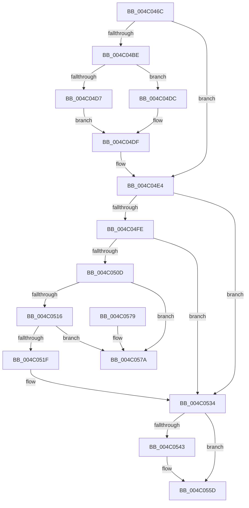

# CcPostWorkQueueSpecial

- RVA: `0x004C046C`–`0x004C0581` (길이 `277` bytes)
- VA: `0x00000001404C046C`
- 실행 섹션: `.text`
- PDB 이름 있음: `예`; PDB Function 태그: `아니요`
- unwind 정보 RVA: `0x0008CF6C`
- 디코드: `76`개 명령, `277/277` bytes 표시
- 미해석 바이트: `0` (있으면 어셈블리에 `.byte`로 보존)

> 이 문서는 커널 이미지의 기계어와 PDB 기호를 분석해 생성했습니다. 4번과 5번은 함수 원형과 자료형을 바이너리 사용 방식에서 추정한 C 해석이며 원본 소스 복구 결과는 아닙니다.

## 1. Dependencies

- 직접 호출 지점: **5**; 고유 호출 대상: **5**
- 직접 호출자로 확인된 함수: **1**
- RIP 상대 이미지 참조: **1**

### Outgoing calls
- `0x004C04DF` → [CcPerfLogWorkItemEnqueue](../35/CcPerfLogWorkItemEnqueue_function_00357340.md) (function, `0x00357340`)
- `0x004C04F0` → [KeAcquireInStackQueuedSpinLock](../27/KeAcquireInStackQueuedSpinLock_function_002757A0.md) (function, `0x002757A0`)
- `0x004C052F` → [CcReferencePartitionAndPrivateVolumeCacheMap](../38/CcReferencePartitionAndPrivateVolumeCacheMap_function_0038B9E0.md) (function, `0x0038B9E0`)
- `0x004C0539` → [KeReleaseInStackQueuedSpinLock](../34/KeReleaseInStackQueuedSpinLock_function_00342CE0.md) (function, `0x00342CE0`)
- `0x004C0558` → [ExQueueWorkItemToPartition](../35/ExQueueWorkItemToPartition_function_00356E2C.md) (function, `0x00356E2C`)

### Direct callers
- [CcQueueLazyWriteScanThreadForVolume](../3C/CcQueueLazyWriteScanThreadForVolume_function_003C9AF0.md) at `0x003C9D6A`

### Static image references
- `0x004C04A6` → RVA `0x00FC6B10` (`ALMOSTRO`; read)

## 2. Other-region calls and transfers

- 다른 실행 섹션으로 향하는 call: **0**
- 별도 외부 분기/꼬리 이동을 확인하지 못했습니다.

## 3. Assembly (complete function range)

```asm
004C046C  4C 8B DC                        mov r11, rsp
004C046F  49 89 5B 08                     mov qword ptr [r11 + 8], rbx
004C0473  49 89 6B 10                     mov qword ptr [r11 + 0x10], rbp
004C0477  49 89 73 18                     mov qword ptr [r11 + 0x18], rsi
004C047B  57                              push rdi
004C047C  41 56                           push r14
004C047E  41 57                           push r15
004C0480  48 83 EC 40                     sub rsp, 0x40
004C0484  48 8B A9 88 00 00 00            mov rbp, qword ptr [rcx + 0x88]
004C048B  33 C0                           xor eax, eax
004C048D  4C 8B B1 98 00 00 00            mov r14, qword ptr [rcx + 0x98]
004C0494  33 DB                           xor ebx, ebx
004C0496  4C 8B B9 90 00 00 00            mov r15, qword ptr [rcx + 0x90]
004C049D  0F 57 C0                        xorps xmm0, xmm0
004C04A0  40 32 F6                        xor sil, sil
004C04A3  4C 8B D2                        mov r10, rdx
004C04A6  F7 05 60 66 B0 00 00 00 02 00   test dword ptr [rip + 0xb06660], 0x20000
004C04B0  48 8B F9                        mov rdi, rcx
004C04B3  0F 11 44 24 20                  movups xmmword ptr [rsp + 0x20], xmm0
004C04B8  49 89 43 D8                     mov qword ptr [r11 - 0x28], rax
004C04BC  74 26                           je 0x1404c04e4
004C04BE  8B 81 80 00 00 00               mov eax, dword ptr [rcx + 0x80]
004C04C4  45 33 C0                        xor r8d, r8d
004C04C7  83 E8 02                        sub eax, 2
004C04CA  48 8B D1                        mov rdx, rcx
004C04CD  49 8B CA                        mov rcx, r10
004C04D0  A9 FD FF FF FF                  test eax, 0xfffffffd
004C04D5  74 05                           je 0x1404c04dc
004C04D7  45 33 C9                        xor r9d, r9d
004C04DA  EB 03                           jmp 0x1404c04df
004C04DC  41 B1 01                        mov r9b, 1
004C04DF  E8 5C 6E E9 FF                  call 0x140357340
004C04E4  48 8D 8D 40 03 00 00            lea rcx, [rbp + 0x340]
004C04EB  48 8D 54 24 20                  lea rdx, [rsp + 0x20]
004C04F0  E8 AB 52 DB FF                  call 0x1402757a0
004C04F5  41 38 9E C4 00 00 00            cmp byte ptr [r14 + 0xc4], bl
004C04FC  75 36                           jne 0x1404c0534
004C04FE  49 8D 87 18 06 00 00            lea rax, [r15 + 0x618]
004C0505  48 8B 08                        mov rcx, qword ptr [rax]
004C0508  48 3B C8                        cmp rcx, rax
004C050B  74 27                           je 0x1404c0534
004C050D  48 8B D9                        mov rbx, rcx
004C0510  48 39 41 08                     cmp qword ptr [rcx + 8], rax
004C0514  75 64                           jne 0x1404c057a
004C0516  48 8B 09                        mov rcx, qword ptr [rcx]
004C0519  48 39 59 08                     cmp qword ptr [rcx + 8], rbx
004C051D  75 5B                           jne 0x1404c057a
004C051F  48 89 08                        mov qword ptr [rax], rcx
004C0522  49 8B D7                        mov rdx, r15
004C0525  48 89 41 08                     mov qword ptr [rcx + 8], rax
004C0529  40 B6 01                        mov sil, 1
004C052C  48 8B CD                        mov rcx, rbp
004C052F  E8 AC B4 EC FF                  call 0x14038b9e0
004C0534  48 8D 4C 24 20                  lea rcx, [rsp + 0x20]
004C0539  E8 A2 27 E8 FF                  call 0x140342ce0
004C053E  48 85 DB                        test rbx, rbx
004C0541  74 1A                           je 0x1404c055d
004C0543  48 83 23 00                     and qword ptr [rbx], 0
004C0547  33 D2                           xor edx, edx
004C0549  48 89 7B 30                     mov qword ptr [rbx + 0x30], rdi
004C054D  48 8B CB                        mov rcx, rbx
004C0550  4C 8B 4D 08                     mov r9, qword ptr [rbp + 8]
004C0554  45 8B 46 18                     mov r8d, dword ptr [r14 + 0x18]
004C0558  E8 CF 68 E9 FF                  call 0x140356e2c
004C055D  48 8B 5C 24 60                  mov rbx, qword ptr [rsp + 0x60]
004C0562  40 8A C6                        mov al, sil
004C0565  48 8B 74 24 70                  mov rsi, qword ptr [rsp + 0x70]
004C056A  48 8B 6C 24 68                  mov rbp, qword ptr [rsp + 0x68]
004C056F  48 83 C4 40                     add rsp, 0x40
004C0573  41 5F                           pop r15
004C0575  41 5E                           pop r14
004C0577  5F                              pop rdi
004C0578  C3                              ret
004C0579  CC                              int3
004C057A  B9 03 00 00 00                  mov ecx, 3
004C057F  CD 29                           int 0x29
```

## 4. C-style interpretation (structured pseudocode)

```c
__int64 __fastcall CcPostWorkQueueSpecial(__int64 a1, __int64 a2, int a3, int a4)
{
    __int64 result;
    __int64 v_rbx;
    __int64 v_rsi;
    __int64 v_rsp;
    unsigned __int64 v_stack_m38;
    unsigned __int64 v_stack_p10;
    unsigned __int64 v_stack_p18;
    unsigned __int64 v_stack_p8;

    *(unsigned __int64 *)(v_rsp + 8) = v_rbx;
    *(unsigned __int64 *)(v_rsp + 16) = v_rbp;
    *(unsigned __int64 *)(v_rsp + 24) = v_rsi;
    v_rsp = (v_rsp) - (64);
    result = 0;
    v_rbx = 0;
    v_rsi = 0;
    v_stack_m38 = v_xmm0;
    *(unsigned __int64 *)(v_rsp - 40) = 0;
    if (((*(unsigned int *)(v_rip + 11560544)) & (0x20000ULL)) == 0) goto loc_004C04E4;
    a3 = 0;
    result = (unsigned int)(((unsigned int)(*(unsigned int *)(a1 + 128))) - (2));
    if ((((unsigned int)(result)) & (0xFFFFFFFDULL)) == 0) goto loc_004C04DC;
    a4 = 0;
    goto loc_004C04DF;
loc_004C04DC:
loc_004C04DF:
    result = CcPerfLogWorkItemEnqueue(a2, a1, a3, 1);
loc_004C04E4:
    result = KeAcquireInStackQueuedSpinLock(*(unsigned __int64 *)(a1 + 136) + 832, v_stack_m38, a3, 1);
    if ((*(unsigned __int8 *)(*(unsigned __int64 *)(a1 + 152) + 196)) != 0) goto loc_004C0534;
    if ((*(unsigned __int64 *)(*(unsigned __int64 *)(a1 + 144) + 1560)) == (*(unsigned __int64 *)(a1 + 144) + 1560)) goto loc_004C0534;
    if ((*(unsigned __int64 *)(*(unsigned __int64 *)(*(unsigned __int64 *)(a1 + 144) + 1560) + 8)) != (*(unsigned __int64 *)(a1 + 144) + 1560)) goto loc_004C057A;
    if ((*(unsigned __int64 *)(*(unsigned __int64 *)(*(unsigned __int64 *)(*(unsigned __int64 *)(a1 + 144) + 1560)) + 8)) != (*(unsigned __int64 *)(*(unsigned __int64 *)(a1 + 144) + 1560))) goto loc_004C057A;
    *(unsigned __int64 *)(*(unsigned __int64 *)(a1 + 144) + 1560) = *(unsigned __int64 *)(*(unsigned __int64 *)(*(unsigned __int64 *)(a1 + 144) + 1560));
    *(unsigned __int64 *)(*(unsigned __int64 *)(*(unsigned __int64 *)(*(unsigned __int64 *)(a1 + 144) + 1560)) + 8) = *(unsigned __int64 *)(a1 + 144) + 1560;
    result = CcReferencePartitionAndPrivateVolumeCacheMap(*(unsigned __int64 *)(a1 + 136), *(unsigned __int64 *)(a1 + 144), a3, 1);
loc_004C0534:
    result = KeReleaseInStackQueuedSpinLock(v_stack_m38, *(unsigned __int64 *)(a1 + 144), a3, 1);
    if (*(unsigned __int64 *)(*(unsigned __int64 *)(a1 + 144) + 1560) != 0) {
        a2 = 0;
        *(unsigned __int64 *)(*(unsigned __int64 *)(*(unsigned __int64 *)(a1 + 144) + 1560) + 48) = a1;
        a1 = *(unsigned __int64 *)(*(unsigned __int64 *)(a1 + 144) + 1560);
        a4 = *(unsigned __int64 *)(*(unsigned __int64 *)(a1 + 136) + 8);
        a3 = *(unsigned int *)(*(unsigned __int64 *)(a1 + 152) + 24);
        result = ExQueueWorkItemToPartition(a1, a2, a3, a4);
    }
    v_rsp = (v_rsp) + (64);
    return 1;
loc_004C057A:
    return 1;
}
```

## 5. (Beta) C Style

```c
int64_t CcPostWorkQueueSpecial(void *Arg1, int64_t Arg2, int32_t Arg3, int32_t Arg4)
{
    uint8_t *arg1 = (uint8_t *)Arg1;

    int64_t result;
    int64_t local_rbx;
    int64_t local_rsi;
    int64_t local_rsp;
    uint64_t v_stack_m38;
    uint64_t v_stack_p10;
    uint64_t v_stack_p18;
    uint64_t v_stack_p8;

    *(uint64_t *)(local_rsp + 0x8) = local_rbx;
    *(uint64_t *)(local_rsp + 0x10) = local_rbp;
    *(uint64_t *)(local_rsp + 0x18) = local_rsi;
    local_rsp = (local_rsp) - (64);
    result = 0;
    local_rbx = 0;
    local_rsi = 0;
    v_stack_m38 = v_xmm0;
    *(uint64_t *)(local_rsp - 0x28) = 0;
    if (((*(uint32_t *)(v_rip + 0xB06660)) & (0x20000ULL)) == 0) goto loc_004C04E4;
    Arg3 = 0;
    result = (uint32_t)(((uint32_t)(*(uint32_t *)(arg1 + 0x80))) - (2));
    if ((((uint32_t)(result)) & (0xFFFFFFFDULL)) == 0) goto loc_004C04DC;
    Arg4 = 0;
    goto loc_004C04DF;
loc_004C04DC:
loc_004C04DF:
    result = CcPerfLogWorkItemEnqueue(Arg2, Arg1, Arg3, 1);
loc_004C04E4:
    result = KeAcquireInStackQueuedSpinLock(*(uint64_t *)(arg1 + 0x88) + 832, v_stack_m38, Arg3, 1);
    if ((*(uint8_t *)(*(uint64_t *)(arg1 + 0x98) + 0xC4)) != 0) goto loc_004C0534;
    if ((*(uint64_t *)(*(uint64_t *)(arg1 + 0x90) + 0x618)) == (*(uint64_t *)(arg1 + 0x90) + 1560)) goto loc_004C0534;
    if ((*(uint64_t *)(*(uint64_t *)(*(uint64_t *)(arg1 + 0x90) + 0x618) + 0x8)) != (*(uint64_t *)(arg1 + 0x90) + 1560)) goto loc_004C057A;
    if ((*(uint64_t *)(*(uint64_t *)(*(uint64_t *)(*(uint64_t *)(arg1 + 0x90) + 0x618)) + 0x8)) != (*(uint64_t *)(*(uint64_t *)(arg1 + 0x90) + 0x618))) goto loc_004C057A;
    *(uint64_t *)(*(uint64_t *)(arg1 + 0x90) + 0x618) = *(uint64_t *)(*(uint64_t *)(*(uint64_t *)(arg1 + 0x90) + 0x618));
    *(uint64_t *)(*(uint64_t *)(*(uint64_t *)(*(uint64_t *)(arg1 + 0x90) + 0x618)) + 0x8) = *(uint64_t *)(arg1 + 0x90) + 1560;
    result = CcReferencePartitionAndPrivateVolumeCacheMap(*(uint64_t *)(arg1 + 0x88), *(uint64_t *)(arg1 + 0x90), Arg3, 1);
loc_004C0534:
    result = KeReleaseInStackQueuedSpinLock(v_stack_m38, *(uint64_t *)(arg1 + 0x90), Arg3, 1);
    if (*(uint64_t *)(*(uint64_t *)(arg1 + 0x90) + 0x618) != 0) {
        Arg2 = 0;
        *(void **)(*(uint64_t *)(*(uint64_t *)(arg1 + 0x90) + 0x618) + 0x30) = Arg1;
        Arg1 = *(uint64_t *)(*(uint64_t *)(arg1 + 0x90) + 0x618);
        Arg4 = *(uint64_t *)(*(uint64_t *)(arg1 + 0x88) + 0x8);
        Arg3 = *(uint32_t *)(*(uint64_t *)(arg1 + 0x98) + 0x18);
        result = ExQueueWorkItemToPartition(Arg1, Arg2, Arg3, Arg4);
    }
    local_rsp = (local_rsp) + (64);
    return 1;
loc_004C057A:
    return 1;
}
```

### 관측된 메모리 오프셋

구조체 형식이 확인되지 않은 접근은 인자 기준의 오프셋으로만 기록했습니다.

| 기준 인자 | 오프셋 표현 | 폭 (bit) | 접근 |
|---|---:|---:|---|
| `Arg1` | `+ 0x80` | `32` | `R` |
| `Arg1` | `+ 0x88` | `64` | `R` |
| `Arg1` | `+ 0x90` | `64` | `R` |
| `Arg1` | `+ 0x98` | `64` | `R` |

## 6. Execution-region graph

[열기: 2D/3D 그래프와 함수 탐색 컨트롤 패널](../../../control-panel.html?section=text&rva=0x004C046C&view=graph)

- 2D 그래프는 위에서 아래로 흐르고, 3D 그래프는 빈 공간을 드래그해 회전합니다. Shift+드래그는 이동, 휠은 확대·축소, 함수 노드 선택은 대상 보고서 이동입니다.

### Static fallback


