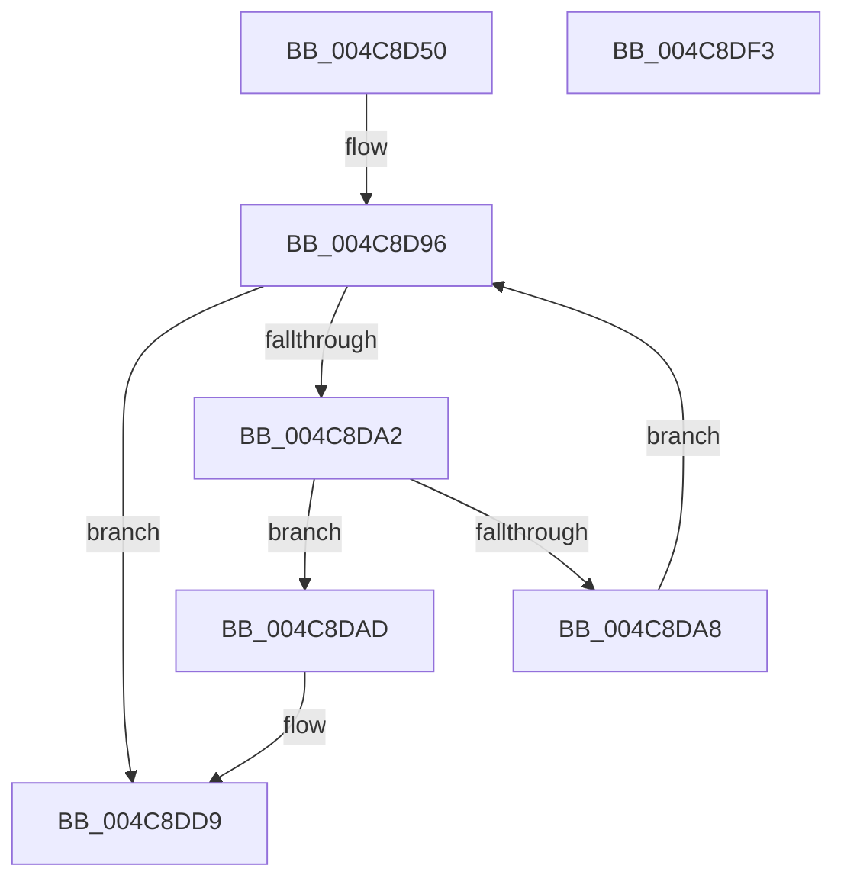

# CcSetLoggedDataThreshold

- RVA: `0x004C8D50`–`0x004C8DF4` (길이 `164` bytes)
- VA: `0x00000001404C8D50`
- 실행 섹션: `.text`
- PDB 이름 있음: `예`; PDB Function 태그: `아니요`
- unwind 정보 RVA: `0x0007F83C`
- 디코드: `41`개 명령, `164/164` bytes 표시
- 미해석 바이트: `0` (있으면 어셈블리에 `.byte`로 보존)

> 이 문서는 커널 이미지의 기계어와 PDB 기호를 분석해 생성했습니다. 4번과 5번은 함수 원형과 자료형을 바이너리 사용 방식에서 추정한 C 해석이며 원본 소스 복구 결과는 아닙니다.

## 1. Dependencies

- 직접 호출 지점: **4**; 고유 호출 대상: **4**
- 직접 호출자로 확인된 함수: **0**
- RIP 상대 이미지 참조: **3**

### Outgoing calls
- `0x004C8D8A` → [KeAcquireInStackQueuedSpinLock](../27/KeAcquireInStackQueuedSpinLock_function_002757A0.md) (function, `0x002757A0`)
- `0x004C8DC4` → [KeAcquireInStackQueuedSpinLockAtDpcLevel](../27/KeAcquireInStackQueuedSpinLockAtDpcLevel_function_00275740.md) (function, `0x00275740`)
- `0x004C8DD4` → [KeReleaseInStackQueuedSpinLockFromDpcLevel](../21/KeReleaseInStackQueuedSpinLockFromDpcLevel_function_002171B0.md) (function, `0x002171B0`)
- `0x004C8DDE` → [KeReleaseInStackQueuedSpinLock](../34/KeReleaseInStackQueuedSpinLock_function_00342CE0.md) (function, `0x00342CE0`)

### Direct callers
- 이 함수 시작 RVA로 연결되는 직접 call은 확인되지 않았습니다. 간접 호출은 완전히 역산할 수 없습니다.

### Static image references
- `0x004C8D76` → RVA `0x00E11CC0` (`.data`; read)
- `0x004C8D8F` → RVA `0x00F8F560` (`.data`; read)
- `0x004C8DAD` → RVA `0x00FC6EA0` (`ALMOSTRO`; read)

## 2. Other-region calls and transfers

- 다른 실행 섹션으로 향하는 call: **0**
- 별도 외부 분기/꼬리 이동을 확인하지 못했습니다.

## 3. Assembly (complete function range)

```asm
004C8D50  4C 8B DC                        mov r11, rsp
004C8D53  49 89 5B 08                     mov qword ptr [r11 + 8], rbx
004C8D57  49 89 73 10                     mov qword ptr [r11 + 0x10], rsi
004C8D5B  57                              push rdi
004C8D5C  48 83 EC 50                     sub rsp, 0x50
004C8D60  33 C0                           xor eax, eax
004C8D62  0F 57 C0                        xorps xmm0, xmm0
004C8D65  0F 57 C9                        xorps xmm1, xmm1
004C8D68  8B F2                           mov esi, edx
004C8D6A  48 8B F9                        mov rdi, rcx
004C8D6D  49 8D 53 E0                     lea rdx, [r11 - 0x20]
004C8D71  0F 11 44 24 38                  movups xmmword ptr [rsp + 0x38], xmm0
004C8D76  48 8D 0D 43 8F 94 00            lea rcx, [rip + 0x948f43]
004C8D7D  49 89 43 F0                     mov qword ptr [r11 - 0x10], rax
004C8D81  0F 11 4C 24 20                  movups xmmword ptr [rsp + 0x20], xmm1
004C8D86  49 89 43 D8                     mov qword ptr [r11 - 0x28], rax
004C8D8A  E8 11 CA DA FF                  call 0x1402757a0
004C8D8F  48 8B 1D CA 67 AC 00            mov rbx, qword ptr [rip + 0xac67ca]
004C8D96  48 8D 05 C3 67 AC 00            lea rax, [rip + 0xac67c3]
004C8D9D  48 3B D8                        cmp rbx, rax
004C8DA0  74 37                           je 0x1404c8dd9
004C8DA2  48 39 7B 18                     cmp qword ptr [rbx + 0x18], rdi
004C8DA6  74 05                           je 0x1404c8dad
004C8DA8  48 8B 1B                        mov rbx, qword ptr [rbx]
004C8DAB  EB E9                           jmp 0x1404c8d96
004C8DAD  48 8B 05 EC E0 AF 00            mov rax, qword ptr [rip + 0xafe0ec]
004C8DB4  48 8D 54 24 20                  lea rdx, [rsp + 0x20]
004C8DB9  48 8B 48 08                     mov rcx, qword ptr [rax + 8]
004C8DBD  48 81 C1 00 03 00 00            add rcx, 0x300
004C8DC4  E8 77 C9 DA FF                  call 0x140275740
004C8DC9  48 8D 4C 24 20                  lea rcx, [rsp + 0x20]
004C8DCE  89 B3 84 00 00 00               mov dword ptr [rbx + 0x84], esi
004C8DD4  E8 D7 E3 D4 FF                  call 0x1402171b0
004C8DD9  48 8D 4C 24 38                  lea rcx, [rsp + 0x38]
004C8DDE  E8 FD 9E E7 FF                  call 0x140342ce0
004C8DE3  48 8B 5C 24 60                  mov rbx, qword ptr [rsp + 0x60]
004C8DE8  48 8B 74 24 68                  mov rsi, qword ptr [rsp + 0x68]
004C8DED  48 83 C4 50                     add rsp, 0x50
004C8DF1  5F                              pop rdi
004C8DF2  C3                              ret
004C8DF3  CC                              int3
```

## 4. C-style interpretation (structured pseudocode)

```c
__int64 __fastcall CcSetLoggedDataThreshold(__int64 a1, int a2)
{
    __int64 result;
    __int64 v_rsp;
    unsigned __int64 v_stack_m20;
    unsigned __int64 v_stack_m38;
    unsigned __int64 v_stack_p10;
    unsigned __int64 v_stack_p8;

    *(unsigned __int64 *)(v_rsp + 8) = v_rbx;
    *(unsigned __int64 *)(v_rsp + 16) = v_rsi;
    v_rsp = (v_rsp) - (80);
    result = 0;
    v_stack_m20 = v_xmm0;
    *(unsigned __int64 *)(v_rsp - 16) = 0;
    v_stack_m38 = v_xmm1;
    *(unsigned __int64 *)(v_rsp - 40) = 0;
    result = KeAcquireInStackQueuedSpinLock(v_rip + 9736003, v_rsp - 32, a3, a4);
loc_004C8D96:
    if ((*(unsigned __int64 *)(v_rip + 11298762)) == (v_rip + 11298755)) goto loc_004C8DD9;
    if ((*(unsigned __int64 *)(*(unsigned __int64 *)(v_rip + 11298762) + 24)) == a1) goto loc_004C8DAD;
    goto loc_004C8D96;
loc_004C8DAD:
    a1 = (*(unsigned __int64 *)(*(unsigned __int64 *)(v_rip + 11526380) + 8)) + (768);
    result = KeAcquireInStackQueuedSpinLockAtDpcLevel(a1, v_stack_m38, a3, a4);
    *(unsigned int *)(*(unsigned __int64 *)(*(unsigned __int64 *)(v_rip + 11298762)) + 132) = (unsigned int)((unsigned int)(a2));
    result = KeReleaseInStackQueuedSpinLockFromDpcLevel(v_stack_m38, v_stack_m38, a3, a4);
loc_004C8DD9:
    result = KeReleaseInStackQueuedSpinLock(v_stack_m20, v_stack_m38, a3, a4);
    v_rsp = (v_rsp) + (80);
    return result;
}
```

## 5. (Beta) C Style

```c
int64_t CcSetLoggedDataThreshold(int64_t Arg1, int32_t Arg2)
{
    int64_t result;
    int64_t local_rsp;
    uint64_t v_stack_m20;
    uint64_t v_stack_m38;
    uint64_t v_stack_p10;
    uint64_t v_stack_p8;

    *(uint64_t *)(local_rsp + 0x8) = local_rbx;
    *(uint64_t *)(local_rsp + 0x10) = local_rsi;
    local_rsp = (local_rsp) - (80);
    result = 0;
    v_stack_m20 = v_xmm0;
    *(uint64_t *)(local_rsp - 0x10) = 0;
    v_stack_m38 = v_xmm1;
    *(uint64_t *)(local_rsp - 0x28) = 0;
    result = KeAcquireInStackQueuedSpinLock(v_rip + 9736003, local_rsp - 32, a3, a4);
loc_004C8D96:
    if ((*(uint64_t *)(v_rip + 0xAC67CA)) == (v_rip + 11298755)) goto loc_004C8DD9;
    if ((*(uint64_t *)(*(uint64_t *)(v_rip + 0xAC67CA) + 0x18)) == Arg1) goto loc_004C8DAD;
    goto loc_004C8D96;
loc_004C8DAD:
    Arg1 = (*(uint64_t *)(*(uint64_t *)(v_rip + 0xAFE0EC) + 0x8)) + (768);
    result = KeAcquireInStackQueuedSpinLockAtDpcLevel(Arg1, v_stack_m38, a3, a4);
    *(uint32_t *)(*(uint64_t *)(*(uint64_t *)(v_rip + 0xAC67CA)) + 0x84) = (uint32_t)((uint32_t)(Arg2));
    result = KeReleaseInStackQueuedSpinLockFromDpcLevel(v_stack_m38, v_stack_m38, a3, a4);
loc_004C8DD9:
    result = KeReleaseInStackQueuedSpinLock(v_stack_m20, v_stack_m38, a3, a4);
    local_rsp = (local_rsp) + (80);
    return result;
}
```

## 6. Execution-region graph

[열기: 2D/3D 그래프와 함수 탐색 컨트롤 패널](../../../control-panel.html?section=text&rva=0x004C8D50&view=graph)

- 2D 그래프는 위에서 아래로 흐르고, 3D 그래프는 빈 공간을 드래그해 회전합니다. Shift+드래그는 이동, 휠은 확대·축소, 함수 노드 선택은 대상 보고서 이동입니다.

### Static fallback


