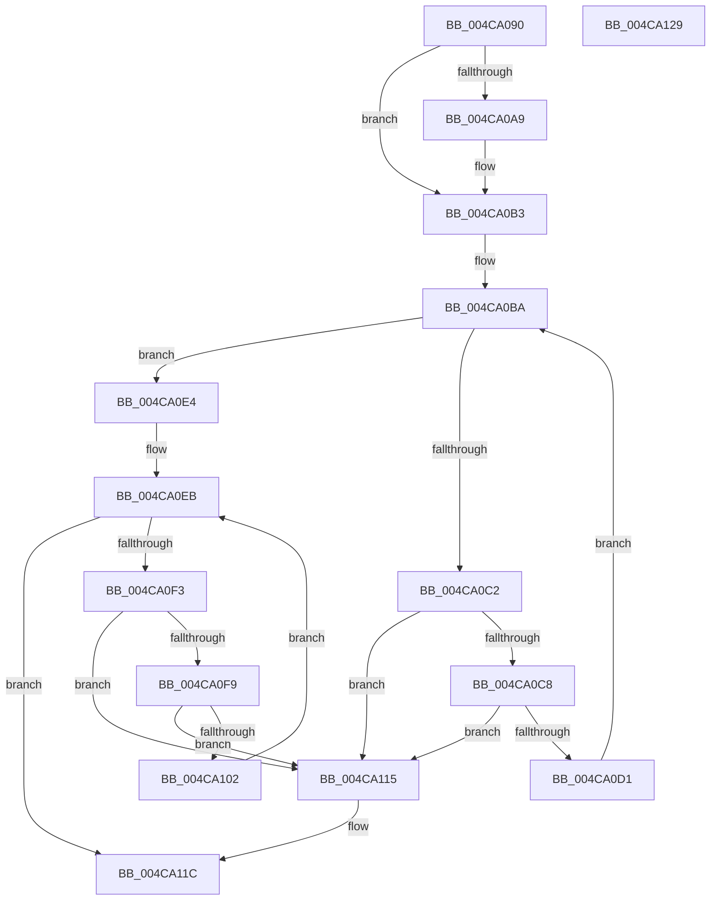

# CcUninitializeAsyncLazywriteForNodeHelper

- RVA: `0x004CA090`–`0x004CA12A` (길이 `154` bytes)
- VA: `0x00000001404CA090`
- 실행 섹션: `.text`
- PDB 이름 있음: `예`; PDB Function 태그: `아니요`
- unwind 정보 RVA: `0x0005CAAC`
- 디코드: `45`개 명령, `154/154` bytes 표시
- 미해석 바이트: `0` (있으면 어셈블리에 `.byte`로 보존)

> 이 문서는 커널 이미지의 기계어와 PDB 기호를 분석해 생성했습니다. 4번과 5번은 함수 원형과 자료형을 바이너리 사용 방식에서 추정한 C 해석이며 원본 소스 복구 결과는 아닙니다.

## 1. Dependencies

- 직접 호출 지점: **3**; 고유 호출 대상: **1**
- 직접 호출자로 확인된 함수: **0**
- RIP 상대 이미지 참조: **0**

### Outgoing calls
- `0x004CA0AE` → [ExFreePoolWithTag](../../poolcode/B8/ExFreePoolWithTag_function_00B82870.md) (function, `0x00B82870`)
- `0x004CA0DD` → [ExFreePoolWithTag](../../poolcode/B8/ExFreePoolWithTag_function_00B82870.md) (function, `0x00B82870`)
- `0x004CA10E` → [ExFreePoolWithTag](../../poolcode/B8/ExFreePoolWithTag_function_00B82870.md) (function, `0x00B82870`)

### Direct callers
- 이 함수 시작 RVA로 연결되는 직접 call은 확인되지 않았습니다. 간접 호출은 완전히 역산할 수 없습니다.

### Static image references
- 디코드된 RIP-relative 메모리 참조가 없습니다.

## 2. Other-region calls and transfers

- 다른 실행 섹션으로 향하는 call: **3**
  - `0x004CA0AE` → [ExFreePoolWithTag](../../poolcode/B8/ExFreePoolWithTag_function_00B82870.md) (`.text` → `POOLCODE`)
  - `0x004CA0DD` → [ExFreePoolWithTag](../../poolcode/B8/ExFreePoolWithTag_function_00B82870.md) (`.text` → `POOLCODE`)
  - `0x004CA10E` → [ExFreePoolWithTag](../../poolcode/B8/ExFreePoolWithTag_function_00B82870.md) (`.text` → `POOLCODE`)
- 별도 외부 분기/꼬리 이동을 확인하지 못했습니다.

## 3. Assembly (complete function range)

```asm
004CA090  48 89 5C 24 08                  mov qword ptr [rsp + 8], rbx
004CA095  57                              push rdi
004CA096  48 83 EC 20                     sub rsp, 0x20
004CA09A  49 8B 88 60 01 00 00            mov rcx, qword ptr [r8 + 0x160]
004CA0A1  49 8B F8                        mov rdi, r8
004CA0A4  48 85 C9                        test rcx, rcx
004CA0A7  74 0A                           je 0x1404ca0b3
004CA0A9  BA 43 63 57 71                  mov edx, 0x71576343
004CA0AE  E8 BD 87 6B 00                  call 0x140b82870
004CA0B3  48 8D 9F 20 01 00 00            lea rbx, [rdi + 0x120]
004CA0BA  48 8B 0B                        mov rcx, qword ptr [rbx]
004CA0BD  48 3B CB                        cmp rcx, rbx
004CA0C0  74 22                           je 0x1404ca0e4
004CA0C2  48 39 59 08                     cmp qword ptr [rcx + 8], rbx
004CA0C6  75 4D                           jne 0x1404ca115
004CA0C8  48 8B 01                        mov rax, qword ptr [rcx]
004CA0CB  48 39 48 08                     cmp qword ptr [rax + 8], rcx
004CA0CF  75 44                           jne 0x1404ca115
004CA0D1  48 89 03                        mov qword ptr [rbx], rax
004CA0D4  BA 43 63 57 71                  mov edx, 0x71576343
004CA0D9  48 89 58 08                     mov qword ptr [rax + 8], rbx
004CA0DD  E8 8E 87 6B 00                  call 0x140b82870
004CA0E2  EB D6                           jmp 0x1404ca0ba
004CA0E4  48 8D 9F 68 01 00 00            lea rbx, [rdi + 0x168]
004CA0EB  48 8B 0B                        mov rcx, qword ptr [rbx]
004CA0EE  48 3B CB                        cmp rcx, rbx
004CA0F1  74 29                           je 0x1404ca11c
004CA0F3  48 39 59 08                     cmp qword ptr [rcx + 8], rbx
004CA0F7  75 1C                           jne 0x1404ca115
004CA0F9  48 8B 01                        mov rax, qword ptr [rcx]
004CA0FC  48 39 48 08                     cmp qword ptr [rax + 8], rcx
004CA100  75 13                           jne 0x1404ca115
004CA102  48 89 03                        mov qword ptr [rbx], rax
004CA105  BA 43 63 57 71                  mov edx, 0x71576343
004CA10A  48 89 58 08                     mov qword ptr [rax + 8], rbx
004CA10E  E8 5D 87 6B 00                  call 0x140b82870
004CA113  EB D6                           jmp 0x1404ca0eb
004CA115  B9 03 00 00 00                  mov ecx, 3
004CA11A  CD 29                           int 0x29
004CA11C  48 8B 5C 24 30                  mov rbx, qword ptr [rsp + 0x30]
004CA121  B0 01                           mov al, 1
004CA123  48 83 C4 20                     add rsp, 0x20
004CA127  5F                              pop rdi
004CA128  C3                              ret
004CA129  CC                              int3
```

## 4. C-style interpretation (structured pseudocode)

```c
__int64 __fastcall CcUninitializeAsyncLazywriteForNodeHelper(__int64 a1, __int64 a2, __int64 a3)
{
    __int64 result;
    __int64 v_rsp;
    unsigned __int64 v_stack_p8;

    v_stack_p8 = v_rbx;
    v_rsp = (v_rsp) - (32);
    if (*(unsigned __int64 *)(a3 + 352) != 0) {
        a2 = 0x71576343ULL;
        result = ExFreePoolWithTag(*(unsigned __int64 *)(a3 + 352), a2, a3, a4);
    }
loc_004CA0BA:
    if ((*(unsigned __int64 *)(a3 + 288)) == (a3 + 288)) goto loc_004CA0E4;
    if ((*(unsigned __int64 *)(*(unsigned __int64 *)(a3 + 288) + 8)) != (a3 + 288)) goto loc_004CA115;
    if ((*(unsigned __int64 *)(*(unsigned __int64 *)(*(unsigned __int64 *)(a3 + 288)) + 8)) != (*(unsigned __int64 *)(a3 + 288))) goto loc_004CA115;
    *(unsigned __int64 *)(a3 + 288) = *(unsigned __int64 *)(*(unsigned __int64 *)(a3 + 288));
    *(unsigned __int64 *)(*(unsigned __int64 *)(*(unsigned __int64 *)(a3 + 288)) + 8) = a3 + 288;
    result = ExFreePoolWithTag(*(unsigned __int64 *)(a3 + 288), (unsigned int)(0x71576343ULL), a3, a4);
    goto loc_004CA0BA;
loc_004CA0E4:
loc_004CA0EB:
    if ((*(unsigned __int64 *)(a3 + 360)) == (a3 + 360)) goto loc_004CA11C;
    if ((*(unsigned __int64 *)(*(unsigned __int64 *)(a3 + 360) + 8)) != (a3 + 360)) goto loc_004CA115;
    if ((*(unsigned __int64 *)(*(unsigned __int64 *)(*(unsigned __int64 *)(a3 + 360)) + 8)) != (*(unsigned __int64 *)(a3 + 360))) goto loc_004CA115;
    *(unsigned __int64 *)(a3 + 360) = *(unsigned __int64 *)(*(unsigned __int64 *)(a3 + 360));
    *(unsigned __int64 *)(*(unsigned __int64 *)(*(unsigned __int64 *)(a3 + 360)) + 8) = a3 + 360;
    result = ExFreePoolWithTag(*(unsigned __int64 *)(a3 + 360), (unsigned int)(0x71576343ULL), a3, a4);
    goto loc_004CA0EB;
loc_004CA115:
loc_004CA11C:
    v_rsp = (v_rsp) + (32);
    return 1;
}
```

## 5. (Beta) C Style

```c
int64_t CcUninitializeAsyncLazywriteForNodeHelper(int64_t Arg1, int64_t Arg2, void *Arg3)
{
    uint8_t *arg3 = (uint8_t *)Arg3;

    int64_t result;
    int64_t local_rsp;
    uint64_t v_stack_p8;

    v_stack_p8 = local_rbx;
    local_rsp = (local_rsp) - (32);
    if (*(uint64_t *)(arg3 + 0x160) != 0) {
        Arg2 = 0x71576343ULL;
        result = ExFreePoolWithTag(*(uint64_t *)(arg3 + 0x160), Arg2, Arg3, a4);
    }
loc_004CA0BA:
    if ((*(uint64_t *)(arg3 + 0x120)) == (Arg3 + 288)) goto loc_004CA0E4;
    if ((*(uint64_t *)(*(uint64_t *)(arg3 + 0x120) + 0x8)) != (Arg3 + 288)) goto loc_004CA115;
    if ((*(uint64_t *)(*(uint64_t *)(*(uint64_t *)(arg3 + 0x120)) + 0x8)) != (*(uint64_t *)(arg3 + 0x120))) goto loc_004CA115;
    *(uint64_t *)(arg3 + 0x120) = *(uint64_t *)(*(uint64_t *)(arg3 + 0x120));
    *(void **)(*(uint64_t *)(*(uint64_t *)(arg3 + 0x120)) + 0x8) = Arg3 + 288;
    result = ExFreePoolWithTag(*(uint64_t *)(arg3 + 0x120), (uint32_t)(0x71576343ULL), Arg3, a4);
    goto loc_004CA0BA;
loc_004CA0E4:
loc_004CA0EB:
    if ((*(uint64_t *)(arg3 + 0x168)) == (Arg3 + 360)) goto loc_004CA11C;
    if ((*(uint64_t *)(*(uint64_t *)(arg3 + 0x168) + 0x8)) != (Arg3 + 360)) goto loc_004CA115;
    if ((*(uint64_t *)(*(uint64_t *)(*(uint64_t *)(arg3 + 0x168)) + 0x8)) != (*(uint64_t *)(arg3 + 0x168))) goto loc_004CA115;
    *(uint64_t *)(arg3 + 0x168) = *(uint64_t *)(*(uint64_t *)(arg3 + 0x168));
    *(void **)(*(uint64_t *)(*(uint64_t *)(arg3 + 0x168)) + 0x8) = Arg3 + 360;
    result = ExFreePoolWithTag(*(uint64_t *)(arg3 + 0x168), (uint32_t)(0x71576343ULL), Arg3, a4);
    goto loc_004CA0EB;
loc_004CA115:
loc_004CA11C:
    local_rsp = (local_rsp) + (32);
    return 1;
}
```

### 관측된 메모리 오프셋

구조체 형식이 확인되지 않은 접근은 인자 기준의 오프셋으로만 기록했습니다.

| 기준 인자 | 오프셋 표현 | 폭 (bit) | 접근 |
|---|---:|---:|---|
| `Arg3` | `+ 0x0` | `64` | `R` |
| `Arg3` | `+ 0x0` | `64` | `W` |
| `Arg3` | `+ 0x120` | `64` | `R` |
| `Arg3` | `+ 0x160` | `64` | `R` |
| `Arg3` | `+ 0x168` | `64` | `R` |

## 6. Execution-region graph

[열기: 2D/3D 그래프와 함수 탐색 컨트롤 패널](../../../control-panel.html?section=text&rva=0x004CA090&view=graph)

- 2D 그래프는 위에서 아래로 흐르고, 3D 그래프는 빈 공간을 드래그해 회전합니다. Shift+드래그는 이동, 휠은 확대·축소, 함수 노드 선택은 대상 보고서 이동입니다.

### Static fallback


