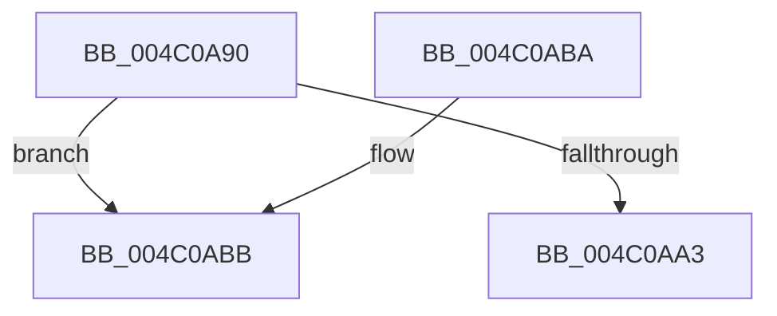

# CcUnmapFileOffsetFromSystemCache

- RVA: `0x004C0A90`–`0x004C0ADA` (길이 `74` bytes)
- VA: `0x00000001404C0A90`
- 실행 섹션: `.text`
- PDB 이름 있음: `예`; PDB Function 태그: `아니요`
- unwind 정보 RVA: `0x0007D698`
- 디코드: `20`개 명령, `74/74` bytes 표시
- 미해석 바이트: `0` (있으면 어셈블리에 `.byte`로 보존)

> 이 문서는 커널 이미지의 기계어와 PDB 기호를 분석해 생성했습니다. 4번과 5번은 함수 원형과 자료형을 바이너리 사용 방식에서 추정한 C 해석이며 원본 소스 복구 결과는 아닙니다.

## 1. Dependencies

- 직접 호출 지점: **2**; 고유 호출 대상: **2**
- 직접 호출자로 확인된 함수: **0**
- RIP 상대 이미지 참조: **0**

### Outgoing calls
- `0x004C0AB0` → [CcUnmapVacbArray](../38/CcUnmapVacbArray_function_0038AEAC.md) (function, `0x0038AEAC`)
- `0x004C0AD4` → [KeBugCheckEx](../4F/KeBugCheckEx_function_004FD660.md) (function, `0x004FD660`)

### Direct callers
- 이 함수 시작 RVA로 연결되는 직접 call은 확인되지 않았습니다. 간접 호출은 완전히 역산할 수 없습니다.

### Static image references
- 디코드된 RIP-relative 메모리 참조가 없습니다.

## 2. Other-region calls and transfers

- 다른 실행 섹션으로 향하는 call: **0**
- 별도 외부 분기/꼬리 이동을 확인하지 못했습니다.

## 3. Assembly (complete function range)

```asm
004C0A90  48 83 EC 38                     sub rsp, 0x38
004C0A94  48 8B 41 28                     mov rax, qword ptr [rcx + 0x28]
004C0A98  48 8B 48 08                     mov rcx, qword ptr [rax + 8]
004C0A9C  8B 41 04                        mov eax, dword ptr [rcx + 4]
004C0A9F  85 C0                           test eax, eax
004C0AA1  74 18                           je 0x1404c0abb
004C0AA3  C6 44 24 28 01                  mov byte ptr [rsp + 0x28], 1
004C0AA8  45 33 C9                        xor r9d, r9d
004C0AAB  C6 44 24 20 00                  mov byte ptr [rsp + 0x20], 0
004C0AB0  E8 F7 A3 EC FF                  call 0x14038aeac
004C0AB5  48 83 C4 38                     add rsp, 0x38
004C0AB9  C3                              ret
004C0ABA  CC                              int3
004C0ABB  48 83 64 24 20 00               and qword ptr [rsp + 0x20], 0
004C0AC1  45 33 C9                        xor r9d, r9d
004C0AC4  BA CA 15 00 00                  mov edx, 0x15ca
004C0AC9  49 C7 C0 20 04 00 C0            mov r8, 0xffffffffc0000420
004C0AD0  41 8D 49 34                     lea ecx, [r9 + 0x34]
004C0AD4  E8 87 CB 03 00                  call 0x1404fd660
004C0AD9  CC                              int3
```

## 4. C-style interpretation (structured pseudocode)

```c
__int64 __fastcall CcUnmapFileOffsetFromSystemCache(__int64 a1, __int64 a2, __int64 a3, int a4)
{
    __int64 result;
    __int64 v_rsp;
    unsigned __int8 v_stack_m10;
    unsigned __int8 v_stack_m18;
    unsigned __int64 v_stack_p20;

    v_rsp = (v_rsp) - (56);
    if ((unsigned int)((unsigned int)(*(unsigned int *)(*(unsigned __int64 *)(*(unsigned __int64 *)(a1 + 40) + 8) + 4))) == 0) goto loc_004C0ABB;
    v_stack_m10 = 1;
    a4 = 0;
    v_stack_m18 = 0;
    result = CcUnmapVacbArray(*(unsigned __int64 *)(*(unsigned __int64 *)(a1 + 40) + 8), a2, a3, a4);
    v_rsp = (v_rsp) + (56);
    return result;
loc_004C0ABB:
    a4 = 0;
    result = KeBugCheckEx(a4 + 52, (unsigned int)(0x15CAULL), 0xFFFFFFFFC0000420ULL, a4);
    return result;
}
```

## 5. (Beta) C Style

```c
int64_t CcUnmapFileOffsetFromSystemCache(void *Arg1, int64_t Arg2, int64_t Arg3, int32_t Arg4)
{
    uint8_t *arg1 = (uint8_t *)Arg1;

    int64_t result;
    int64_t local_rsp;
    uint8_t v_stack_m10;
    uint8_t v_stack_m18;
    uint64_t v_stack_p20;

    local_rsp = (local_rsp) - (56);
    if ((uint32_t)((uint32_t)(*(uint32_t *)(*(uint64_t *)(*(uint64_t *)(arg1 + 0x28) + 0x8) + 0x4))) == 0) goto loc_004C0ABB;
    v_stack_m10 = 1;
    Arg4 = 0;
    v_stack_m18 = 0;
    result = CcUnmapVacbArray(*(uint64_t *)(*(uint64_t *)(arg1 + 0x28) + 0x8), Arg2, Arg3, Arg4);
    local_rsp = (local_rsp) + (56);
    return result;
loc_004C0ABB:
    Arg4 = 0;
    result = KeBugCheckEx(Arg4 + 52, (uint32_t)(0x15CAULL), 0xFFFFFFFFC0000420ULL, Arg4);
    return result;
}
```

### 관측된 메모리 오프셋

구조체 형식이 확인되지 않은 접근은 인자 기준의 오프셋으로만 기록했습니다.

| 기준 인자 | 오프셋 표현 | 폭 (bit) | 접근 |
|---|---:|---:|---|
| `Arg1` | `+ 0x28` | `64` | `R` |

## 6. Execution-region graph

[열기: 2D/3D 그래프와 함수 탐색 컨트롤 패널](../../../control-panel.html?section=text&rva=0x004C0A90&view=graph)

- 2D 그래프는 위에서 아래로 흐르고, 3D 그래프는 빈 공간을 드래그해 회전합니다. Shift+드래그는 이동, 휠은 확대·축소, 함수 노드 선택은 대상 보고서 이동입니다.

### Static fallback


