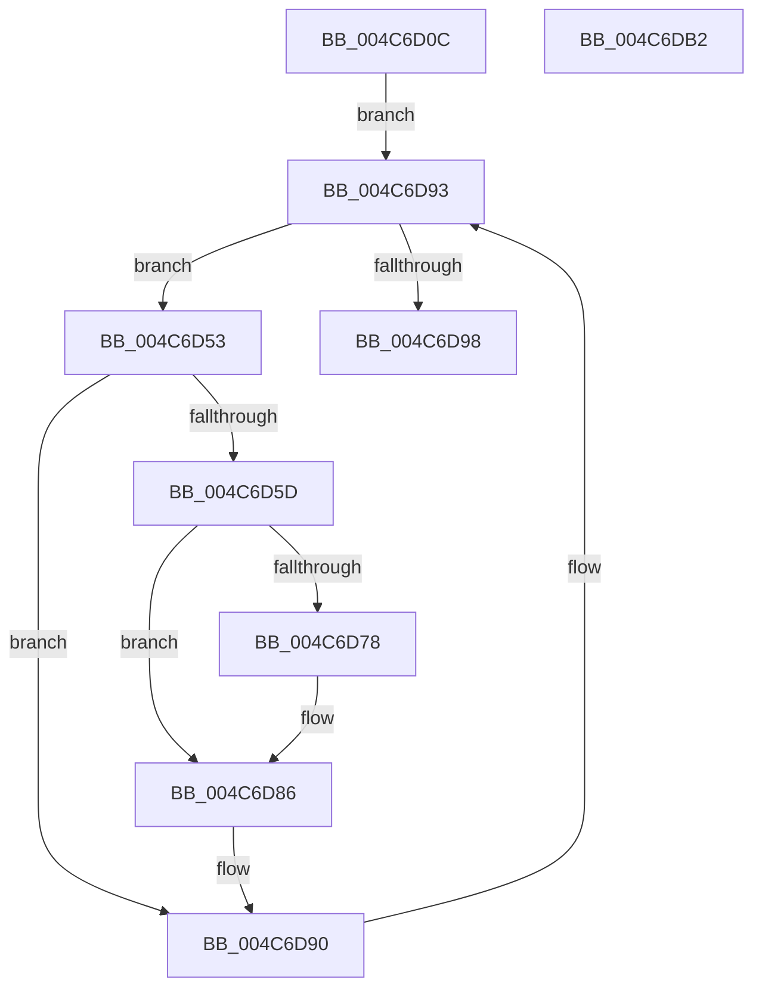

# CcUpdateTimeOnLogHandles

- RVA: `0x004C6D0C`–`0x004C6DB3` (길이 `167` bytes)
- VA: `0x00000001404C6D0C`
- 실행 섹션: `.text`
- PDB 이름 있음: `예`; PDB Function 태그: `아니요`
- unwind 정보 RVA: `0x0007D3C0`
- 디코드: `41`개 명령, `167/167` bytes 표시
- 미해석 바이트: `0` (있으면 어셈블리에 `.byte`로 보존)

> 이 문서는 커널 이미지의 기계어와 PDB 기호를 분석해 생성했습니다. 4번과 5번은 함수 원형과 자료형을 바이너리 사용 방식에서 추정한 C 해석이며 원본 소스 복구 결과는 아닙니다.

## 1. Dependencies

- 직접 호출 지점: **4**; 고유 호출 대상: **4**
- 직접 호출자로 확인된 함수: **2**
- RIP 상대 이미지 참조: **1**

### Outgoing calls
- `0x004C6D3E` → [KeRcuReadLock](../38/KeRcuReadLock_function_0038A1A0.md) (function, `0x0038A1A0`)
- `0x004C6D69` → [KeAcquireInStackQueuedSpinLockAtDpcLevel](../27/KeAcquireInStackQueuedSpinLockAtDpcLevel_function_00275740.md) (function, `0x00275740`)
- `0x004C6D8B` → [KeReleaseInStackQueuedSpinLockFromDpcLevel](../21/KeReleaseInStackQueuedSpinLockFromDpcLevel_function_002171B0.md) (function, `0x002171B0`)
- `0x004C6D98` → [KeRcuReadUnlock](../38/KeRcuReadUnlock_function_0038A070.md) (function, `0x0038A070`)

### Direct callers
- [CcLazyWriteScanVolume](../38/CcLazyWriteScanVolume_function_00388DC0.md) at `0x00389568`
- [CcLazyWriteScan](../3C/CcLazyWriteScan_function_003C9394.md) at `0x003C9A8D`

### Static image references
- `0x004C6D43` → RVA `0x00F8F560` (`.data`; read)

## 2. Other-region calls and transfers

- 다른 실행 섹션으로 향하는 call: **0**
- 별도 외부 분기/꼬리 이동을 확인하지 못했습니다.

## 3. Assembly (complete function range)

```asm
004C6D0C  4C 8B DC                        mov r11, rsp
004C6D0F  49 89 5B 08                     mov qword ptr [r11 + 8], rbx
004C6D13  49 89 6B 10                     mov qword ptr [r11 + 0x10], rbp
004C6D17  49 89 73 18                     mov qword ptr [r11 + 0x18], rsi
004C6D1B  57                              push rdi
004C6D1C  48 83 EC 40                     sub rsp, 0x40
004C6D20  0F 57 C0                        xorps xmm0, xmm0
004C6D23  33 C0                           xor eax, eax
004C6D25  0F 11 44 24 20                  movups xmmword ptr [rsp + 0x20], xmm0
004C6D2A  49 89 43 E8                     mov qword ptr [r11 - 0x18], rax
004C6D2E  48 BB 20 03 00 00 80 F7 FF FF   movabs rbx, 0xfffff78000000320
004C6D38  48 8B F1                        mov rsi, rcx
004C6D3B  48 8B 1B                        mov rbx, qword ptr [rbx]
004C6D3E  E8 5D 34 EC FF                  call 0x14038a1a0
004C6D43  48 8B 3D 16 88 AC 00            mov rdi, qword ptr [rip + 0xac8816]
004C6D4A  48 8D 2D 0F 88 AC 00            lea rbp, [rip + 0xac880f]
004C6D51  EB 40                           jmp 0x1404c6d93
004C6D53  8B 87 A8 00 00 00               mov eax, dword ptr [rdi + 0xa8]
004C6D59  A8 01                           test al, 1
004C6D5B  74 33                           je 0x1404c6d90
004C6D5D  48 8D 8E 00 03 00 00            lea rcx, [rsi + 0x300]
004C6D64  48 8D 54 24 20                  lea rdx, [rsp + 0x20]
004C6D69  E8 D2 E9 DA FF                  call 0x140275740
004C6D6E  8B 87 A8 00 00 00               mov eax, dword ptr [rdi + 0xa8]
004C6D74  A8 01                           test al, 1
004C6D76  74 0E                           je 0x1404c6d86
004C6D78  48 89 9F A0 00 00 00            mov qword ptr [rdi + 0xa0], rbx
004C6D7F  83 A7 A8 00 00 00 FE            and dword ptr [rdi + 0xa8], 0xfffffffe
004C6D86  48 8D 4C 24 20                  lea rcx, [rsp + 0x20]
004C6D8B  E8 20 04 D5 FF                  call 0x1402171b0
004C6D90  48 8B 3F                        mov rdi, qword ptr [rdi]
004C6D93  48 3B FD                        cmp rdi, rbp
004C6D96  75 BB                           jne 0x1404c6d53
004C6D98  E8 D3 32 EC FF                  call 0x14038a070
004C6D9D  48 8B 5C 24 50                  mov rbx, qword ptr [rsp + 0x50]
004C6DA2  48 8B 6C 24 58                  mov rbp, qword ptr [rsp + 0x58]
004C6DA7  48 8B 74 24 60                  mov rsi, qword ptr [rsp + 0x60]
004C6DAC  48 83 C4 40                     add rsp, 0x40
004C6DB0  5F                              pop rdi
004C6DB1  C3                              ret
004C6DB2  CC                              int3
```

## 4. C-style interpretation (structured pseudocode)

```c
__int64 __fastcall CcUpdateTimeOnLogHandles(__int64 a1)
{
    __int64 result;
    __int64 v_rsp;
    unsigned __int64 v_stack_m28;
    unsigned __int64 v_stack_p10;
    unsigned __int64 v_stack_p18;
    unsigned __int64 v_stack_p8;

    *(unsigned __int64 *)(v_rsp + 8) = v_rbx;
    *(unsigned __int64 *)(v_rsp + 16) = v_rbp;
    *(unsigned __int64 *)(v_rsp + 24) = v_rsi;
    v_rsp = (v_rsp) - (64);
    result = 0;
    v_stack_m28 = v_xmm0;
    *(unsigned __int64 *)(v_rsp - 24) = 0;
    result = KeRcuReadLock(a1, a2, a3, a4);
    goto loc_004C6D93;
loc_004C6D53:
    if ((((unsigned __int8)((unsigned int)(*(unsigned int *)(*(unsigned __int64 *)(v_rip + 11307030) + 168)))) & (1)) == 0) goto loc_004C6D90;
    result = KeAcquireInStackQueuedSpinLockAtDpcLevel(a1 + 768, v_stack_m28, a3, a4);
    if ((((unsigned __int8)((unsigned int)(*(unsigned int *)(*(unsigned __int64 *)(v_rip + 11307030) + 168)))) & (1)) != 0) {
        *(unsigned __int64 *)(*(unsigned __int64 *)(v_rip + 11307030) + 160) = *(unsigned __int64 *)(v_rbx);
    }
    result = KeReleaseInStackQueuedSpinLockFromDpcLevel(v_stack_m28, v_stack_m28, a3, a4);
loc_004C6D90:
loc_004C6D93:
    if ((*(unsigned __int64 *)(*(unsigned __int64 *)(v_rip + 11307030))) != (v_rip + 11307023)) goto loc_004C6D53;
    result = KeRcuReadUnlock(v_stack_m28, v_stack_m28, a3, a4);
    v_rsp = (v_rsp) + (64);
    return result;
}
```

## 5. (Beta) C Style

```c
int64_t CcUpdateTimeOnLogHandles(void *Arg1)
{
    uint8_t *arg1 = (uint8_t *)Arg1;

    int64_t result;
    int64_t local_rsp;
    uint64_t v_stack_m28;
    uint64_t v_stack_p10;
    uint64_t v_stack_p18;
    uint64_t v_stack_p8;

    *(uint64_t *)(local_rsp + 0x8) = local_rbx;
    *(uint64_t *)(local_rsp + 0x10) = local_rbp;
    *(uint64_t *)(local_rsp + 0x18) = local_rsi;
    local_rsp = (local_rsp) - (64);
    result = 0;
    v_stack_m28 = v_xmm0;
    *(uint64_t *)(local_rsp - 0x18) = 0;
    result = KeRcuReadLock(Arg1, a2, a3, a4);
    goto loc_004C6D93;
loc_004C6D53:
    if ((((uint8_t)((uint32_t)(*(uint32_t *)(*(uint64_t *)(v_rip + 0xAC8816) + 0xA8)))) & (1)) == 0) goto loc_004C6D90;
    result = KeAcquireInStackQueuedSpinLockAtDpcLevel(Arg1 + 768, v_stack_m28, a3, a4);
    if ((((uint8_t)((uint32_t)(*(uint32_t *)(*(uint64_t *)(v_rip + 0xAC8816) + 0xA8)))) & (1)) != 0) {
        *(uint64_t *)(*(uint64_t *)(v_rip + 0xAC8816) + 0xA0) = *(uint64_t *)(local_rbx);
    }
    result = KeReleaseInStackQueuedSpinLockFromDpcLevel(v_stack_m28, v_stack_m28, a3, a4);
loc_004C6D90:
loc_004C6D93:
    if ((*(uint64_t *)(*(uint64_t *)(v_rip + 0xAC8816))) != (v_rip + 11307023)) goto loc_004C6D53;
    result = KeRcuReadUnlock(v_stack_m28, v_stack_m28, a3, a4);
    local_rsp = (local_rsp) + (64);
    return result;
}
```

### 관측된 메모리 오프셋

구조체 형식이 확인되지 않은 접근은 인자 기준의 오프셋으로만 기록했습니다.

| 기준 인자 | 오프셋 표현 | 폭 (bit) | 접근 |
|---|---:|---:|---|
| `Arg1` | `+ 0x300` | `64` | `R` |

## 6. Execution-region graph

[열기: 2D/3D 그래프와 함수 탐색 컨트롤 패널](../../../control-panel.html?section=text&rva=0x004C6D0C&view=graph)

- 2D 그래프는 위에서 아래로 흐르고, 3D 그래프는 빈 공간을 드래그해 회전합니다. Shift+드래그는 이동, 휠은 확대·축소, 함수 노드 선택은 대상 보고서 이동입니다.

### Static fallback


