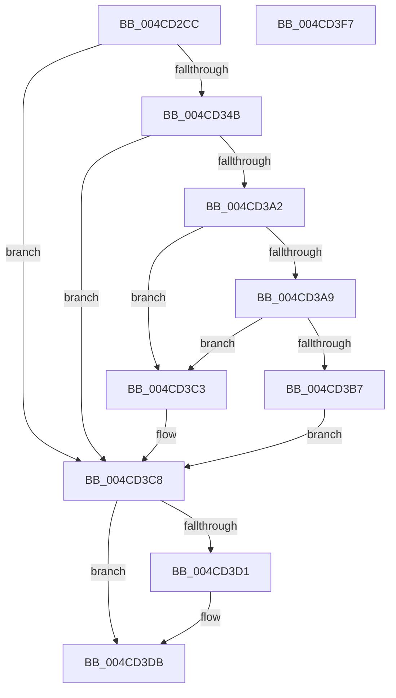

# CmFcpSendFeatureUsageReportAlpcMessage

- RVA: `0x004CD2CC`–`0x004CD3F8` (길이 `300` bytes)
- VA: `0x00000001404CD2CC`
- 실행 섹션: `.text`
- PDB 이름 있음: `예`; PDB Function 태그: `아니요`
- unwind 정보 RVA: `0x000BD854`
- 디코드: `84`개 명령, `300/300` bytes 표시
- 미해석 바이트: `0` (있으면 어셈블리에 `.byte`로 보존)

> 이 문서는 커널 이미지의 기계어와 PDB 기호를 분석해 생성했습니다. 4번과 5번은 함수 원형과 자료형을 바이너리 사용 방식에서 추정한 C 해석이며 원본 소스 복구 결과는 아닙니다.

## 1. Dependencies

- 직접 호출 지점: **4**; 고유 호출 대상: **4**
- 직접 호출자로 확인된 함수: **1**
- RIP 상대 이미지 참조: **1**

### Outgoing calls
- `0x004CD340` → [CmFcpCreateAlpcSectionView](../../page/AD/CmFcpCreateAlpcSectionView_function_00ADA8DC.md) (function, `0x00ADA8DC`)
- `0x004CD397` → [ZwAlpcSendWaitReceivePort](../6A/ZwAlpcSendWaitReceivePort_function_006AE290.md) (function, `0x006AE290`)
- `0x004CD3D6` → [ZwAlpcDeletePortSection](../6A/ZwAlpcDeletePortSection_function_006AE110.md) (function, `0x006AE110`)
- `0x004CD3E4` → [_security_check_cookie](../6A/_security_check_cookie_function_006AC640.md) (function, `0x006AC640`)

### Direct callers
- [CmFcpManagerPublishFeatureUsageDataBuffers](../../page/A9/CmFcpManagerPublishFeatureUsageDataBuffers_function_00A9677C.md) at `0x00A968C2`

### Static image references
- `0x004CD2DF` → RVA `0x00E0A740` (`.data`; read)

## 2. Other-region calls and transfers

- 다른 실행 섹션으로 향하는 call: **1**
  - `0x004CD340` → [CmFcpCreateAlpcSectionView](../../page/AD/CmFcpCreateAlpcSectionView_function_00ADA8DC.md) (`.text` → `PAGE`)
- 별도 외부 분기/꼬리 이동을 확인하지 못했습니다.

## 3. Assembly (complete function range)

```asm
004CD2CC  40 55                           push rbp
004CD2CE  53                              push rbx
004CD2CF  56                              push rsi
004CD2D0  57                              push rdi
004CD2D1  41 57                           push r15
004CD2D3  48 8D 6C 24 C9                  lea rbp, [rsp - 0x37]
004CD2D8  48 81 EC C0 00 00 00            sub rsp, 0xc0
004CD2DF  48 8B 05 5A D4 93 00            mov rax, qword ptr [rip + 0x93d45a]
004CD2E6  48 33 C4                        xor rax, rsp
004CD2E9  48 89 45 27                     mov qword ptr [rbp + 0x27], rax
004CD2ED  33 C0                           xor eax, eax
004CD2EF  C7 45 FF 00 00 00 40            mov dword ptr [rbp - 1], 0x40000000
004CD2F6  48 21 45 BF                     and qword ptr [rbp - 0x41], rax
004CD2FA  4C 8D 4D FF                     lea r9, [rbp - 1]
004CD2FE  21 45 03                        and dword ptr [rbp + 3], eax
004CD301  0F 57 C0                        xorps xmm0, xmm0
004CD304  48 89 45 F7                     mov qword ptr [rbp - 9], rax
004CD308  41 8B F0                        mov esi, r8d
004CD30B  44 8D 78 38                     lea r15d, [rax + 0x38]
004CD30F  0F 57 C9                        xorps xmm1, xmm1
004CD312  48 8D 45 BF                     lea rax, [rbp - 0x41]
004CD316  4C 89 7D B7                     mov qword ptr [rbp - 0x49], r15
004CD31A  46 8D 04 C5 00 00 00 00         lea r8d, [r8*8]
004CD322  48 89 44 24 20                  mov qword ptr [rsp + 0x20], rax
004CD327  48 8B F9                        mov rdi, rcx
004CD32A  F3 0F 7F 45 07                  movdqu xmmword ptr [rbp + 7], xmm0
004CD32F  F3 0F 7F 4D 17                  movdqu xmmword ptr [rbp + 0x17], xmm1
004CD334  0F 11 45 C7                     movups xmmword ptr [rbp - 0x39], xmm0
004CD338  0F 11 45 D7                     movups xmmword ptr [rbp - 0x29], xmm0
004CD33C  0F 11 45 E7                     movups xmmword ptr [rbp - 0x19], xmm0
004CD340  E8 97 D5 60 00                  call 0x140ada8dc
004CD345  8B D8                           mov ebx, eax
004CD347  85 C0                           test eax, eax
004CD349  78 7D                           js 0x1404cd3c8
004CD34B  48 83 64 24 38 00               and qword ptr [rsp + 0x38], 0
004CD351  4C 8D 4D FF                     lea r9, [rbp - 1]
004CD355  48 83 64 24 30 00               and qword ptr [rsp + 0x30], 0
004CD35B  4C 8D 45 C7                     lea r8, [rbp - 0x39]
004CD35F  83 65 DF 00                     and dword ptr [rbp - 0x21], 0
004CD363  B8 01 80 FF FF                  mov eax, 0xffff8001
004CD368  66 89 45 CB                     mov word ptr [rbp - 0x35], ax
004CD36C  BA 00 00 02 00                  mov edx, 0x20000
004CD371  48 8D 45 B7                     lea rax, [rbp - 0x49]
004CD375  C7 45 C7 10 00 38 00            mov dword ptr [rbp - 0x39], 0x380010
004CD37C  48 89 44 24 28                  mov qword ptr [rsp + 0x28], rax
004CD381  48 8B CF                        mov rcx, rdi
004CD384  48 8D 45 C7                     lea rax, [rbp - 0x39]
004CD388  C7 45 EF 02 00 00 00            mov dword ptr [rbp - 0x11], 2
004CD38F  48 89 44 24 20                  mov qword ptr [rsp + 0x20], rax
004CD394  89 75 F7                        mov dword ptr [rbp - 9], esi
004CD397  E8 F4 0E 1E 00                  call 0x1406ae290
004CD39C  8B D8                           mov ebx, eax
004CD39E  85 C0                           test eax, eax
004CD3A0  78 26                           js 0x1404cd3c8
004CD3A2  48 83 7D B7 30                  cmp qword ptr [rbp - 0x49], 0x30
004CD3A7  72 1A                           jb 0x1404cd3c3
004CD3A9  0F B7 45 CB                     movzx eax, word ptr [rbp - 0x35]
004CD3AD  25 FF 00 FF FF                  and eax, 0xffff00ff
004CD3B2  83 F8 02                        cmp eax, 2
004CD3B5  75 0C                           jne 0x1404cd3c3
004CD3B7  8B 45 F3                        mov eax, dword ptr [rbp - 0xd]
004CD3BA  33 DB                           xor ebx, ebx
004CD3BC  85 C0                           test eax, eax
004CD3BE  0F 48 D8                        cmovs ebx, eax
004CD3C1  EB 05                           jmp 0x1404cd3c8
004CD3C3  BB 01 00 00 C0                  mov ebx, 0xc0000001
004CD3C8  4C 8B 45 BF                     mov r8, qword ptr [rbp - 0x41]
004CD3CC  4D 85 C0                        test r8, r8
004CD3CF  74 0A                           je 0x1404cd3db
004CD3D1  33 D2                           xor edx, edx
004CD3D3  48 8B CF                        mov rcx, rdi
004CD3D6  E8 35 0D 1E 00                  call 0x1406ae110
004CD3DB  8B C3                           mov eax, ebx
004CD3DD  48 8B 4D 27                     mov rcx, qword ptr [rbp + 0x27]
004CD3E1  48 33 CC                        xor rcx, rsp
004CD3E4  E8 57 F2 1D 00                  call 0x1406ac640
004CD3E9  48 81 C4 C0 00 00 00            add rsp, 0xc0
004CD3F0  41 5F                           pop r15
004CD3F2  5F                              pop rdi
004CD3F3  5E                              pop rsi
004CD3F4  5B                              pop rbx
004CD3F5  5D                              pop rbp
004CD3F6  C3                              ret
004CD3F7  CC                              int3
```

## 4. C-style interpretation (structured pseudocode)

```c
__int64 __fastcall CmFcpSendFeatureUsageReportAlpcMessage(__int64 a1, __int64 a2, __int64 a3)
{
    __int64 result;
    __int64 v_rbx;
    __int64 v_rsp;
    unsigned __int64 v_stack_m38;
    unsigned __int64 v_stack_m48;
    unsigned __int64 v_stack_m58;
    unsigned int v_stack_m5C;
    unsigned __int64 v_stack_m5F;
    unsigned int v_stack_m60;
    unsigned __int64 v_stack_m68;
    unsigned int v_stack_m6C;
    unsigned int v_stack_m70;
    unsigned __int64 v_stack_m78;
    unsigned int v_stack_m80;
    unsigned __int64 v_stack_m88;
    unsigned __int16 v_stack_m94;
    unsigned __int64 v_stack_m98;
    unsigned __int64 v_stack_mA0;
    unsigned __int64 v_stack_mA8;
    unsigned __int64 v_stack_mB0;
    unsigned __int64 v_stack_mB8;
    unsigned __int64 v_stack_mC0;
    unsigned __int64 v_stack_mC8;

    v_rsp = (v_rsp) - (192);
    result = (*(unsigned __int64 *)(v_rip + 9688154)) ^ (v_rsp);
    v_stack_m38 = result;
    result = 0;
    v_stack_m60 = 0x40000000ULL;
    v_stack_m68 = 0;
    v_stack_mA8 = result + 56;
    v_stack_mC8 = v_stack_mA0;
    v_stack_m58 = v_xmm0;
    v_stack_m48 = v_xmm1;
    v_stack_m98 = v_xmm0;
    v_stack_m88 = v_xmm0;
    v_stack_m78 = v_xmm0;
    result = CmFcpCreateAlpcSectionView(a1, a2, a3 * 8, v_stack_m60);
    if (sign_flag) goto loc_004CD3C8;
    v_stack_m94 = (unsigned __int16)((unsigned int)(0xFFFF8001ULL));
    v_stack_m98 = 0x380010ULL;
    v_stack_mC0 = v_stack_mA8;
    v_stack_m70 = 2;
    v_stack_mC8 = v_stack_m98;
    v_stack_m68 = (unsigned int)((unsigned int)((unsigned int)(a3)));
    result = ZwAlpcSendWaitReceivePort(a1, (unsigned int)(0x20000ULL), v_stack_m98, v_stack_m60);
    if (sign_flag) goto loc_004CD3C8;
    if (v_stack_mA8 < 48) goto loc_004CD3C3;
    result = (unsigned int)((v_stack_m94) & (0xFFFF00FFULL));
    if (((unsigned int)(result)) != 2) goto loc_004CD3C3;
    v_rbx = 0;
    if (sign_flag) { v_rbx = (unsigned int)((unsigned int)(v_stack_m6C)); }
    goto loc_004CD3C8;
loc_004CD3C3:
loc_004CD3C8:
    result = (unsigned int)(v_stack_m6C);
    if (v_stack_mA0 != 0) {
        a2 = 0;
        a1 = a1;
        result = ZwAlpcDeletePortSection(a1, a2, v_stack_mA0, v_stack_m60);
    }
    a1 = (v_stack_m38) ^ (v_rsp);
    result = _security_check_cookie(a1, a2, v_stack_mA0, v_stack_m60);
    v_rsp = (v_rsp) + (192);
    return result;
}
```

## 5. (Beta) C Style

```c
int64_t CmFcpSendFeatureUsageReportAlpcMessage(int64_t Arg1, int64_t Arg2, int64_t Arg3)
{
    int64_t result;
    int64_t local_rbx;
    int64_t local_rsp;
    uint64_t v_stack_m38;
    uint64_t v_stack_m48;
    uint64_t v_stack_m58;
    uint32_t v_stack_m5C;
    uint64_t v_stack_m5F;
    uint32_t v_stack_m60;
    uint64_t v_stack_m68;
    uint32_t v_stack_m6C;
    uint32_t v_stack_m70;
    uint64_t v_stack_m78;
    uint32_t v_stack_m80;
    uint64_t v_stack_m88;
    uint16_t v_stack_m94;
    uint64_t v_stack_m98;
    uint64_t v_stack_mA0;
    uint64_t v_stack_mA8;
    uint64_t v_stack_mB0;
    uint64_t v_stack_mB8;
    uint64_t v_stack_mC0;
    uint64_t v_stack_mC8;

    local_rsp = (local_rsp) - (192);
    result = (*(uint64_t *)(v_rip + 0x93D45A)) ^ (local_rsp);
    v_stack_m38 = result;
    result = 0;
    v_stack_m60 = 0x40000000ULL;
    v_stack_m68 = 0;
    v_stack_mA8 = result + 56;
    v_stack_mC8 = v_stack_mA0;
    v_stack_m58 = v_xmm0;
    v_stack_m48 = v_xmm1;
    v_stack_m98 = v_xmm0;
    v_stack_m88 = v_xmm0;
    v_stack_m78 = v_xmm0;
    result = CmFcpCreateAlpcSectionView(Arg1, Arg2, Arg3 * 8, v_stack_m60);
    if (sign_flag) goto loc_004CD3C8;
    v_stack_m94 = (uint16_t)((uint32_t)(0xFFFF8001ULL));
    v_stack_m98 = 0x380010ULL;
    v_stack_mC0 = v_stack_mA8;
    v_stack_m70 = 2;
    v_stack_mC8 = v_stack_m98;
    v_stack_m68 = (uint32_t)((uint32_t)((uint32_t)(Arg3)));
    result = ZwAlpcSendWaitReceivePort(Arg1, (uint32_t)(0x20000ULL), v_stack_m98, v_stack_m60);
    if (sign_flag) goto loc_004CD3C8;
    if (v_stack_mA8 < 48) goto loc_004CD3C3;
    result = (uint32_t)((v_stack_m94) & (0xFFFF00FFULL));
    if (((uint32_t)(result)) != 2) goto loc_004CD3C3;
    local_rbx = 0;
    if (sign_flag) { local_rbx = (uint32_t)((uint32_t)(v_stack_m6C)); }
    goto loc_004CD3C8;
loc_004CD3C3:
loc_004CD3C8:
    result = (uint32_t)(v_stack_m6C);
    if (v_stack_mA0 != 0) {
        Arg2 = 0;
        Arg1 = Arg1;
        result = ZwAlpcDeletePortSection(Arg1, Arg2, v_stack_mA0, v_stack_m60);
    }
    Arg1 = (v_stack_m38) ^ (local_rsp);
    result = _security_check_cookie(Arg1, Arg2, v_stack_mA0, v_stack_m60);
    local_rsp = (local_rsp) + (192);
    return result;
}
```

## 6. Execution-region graph

[열기: 2D/3D 그래프와 함수 탐색 컨트롤 패널](../../../control-panel.html?section=text&rva=0x004CD2CC&view=graph)

- 2D 그래프는 위에서 아래로 흐르고, 3D 그래프는 빈 공간을 드래그해 회전합니다. Shift+드래그는 이동, 휠은 확대·축소, 함수 노드 선택은 대상 보고서 이동입니다.

### Static fallback


