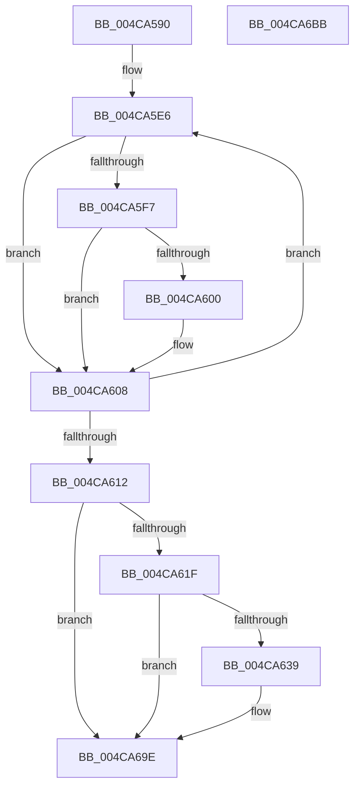

# CmpThreadInfoLogStack

- RVA: `0x004CA590`–`0x004CA6BC` (길이 `300` bytes)
- VA: `0x00000001404CA590`
- 실행 섹션: `.text`
- PDB 이름 있음: `예`; PDB Function 태그: `아니요`
- unwind 정보 RVA: `0x000BD570`
- 디코드: `65`개 명령, `300/300` bytes 표시
- 미해석 바이트: `0` (있으면 어셈블리에 `.byte`로 보존)

> 이 문서는 커널 이미지의 기계어와 PDB 기호를 분석해 생성했습니다. 4번과 5번은 함수 원형과 자료형을 바이너리 사용 방식에서 추정한 C 해석이며 원본 소스 복구 결과는 아닙니다.

## 1. Dependencies

- 직접 호출 지점: **6**; 고유 호출 대상: **5**
- 직접 호출자로 확인된 함수: **4**
- RIP 상대 이미지 참조: **5**

### Outgoing calls
- `0x004CA5BA` → [memset](../6C/memset_function_006C6C40.md) (function, `0x006C6C40`)
- `0x004CA5C9` → [memset](../6C/memset_function_006C6C40.md) (function, `0x006C6C40`)
- `0x004CA5DB` → [RtlWalkFrameChain](../2F/RtlWalkFrameChain_function_002F85E0.md) (function, `0x002F85E0`)
- `0x004CA630` → [tlgKeywordOn](../42/tlgKeywordOn_function_0042EAA0.md) (function, `0x0042EAA0`)
- `0x004CA699` → [tlgWriteAgg](../2F/tlgWriteAgg_function_002F0F7C.md) (function, `0x002F0F7C`)
- `0x004CA6A5` → [_security_check_cookie](../6A/_security_check_cookie_function_006AC640.md) (function, `0x006AC640`)

### Direct callers
- [CmpRecordRegistryLockAcquire](../45/CmpRecordRegistryLockAcquire_function_004565F4.md) at `0x0045660B`
- [CmpRecordRegistryLockRelease](../45/CmpRecordRegistryLockRelease_function_00456618.md) at `0x00456649`
- [CmpIsRegistryLockAcquired](../45/CmpIsRegistryLockAcquired_function_00456A7C.md) at `0x00456A9C`
- [CmpGetThreadInfo](../45/CmpGetThreadInfo_function_00456AB8.md) at `0x00456AE3`

### Static image references
- `0x004CA5A2` → RVA `0x00E0A740` (`.data`; read)
- `0x004CA5EB` → RVA `0x00FC6B28` (`ALMOSTRO`; read)
- `0x004CA5F7` → RVA `0x00FC6CB0` (`ALMOSTRO`; read)
- `0x004CA616` → RVA `0x00E09F58` (`.data`; read)
- `0x004CA64C` → RVA `0x000562BF` (`.rdata`; read)

## 2. Other-region calls and transfers

- 다른 실행 섹션으로 향하는 call: **0**
- 별도 외부 분기/꼬리 이동을 확인하지 못했습니다.

## 3. Assembly (complete function range)

```asm
004CA590  48 89 5C 24 08                  mov qword ptr [rsp + 8], rbx
004CA595  55                              push rbp
004CA596  48 8D 6C 24 C0                  lea rbp, [rsp - 0x40]
004CA59B  48 81 EC 40 01 00 00            sub rsp, 0x140
004CA5A2  48 8B 05 97 01 94 00            mov rax, qword ptr [rip + 0x940197]
004CA5A9  48 33 C4                        xor rax, rsp
004CA5AC  48 89 45 30                     mov qword ptr [rbp + 0x30], rax
004CA5B0  33 D2                           xor edx, edx
004CA5B2  48 8D 4D 90                     lea rcx, [rbp - 0x70]
004CA5B6  44 8D 42 50                     lea r8d, [rdx + 0x50]
004CA5BA  E8 81 C6 1F 00                  call 0x1406c6c40
004CA5BF  33 D2                           xor edx, edx
004CA5C1  48 8D 4D E0                     lea rcx, [rbp - 0x20]
004CA5C5  44 8D 42 50                     lea r8d, [rdx + 0x50]
004CA5C9  E8 72 C6 1F 00                  call 0x1406c6c40
004CA5CE  45 33 C0                        xor r8d, r8d
004CA5D1  48 8D 4D 90                     lea rcx, [rbp - 0x70]
004CA5D5  41 8D 58 0A                     lea ebx, [r8 + 0xa]
004CA5D9  8B D3                           mov edx, ebx
004CA5DB  E8 00 E0 E2 FF                  call 0x1402f85e0
004CA5E0  45 33 C0                        xor r8d, r8d
004CA5E3  41 8B C8                        mov ecx, r8d
004CA5E6  48 8B 44 0D 90                  mov rax, qword ptr [rbp + rcx - 0x70]
004CA5EB  48 8B 15 36 C5 AF 00            mov rdx, qword ptr [rip + 0xafc536]
004CA5F2  48 3B C2                        cmp rax, rdx
004CA5F5  72 11                           jb 0x1404ca608
004CA5F7  48 3B 05 B2 C6 AF 00            cmp rax, qword ptr [rip + 0xafc6b2]
004CA5FE  77 08                           ja 0x1404ca608
004CA600  48 2B C2                        sub rax, rdx
004CA603  48 89 44 0D E0                  mov qword ptr [rbp + rcx - 0x20], rax
004CA608  48 83 C1 08                     add rcx, 8
004CA60C  48 83 EB 01                     sub rbx, 1
004CA610  75 D4                           jne 0x1404ca5e6
004CA612  44 8D 4B 05                     lea r9d, [rbx + 5]
004CA616  44 39 0D 3B F9 93 00            cmp dword ptr [rip + 0x93f93b], r9d
004CA61D  76 7F                           jbe 0x1404ca69e
004CA61F  48 BA 00 00 00 00 00 40 00 00   movabs rdx, 0x400000000000
004CA629  48 8D 0D 28 F9 93 00            lea rcx, [rip + 0x93f928]
004CA630  E8 6B 44 F6 FF                  call 0x14042eaa0
004CA635  84 C0                           test al, al
004CA637  74 65                           je 0x1404ca69e
004CA639  48 8D 44 24 30                  lea rax, [rsp + 0x30]
004CA63E  48 C7 44 24 30 01 00 00 00      mov qword ptr [rsp + 0x30], 1
004CA647  48 89 44 24 60                  mov qword ptr [rsp + 0x60], rax
004CA64C  48 8D 15 6C BC B8 FF            lea rdx, [rip - 0x474394]
004CA653  48 8D 45 E0                     lea rax, [rbp - 0x20]
004CA657  48 C7 44 24 68 08 00 00 00      mov qword ptr [rsp + 0x68], 8
004CA660  48 89 44 24 70                  mov qword ptr [rsp + 0x70], rax
004CA665  48 8D 0D EC F8 93 00            lea rcx, [rip + 0x93f8ec]
004CA66C  48 8D 44 24 38                  lea rax, [rsp + 0x38]
004CA671  48 C7 44 24 78 50 00 00 00      mov qword ptr [rsp + 0x78], 0x50
004CA67A  48 89 45 80                     mov qword ptr [rbp - 0x80], rax
004CA67E  48 8D 44 24 40                  lea rax, [rsp + 0x40]
004CA683  48 89 44 24 20                  mov qword ptr [rsp + 0x20], rax
004CA688  48 C7 44 24 38 00 00 00 01      mov qword ptr [rsp + 0x38], 0x1000000
004CA691  48 C7 45 88 08 00 00 00         mov qword ptr [rbp - 0x78], 8
004CA699  E8 DE 68 E2 FF                  call 0x1402f0f7c
004CA69E  48 8B 4D 30                     mov rcx, qword ptr [rbp + 0x30]
004CA6A2  48 33 CC                        xor rcx, rsp
004CA6A5  E8 96 1F 1E 00                  call 0x1406ac640
004CA6AA  48 8B 9C 24 50 01 00 00         mov rbx, qword ptr [rsp + 0x150]
004CA6B2  48 81 C4 40 01 00 00            add rsp, 0x140
004CA6B9  5D                              pop rbp
004CA6BA  C3                              ret
004CA6BB  CC                              int3
```

## 4. C-style interpretation (structured pseudocode)

```c
__int64 __fastcall CmpThreadInfoLogStack(__int64 a1, int a2)
{
    __int64 result;
    __int64 v_rbx;
    __int64 v_rsp;
    unsigned __int64 v_stack_m108;
    unsigned __int64 v_stack_m110;
    unsigned __int64 v_stack_m118;
    unsigned __int64 v_stack_m128;
    unsigned __int64 v_stack_m18;
    unsigned __int64 v_stack_m48;
    unsigned __int64 v_stack_m68;
    unsigned __int64 v_stack_mB8;
    unsigned __int64 v_stack_mC0;
    unsigned __int64 v_stack_mC8;
    unsigned __int64 v_stack_mD0;
    unsigned __int64 v_stack_mD8;
    unsigned __int64 v_stack_mE0;
    unsigned __int64 v_stack_mE8;
    unsigned __int64 v_stack_p8;

    v_stack_p8 = v_rbx;
    v_rsp = (v_rsp) - (320);
    result = (*(unsigned __int64 *)(v_rip + 9699735)) ^ (v_rsp);
    v_stack_m18 = result;
    a2 = 0;
    result = memset(v_stack_mB8, a2, a2 + 80, a4);
    a2 = 0;
    result = memset(v_stack_m68, a2, a2 + 80, a4);
    a3 = 0;
    result = RtlWalkFrameChain(v_stack_mB8, (unsigned int)((unsigned int)(a3 + 10)), a3, a4);
    a3 = 0;
loc_004CA5E6:
    if ((*(unsigned __int64 *)(v_stack_m48 + 0 * 1 - 112)) < (*(unsigned __int64 *)(v_rip + 11519286))) goto loc_004CA608;
    result = *(unsigned __int64 *)(v_stack_m48 + 0 * 1 - 112);
    if ((*(unsigned __int64 *)(v_stack_m48 + 0 * 1 - 112)) <= (*(unsigned __int64 *)(v_rip + 11519666))) {
        result = (*(unsigned __int64 *)(v_stack_m48 + 0 * 1 - 112)) - (*(unsigned __int64 *)(v_rip + 11519286));
        *(unsigned __int64 *)(v_stack_m48 + 0 * 1 - 32) = result;
    }
    a1 = (0) + (8);
    v_rbx = (a3 + 10) - (1);
    if (condition_is_not_equal) goto loc_004CA5E6;
    if ((*(unsigned int *)(v_rip + 9697595)) <= ((unsigned int)(v_rbx + 5))) goto loc_004CA69E;
    result = tlgKeywordOn(v_rip + 9697576, *(unsigned __int64 *)(v_rip + 11519286), a3, v_rbx + 5);
    if ((unsigned __int8)(result) != 0) {
        result = v_stack_m118;
        v_stack_m118 = 1;
        v_stack_mE8 = result;
        a2 = v_rip - 4670356;
        result = v_stack_m68;
        v_stack_mE0 = 8;
        v_stack_mD8 = result;
        a1 = v_rip + 9697516;
        result = v_stack_m110;
        v_stack_mD0 = 80;
        v_stack_mC8 = result;
        result = v_stack_m108;
        v_stack_m128 = result;
        v_stack_m110 = 0x1000000ULL;
        v_stack_mC0 = 8;
        result = tlgWriteAgg(a1, a2, a3, v_rbx + 5);
    }
    a1 = (v_stack_m18) ^ (v_rsp);
    result = _security_check_cookie(a1, a2, a3, v_rbx + 5);
    v_rsp = (v_rsp) + (320);
    return result;
}
```

## 5. (Beta) C Style

```c
int64_t CmpThreadInfoLogStack(int64_t Arg1, int32_t Arg2)
{
    int64_t result;
    int64_t local_rbx;
    int64_t local_rsp;
    uint64_t v_stack_m108;
    uint64_t v_stack_m110;
    uint64_t v_stack_m118;
    uint64_t v_stack_m128;
    uint64_t v_stack_m18;
    uint64_t v_stack_m48;
    uint64_t v_stack_m68;
    uint64_t v_stack_mB8;
    uint64_t v_stack_mC0;
    uint64_t v_stack_mC8;
    uint64_t v_stack_mD0;
    uint64_t v_stack_mD8;
    uint64_t v_stack_mE0;
    uint64_t v_stack_mE8;
    uint64_t v_stack_p8;

    v_stack_p8 = local_rbx;
    local_rsp = (local_rsp) - (320);
    result = (*(uint64_t *)(v_rip + 0x940197)) ^ (local_rsp);
    v_stack_m18 = result;
    Arg2 = 0;
    result = memset(v_stack_mB8, Arg2, Arg2 + 80, a4);
    Arg2 = 0;
    result = memset(v_stack_m68, Arg2, Arg2 + 80, a4);
    a3 = 0;
    result = RtlWalkFrameChain(v_stack_mB8, (uint32_t)((uint32_t)(a3 + 10)), a3, a4);
    a3 = 0;
loc_004CA5E6:
    if ((*(uint64_t *)(v_stack_m48 + 0x0 * 1 - 0x70)) < (*(uint64_t *)(v_rip + 0xAFC536))) goto loc_004CA608;
    result = *(uint64_t *)(v_stack_m48 + 0x0 * 1 - 0x70);
    if ((*(uint64_t *)(v_stack_m48 + 0x0 * 1 - 0x70)) <= (*(uint64_t *)(v_rip + 0xAFC6B2))) {
        result = (*(uint64_t *)(v_stack_m48 + 0x0 * 1 - 0x70)) - (*(uint64_t *)(v_rip + 0xAFC536));
        *(uint64_t *)(v_stack_m48 + 0x0 * 1 - 0x20) = result;
    }
    Arg1 = (0) + (8);
    local_rbx = (a3 + 10) - (1);
    if (condition_is_not_equal) goto loc_004CA5E6;
    if ((*(uint32_t *)(v_rip + 0x93F93B)) <= ((uint32_t)(local_rbx + 5))) goto loc_004CA69E;
    result = tlgKeywordOn(v_rip + 9697576, *(uint64_t *)(v_rip + 0xAFC536), a3, local_rbx + 5);
    if ((uint8_t)(result) != 0) {
        result = v_stack_m118;
        v_stack_m118 = 1;
        v_stack_mE8 = result;
        Arg2 = v_rip - 4670356;
        result = v_stack_m68;
        v_stack_mE0 = 8;
        v_stack_mD8 = result;
        Arg1 = v_rip + 9697516;
        result = v_stack_m110;
        v_stack_mD0 = 80;
        v_stack_mC8 = result;
        result = v_stack_m108;
        v_stack_m128 = result;
        v_stack_m110 = 0x1000000ULL;
        v_stack_mC0 = 8;
        result = tlgWriteAgg(Arg1, Arg2, a3, local_rbx + 5);
    }
    Arg1 = (v_stack_m18) ^ (local_rsp);
    result = _security_check_cookie(Arg1, Arg2, a3, local_rbx + 5);
    local_rsp = (local_rsp) + (320);
    return result;
}
```

## 6. Execution-region graph

[열기: 2D/3D 그래프와 함수 탐색 컨트롤 패널](../../../control-panel.html?section=text&rva=0x004CA590&view=graph)

- 2D 그래프는 위에서 아래로 흐르고, 3D 그래프는 빈 공간을 드래그해 회전합니다. Shift+드래그는 이동, 휠은 확대·축소, 함수 노드 선택은 대상 보고서 이동입니다.

### Static fallback


