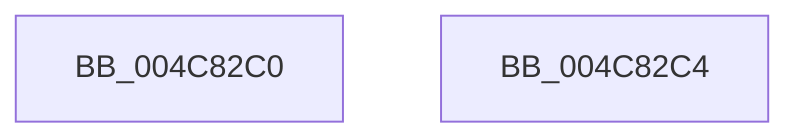

# CsanRead64NoCheck

- RVA: `0x004C82C0`–`0x004C82C5` (길이 `5` bytes)
- VA: `0x00000001404C82C0`
- 실행 섹션: `.text`
- PDB 이름 있음: `예`; PDB Function 태그: `아니요`
- unwind 정보 RVA: `0x000DB714`
- 디코드: `3`개 명령, `5/5` bytes 표시
- 미해석 바이트: `0` (있으면 어셈블리에 `.byte`로 보존)

> 이 문서는 커널 이미지의 기계어와 PDB 기호를 분석해 생성했습니다. 4번과 5번은 함수 원형과 자료형을 바이너리 사용 방식에서 추정한 C 해석이며 원본 소스 복구 결과는 아닙니다.

## 1. Dependencies

- 직접 호출 지점: **0**; 고유 호출 대상: **0**
- 직접 호출자로 확인된 함수: **10**
- RIP 상대 이미지 참조: **0**

### Outgoing calls
- 직접 디코드된 call 명령이 없습니다.

### Direct callers
- [PfpLogScenarioEventCallback](../../page/75/PfpLogScenarioEventCallback_function_007507B0.md) at `0x007507D8`
- [PfTStart](../../page/75/PfTStart_function_007517AC.md) at `0x007518E1`
- [sub_0097C0F8](../../page/97/Unknown_function_0097C0F8.md) at `0x0097C29A`
- [sub_0097C3DE](../../page/97/Unknown_function_0097C3DE.md) at `0x0097C3F9`
- [CmFcManagerRegisterFeatureConfigurationChangeNotification](../../page/AB/CmFcManagerRegisterFeatureConfigurationChangeNotification_function_00AB91CC.md) at `0x00AB92A8`
- [PfpLogEventRequest](../../page/AC/PfpLogEventRequest_function_00AC1278.md) at `0x00AC1344`
- [PfpPowerActionSleepSystemPhaseCallback](../../pagelk/B6/PfpPowerActionSleepSystemPhaseCallback_function_00B6B270.md) at `0x00B6B289`
- [PfpPowerActionStartScenarioTracingCallback](../../pagelk/B6/PfpPowerActionStartScenarioTracingCallback_function_00B6B2E0.md) at `0x00B6B2FF`
- [PfTAccessTracingStart](../../pagelk/B6/PfTAccessTracingStart_function_00B6B9F0.md) at `0x00B6BA17`
- [PfTSetTracingPriority](../../pagelk/B6/PfTSetTracingPriority_function_00B6BA6C.md) at `0x00B6BA94`

### Static image references
- 디코드된 RIP-relative 메모리 참조가 없습니다.

## 2. Other-region calls and transfers

- 다른 실행 섹션으로 향하는 call: **0**
- 별도 외부 분기/꼬리 이동을 확인하지 못했습니다.

## 3. Assembly (complete function range)

```asm
004C82C0  48 8B 01                        mov rax, qword ptr [rcx]
004C82C3  C3                              ret
004C82C4  CC                              int3
```

## 4. C-style interpretation (structured pseudocode)

```c
__int64 __fastcall CsanRead64NoCheck(__int64 a1)
{
    return *(unsigned __int64 *)(a1);
}
```

## 5. (Beta) C Style

```c
int64_t CsanRead64NoCheck(void *Arg1)
{
    uint8_t *arg1 = (uint8_t *)Arg1;

    return *(uint64_t *)(arg1);
}
```

### 관측된 메모리 오프셋

구조체 형식이 확인되지 않은 접근은 인자 기준의 오프셋으로만 기록했습니다.

| 기준 인자 | 오프셋 표현 | 폭 (bit) | 접근 |
|---|---:|---:|---|
| `Arg1` | `+ 0x0` | `64` | `R` |

## 6. Execution-region graph

[열기: 2D/3D 그래프와 함수 탐색 컨트롤 패널](../../../control-panel.html?section=text&rva=0x004C82C0&view=graph)

- 2D 그래프는 위에서 아래로 흐르고, 3D 그래프는 빈 공간을 드래그해 회전합니다. Shift+드래그는 이동, 휠은 확대·축소, 함수 노드 선택은 대상 보고서 이동입니다.

### Static fallback


