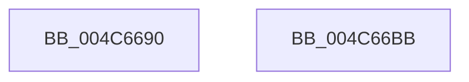

# DbgUnLoadImageSymbols

- RVA: `0x004C6690`–`0x004C66BC` (길이 `44` bytes)
- VA: `0x00000001404C6690`
- 실행 섹션: `.text`
- PDB 이름 있음: `예`; PDB Function 태그: `아니요`
- unwind 정보 RVA: `0x00082420`
- 디코드: `12`개 명령, `44/44` bytes 표시
- 미해석 바이트: `0` (있으면 어셈블리에 `.byte`로 보존)

> 이 문서는 커널 이미지의 기계어와 PDB 기호를 분석해 생성했습니다. 4번과 5번은 함수 원형과 자료형을 바이너리 사용 방식에서 추정한 C 해석이며 원본 소스 복구 결과는 아닙니다.

## 1. Dependencies

- 직접 호출 지점: **1**; 고유 호출 대상: **1**
- 직접 호출자로 확인된 함수: **3**
- RIP 상대 이미지 참조: **0**

### Outgoing calls
- `0x004C66B1` → [DebugService2](../4F/DebugService2_function_004FE530.md) (function, `0x004FE530`)

### Direct callers
- [KiBugcheckUnloadDebugSymbols](../5B/KiBugcheckUnloadDebugSymbols_function_005B41B4.md) at `0x005B41CA`
- [PopSaveHiberContext](../../pagelk/B6/PopSaveHiberContext_function_00B6F050.md) at `0x00B6FA0F`
- [PopShutdownSystem](../../pagelk/B7/PopShutdownSystem_function_00B71784.md) at `0x00B717B6`

### Static image references
- 디코드된 RIP-relative 메모리 참조가 없습니다.

## 2. Other-region calls and transfers

- 다른 실행 섹션으로 향하는 call: **0**
- 별도 외부 분기/꼬리 이동을 확인하지 못했습니다.

## 3. Assembly (complete function range)

```asm
004C6690  48 8B C4                        mov rax, rsp
004C6693  48 83 EC 48                     sub rsp, 0x48
004C6697  83 60 E8 00                     and dword ptr [rax - 0x18], 0
004C669B  83 60 EC 00                     and dword ptr [rax - 0x14], 0
004C669F  48 89 50 D8                     mov qword ptr [rax - 0x28], rdx
004C66A3  48 8D 50 D8                     lea rdx, [rax - 0x28]
004C66A7  4C 89 40 E0                     mov qword ptr [rax - 0x20], r8
004C66AB  41 B8 04 00 00 00               mov r8d, 4
004C66B1  E8 7A 7E 03 00                  call 0x1404fe530
004C66B6  48 83 C4 48                     add rsp, 0x48
004C66BA  C3                              ret
004C66BB  CC                              int3
```

## 4. C-style interpretation (structured pseudocode)

```c
__int64 __fastcall DbgUnLoadImageSymbols(__int64 a1, __int64 a2, __int64 a3)
{
    __int64 result;
    __int64 v_rsp;

    v_rsp = (v_rsp) - (72);
    *(unsigned __int64 *)(v_rsp - 40) = a2;
    *(unsigned __int64 *)(v_rsp - 32) = a3;
    result = DebugService2(a1, v_rsp - 40, 4, a4);
    v_rsp = (v_rsp) + (72);
    return result;
}
```

## 5. (Beta) C Style

```c
int64_t DbgUnLoadImageSymbols(int64_t Arg1, int64_t Arg2, int64_t Arg3)
{
    int64_t result;
    int64_t local_rsp;

    local_rsp = (local_rsp) - (72);
    *(uint64_t *)(local_rsp - 0x28) = Arg2;
    *(uint64_t *)(local_rsp - 0x20) = Arg3;
    result = DebugService2(Arg1, local_rsp - 40, 4, a4);
    local_rsp = (local_rsp) + (72);
    return result;
}
```

## 6. Execution-region graph

[열기: 2D/3D 그래프와 함수 탐색 컨트롤 패널](../../../control-panel.html?section=text&rva=0x004C6690&view=graph)

- 2D 그래프는 위에서 아래로 흐르고, 3D 그래프는 빈 공간을 드래그해 회전합니다. Shift+드래그는 이동, 휠은 확대·축소, 함수 노드 선택은 대상 보고서 이동입니다.

### Static fallback


