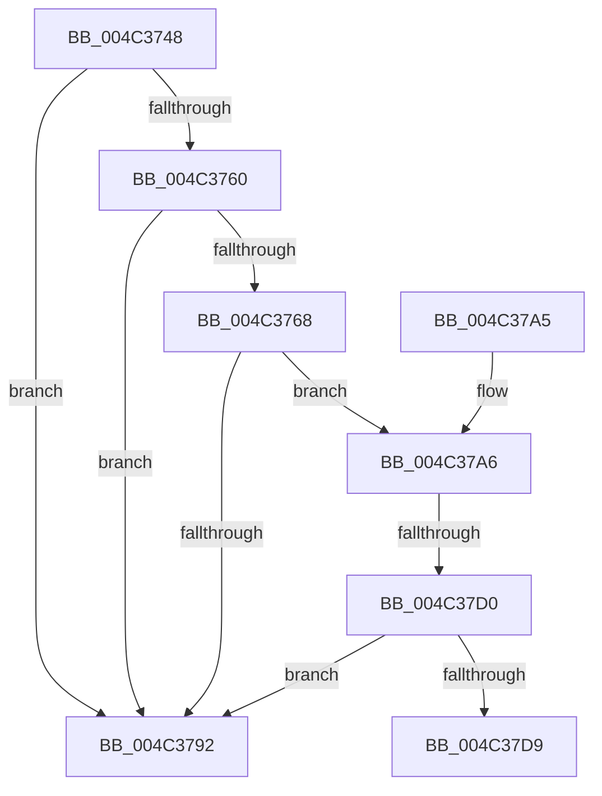

# DownLevelLanguageNameToLangID

- RVA: `0x004C3748`–`0x004C37DE` (길이 `150` bytes)
- VA: `0x00000001404C3748`
- 실행 섹션: `.text`
- PDB 이름 있음: `예`; PDB Function 태그: `예`
- unwind 정보 RVA: `0x000A7580`
- 디코드: `39`개 명령, `150/150` bytes 표시
- 미해석 바이트: `0` (있으면 어셈블리에 `.byte`로 보존)

> 이 문서는 커널 이미지의 기계어와 PDB 기호를 분석해 생성했습니다. 4번과 5번은 함수 원형과 자료형을 바이너리 사용 방식에서 추정한 C 해석이며 원본 소스 복구 결과는 아닙니다.

## 1. Dependencies

- 직접 호출 지점: **2**; 고유 호출 대상: **2**
- 직접 호출자로 확인된 함수: **5**
- RIP 상대 이미지 참조: **4**

### Outgoing calls
- `0x004C3788` → [bsearch](../50/bsearch_function_00500430.md) (function, `0x00500430`)
- `0x004C37D0` → [IsNeutralLanguageItem](IsNeutralLanguageItem_function_004CCF90.md) (function, `0x004CCF90`)

### Direct callers
- [LdrpGetParentLangId](../4B/LdrpGetParentLangId_function_004BDAC0.md) at `0x004BDBA1`
- [RtlLoadString](../../page/78/RtlLoadString_function_0078C570.md) at `0x0078C62B`
- [LdrResSearchResource](../../page/98/LdrResSearchResource_function_0098F7A0.md) at `0x0098FAF3`
- [RtlCultureNameToLCID](../../page/AA/RtlCultureNameToLCID_function_00AACEF0.md) at `0x00AACF68`
- [CmSelectQualifiedInstallLanguage](../../init/C5/CmSelectQualifiedInstallLanguage_function_00C58F58.md) at `0x00C59154`
- [CmSelectQualifiedInstallLanguage](../../init/C5/CmSelectQualifiedInstallLanguage_function_00C58F58.md) at `0x00C593CF`

### Static image references
- `0x004C3768` → RVA `0x004A8610` (`CompareLangName`; read)
- `0x004C3775` → RVA `0x00005610` (`.rdata`; read)
- `0x004C37A9` → RVA `0x000399B0` (`.rdata`; read)
- `0x004C37B9` → RVA `0x00003A90` (`.rdata`; read)

## 2. Other-region calls and transfers

- 다른 실행 섹션으로 향하는 call: **0**
- call이 아닌 외부 분기/꼬리 이동: **2**
  - `0x004C37CA` → [sub_006FCC3C](../6F/Unknown_function_006FCC3C.md) (`tail-transfer`)
  - `0x004C37D9` → [sub_006FCC3C](../6F/Unknown_function_006FCC3C.md) (`tail-transfer`)

## 3. Assembly (complete function range)

```asm
004C3748  48 89 5C 24 08                  mov qword ptr [rsp + 8], rbx
004C374D  48 89 74 24 10                  mov qword ptr [rsp + 0x10], rsi
004C3752  57                              push rdi
004C3753  48 83 EC 30                     sub rsp, 0x30
004C3757  33 FF                           xor edi, edi
004C3759  8B DA                           mov ebx, edx
004C375B  48 85 C9                        test rcx, rcx
004C375E  74 32                           je 0x1404c3792
004C3760  F7 C2 FD FF FF FF               test edx, 0xfffffffd
004C3766  75 2A                           jne 0x1404c3792
004C3768  48 8D 05 A1 4E FE FF            lea rax, [rip - 0x1b15f]
004C376F  41 B8 B3 01 00 00               mov r8d, 0x1b3
004C3775  48 8D 35 94 1E B4 FF            lea rsi, [rip - 0x4be16c]
004C377C  48 89 44 24 20                  mov qword ptr [rsp + 0x20], rax
004C3781  48 8B D6                        mov rdx, rsi
004C3784  44 8D 4F 08                     lea r9d, [rdi + 8]
004C3788  E8 A3 CC 03 00                  call 0x140500430
004C378D  48 85 C0                        test rax, rax
004C3790  75 14                           jne 0x1404c37a6
004C3792  0F B7 C7                        movzx eax, di
004C3795  48 8B 5C 24 40                  mov rbx, qword ptr [rsp + 0x40]
004C379A  48 8B 74 24 48                  mov rsi, qword ptr [rsp + 0x48]
004C379F  48 83 C4 30                     add rsp, 0x30
004C37A3  5F                              pop rdi
004C37A4  C3                              ret
004C37A5  CC                              int3
004C37A6  48 2B C6                        sub rax, rsi
004C37A9  48 8D 0D 00 62 B7 FF            lea rcx, [rip - 0x489e00]
004C37B0  48 C1 F8 03                     sar rax, 3
004C37B4  48 0F BF 0C 41                  movsx rcx, word ptr [rcx + rax*2]
004C37B9  48 8D 05 D0 02 B4 FF            lea rax, [rip - 0x4bfd30]
004C37C0  48 C1 E1 04                     shl rcx, 4
004C37C4  48 03 C8                        add rcx, rax
004C37C7  F6 C3 02                        test bl, 2
004C37CA  0F 85 6C 94 23 00               jne 0x1406fcc3c
004C37D0  E8 BB 97 00 00                  call 0x1404ccf90
004C37D5  85 C0                           test eax, eax
004C37D7  75 B9                           jne 0x1404c3792
004C37D9  E9 5E 94 23 00                  jmp 0x1406fcc3c
```

## 4. C-style interpretation (structured pseudocode)

```c
__int64 __fastcall DownLevelLanguageNameToLangID(__int64 a1, int a2)
{
    __int64 result;
    __int64 v_rdi;
    __int64 v_rsp;
    unsigned __int64 v_stack_m18;
    unsigned __int64 v_stack_p10;
    unsigned __int64 v_stack_p8;

    v_stack_p8 = v_rbx;
    v_stack_p10 = v_rsi;
    v_rsp = (v_rsp) - (48);
    v_rdi = 0;
    if (a1 == 0) goto loc_004C3792;
    if (((a2) & (0xFFFFFFFDULL)) != 0) goto loc_004C3792;
    v_stack_m18 = v_rip - 110943;
    result = bsearch(a1, v_rip - 4972908, 435, v_rdi + 8);
    if (result != 0) goto loc_004C37A6;
loc_004C3792:
    v_rsp = (v_rsp) + (48);
    return 0;
loc_004C37A6:
    result = (0) - (v_stack_p10);
    result = (result) >> (3);
    a1 = ((__int16)(*(unsigned __int16 *)(v_rip - 4759040 + result * 2))) << (4);
    a1 = (a1) + (v_rip - 4980016);
    result = IsNeutralLanguageItem(a1, v_rip - 4972908, 435, v_rdi + 8);
    if ((unsigned int)(result) != 0) goto loc_004C3792;
}
```

## 5. (Beta) C Style

```c
int64_t DownLevelLanguageNameToLangID(int64_t Arg1, int32_t Arg2)
{
    int64_t result;
    int64_t local_rdi;
    int64_t local_rsp;
    uint64_t v_stack_m18;
    uint64_t v_stack_p10;
    uint64_t v_stack_p8;

    v_stack_p8 = local_rbx;
    v_stack_p10 = local_rsi;
    local_rsp = (local_rsp) - (48);
    local_rdi = 0;
    if (Arg1 == 0) goto loc_004C3792;
    if (((Arg2) & (0xFFFFFFFDULL)) != 0) goto loc_004C3792;
    v_stack_m18 = v_rip - 110943;
    result = bsearch(Arg1, v_rip - 4972908, 435, local_rdi + 8);
    if (result != 0) goto loc_004C37A6;
loc_004C3792:
    local_rsp = (local_rsp) + (48);
    return 0;
loc_004C37A6:
    result = (0) - (v_stack_p10);
    result = (result) >> (3);
    Arg1 = ((int16_t)(*(uint16_t *)(v_rip - 0x489E00 + result * 2))) << (4);
    Arg1 = (Arg1) + (v_rip - 4980016);
    result = IsNeutralLanguageItem(Arg1, v_rip - 4972908, 435, local_rdi + 8);
    if ((uint32_t)(result) != 0) goto loc_004C3792;
}
```

## 6. Execution-region graph

[열기: 2D/3D 그래프와 함수 탐색 컨트롤 패널](../../../control-panel.html?section=text&rva=0x004C3748&view=graph)

- 2D 그래프는 위에서 아래로 흐르고, 3D 그래프는 빈 공간을 드래그해 회전합니다. Shift+드래그는 이동, 휠은 확대·축소, 함수 노드 선택은 대상 보고서 이동입니다.

### Static fallback


