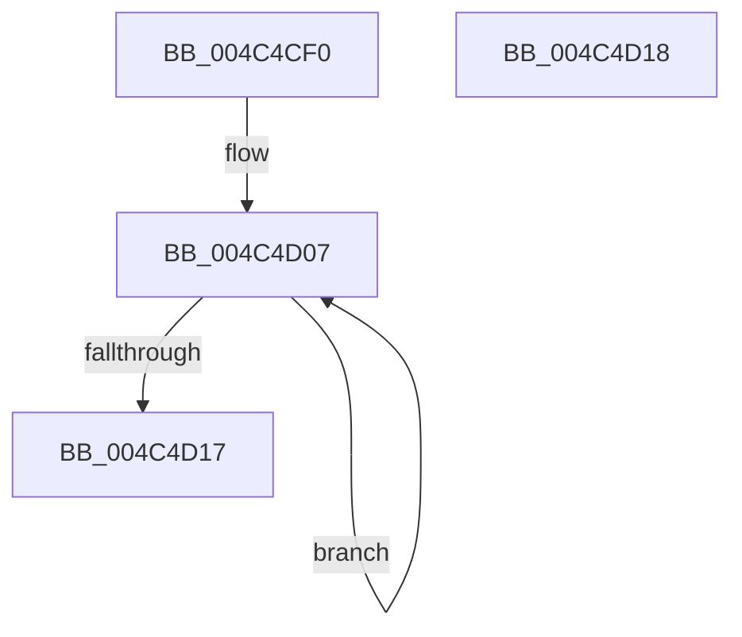

# EtwpReenableStackWalkApc

- RVA: `0x004C4CF0`–`0x004C4D19` (길이 `41` bytes)
- VA: `0x00000001404C4CF0`
- 실행 섹션: `.text`
- PDB 이름 있음: `예`; PDB Function 태그: `아니요`
- unwind 정보 RVA: `0x000DB714`
- 디코드: `11`개 명령, `41/41` bytes 표시
- 미해석 바이트: `0` (있으면 어셈블리에 `.byte`로 보존)

> 이 문서는 커널 이미지의 기계어와 PDB 기호를 분석해 생성했습니다. 4번과 5번은 함수 원형과 자료형을 바이너리 사용 방식에서 추정한 C 해석이며 원본 소스 복구 결과는 아닙니다.

## 1. Dependencies

- 직접 호출 지점: **0**; 고유 호출 대상: **0**
- 직접 호출자로 확인된 함수: **0**
- RIP 상대 이미지 참조: **0**

### Outgoing calls
- 직접 디코드된 call 명령이 없습니다.

### Direct callers
- 이 함수 시작 RVA로 연결되는 직접 call은 확인되지 않았습니다. 간접 호출은 완전히 역산할 수 없습니다.

### Static image references
- 디코드된 RIP-relative 메모리 참조가 없습니다.

## 2. Other-region calls and transfers

- 다른 실행 섹션으로 향하는 call: **0**
- 별도 외부 분기/꼬리 이동을 확인하지 못했습니다.

## 3. Assembly (complete function range)

```asm
004C4CF0  65 4C 8B 04 25 88 01 00 00      mov r8, qword ptr gs:[0x188]
004C4CF9  C1 E1 17                        shl ecx, 0x17
004C4CFC  81 C9 FF FF 7F 00               or ecx, 0x7fffff
004C4D02  41 0F 0D 48 78                  prefetchw byte ptr [r8 + 0x78]
004C4D07  41 8B 40 78                     mov eax, dword ptr [r8 + 0x78]
004C4D0B  8B D1                           mov edx, ecx
004C4D0D  23 D0                           and edx, eax
004C4D0F  F0 41 0F B1 50 78               lock cmpxchg dword ptr [r8 + 0x78], edx
004C4D15  75 F0                           jne 0x1404c4d07
004C4D17  C3                              ret
004C4D18  CC                              int3
```

## 4. C-style interpretation (structured pseudocode)

```c
__int64 __fastcall EtwpReenableStackWalkApc(int a1)
{
    a1 = (unsigned int)((a1) << (23));
    a1 = (unsigned int)((a1) | (0x7FFFFFULL));
loc_004C4D07:
    a2 = (unsigned int)(((unsigned int)(a1)) & ((unsigned int)((unsigned int)(*(unsigned int *)(*(unsigned __int64 *)(gs_base + (0 + 392)) + 120)))));
    if (condition_is_not_equal) goto loc_004C4D07;
    return (unsigned int)(*(unsigned int *)(*(unsigned __int64 *)(gs_base + (0 + 392)) + 120));
}
```

## 5. (Beta) C Style

```c
int64_t EtwpReenableStackWalkApc(int32_t Arg1)
{
    Arg1 = (uint32_t)((Arg1) << (23));
    Arg1 = (uint32_t)((Arg1) | (0x7FFFFFULL));
loc_004C4D07:
    a2 = (uint32_t)(((uint32_t)(Arg1)) & ((uint32_t)((uint32_t)(*(uint32_t *)(*(uint64_t *)(gs_base + (0 + 0x188)) + 0x78)))));
    if (condition_is_not_equal) goto loc_004C4D07;
    return (uint32_t)(*(uint32_t *)(*(uint64_t *)(gs_base + (0 + 0x188)) + 0x78));
}
```

## 6. Execution-region graph

[열기: 2D/3D 그래프와 함수 탐색 컨트롤 패널](../../../control-panel.html?section=text&rva=0x004C4CF0&view=graph)

- 2D 그래프는 위에서 아래로 흐르고, 3D 그래프는 빈 공간을 드래그해 회전합니다. Shift+드래그는 이동, 휠은 확대·축소, 함수 노드 선택은 대상 보고서 이동입니다.

### Static fallback


