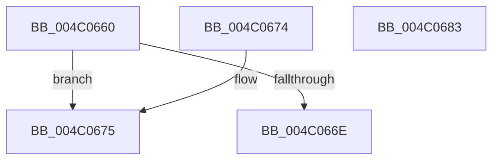

# EtwpSetQpcDeltaTracking

- RVA: `0x004C0660`–`0x004C0684` (길이 `36` bytes)
- VA: `0x00000001404C0660`
- 실행 섹션: `.text`
- PDB 이름 있음: `예`; PDB Function 태그: `아니요`
- unwind 정보 RVA: `0x000DB714`
- 디코드: `11`개 명령, `36/36` bytes 표시
- 미해석 바이트: `0` (있으면 어셈블리에 `.byte`로 보존)

> 이 문서는 커널 이미지의 기계어와 PDB 기호를 분석해 생성했습니다. 4번과 5번은 함수 원형과 자료형을 바이너리 사용 방식에서 추정한 C 해석이며 원본 소스 복구 결과는 아닙니다.

## 1. Dependencies

- 직접 호출 지점: **0**; 고유 호출 대상: **0**
- 직접 호출자로 확인된 함수: **1**
- RIP 상대 이미지 참조: **0**

### Outgoing calls
- 직접 디코드된 call 명령이 없습니다.

### Direct callers
- [EtwpStartLogger](../../page/A9/EtwpStartLogger_function_00A99D80.md) at `0x00A9A86C`

### Static image references
- 디코드된 RIP-relative 메모리 참조가 없습니다.

## 2. Other-region calls and transfers

- 다른 실행 섹션으로 향하는 call: **0**
- 별도 외부 분기/꼬리 이동을 확인하지 못했습니다.

## 3. Assembly (complete function range)

```asm
004C0660  8B 81 C8 00 00 00               mov eax, dword ptr [rcx + 0xc8]
004C0666  83 E8 03                        sub eax, 3
004C0669  83 F8 01                        cmp eax, 1
004C066C  77 07                           ja 0x1404c0675
004C066E  B8 BB 00 00 C0                  mov eax, 0xc00000bb
004C0673  C3                              ret
004C0674  CC                              int3
004C0675  F0 81 89 30 03 00 00 00 00 00 08  lock or dword ptr [rcx + 0x330], 0x8000000
004C0680  33 C0                           xor eax, eax
004C0682  C3                              ret
004C0683  CC                              int3
```

## 4. C-style interpretation (structured pseudocode)

```c
__int64 __fastcall EtwpSetQpcDeltaTracking(__int64 a1)
{
    __int64 result;

    result = (unsigned int)(((unsigned int)(*(unsigned int *)(a1 + 200))) - (3));
    if (((unsigned int)(result)) > 1) goto loc_004C0675;
    return (unsigned int)(0xC00000BBULL);
loc_004C0675:
    result = 0;
    return result;
}
```

## 5. (Beta) C Style

```c
int64_t EtwpSetQpcDeltaTracking(void *Arg1)
{
    uint8_t *arg1 = (uint8_t *)Arg1;

    int64_t result;

    result = (uint32_t)(((uint32_t)(*(uint32_t *)(arg1 + 0xC8))) - (3));
    if (((uint32_t)(result)) > 1) goto loc_004C0675;
    return (uint32_t)(0xC00000BBULL);
loc_004C0675:
    result = 0;
    return result;
}
```

### 관측된 메모리 오프셋

구조체 형식이 확인되지 않은 접근은 인자 기준의 오프셋으로만 기록했습니다.

| 기준 인자 | 오프셋 표현 | 폭 (bit) | 접근 |
|---|---:|---:|---|
| `Arg1` | `+ 0xC8` | `32` | `R` |
| `Arg1` | `+ 0x330` | `32` | `R/W` |

## 6. Execution-region graph

[열기: 2D/3D 그래프와 함수 탐색 컨트롤 패널](../../../control-panel.html?section=text&rva=0x004C0660&view=graph)

- 2D 그래프는 위에서 아래로 흐르고, 3D 그래프는 빈 공간을 드래그해 회전합니다. Shift+드래그는 이동, 휠은 확대·축소, 함수 노드 선택은 대상 보고서 이동입니다.

### Static fallback


