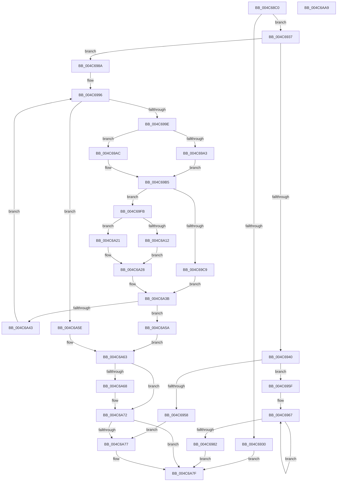

# ExAllocateCacheAwarePushLock

- RVA: `0x004C68C0`–`0x004C6AAA` (길이 `490` bytes)
- VA: `0x00000001404C68C0`
- 실행 섹션: `.text`
- PDB 이름 있음: `예`; PDB Function 태그: `아니요`
- unwind 정보 RVA: `0x000BD094`
- 디코드: `130`개 명령, `490/490` bytes 표시
- 미해석 바이트: `0` (있으면 어셈블리에 `.byte`로 보존)

> 이 문서는 커널 이미지의 기계어와 PDB 기호를 분석해 생성했습니다. 4번과 5번은 함수 원형과 자료형을 바이너리 사용 방식에서 추정한 C 해석이며 원본 소스 복구 결과는 아닙니다.

## 1. Dependencies

- 직접 호출 지점: **11**; 고유 호출 대상: **8**
- 직접 호출자로 확인된 함수: **1**
- RIP 상대 이미지 참조: **3**

### Outgoing calls
- `0x004C6923` → [ExAllocatePool2](../../poolcode/B8/ExAllocatePool2_function_00B820F0.md) (function, `0x00B820F0`)
- `0x004C694E` → [ExAllocatePool2](../../poolcode/B8/ExAllocatePool2_function_00B820F0.md) (function, `0x00B820F0`)
- `0x004C69A5` → [KeGetPrcb](../2D/KeGetPrcb_function_002D85D0.md) (function, `0x002D85D0`)
- `0x004C69F4` → [ExAllocatePool3](../../poolcode/B8/ExAllocatePool3_function_00B84270.md) (function, `0x00B84270`)
- `0x004C6A03` → [KeQueryNodeActiveAffinity](../43/KeQueryNodeActiveAffinity_function_0043EF80.md) (function, `0x0043EF80`)
- `0x004C6A17` → [KeSetSystemGroupAffinityThread](../39/KeSetSystemGroupAffinityThread_function_00399140.md) (function, `0x00399140`)
- `0x004C6A23` → [KeSetSystemGroupAffinityThread](../39/KeSetSystemGroupAffinityThread_function_00399140.md) (function, `0x00399140`)
- `0x004C6A36` → [ExAllocatePool2](../../poolcode/B8/ExAllocatePool2_function_00B820F0.md) (function, `0x00B820F0`)
- `0x004C6A6D` → [KeRevertToUserGroupAffinityThread](../39/KeRevertToUserGroupAffinityThread_function_00398EC0.md) (function, `0x00398EC0`)
- `0x004C6A7A` → [ExFreeCacheAwarePushLock](../4F/ExFreeCacheAwarePushLock_function_004FCF90.md) (function, `0x004FCF90`)
- `0x004C6A8A` → [_security_check_cookie](../6A/_security_check_cookie_function_006AC640.md) (function, `0x006AC640`)

### Direct callers
- [CmInitSystem1](../../init/C5/CmInitSystem1_function_00C559CC.md) at `0x00C55B84`

### Static image references
- `0x004C68D8` → RVA `0x00E0A740` (`.data`; read)
- `0x004C6937` → RVA `0x00FC5000` (`ALMOSTRO`; read)
- `0x004C698A` → RVA `0x00FC6A80` (`ALMOSTRO`; read)

## 2. Other-region calls and transfers

- 다른 실행 섹션으로 향하는 call: **4**
  - `0x004C6923` → [ExAllocatePool2](../../poolcode/B8/ExAllocatePool2_function_00B820F0.md) (`.text` → `POOLCODE`)
  - `0x004C694E` → [ExAllocatePool2](../../poolcode/B8/ExAllocatePool2_function_00B820F0.md) (`.text` → `POOLCODE`)
  - `0x004C69F4` → [ExAllocatePool3](../../poolcode/B8/ExAllocatePool3_function_00B84270.md) (`.text` → `POOLCODE`)
  - `0x004C6A36` → [ExAllocatePool2](../../poolcode/B8/ExAllocatePool2_function_00B820F0.md) (`.text` → `POOLCODE`)
- 별도 외부 분기/꼬리 이동을 확인하지 못했습니다.

## 3. Assembly (complete function range)

```asm
004C68C0  48 89 5C 24 08                  mov qword ptr [rsp + 8], rbx
004C68C5  48 89 6C 24 10                  mov qword ptr [rsp + 0x10], rbp
004C68CA  48 89 74 24 18                  mov qword ptr [rsp + 0x18], rsi
004C68CF  57                              push rdi
004C68D0  41 54                           push r12
004C68D2  41 57                           push r15
004C68D4  48 83 EC 70                     sub rsp, 0x70
004C68D8  48 8B 05 61 3E 94 00            mov rax, qword ptr [rip + 0x943e61]
004C68DF  48 33 C4                        xor rax, rsp
004C68E2  48 89 44 24 60                  mov qword ptr [rsp + 0x60], rax
004C68E7  0F 57 C0                        xorps xmm0, xmm0
004C68EA  BA 00 01 00 00                  mov edx, 0x100
004C68EF  0F 57 C9                        xorps xmm1, xmm1
004C68F2  BB 01 00 00 00                  mov ebx, 1
004C68F7  22 CB                           and cl, bl
004C68F9  45 32 FF                        xor r15b, r15b
004C68FC  F6 D9                           neg cl
004C68FE  41 B8 50 6C 63 70               mov r8d, 0x70636c50
004C6904  0F 11 44 24 40                  movups xmmword ptr [rsp + 0x40], xmm0
004C6909  48 1B F6                        sbb rsi, rsi
004C690C  48 81 E6 40 FF FF FF            and rsi, 0xffffffffffffff40
004C6913  48 03 F2                        add rsi, rdx
004C6916  48 8B CE                        mov rcx, rsi
004C6919  0F 11 4C 24 30                  movups xmmword ptr [rsp + 0x30], xmm1
004C691E  0F 11 44 24 50                  movups xmmword ptr [rsp + 0x50], xmm0
004C6923  E8 C8 B7 6B 00                  call 0x140b820f0
004C6928  48 8B F8                        mov rdi, rax
004C692B  48 85 C0                        test rax, rax
004C692E  75 07                           jne 0x1404c6937
004C6930  33 DB                           xor ebx, ebx
004C6932  E9 48 01 00 00                  jmp 0x1404c6a7f
004C6937  66 39 1D C2 E6 AF 00            cmp word ptr [rip + 0xafe6c2], bx
004C693E  75 4A                           jne 0x1404c698a
004C6940  BA 00 10 00 00                  mov edx, 0x1000
004C6945  41 B8 50 6C 63 6C               mov r8d, 0x6c636c50
004C694B  48 8B CE                        mov rcx, rsi
004C694E  E8 9D B7 6B 00                  call 0x140b820f0
004C6953  48 85 C0                        test rax, rax
004C6956  75 07                           jne 0x1404c695f
004C6958  33 DB                           xor ebx, ebx
004C695A  E9 18 01 00 00                  jmp 0x1404c6a77
004C695F  48 8B CF                        mov rcx, rdi
004C6962  BD 20 00 00 00                  mov ebp, 0x20
004C6967  48 83 20 00                     and qword ptr [rax], 0
004C696B  88 58 08                        mov byte ptr [rax + 8], bl
004C696E  48 89 78 10                     mov qword ptr [rax + 0x10], rdi
004C6972  48 89 01                        mov qword ptr [rcx], rax
004C6975  48 83 E8 80                     sub rax, -0x80
004C6979  48 8D 49 08                     lea rcx, [rcx + 8]
004C697D  48 2B EB                        sub rbp, rbx
004C6980  75 E5                           jne 0x1404c6967
004C6982  48 8B DF                        mov rbx, rdi
004C6985  E9 F5 00 00 00                  jmp 0x1404c6a7f
004C698A  44 8B 25 EF 00 B0 00            mov r12d, dword ptr [rip + 0xb000ef]
004C6991  33 DB                           xor ebx, ebx
004C6993  8D 6B 20                        lea ebp, [rbx + 0x20]
004C6996  3B DD                           cmp ebx, ebp
004C6998  0F 83 C0 00 00 00               jae 0x1404c6a5e
004C699E  41 3B DC                        cmp ebx, r12d
004C69A1  73 09                           jae 0x1404c69ac
004C69A3  8B CB                           mov ecx, ebx
004C69A5  E8 26 1C E1 FF                  call 0x1402d85d0
004C69AA  EB 09                           jmp 0x1404c69b5
004C69AC  65 48 8B 04 25 20 00 00 00      mov rax, qword ptr gs:[0x20]
004C69B5  48 8B 88 C0 00 00 00            mov rcx, qword ptr [rax + 0xc0]
004C69BC  0F B7 89 8A 00 00 00            movzx ecx, word ptr [rcx + 0x8a]
004C69C3  40 F6 C6 40                     test sil, 0x40
004C69C7  74 32                           je 0x1404c69fb
004C69C9  0F B7 C1                        movzx eax, cx
004C69CC  4C 8D 4C 24 30                  lea r9, [rsp + 0x30]
004C69D1  0F BA E8 1F                     bts eax, 0x1f
004C69D5  C6 44 24 30 03                  mov byte ptr [rsp + 0x30], 3
004C69DA  BA 80 00 00 00                  mov edx, 0x80
004C69DF  89 44 24 38                     mov dword ptr [rsp + 0x38], eax
004C69E3  41 B8 50 6C 63 6C               mov r8d, 0x6c636c50
004C69E9  C7 44 24 20 01 00 00 00         mov dword ptr [rsp + 0x20], 1
004C69F1  48 8B CE                        mov rcx, rsi
004C69F4  E8 77 D8 6B 00                  call 0x140b84270
004C69F9  EB 40                           jmp 0x1404c6a3b
004C69FB  45 33 C0                        xor r8d, r8d
004C69FE  48 8D 54 24 40                  lea rdx, [rsp + 0x40]
004C6A03  E8 78 85 F7 FF                  call 0x14043ef80
004C6A08  48 8D 4C 24 40                  lea rcx, [rsp + 0x40]
004C6A0D  45 84 FF                        test r15b, r15b
004C6A10  75 0F                           jne 0x1404c6a21
004C6A12  48 8D 54 24 50                  lea rdx, [rsp + 0x50]
004C6A17  E8 24 27 ED FF                  call 0x140399140
004C6A1C  41 B7 01                        mov r15b, 1
004C6A1F  EB 07                           jmp 0x1404c6a28
004C6A21  33 D2                           xor edx, edx
004C6A23  E8 18 27 ED FF                  call 0x140399140
004C6A28  BA 80 00 00 00                  mov edx, 0x80
004C6A2D  41 B8 50 6C 63 6C               mov r8d, 0x6c636c50
004C6A33  48 8B CE                        mov rcx, rsi
004C6A36  E8 B5 B6 6B 00                  call 0x140b820f0
004C6A3B  48 8B C8                        mov rcx, rax
004C6A3E  48 85 C0                        test rax, rax
004C6A41  74 17                           je 0x1404c6a5a
004C6A43  48 83 20 00                     and qword ptr [rax], 0
004C6A47  C6 40 08 00                     mov byte ptr [rax + 8], 0
004C6A4B  48 89 78 10                     mov qword ptr [rax + 0x10], rdi
004C6A4F  48 89 04 DF                     mov qword ptr [rdi + rbx*8], rax
004C6A53  FF C3                           inc ebx
004C6A55  E9 3C FF FF FF                  jmp 0x1404c6996
004C6A5A  33 DB                           xor ebx, ebx
004C6A5C  EB 05                           jmp 0x1404c6a63
004C6A5E  48 8B DF                        mov rbx, rdi
004C6A61  33 FF                           xor edi, edi
004C6A63  45 84 FF                        test r15b, r15b
004C6A66  74 0A                           je 0x1404c6a72
004C6A68  48 8D 4C 24 50                  lea rcx, [rsp + 0x50]
004C6A6D  E8 4E 24 ED FF                  call 0x140398ec0
004C6A72  48 85 FF                        test rdi, rdi
004C6A75  74 08                           je 0x1404c6a7f
004C6A77  48 8B CF                        mov rcx, rdi
004C6A7A  E8 11 65 03 00                  call 0x1404fcf90
004C6A7F  48 8B C3                        mov rax, rbx
004C6A82  48 8B 4C 24 60                  mov rcx, qword ptr [rsp + 0x60]
004C6A87  48 33 CC                        xor rcx, rsp
004C6A8A  E8 B1 5B 1E 00                  call 0x1406ac640
004C6A8F  4C 8D 5C 24 70                  lea r11, [rsp + 0x70]
004C6A94  49 8B 5B 20                     mov rbx, qword ptr [r11 + 0x20]
004C6A98  49 8B 6B 28                     mov rbp, qword ptr [r11 + 0x28]
004C6A9C  49 8B 73 30                     mov rsi, qword ptr [r11 + 0x30]
004C6AA0  49 8B E3                        mov rsp, r11
004C6AA3  41 5F                           pop r15
004C6AA5  41 5C                           pop r12
004C6AA7  5F                              pop rdi
004C6AA8  C3                              ret
004C6AA9  CC                              int3
```

## 4. C-style interpretation (structured pseudocode)

```c
__int64 __fastcall ExAllocateCacheAwarePushLock(unsigned __int8 a1)
{
    __int64 result;
    __int64 v_r15;
    __int64 v_rbp;
    __int64 v_rbx;
    __int64 v_rdi;
    __int64 v_rsi;
    __int64 v_rsp;
    unsigned __int64 v_stack_m18;
    unsigned __int64 v_stack_m28;
    unsigned __int64 v_stack_m38;
    unsigned __int64 v_stack_m48;
    unsigned int v_stack_m50;
    unsigned __int64 v_stack_m58;
    unsigned int v_stack_m68;
    unsigned __int64 v_stack_p10;
    unsigned __int64 v_stack_p18;
    unsigned __int64 v_stack_p8;

    v_stack_p8 = v_rbx;
    v_stack_p10 = v_rbp;
    v_stack_p18 = v_rsi;
    v_rsp = (v_rsp) - (112);
    result = (*(unsigned __int64 *)(v_rip + 9715297)) ^ (v_rsp);
    v_stack_m28 = result;
    a1 = (unsigned __int8)((a1) & (1));
    v_r15 = 0;
    a1 = (unsigned __int8)(-(a1));
    v_stack_m48 = v_xmm0;
    v_rsi = (v_rsi) & (-192);
    v_rsi = (v_rsi) + (256);
    v_stack_m58 = v_xmm1;
    v_stack_m38 = v_xmm0;
    result = ExAllocatePool2(v_rsi, 256, (unsigned int)(0x70636C50ULL), a4);
    if (result != 0) goto loc_004C6937;
    v_rbx = 0;
    goto loc_004C6A7F;
loc_004C6937:
    if ((*(unsigned __int16 *)(v_rip + 11527874)) != 0) goto loc_004C698A;
    result = ExAllocatePool2(v_rsi, (unsigned int)(0x1000ULL), (unsigned int)(0x6C636C50ULL), a4);
    if (result != 0) goto loc_004C695F;
    v_rbx = 0;
    goto loc_004C6A77;
loc_004C695F:
loc_004C6967:
    *(unsigned __int8 *)(result + 8) = 0;
    *(unsigned __int64 *)(result + 16) = result;
    *(unsigned __int64 *)(result) = result;
    result = (result) - (-128);
    v_rbp = (32) - (0);
    if (condition_is_not_equal) goto loc_004C6967;
    goto loc_004C6A7F;
loc_004C698A:
    v_rbx = 0;
loc_004C6996:
    if (0 >= ((unsigned int)(v_rbx + 32))) goto loc_004C6A5E;
    if (0 >= ((unsigned int)((unsigned int)(*(unsigned int *)(v_rip + 11534575))))) goto loc_004C69AC;
    result = KeGetPrcb(0, (unsigned int)(0x1000ULL), (unsigned int)(0x6C636C50ULL), a4);
    goto loc_004C69B5;
loc_004C69AC:
loc_004C69B5:
    if ((((unsigned __int8)(v_rsi)) & (64)) == 0) goto loc_004C69FB;
    v_stack_m58 = 3;
    v_stack_m50 = (unsigned int)((unsigned __int16)(*(unsigned __int16 *)(*(unsigned __int64 *)(*(unsigned __int64 *)(gs_base + (0 + 32)) + 192) + 138)));
    v_stack_m68 = 1;
    result = ExAllocatePool3(v_rsi, 128, (unsigned int)(0x6C636C50ULL), v_stack_m58);
    goto loc_004C6A3B;
loc_004C69FB:
    a3 = 0;
    result = KeQueryNodeActiveAffinity(v_rsi, v_stack_m48, a3, v_stack_m58);
    if (0 != 0) goto loc_004C6A21;
    result = KeSetSystemGroupAffinityThread(v_stack_m48, v_stack_m38, a3, v_stack_m58);
    goto loc_004C6A28;
loc_004C6A21:
    a2 = 0;
    result = KeSetSystemGroupAffinityThread(v_stack_m48, a2, a3, v_stack_m58);
loc_004C6A28:
    result = ExAllocatePool2(v_rsi, 128, (unsigned int)(0x6C636C50ULL), v_stack_m58);
loc_004C6A3B:
    if (result == 0) goto loc_004C6A5A;
    *(unsigned __int8 *)(result + 8) = 0;
    *(unsigned __int64 *)(result + 16) = result;
    *(unsigned __int64 *)(result + v_rbx * 8) = result;
    v_rbx = (unsigned int)((v_rbx) + 1);
    goto loc_004C6996;
loc_004C6A5A:
    v_rbx = 0;
    goto loc_004C6A63;
loc_004C6A5E:
    v_rdi = 0;
loc_004C6A63:
    if (1 != 0) {
        a1 = v_stack_m38;
        result = KeRevertToUserGroupAffinityThread(a1, 128, (unsigned int)(0x6C636C50ULL), v_stack_m58);
    }
    if (0 != 0) {
        a1 = 0;
        result = ExFreeCacheAwarePushLock(a1, 128, (unsigned int)(0x6C636C50ULL), v_stack_m58);
    }
    a1 = (v_stack_m28) ^ (v_rsp);
    result = _security_check_cookie(a1, 128, (unsigned int)(0x6C636C50ULL), v_stack_m58);
    return result;
}
```

## 5. (Beta) C Style

```c
int64_t ExAllocateCacheAwarePushLock(uint8_t Arg1)
{
    int64_t result;
    int64_t local_r15;
    int64_t local_rbp;
    int64_t local_rbx;
    int64_t local_rdi;
    int64_t local_rsi;
    int64_t local_rsp;
    uint64_t v_stack_m18;
    uint64_t v_stack_m28;
    uint64_t v_stack_m38;
    uint64_t v_stack_m48;
    uint32_t v_stack_m50;
    uint64_t v_stack_m58;
    uint32_t v_stack_m68;
    uint64_t v_stack_p10;
    uint64_t v_stack_p18;
    uint64_t v_stack_p8;

    v_stack_p8 = local_rbx;
    v_stack_p10 = local_rbp;
    v_stack_p18 = local_rsi;
    local_rsp = (local_rsp) - (112);
    result = (*(uint64_t *)(v_rip + 0x943E61)) ^ (local_rsp);
    v_stack_m28 = result;
    Arg1 = (uint8_t)((Arg1) & (1));
    local_r15 = 0;
    Arg1 = (uint8_t)(-(Arg1));
    v_stack_m48 = v_xmm0;
    local_rsi = (local_rsi) & (-192);
    local_rsi = (local_rsi) + (256);
    v_stack_m58 = v_xmm1;
    v_stack_m38 = v_xmm0;
    result = ExAllocatePool2(local_rsi, 256, (uint32_t)(0x70636C50ULL), a4);
    if (result != 0) goto loc_004C6937;
    local_rbx = 0;
    goto loc_004C6A7F;
loc_004C6937:
    if ((*(uint16_t *)(v_rip + 0xAFE6C2)) != 0) goto loc_004C698A;
    result = ExAllocatePool2(local_rsi, (uint32_t)(0x1000ULL), (uint32_t)(0x6C636C50ULL), a4);
    if (result != 0) goto loc_004C695F;
    local_rbx = 0;
    goto loc_004C6A77;
loc_004C695F:
loc_004C6967:
    *(uint8_t *)(result + 0x8) = 0;
    *(uint64_t *)(result + 0x10) = result;
    *(uint64_t *)(result) = result;
    result = (result) - (-128);
    local_rbp = (32) - (0);
    if (condition_is_not_equal) goto loc_004C6967;
    goto loc_004C6A7F;
loc_004C698A:
    local_rbx = 0;
loc_004C6996:
    if (0 >= ((uint32_t)(local_rbx + 32))) goto loc_004C6A5E;
    if (0 >= ((uint32_t)((uint32_t)(*(uint32_t *)(v_rip + 0xB000EF))))) goto loc_004C69AC;
    result = KeGetPrcb(0, (uint32_t)(0x1000ULL), (uint32_t)(0x6C636C50ULL), a4);
    goto loc_004C69B5;
loc_004C69AC:
loc_004C69B5:
    if ((((uint8_t)(local_rsi)) & (64)) == 0) goto loc_004C69FB;
    v_stack_m58 = 3;
    v_stack_m50 = (uint32_t)((uint16_t)(*(uint16_t *)(*(uint64_t *)(*(uint64_t *)(gs_base + (0 + 0x20)) + 0xC0) + 0x8A)));
    v_stack_m68 = 1;
    result = ExAllocatePool3(local_rsi, 128, (uint32_t)(0x6C636C50ULL), v_stack_m58);
    goto loc_004C6A3B;
loc_004C69FB:
    a3 = 0;
    result = KeQueryNodeActiveAffinity(local_rsi, v_stack_m48, a3, v_stack_m58);
    if (0 != 0) goto loc_004C6A21;
    result = KeSetSystemGroupAffinityThread(v_stack_m48, v_stack_m38, a3, v_stack_m58);
    goto loc_004C6A28;
loc_004C6A21:
    a2 = 0;
    result = KeSetSystemGroupAffinityThread(v_stack_m48, a2, a3, v_stack_m58);
loc_004C6A28:
    result = ExAllocatePool2(local_rsi, 128, (uint32_t)(0x6C636C50ULL), v_stack_m58);
loc_004C6A3B:
    if (result == 0) goto loc_004C6A5A;
    *(uint8_t *)(result + 0x8) = 0;
    *(uint64_t *)(result + 0x10) = result;
    *(uint64_t *)(result + local_rbx * 8) = result;
    local_rbx = (uint32_t)((local_rbx) + 1);
    goto loc_004C6996;
loc_004C6A5A:
    local_rbx = 0;
    goto loc_004C6A63;
loc_004C6A5E:
    local_rdi = 0;
loc_004C6A63:
    if (1 != 0) {
        Arg1 = v_stack_m38;
        result = KeRevertToUserGroupAffinityThread(Arg1, 128, (uint32_t)(0x6C636C50ULL), v_stack_m58);
    }
    if (0 != 0) {
        Arg1 = 0;
        result = ExFreeCacheAwarePushLock(Arg1, 128, (uint32_t)(0x6C636C50ULL), v_stack_m58);
    }
    Arg1 = (v_stack_m28) ^ (local_rsp);
    result = _security_check_cookie(Arg1, 128, (uint32_t)(0x6C636C50ULL), v_stack_m58);
    return result;
}
```

## 6. Execution-region graph

[열기: 2D/3D 그래프와 함수 탐색 컨트롤 패널](../../../control-panel.html?section=text&rva=0x004C68C0&view=graph)

- 2D 그래프는 위에서 아래로 흐르고, 3D 그래프는 빈 공간을 드래그해 회전합니다. Shift+드래그는 이동, 휠은 확대·축소, 함수 노드 선택은 대상 보고서 이동입니다.

### Static fallback


