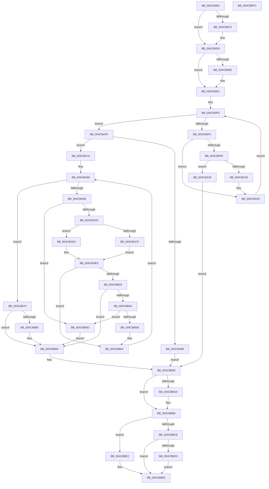

# ExGetWakeTimerList

- RVA: `0x004CB964`–`0x004CBBFD` (길이 `665` bytes)
- VA: `0x00000001404CB964`
- 실행 섹션: `.text`
- PDB 이름 있음: `예`; PDB Function 태그: `아니요`
- unwind 정보 RVA: `0x000BD668`
- 디코드: `168`개 명령, `665/665` bytes 표시
- 미해석 바이트: `0` (있으면 어셈블리에 `.byte`로 보존)

> 이 문서는 커널 이미지의 기계어와 PDB 기호를 분석해 생성했습니다. 4번과 5번은 함수 원형과 자료형을 바이너리 사용 방식에서 추정한 C 해석이며 원본 소스 복구 결과는 아닙니다.

## 1. Dependencies

- 직접 호출 지점: **12**; 고유 호출 대상: **11**
- 직접 호출자로 확인된 함수: **1**
- RIP 상대 이미지 참조: **3**

### Outgoing calls
- `0x004CB9AF` → [KeAbPreAcquire](../21/KeAbPreAcquire_function_00210230.md) (function, `0x00210230`)
- `0x004CB9D4` → [ExfAcquirePushLockExclusiveEx](../20/ExfAcquirePushLockExclusiveEx_function_0020FC90.md) (function, `0x0020FC90`)
- `0x004CBA0A` → [PoStoreDiagnosticContext](../23/PoStoreDiagnosticContext_function_0023009C.md) (function, `0x0023009C`)
- `0x004CBA59` → [ExAllocatePool2](../../poolcode/B8/ExAllocatePool2_function_00B820F0.md) (function, `0x00B820F0`)
- `0x004CBAA8` → [KeAcquireSpinLockRaiseToDpc](../20/KeAcquireSpinLockRaiseToDpc_function_00208470.md) (function, `0x00208470`)
- `0x004CBADB` → [KeQueryTimerDueTime](../49/KeQueryTimerDueTime_function_00499CC0.md) (function, `0x00499CC0`)
- `0x004CBAF4` → [KeReleaseSpinLock](../39/KeReleaseSpinLock_function_00392BA0.md) (function, `0x00392BA0`)
- `0x004CBB39` → [PoStoreDiagnosticContext](../23/PoStoreDiagnosticContext_function_0023009C.md) (function, `0x0023009C`)
- `0x004CBBB1` → [ExfTryToWakePushLock](../26/ExfTryToWakePushLock_function_00265DD0.md) (function, `0x00265DD0`)
- `0x004CBBBD` → [KeAbPostRelease](../2E/KeAbPostRelease_function_002E1600.md) (function, `0x002E1600`)
- `0x004CBBC5` → [KeLeaveCriticalRegionThread](../25/KeLeaveCriticalRegionThread_function_0025EFF0.md) (function, `0x0025EFF0`)
- `0x004CBBDB` → [ExFreePoolWithTag](../../poolcode/B8/ExFreePoolWithTag_function_00B82870.md) (function, `0x00B82870`)

### Direct callers
- [NtPowerInformation](../../page/95/NtPowerInformation_function_00955D80.md) at `0x009571E1`

### Static image references
- `0x004CB996` → RVA `0x00EFABA8` (`.data`; read)
- `0x004CB9B4` → RVA `0x00EFABA8` (`.data`; read/write)
- `0x004CB9E2` → RVA `0x00EFAB90` (`.data`; read)

## 2. Other-region calls and transfers

- 다른 실행 섹션으로 향하는 call: **2**
  - `0x004CBA59` → [ExAllocatePool2](../../poolcode/B8/ExAllocatePool2_function_00B820F0.md) (`.text` → `POOLCODE`)
  - `0x004CBBDB` → [ExFreePoolWithTag](../../poolcode/B8/ExFreePoolWithTag_function_00B82870.md) (`.text` → `POOLCODE`)
- 별도 외부 분기/꼬리 이동을 확인하지 못했습니다.

## 3. Assembly (complete function range)

```asm
004CB964  48 89 54 24 10                  mov qword ptr [rsp + 0x10], rdx
004CB969  48 89 4C 24 08                  mov qword ptr [rsp + 8], rcx
004CB96E  53                              push rbx
004CB96F  55                              push rbp
004CB970  56                              push rsi
004CB971  57                              push rdi
004CB972  41 54                           push r12
004CB974  41 55                           push r13
004CB976  41 56                           push r14
004CB978  41 57                           push r15
004CB97A  48 83 EC 48                     sub rsp, 0x48
004CB97E  65 48 8B 34 25 88 01 00 00      mov rsi, qword ptr gs:[0x188]
004CB987  4C 8B F2                        mov r14, rdx
004CB98A  4C 8B E1                        mov r12, rcx
004CB98D  48 89 74 24 28                  mov qword ptr [rsp + 0x28], rsi
004CB992  48 83 CB FF                     or rbx, 0xffffffffffffffff
004CB996  48 8D 0D 0B F2 A2 00            lea rcx, [rip + 0xa2f20b]
004CB99D  45 33 C0                        xor r8d, r8d
004CB9A0  33 D2                           xor edx, edx
004CB9A2  66 01 9E E4 01 00 00            add word ptr [rsi + 0x1e4], bx
004CB9A9  33 ED                           xor ebp, ebp
004CB9AB  90                              nop
004CB9AC  45 33 FF                        xor r15d, r15d
004CB9AF  E8 7C 48 D4 FF                  call 0x140210230
004CB9B4  F0 48 0F BA 2D EA F1 A2 00 00   lock bts qword ptr [rip + 0xa2f1ea], 0
004CB9BE  48 8B F8                        mov rdi, rax
004CB9C1  73 16                           jae 0x1404cb9d9
004CB9C3  4C 8D 05 DE F1 A2 00            lea r8, [rip + 0xa2f1de]
004CB9CA  48 8B D0                        mov rdx, rax
004CB9CD  48 8D 0D D4 F1 A2 00            lea rcx, [rip + 0xa2f1d4]
004CB9D4  E8 B7 42 D4 FF                  call 0x14020fc90
004CB9D9  48 85 FF                        test rdi, rdi
004CB9DC  74 04                           je 0x1404cb9e2
004CB9DE  C6 47 0A 01                     mov byte ptr [rdi + 0xa], 1
004CB9E2  48 8B 3D A7 F1 A2 00            mov rdi, qword ptr [rip + 0xa2f1a7]
004CB9E9  48 8D 05 A0 F1 A2 00            lea rax, [rip + 0xa2f1a0]
004CB9F0  48 3B F8                        cmp rdi, rax
004CB9F3  74 4A                           je 0x1404cba3f
004CB9F5  48 8B 4F F8                     mov rcx, qword ptr [rdi - 8]
004CB9F9  48 85 C9                        test rcx, rcx
004CB9FC  74 32                           je 0x1404cba30
004CB9FE  4C 21 7C 24 20                  and qword ptr [rsp + 0x20], r15
004CBA03  4C 8D 44 24 20                  lea r8, [rsp + 0x20]
004CBA08  33 D2                           xor edx, edx
004CBA0A  E8 8D 46 D6 FF                  call 0x14023009c
004CBA0F  48 8B 44 24 20                  mov rax, qword ptr [rsp + 0x20]
004CBA14  48 83 C0 1F                     add rax, 0x1f
004CBA18  48 03 E8                        add rbp, rax
004CBA1B  B8 FF FF FF FF                  mov eax, 0xffffffff
004CBA20  48 83 E5 F8                     and rbp, 0xfffffffffffffff8
004CBA24  48 3B E8                        cmp rbp, rax
004CBA27  77 0C                           ja 0x1404cba35
004CBA29  48 8D 05 60 F1 A2 00            lea rax, [rip + 0xa2f160]
004CBA30  48 8B 3F                        mov rdi, qword ptr [rdi]
004CBA33  EB BB                           jmp 0x1404cb9f0
004CBA35  BF 23 00 00 C0                  mov edi, 0xc0000023
004CBA3A  E9 5A 01 00 00                  jmp 0x1404cbb99
004CBA3F  B8 40 00 00 00                  mov eax, 0x40
004CBA44  48 85 ED                        test rbp, rbp
004CBA47  41 B8 57 6B 4C 73               mov r8d, 0x734c6b57
004CBA4D  B9 01 01 00 00                  mov ecx, 0x101
004CBA52  48 0F 44 E8                     cmove rbp, rax
004CBA56  48 8B D5                        mov rdx, rbp
004CBA59  E8 92 66 6B 00                  call 0x140b820f0
004CBA5E  4C 8B F8                        mov r15, rax
004CBA61  48 85 C0                        test rax, rax
004CBA64  75 0A                           jne 0x1404cba70
004CBA66  BF 9A 00 00 C0                  mov edi, 0xc000009a
004CBA6B  E9 29 01 00 00                  jmp 0x1404cbb99
004CBA70  4C 8B 25 19 F1 A2 00            mov r12, qword ptr [rip + 0xa2f119]
004CBA77  33 FF                           xor edi, edi
004CBA79  33 F6                           xor esi, esi
004CBA7B  4C 8B F0                        mov r14, rax
004CBA7E  48 89 74 24 20                  mov qword ptr [rsp + 0x20], rsi
004CBA83  4C 8B ED                        mov r13, rbp
004CBA86  48 8D 05 03 F1 A2 00            lea rax, [rip + 0xa2f103]
004CBA8D  4C 3B E0                        cmp r12, rax
004CBA90  0F 84 DE 00 00 00               je 0x1404cbb74
004CBA96  49 83 FD 40                     cmp r13, 0x40
004CBA9A  0F 82 CD 00 00 00               jb 0x1404cbb6d
004CBAA0  49 8D 8C 24 38 FF FF FF         lea rcx, [r12 - 0xc8]
004CBAA8  E8 C3 C9 D3 FF                  call 0x140208470
004CBAAD  49 8B 4C 24 F8                  mov rcx, qword ptr [r12 - 8]
004CBAB2  41 8B 54 24 E8                  mov edx, dword ptr [r12 - 0x18]
004CBAB7  88 84 24 A0 00 00 00            mov byte ptr [rsp + 0xa0], al
004CBABE  48 89 4C 24 38                  mov qword ptr [rsp + 0x38], rcx
004CBAC3  89 94 24 A8 00 00 00            mov dword ptr [rsp + 0xa8], edx
004CBACA  48 85 C9                        test rcx, rcx
004CBACD  75 04                           jne 0x1404cbad3
004CBACF  33 C0                           xor eax, eax
004CBAD1  EB 0D                           jmp 0x1404cbae0
004CBAD3  49 8D 8C 24 F8 FE FF FF         lea rcx, [r12 - 0x108]
004CBADB  E8 E0 E1 FC FF                  call 0x140499cc0
004CBAE0  8A 94 24 A0 00 00 00            mov dl, byte ptr [rsp + 0xa0]
004CBAE7  49 8D 8C 24 38 FF FF FF         lea rcx, [r12 - 0xc8]
004CBAEF  48 89 44 24 30                  mov qword ptr [rsp + 0x30], rax
004CBAF4  E8 A7 70 EC FF                  call 0x140392ba0
004CBAF9  48 8B 44 24 30                  mov rax, qword ptr [rsp + 0x30]
004CBAFE  48 85 C0                        test rax, rax
004CBB01  74 61                           je 0x1404cbb64
004CBB03  48 8B 4C 24 38                  mov rcx, qword ptr [rsp + 0x38]
004CBB08  4C 8D 44 24 20                  lea r8, [rsp + 0x20]
004CBB0D  48 BA 08 00 00 00 80 F7 FF FF   movabs rdx, 0xfffff78000000008
004CBB17  48 8B 12                        mov rdx, qword ptr [rdx]
004CBB1A  48 2B C2                        sub rax, rdx
004CBB1D  49 8D 56 18                     lea rdx, [r14 + 0x18]
004CBB21  49 89 46 08                     mov qword ptr [r14 + 8], rax
004CBB25  8B 84 24 A8 00 00 00            mov eax, dword ptr [rsp + 0xa8]
004CBB2C  41 89 46 10                     mov dword ptr [r14 + 0x10], eax
004CBB30  49 8D 45 E8                     lea rax, [r13 - 0x18]
004CBB34  48 89 44 24 20                  mov qword ptr [rsp + 0x20], rax
004CBB39  E8 5E 45 D6 FF                  call 0x14023009c
004CBB3E  8B F8                           mov edi, eax
004CBB40  85 C0                           test eax, eax
004CBB42  78 40                           js 0x1404cbb84
004CBB44  48 8B 74 24 20                  mov rsi, qword ptr [rsp + 0x20]
004CBB49  48 83 C6 1F                     add rsi, 0x1f
004CBB4D  48 83 E6 F8                     and rsi, 0xfffffffffffffff8
004CBB51  48 89 74 24 20                  mov qword ptr [rsp + 0x20], rsi
004CBB56  4C 3B EE                        cmp r13, rsi
004CBB59  72 12                           jb 0x1404cbb6d
004CBB5B  4C 2B EE                        sub r13, rsi
004CBB5E  49 89 36                        mov qword ptr [r14], rsi
004CBB61  4C 03 F6                        add r14, rsi
004CBB64  4D 8B 24 24                     mov r12, qword ptr [r12]
004CBB68  E9 19 FF FF FF                  jmp 0x1404cba86
004CBB6D  BF 23 00 00 C0                  mov edi, 0xc0000023
004CBB72  EB 10                           jmp 0x1404cbb84
004CBB74  4C 2B F6                        sub r14, rsi
004CBB77  49 83 26 00                     and qword ptr [r14], 0
004CBB7B  48 85 F6                        test rsi, rsi
004CBB7E  75 04                           jne 0x1404cbb84
004CBB80  49 21 76 08                     and qword ptr [r14 + 8], rsi
004CBB84  48 8B 74 24 28                  mov rsi, qword ptr [rsp + 0x28]
004CBB89  4C 8B B4 24 98 00 00 00         mov r14, qword ptr [rsp + 0x98]
004CBB91  4C 8B A4 24 90 00 00 00         mov r12, qword ptr [rsp + 0x90]
004CBB99  F0 48 0F C1 1D 06 F0 A2 00      lock xadd qword ptr [rip + 0xa2f006], rbx
004CBBA2  80 E3 06                        and bl, 6
004CBBA5  80 FB 02                        cmp bl, 2
004CBBA8  75 0C                           jne 0x1404cbbb6
004CBBAA  48 8D 0D F7 EF A2 00            lea rcx, [rip + 0xa2eff7]
004CBBB1  E8 1A A2 D9 FF                  call 0x140265dd0
004CBBB6  48 8D 0D EB EF A2 00            lea rcx, [rip + 0xa2efeb]
004CBBBD  E8 3E 5A E1 FF                  call 0x1402e1600
004CBBC2  48 8B CE                        mov rcx, rsi
004CBBC5  E8 26 34 D9 FF                  call 0x14025eff0
004CBBCA  85 FF                           test edi, edi
004CBBCC  79 14                           jns 0x1404cbbe2
004CBBCE  4D 85 FF                        test r15, r15
004CBBD1  74 16                           je 0x1404cbbe9
004CBBD3  BA 57 6B 4C 73                  mov edx, 0x734c6b57
004CBBD8  49 8B CF                        mov rcx, r15
004CBBDB  E8 90 6C 6B 00                  call 0x140b82870
004CBBE0  EB 07                           jmp 0x1404cbbe9
004CBBE2  4D 89 3C 24                     mov qword ptr [r12], r15
004CBBE6  41 89 2E                        mov dword ptr [r14], ebp
004CBBE9  8B C7                           mov eax, edi
004CBBEB  48 83 C4 48                     add rsp, 0x48
004CBBEF  41 5F                           pop r15
004CBBF1  41 5E                           pop r14
004CBBF3  41 5D                           pop r13
004CBBF5  41 5C                           pop r12
004CBBF7  5F                              pop rdi
004CBBF8  5E                              pop rsi
004CBBF9  5D                              pop rbp
004CBBFA  5B                              pop rbx
004CBBFB  C3                              ret
004CBBFC  CC                              int3
```

## 4. C-style interpretation (structured pseudocode)

```c
__int64 __fastcall ExGetWakeTimerList(__int64 a1, __int64 a2, int a3)
{
    __int64 result;
    __int64 v_r13;
    __int64 v_r14;
    __int64 v_r15;
    __int64 v_rbp;
    __int64 v_rbx;
    __int64 v_rdi;
    __int64 v_rsi;
    __int64 v_rsp;
    unsigned __int64 v_stack_m50;
    unsigned __int64 v_stack_m58;
    unsigned __int64 v_stack_m60;
    unsigned __int64 v_stack_m68;
    unsigned __int64 v_stack_p10;
    unsigned __int8 v_stack_p18;
    unsigned int v_stack_p20;
    unsigned __int64 v_stack_p8;

    v_stack_p10 = a2;
    v_stack_p8 = a1;
    v_rsp = (v_rsp) - (72);
    v_stack_m60 = *(unsigned __int64 *)(gs_base + (0 + 392));
    v_rbx = (v_rbx) | (-1);
    a3 = 0;
    a2 = 0;
    v_rbp = 0;
    v_r15 = 0;
    result = KeAbPreAcquire(v_rip + 10678795, a2, a3, a4);
    if (!(condition_is_above_or_equal)) {
        a3 = v_rip + 10678750;
        a2 = result;
        a1 = v_rip + 10678740;
        result = ExfAcquirePushLockExclusiveEx(a1, a2, a3, a4);
    }
    if (result != 0) {
        *(unsigned __int8 *)(result + 10) = 1;
    }
loc_004CB9F0:
    if ((*(unsigned __int64 *)(v_rip + 10678695)) == (v_rip + 10678688)) goto loc_004CBA3F;
    if (*(unsigned __int64 *)(*(unsigned __int64 *)(v_rip + 10678695) - 8) == 0) goto loc_004CBA30;
    a2 = 0;
    result = PoStoreDiagnosticContext(*(unsigned __int64 *)(*(unsigned __int64 *)(v_rip + 10678695) - 8), a2, v_stack_m68, a4);
    result = (v_stack_m68) + (31);
    v_rbp = (v_rbp) + (result);
    v_rbp = (v_rbp) & (-8);
    if (v_rbp > ((unsigned int)(0xFFFFFFFFULL))) goto loc_004CBA35;
loc_004CBA30:
    goto loc_004CB9F0;
loc_004CBA35:
    goto loc_004CBB99;
loc_004CBA3F:
    if (v_rbp == 0) { v_rbp = 64; }
    result = ExAllocatePool2(257, v_rbp, (unsigned int)(0x734C6B57ULL), a4);
    if (result != 0) goto loc_004CBA70;
    goto loc_004CBB99;
loc_004CBA70:
    v_rdi = 0;
    v_rsi = 0;
    v_stack_m68 = 0;
loc_004CBA86:
    if ((*(unsigned __int64 *)(v_rip + 10678553)) == (v_rip + 10678531)) goto loc_004CBB74;
    if (v_rbp < 64) goto loc_004CBB6D;
    result = KeAcquireSpinLockRaiseToDpc(*(unsigned __int64 *)(v_rip + 10678553) - 200, v_rbp, (unsigned int)(0x734C6B57ULL), a4);
    v_stack_p18 = (unsigned __int8)(result);
    v_stack_m50 = *(unsigned __int64 *)(*(unsigned __int64 *)(v_rip + 10678553) - 8);
    v_stack_p20 = (unsigned int)((unsigned int)(*(unsigned int *)(*(unsigned __int64 *)(v_rip + 10678553) - 24)));
    if (*(unsigned __int64 *)(*(unsigned __int64 *)(v_rip + 10678553) - 8) != 0) goto loc_004CBAD3;
    result = 0;
    goto loc_004CBAE0;
loc_004CBAD3:
    result = KeQueryTimerDueTime(*(unsigned __int64 *)(v_rip + 10678553) - 264, (unsigned int)(*(unsigned int *)(*(unsigned __int64 *)(v_rip + 10678553) - 24)), (unsigned int)(0x734C6B57ULL), a4);
loc_004CBAE0:
    v_stack_m58 = result;
    result = KeReleaseSpinLock(*(unsigned __int64 *)(v_rip + 10678553) - 200, v_stack_p18, (unsigned int)(0x734C6B57ULL), a4);
    if (v_stack_m58 == 0) goto loc_004CBB64;
    result = (v_stack_m58) - (*(unsigned __int64 *)(v_stack_p18));
    *(unsigned __int64 *)(result + 8) = result;
    *(unsigned int *)(result + 16) = (unsigned int)((unsigned int)(v_stack_p20));
    v_stack_m68 = v_rbp - 24;
    result = PoStoreDiagnosticContext(v_stack_m50, result + 24, v_stack_m68, a4);
    if (sign_flag) goto loc_004CBB84;
    v_rsi = (v_stack_m68) + (31);
    v_rsi = (v_rsi) & (-8);
    v_stack_m68 = v_rsi;
    if (v_rbp < v_rsi) goto loc_004CBB6D;
    v_r13 = (v_rbp) - (v_rsi);
    *(unsigned __int64 *)(result) = v_rsi;
    v_r14 = (result) + (v_rsi);
loc_004CBB64:
    goto loc_004CBA86;
loc_004CBB6D:
    goto loc_004CBB84;
loc_004CBB74:
    v_r14 = (v_r14) - (v_rsi);
    if (v_rsi == 0) {
    }
loc_004CBB99:
    v_rbx = (unsigned __int8)((v_rbx) & (6));
    if (((unsigned __int8)(v_rbx)) == 2) {
        a1 = v_rip + 10678263;
        result = ExfTryToWakePushLock(a1, result + 24, v_stack_m68, a4);
    }
    result = KeAbPostRelease(v_rip + 10678251, result + 24, v_stack_m68, a4);
    result = KeLeaveCriticalRegionThread(v_stack_m60, result + 24, v_stack_m68, a4);
    if (!sign_flag) goto loc_004CBBE2;
    if (result == 0) goto loc_004CBBE9;
    result = ExFreePoolWithTag(result, (unsigned int)(0x734C6B57ULL), v_stack_m68, a4);
    goto loc_004CBBE9;
loc_004CBBE2:
    *(unsigned __int64 *)(v_stack_p8) = result;
    *(unsigned int *)(v_stack_p10) = (unsigned int)(v_rbp);
loc_004CBBE9:
    v_rsp = (v_rsp) + (72);
    return (unsigned int)((unsigned int)((unsigned int)(0xC0000023ULL)));
}
```

## 5. (Beta) C Style

```c
int64_t ExGetWakeTimerList(int64_t Arg1, int64_t Arg2, int32_t Arg3)
{
    int64_t result;
    int64_t local_r13;
    int64_t local_r14;
    int64_t local_r15;
    int64_t local_rbp;
    int64_t local_rbx;
    int64_t local_rdi;
    int64_t local_rsi;
    int64_t local_rsp;
    uint64_t v_stack_m50;
    uint64_t v_stack_m58;
    uint64_t v_stack_m60;
    uint64_t v_stack_m68;
    uint64_t v_stack_p10;
    uint8_t v_stack_p18;
    uint32_t v_stack_p20;
    uint64_t v_stack_p8;

    v_stack_p10 = Arg2;
    v_stack_p8 = Arg1;
    local_rsp = (local_rsp) - (72);
    v_stack_m60 = *(uint64_t *)(gs_base + (0 + 0x188));
    local_rbx = (local_rbx) | (-1);
    Arg3 = 0;
    Arg2 = 0;
    local_rbp = 0;
    local_r15 = 0;
    result = KeAbPreAcquire(v_rip + 10678795, Arg2, Arg3, a4);
    if (!(condition_is_above_or_equal)) {
        Arg3 = v_rip + 10678750;
        Arg2 = result;
        Arg1 = v_rip + 10678740;
        result = ExfAcquirePushLockExclusiveEx(Arg1, Arg2, Arg3, a4);
    }
    if (result != 0) {
        *(uint8_t *)(result + 0xA) = 1;
    }
loc_004CB9F0:
    if ((*(uint64_t *)(v_rip + 0xA2F1A7)) == (v_rip + 10678688)) goto loc_004CBA3F;
    if (*(uint64_t *)(*(uint64_t *)(v_rip + 0xA2F1A7) - 0x8) == 0) goto loc_004CBA30;
    Arg2 = 0;
    result = PoStoreDiagnosticContext(*(uint64_t *)(*(uint64_t *)(v_rip + 0xA2F1A7) - 0x8), Arg2, v_stack_m68, a4);
    result = (v_stack_m68) + (31);
    local_rbp = (local_rbp) + (result);
    local_rbp = (local_rbp) & (-8);
    if (local_rbp > ((uint32_t)(0xFFFFFFFFULL))) goto loc_004CBA35;
loc_004CBA30:
    goto loc_004CB9F0;
loc_004CBA35:
    goto loc_004CBB99;
loc_004CBA3F:
    if (local_rbp == 0) { local_rbp = 64; }
    result = ExAllocatePool2(257, local_rbp, (uint32_t)(0x734C6B57ULL), a4);
    if (result != 0) goto loc_004CBA70;
    goto loc_004CBB99;
loc_004CBA70:
    local_rdi = 0;
    local_rsi = 0;
    v_stack_m68 = 0;
loc_004CBA86:
    if ((*(uint64_t *)(v_rip + 0xA2F119)) == (v_rip + 10678531)) goto loc_004CBB74;
    if (local_rbp < 64) goto loc_004CBB6D;
    result = KeAcquireSpinLockRaiseToDpc(*(uint64_t *)(v_rip + 0xA2F119) - 200, local_rbp, (uint32_t)(0x734C6B57ULL), a4);
    v_stack_p18 = (uint8_t)(result);
    v_stack_m50 = *(uint64_t *)(*(uint64_t *)(v_rip + 0xA2F119) - 0x8);
    v_stack_p20 = (uint32_t)((uint32_t)(*(uint32_t *)(*(uint64_t *)(v_rip + 0xA2F119) - 0x18)));
    if (*(uint64_t *)(*(uint64_t *)(v_rip + 0xA2F119) - 0x8) != 0) goto loc_004CBAD3;
    result = 0;
    goto loc_004CBAE0;
loc_004CBAD3:
    result = KeQueryTimerDueTime(*(uint64_t *)(v_rip + 0xA2F119) - 264, (uint32_t)(*(uint32_t *)(*(uint64_t *)(v_rip + 0xA2F119) - 0x18)), (uint32_t)(0x734C6B57ULL), a4);
loc_004CBAE0:
    v_stack_m58 = result;
    result = KeReleaseSpinLock(*(uint64_t *)(v_rip + 0xA2F119) - 200, v_stack_p18, (uint32_t)(0x734C6B57ULL), a4);
    if (v_stack_m58 == 0) goto loc_004CBB64;
    result = (v_stack_m58) - (*(uint64_t *)(v_stack_p18));
    *(uint64_t *)(result + 0x8) = result;
    *(uint32_t *)(result + 0x10) = (uint32_t)((uint32_t)(v_stack_p20));
    v_stack_m68 = local_rbp - 24;
    result = PoStoreDiagnosticContext(v_stack_m50, result + 24, v_stack_m68, a4);
    if (sign_flag) goto loc_004CBB84;
    local_rsi = (v_stack_m68) + (31);
    local_rsi = (local_rsi) & (-8);
    v_stack_m68 = local_rsi;
    if (local_rbp < local_rsi) goto loc_004CBB6D;
    local_r13 = (local_rbp) - (local_rsi);
    *(uint64_t *)(result) = local_rsi;
    local_r14 = (result) + (local_rsi);
loc_004CBB64:
    goto loc_004CBA86;
loc_004CBB6D:
    goto loc_004CBB84;
loc_004CBB74:
    local_r14 = (local_r14) - (local_rsi);
    if (local_rsi == 0) {
    }
loc_004CBB99:
    local_rbx = (uint8_t)((local_rbx) & (6));
    if (((uint8_t)(local_rbx)) == 2) {
        Arg1 = v_rip + 10678263;
        result = ExfTryToWakePushLock(Arg1, result + 24, v_stack_m68, a4);
    }
    result = KeAbPostRelease(v_rip + 10678251, result + 24, v_stack_m68, a4);
    result = KeLeaveCriticalRegionThread(v_stack_m60, result + 24, v_stack_m68, a4);
    if (!sign_flag) goto loc_004CBBE2;
    if (result == 0) goto loc_004CBBE9;
    result = ExFreePoolWithTag(result, (uint32_t)(0x734C6B57ULL), v_stack_m68, a4);
    goto loc_004CBBE9;
loc_004CBBE2:
    *(uint64_t *)(v_stack_p8) = result;
    *(uint32_t *)(v_stack_p10) = (uint32_t)(local_rbp);
loc_004CBBE9:
    local_rsp = (local_rsp) + (72);
    return (uint32_t)((uint32_t)((uint32_t)(0xC0000023ULL)));
}
```

## 6. Execution-region graph

[열기: 2D/3D 그래프와 함수 탐색 컨트롤 패널](../../../control-panel.html?section=text&rva=0x004CB964&view=graph)

- 2D 그래프는 위에서 아래로 흐르고, 3D 그래프는 빈 공간을 드래그해 회전합니다. Shift+드래그는 이동, 휠은 확대·축소, 함수 노드 선택은 대상 보고서 이동입니다.

### Static fallback


