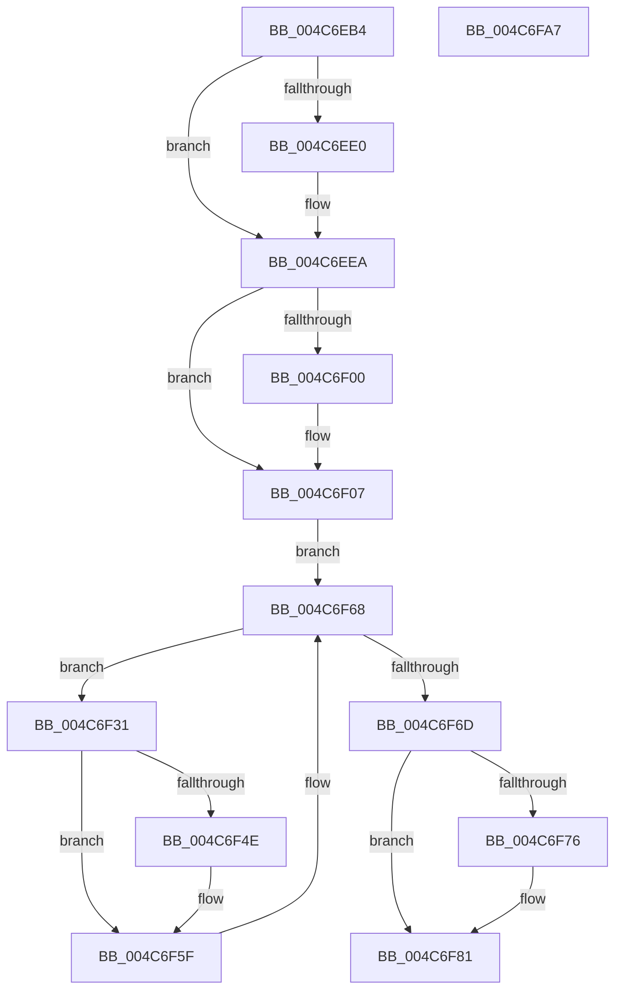

# ExWakeTimersPause

- RVA: `0x004C6EB4`–`0x004C6FA8` (길이 `244` bytes)
- VA: `0x00000001404C6EB4`
- 실행 섹션: `.text`
- PDB 이름 있음: `예`; PDB Function 태그: `아니요`
- unwind 정보 RVA: `0x0008A350`
- 디코드: `61`개 명령, `244/244` bytes 표시
- 미해석 바이트: `0` (있으면 어셈블리에 `.byte`로 보존)

> 이 문서는 커널 이미지의 기계어와 PDB 기호를 분석해 생성했습니다. 4번과 5번은 함수 원형과 자료형을 바이너리 사용 방식에서 추정한 C 해석이며 원본 소스 복구 결과는 아닙니다.

## 1. Dependencies

- 직접 호출 지점: **6**; 고유 호출 대상: **6**
- 직접 호출자로 확인된 함수: **1**
- RIP 상대 이미지 참조: **3**

### Outgoing calls
- `0x004C6EE5` → [ExfAcquirePushLockExclusiveEx](../20/ExfAcquirePushLockExclusiveEx_function_0020FC90.md) (function, `0x0020FC90`)
- `0x004C6F02` → [KiRaiseIrqlProcessIrqlFlags](../4F/KiRaiseIrqlProcessIrqlFlags_function_004F56FC.md) (function, `0x004F56FC`)
- `0x004C6F3F` → [KeAcquireSpinLockAtDpcLevel](../20/KeAcquireSpinLockAtDpcLevel_function_00208430.md) (function, `0x00208430`)
- `0x004C6F5A` → [ExpTimerPause](../3D/ExpTimerPause_function_003D38C4.md) (function, `0x003D38C4`)
- `0x004C6F63` → [KxReleaseSpinLock](../20/KxReleaseSpinLock_function_00206670.md) (function, `0x00206670`)
- `0x004C6F7C` → [KiLowerIrqlProcessIrqlFlags](../4F/KiLowerIrqlProcessIrqlFlags_function_004F5698.md) (function, `0x004F5698`)

### Direct callers
- [PopTransitionSystemPowerStateEx](../../pagelk/B7/PopTransitionSystemPowerStateEx_function_00B7E8C0.md) at `0x00B7F1A2`

### Static image references
- `0x004C6ED1` → RVA `0x00EFABA8` (`.data`; read)
- `0x004C6EF7` → RVA `0x00FC6D20` (`ALMOSTRO`; read)
- `0x004C6F11` → RVA `0x00EFAB90` (`.data`; read)

## 2. Other-region calls and transfers

- 다른 실행 섹션으로 향하는 call: **0**
- 별도 외부 분기/꼬리 이동을 확인하지 못했습니다.

## 3. Assembly (complete function range)

```asm
004C6EB4  48 8B C4                        mov rax, rsp
004C6EB7  48 89 58 08                     mov qword ptr [rax + 8], rbx
004C6EBB  48 89 68 10                     mov qword ptr [rax + 0x10], rbp
004C6EBF  48 89 70 18                     mov qword ptr [rax + 0x18], rsi
004C6EC3  48 89 78 20                     mov qword ptr [rax + 0x20], rdi
004C6EC7  41 55                           push r13
004C6EC9  41 56                           push r14
004C6ECB  41 57                           push r15
004C6ECD  48 83 EC 20                     sub rsp, 0x20
004C6ED1  48 8D 0D D0 3C A3 00            lea rcx, [rip + 0xa33cd0]
004C6ED8  F0 48 0F BA 29 00               lock bts qword ptr [rcx], 0
004C6EDE  73 0A                           jae 0x1404c6eea
004C6EE0  4C 8B C1                        mov r8, rcx
004C6EE3  33 D2                           xor edx, edx
004C6EE5  E8 A6 8D D4 FF                  call 0x14020fc90
004C6EEA  44 0F 20 C3                     mov rbx, cr8
004C6EEE  BA 02 00 00 00                  mov edx, 2
004C6EF3  44 0F 22 C2                     mov cr8, rdx
004C6EF7  83 3D 22 FE AF 00 00            cmp dword ptr [rip + 0xaffe22], 0
004C6EFE  74 07                           je 0x1404c6f07
004C6F00  8A CB                           mov cl, bl
004C6F02  E8 F5 E7 02 00                  call 0x1404f56fc
004C6F07  49 BE 08 00 00 00 80 F7 FF FF   movabs r14, 0xfffff78000000008
004C6F11  4C 8D 2D 78 3C A3 00            lea r13, [rip + 0xa33c78]
004C6F18  49 BF 14 00 00 00 80 F7 FF FF   movabs r15, 0xfffff78000000014
004C6F22  4D 8B 36                        mov r14, qword ptr [r14]
004C6F25  4D 8B 3F                        mov r15, qword ptr [r15]
004C6F28  48 8B 3D 61 3C A3 00            mov rdi, qword ptr [rip + 0xa33c61]
004C6F2F  EB 37                           jmp 0x1404c6f68
004C6F31  48 8D B7 F8 FE FF FF            lea rsi, [rdi - 0x108]
004C6F38  48 8B 3F                        mov rdi, qword ptr [rdi]
004C6F3B  48 8D 4E 40                     lea rcx, [rsi + 0x40]
004C6F3F  E8 EC 14 D4 FF                  call 0x140208430
004C6F44  48 83 BE 00 01 00 00 00         cmp qword ptr [rsi + 0x100], 0
004C6F4C  74 11                           je 0x1404c6f5f
004C6F4E  41 B1 01                        mov r9b, 1
004C6F51  4D 8B C6                        mov r8, r14
004C6F54  49 8B D7                        mov rdx, r15
004C6F57  48 8B CE                        mov rcx, rsi
004C6F5A  E8 65 C9 F0 FF                  call 0x1403d38c4
004C6F5F  48 8D 4E 40                     lea rcx, [rsi + 0x40]
004C6F63  E8 08 F7 D3 FF                  call 0x140206670
004C6F68  49 3B FD                        cmp rdi, r13
004C6F6B  75 C4                           jne 0x1404c6f31
004C6F6D  83 3D AC FD AF 00 00            cmp dword ptr [rip + 0xaffdac], 0
004C6F74  74 0B                           je 0x1404c6f81
004C6F76  44 0F 20 C1                     mov rcx, cr8
004C6F7A  8A D3                           mov dl, bl
004C6F7C  E8 17 E7 02 00                  call 0x1404f5698
004C6F81  0F B6 C3                        movzx eax, bl
004C6F84  44 0F 22 C0                     mov cr8, rax
004C6F88  48 8B 5C 24 40                  mov rbx, qword ptr [rsp + 0x40]
004C6F8D  48 8B 6C 24 48                  mov rbp, qword ptr [rsp + 0x48]
004C6F92  48 8B 74 24 50                  mov rsi, qword ptr [rsp + 0x50]
004C6F97  48 8B 7C 24 58                  mov rdi, qword ptr [rsp + 0x58]
004C6F9C  48 83 C4 20                     add rsp, 0x20
004C6FA0  41 5F                           pop r15
004C6FA2  41 5E                           pop r14
004C6FA4  41 5D                           pop r13
004C6FA6  C3                              ret
004C6FA7  CC                              int3
```

## 4. C-style interpretation (structured pseudocode)

```c
__int64 __fastcall ExWakeTimersPause(__int64 a1, int a2)
{
    __int64 result;
    __int64 v_rsp;
    unsigned __int64 v_stack_p10;
    unsigned __int64 v_stack_p18;
    unsigned __int64 v_stack_p20;
    unsigned __int64 v_stack_p8;

    *(unsigned __int64 *)(v_rsp + 8) = v_rbx;
    *(unsigned __int64 *)(v_rsp + 16) = v_rbp;
    *(unsigned __int64 *)(v_rsp + 24) = v_rsi;
    *(unsigned __int64 *)(v_rsp + 32) = v_rdi;
    v_rsp = (v_rsp) - (32);
    result = v_rsp;
    if (!(condition_is_above_or_equal)) {
        a3 = v_rip + 10697936;
        a2 = 0;
        result = ExfAcquirePushLockExclusiveEx(v_rip + 10697936, a2, a3, a4);
    }
    if ((*(unsigned int *)(v_rip + 11533858)) != 0) {
        a1 = (unsigned __int8)(v_cr8);
        result = KiRaiseIrqlProcessIrqlFlags(a1, 2, a3, a4);
    }
    goto loc_004C6F68;
loc_004C6F31:
    result = KeAcquireSpinLockAtDpcLevel(*(unsigned __int64 *)(v_rip + 10697825) - 264 + 64, 2, a3, a4);
    if ((*(unsigned __int64 *)(*(unsigned __int64 *)(v_rip + 10697825) - 264 + 256)) != 0) {
        a4 = 1;
        a3 = *(unsigned __int64 *)(v_r14);
        a2 = *(unsigned __int64 *)(v_r15);
        a1 = *(unsigned __int64 *)(v_rip + 10697825) - 264;
        result = ExpTimerPause(a1, a2, a3, a4);
    }
    result = KxReleaseSpinLock(*(unsigned __int64 *)(v_rip + 10697825) - 264 + 64, a2, a3, a4);
loc_004C6F68:
    if ((*(unsigned __int64 *)(*(unsigned __int64 *)(v_rip + 10697825))) != (v_rip + 10697848)) goto loc_004C6F31;
    if ((*(unsigned int *)(v_rip + 11533740)) != 0) {
        a1 = 2;
        a2 = (unsigned __int8)(v_cr8);
        result = KiLowerIrqlProcessIrqlFlags(a1, a2, a3, a4);
    }
    v_rsp = (v_rsp) + (32);
    return (unsigned __int8)(v_cr8);
}
```

## 5. (Beta) C Style

```c
int64_t ExWakeTimersPause(int64_t Arg1, int32_t Arg2)
{
    int64_t result;
    int64_t local_rsp;
    uint64_t v_stack_p10;
    uint64_t v_stack_p18;
    uint64_t v_stack_p20;
    uint64_t v_stack_p8;

    *(uint64_t *)(local_rsp + 0x8) = local_rbx;
    *(uint64_t *)(local_rsp + 0x10) = local_rbp;
    *(uint64_t *)(local_rsp + 0x18) = local_rsi;
    *(uint64_t *)(local_rsp + 0x20) = local_rdi;
    local_rsp = (local_rsp) - (32);
    result = local_rsp;
    if (!(condition_is_above_or_equal)) {
        a3 = v_rip + 10697936;
        Arg2 = 0;
        result = ExfAcquirePushLockExclusiveEx(v_rip + 10697936, Arg2, a3, a4);
    }
    if ((*(uint32_t *)(v_rip + 0xAFFE22)) != 0) {
        Arg1 = (uint8_t)(v_cr8);
        result = KiRaiseIrqlProcessIrqlFlags(Arg1, 2, a3, a4);
    }
    goto loc_004C6F68;
loc_004C6F31:
    result = KeAcquireSpinLockAtDpcLevel(*(uint64_t *)(v_rip + 0xA33C61) - 264 + 64, 2, a3, a4);
    if ((*(uint64_t *)(*(uint64_t *)(v_rip + 0xA33C61) - 0x108 + 0x100)) != 0) {
        a4 = 1;
        a3 = *(uint64_t *)(local_r14);
        Arg2 = *(uint64_t *)(local_r15);
        Arg1 = *(uint64_t *)(v_rip + 0xA33C61) - 264;
        result = ExpTimerPause(Arg1, Arg2, a3, a4);
    }
    result = KxReleaseSpinLock(*(uint64_t *)(v_rip + 0xA33C61) - 264 + 64, Arg2, a3, a4);
loc_004C6F68:
    if ((*(uint64_t *)(*(uint64_t *)(v_rip + 0xA33C61))) != (v_rip + 10697848)) goto loc_004C6F31;
    if ((*(uint32_t *)(v_rip + 0xAFFDAC)) != 0) {
        Arg1 = 2;
        Arg2 = (uint8_t)(v_cr8);
        result = KiLowerIrqlProcessIrqlFlags(Arg1, Arg2, a3, a4);
    }
    local_rsp = (local_rsp) + (32);
    return (uint8_t)(v_cr8);
}
```

## 6. Execution-region graph

[열기: 2D/3D 그래프와 함수 탐색 컨트롤 패널](../../../control-panel.html?section=text&rva=0x004C6EB4&view=graph)

- 2D 그래프는 위에서 아래로 흐르고, 3D 그래프는 빈 공간을 드래그해 회전합니다. Shift+드래그는 이동, 휠은 확대·축소, 함수 노드 선택은 대상 보고서 이동입니다.

### Static fallback


