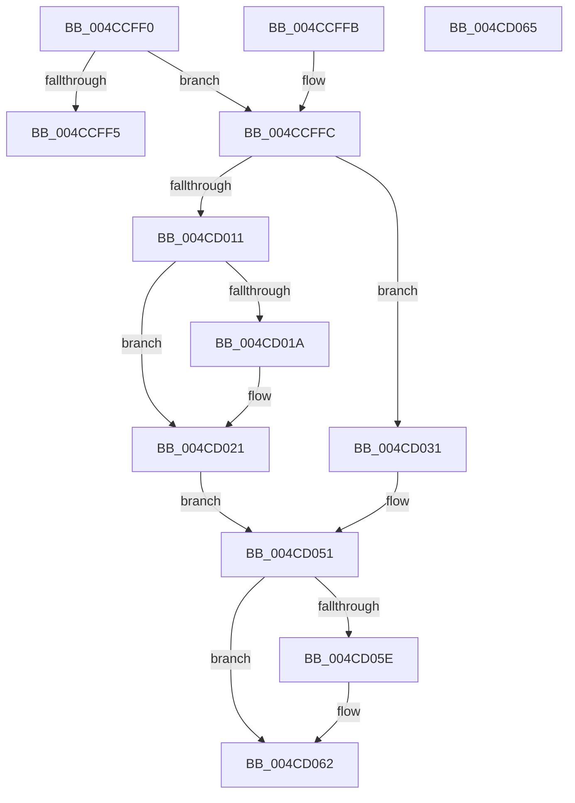

# HalGetDmaAdapterInfo

- RVA: `0x004CCFF0`–`0x004CD066` (길이 `118` bytes)
- VA: `0x00000001404CCFF0`
- 실행 섹션: `.text`
- PDB 이름 있음: `예`; PDB Function 태그: `아니요`
- unwind 정보 RVA: `0x000DB714`
- 디코드: `30`개 명령, `118/118` bytes 표시
- 미해석 바이트: `0` (있으면 어셈블리에 `.byte`로 보존)

> 이 문서는 커널 이미지의 기계어와 PDB 기호를 분석해 생성했습니다. 4번과 5번은 함수 원형과 자료형을 바이너리 사용 방식에서 추정한 C 해석이며 원본 소스 복구 결과는 아닙니다.

## 1. Dependencies

- 직접 호출 지점: **0**; 고유 호출 대상: **0**
- 직접 호출자로 확인된 함수: **0**
- RIP 상대 이미지 참조: **0**

### Outgoing calls
- 직접 디코드된 call 명령이 없습니다.

### Direct callers
- 이 함수 시작 RVA로 연결되는 직접 call은 확인되지 않았습니다. 간접 호출은 완전히 역산할 수 없습니다.

### Static image references
- 디코드된 RIP-relative 메모리 참조가 없습니다.

## 2. Other-region calls and transfers

- 다른 실행 섹션으로 향하는 call: **0**
- 별도 외부 분기/꼬리 이동을 확인하지 못했습니다.

## 3. Assembly (complete function range)

```asm
004CCFF0  83 3A 01                        cmp dword ptr [rdx], 1
004CCFF3  74 07                           je 0x1404ccffc
004CCFF5  B8 BB 00 00 C0                  mov eax, 0xc00000bb
004CCFFA  C3                              ret
004CCFFB  CC                              int3
004CCFFC  8B 81 C0 01 00 00               mov eax, dword ptr [rcx + 0x1c0]
004CD002  45 33 C9                        xor r9d, r9d
004CD005  89 42 0C                        mov dword ptr [rdx + 0xc], eax
004CD008  44 38 89 B9 01 00 00            cmp byte ptr [rcx + 0x1b9], r9b
004CD00F  74 20                           je 0x1404cd031
004CD011  44 38 89 B8 01 00 00            cmp byte ptr [rcx + 0x1b8], r9b
004CD018  75 07                           jne 0x1404cd021
004CD01A  C7 42 10 03 00 00 00            mov dword ptr [rdx + 0x10], 3
004CD021  83 4A 08 FF                     or dword ptr [rdx + 8], 0xffffffff
004CD025  41 B8 01 00 00 00               mov r8d, 1
004CD02B  44 89 4A 04                     mov dword ptr [rdx + 4], r9d
004CD02F  EB 20                           jmp 0x1404cd051
004CD031  48 8B 81 70 01 00 00            mov rax, qword ptr [rcx + 0x170]
004CD038  41 B8 01 00 00 00               mov r8d, 1
004CD03E  44 89 42 04                     mov dword ptr [rdx + 4], r8d
004CD042  44 89 42 08                     mov dword ptr [rdx + 8], r8d
004CD046  44 89 4A 10                     mov dword ptr [rdx + 0x10], r9d
004CD04A  44 8B 80 A4 00 00 00            mov r8d, dword ptr [rax + 0xa4]
004CD051  44 89 42 14                     mov dword ptr [rdx + 0x14], r8d
004CD055  83 B9 08 02 00 00 02            cmp dword ptr [rcx + 0x208], 2
004CD05C  75 04                           jne 0x1404cd062
004CD05E  83 4A 10 04                     or dword ptr [rdx + 0x10], 4
004CD062  33 C0                           xor eax, eax
004CD064  C3                              ret
004CD065  CC                              int3
```

## 4. C-style interpretation (structured pseudocode)

```c
__int64 __fastcall HalGetDmaAdapterInfo(__int64 a1, __int64 a2, __int64 a3, int a4)
{
    __int64 result;

    if ((*(unsigned int *)(a2)) == 1) goto loc_004CCFFC;
    return (unsigned int)(0xC00000BBULL);
loc_004CCFFC:
    a4 = 0;
    *(unsigned int *)(a2 + 12) = (unsigned int)((unsigned int)(*(unsigned int *)(a1 + 448)));
    if ((*(unsigned __int8 *)(a1 + 441)) == 0) goto loc_004CD031;
    if ((*(unsigned __int8 *)(a1 + 440)) == 0) {
        *(unsigned int *)(a2 + 16) = 3;
    }
    *(unsigned int *)(a2 + 4) = 0;
    goto loc_004CD051;
loc_004CD031:
    *(unsigned int *)(a2 + 4) = 1;
    *(unsigned int *)(a2 + 8) = 1;
    *(unsigned int *)(a2 + 16) = 0;
loc_004CD051:
    *(unsigned int *)(a2 + 20) = (unsigned int)((unsigned int)(*(unsigned int *)(*(unsigned __int64 *)(a1 + 368) + 164)));
    if ((*(unsigned int *)(a1 + 520)) == 2) {
    }
    result = 0;
    return result;
}
```

## 5. (Beta) C Style

```c
int64_t HalGetDmaAdapterInfo(void *Arg1, void *Arg2, int64_t Arg3, int32_t Arg4)
{
    uint8_t *arg1 = (uint8_t *)Arg1;
    uint8_t *arg2 = (uint8_t *)Arg2;

    int64_t result;

    if ((*(uint32_t *)(arg2)) == 1) goto loc_004CCFFC;
    return (uint32_t)(0xC00000BBULL);
loc_004CCFFC:
    Arg4 = 0;
    *(uint32_t *)(arg2 + 0xC) = (uint32_t)((uint32_t)(*(uint32_t *)(arg1 + 0x1C0)));
    if ((*(uint8_t *)(arg1 + 0x1B9)) == 0) goto loc_004CD031;
    if ((*(uint8_t *)(arg1 + 0x1B8)) == 0) {
        *(uint32_t *)(arg2 + 0x10) = 3;
    }
    *(uint32_t *)(arg2 + 0x4) = 0;
    goto loc_004CD051;
loc_004CD031:
    *(uint32_t *)(arg2 + 0x4) = 1;
    *(uint32_t *)(arg2 + 0x8) = 1;
    *(uint32_t *)(arg2 + 0x10) = 0;
loc_004CD051:
    *(uint32_t *)(arg2 + 0x14) = (uint32_t)((uint32_t)(*(uint32_t *)(*(uint64_t *)(arg1 + 0x170) + 0xA4)));
    if ((*(uint32_t *)(arg1 + 0x208)) == 2) {
    }
    result = 0;
    return result;
}
```

### 관측된 메모리 오프셋

구조체 형식이 확인되지 않은 접근은 인자 기준의 오프셋으로만 기록했습니다.

| 기준 인자 | 오프셋 표현 | 폭 (bit) | 접근 |
|---|---:|---:|---|
| `Arg1` | `+ 0x170` | `64` | `R` |
| `Arg1` | `+ 0x1B8` | `8` | `R` |
| `Arg1` | `+ 0x1B9` | `8` | `R` |
| `Arg1` | `+ 0x1C0` | `32` | `R` |
| `Arg1` | `+ 0x208` | `32` | `R` |
| `Arg2` | `+ 0x0` | `32` | `R` |
| `Arg2` | `+ 0x4` | `32` | `W` |
| `Arg2` | `+ 0x8` | `32` | `R/W` |
| `Arg2` | `+ 0x8` | `32` | `W` |
| `Arg2` | `+ 0xC` | `32` | `W` |
| `Arg2` | `+ 0x10` | `32` | `R/W` |
| `Arg2` | `+ 0x10` | `32` | `W` |
| `Arg2` | `+ 0x14` | `32` | `W` |

## 6. Execution-region graph

[열기: 2D/3D 그래프와 함수 탐색 컨트롤 패널](../../../control-panel.html?section=text&rva=0x004CCFF0&view=graph)

- 2D 그래프는 위에서 아래로 흐르고, 3D 그래프는 빈 공간을 드래그해 회전합니다. Shift+드래그는 이동, 휠은 확대·축소, 함수 노드 선택은 대상 보고서 이동입니다.

### Static fallback


