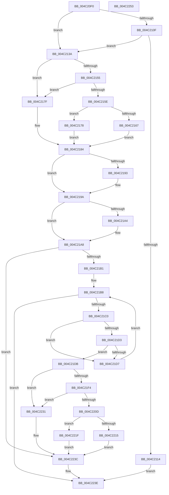

# HalGetInterruptTargetInformation

- RVA: `0x004C20F0`–`0x004C2254` (길이 `356` bytes)
- VA: `0x00000001404C20F0`
- 실행 섹션: `.text`
- PDB 이름 있음: `예`; PDB Function 태그: `아니요`
- unwind 정보 RVA: `0x00066400`
- 디코드: `97`개 명령, `356/356` bytes 표시
- 미해석 바이트: `0` (있으면 어셈블리에 `.byte`로 보존)

> 이 문서는 커널 이미지의 기계어와 PDB 기호를 분석해 생성했습니다. 4번과 5번은 함수 원형과 자료형을 바이너리 사용 방식에서 추정한 C 해석이며 원본 소스 복구 결과는 아닙니다.

## 1. Dependencies

- 직접 호출 지점: **2**; 고유 호출 대상: **2**
- 직접 호출자로 확인된 함수: **1**
- RIP 상대 이미지 참조: **10**

### Outgoing calls
- `0x004C212B` → [HalpInterruptSetProblemEx](../48/HalpInterruptSetProblemEx_function_0048AC8C.md) (function, `0x0048AC8C`)
- `0x004C218A` → [HalpInterruptIsMsiSupported](HalpInterruptIsMsiSupported_function_004C225C.md) (function, `0x004C225C`)

### Direct callers
- [PoInitSystem](../../init/C7/PoInitSystem_function_00C72358.md) at `0x00C72F46`

### Static image references
- `0x004C211E` → RVA `0x00023C30` (`.rdata`; read)
- `0x004C2149` → RVA `0x00E10204` (`.data`; read)
- `0x004C2155` → RVA `0x00F90708` (`.data`; read)
- `0x004C215E` → RVA `0x00F90698` (`.data`; read)
- `0x004C2167` → RVA `0x00E101DC` (`.data`; read)
- `0x004C219A` → RVA `0x00FC1C44` (`.data`; read)
- `0x004C21B8` → RVA `0x00E10200` (`.data`; read)
- `0x004C21C6` → RVA `0x00FC3E30` (`.data`; read)
- `0x004C21DE` → RVA `0x00E101E8` (`.data`; read)
- `0x004C21FC` → RVA `0x00FC3908` (`.data`; read)

## 2. Other-region calls and transfers

- 다른 실행 섹션으로 향하는 call: **0**
- 별도 외부 분기/꼬리 이동을 확인하지 못했습니다.

## 3. Assembly (complete function range)

```asm
004C20F0  48 8B C4                        mov rax, rsp
004C20F3  48 89 58 08                     mov qword ptr [rax + 8], rbx
004C20F7  48 89 68 10                     mov qword ptr [rax + 0x10], rbp
004C20FB  48 89 70 18                     mov qword ptr [rax + 0x18], rsi
004C20FF  57                              push rdi
004C2100  48 83 EC 30                     sub rsp, 0x30
004C2104  49 8B D8                        mov rbx, r8
004C2107  8B EA                           mov ebp, edx
004C2109  8B F1                           mov esi, ecx
004C210B  85 C9                           test ecx, ecx
004C210D  74 2B                           je 0x1404c213a
004C210F  83 F9 02                        cmp ecx, 2
004C2112  74 26                           je 0x1404c213a
004C2114  45 33 C0                        xor r8d, r8d
004C2117  C7 40 E8 E6 01 00 00            mov dword ptr [rax - 0x18], 0x1e6
004C211E  4C 8D 0D 0B 1B B6 FF            lea r9, [rip - 0x49e4f5]
004C2125  33 C9                           xor ecx, ecx
004C2127  41 8D 50 13                     lea edx, [r8 + 0x13]
004C212B  E8 5C 8B FC FF                  call 0x14048ac8c
004C2130  B8 0D 00 00 C0                  mov eax, 0xc000000d
004C2135  E9 04 01 00 00                  jmp 0x1404c223e
004C213A  49 83 60 04 00                  and qword ptr [r8 + 4], 0
004C213F  49 83 60 0C 00                  and qword ptr [r8 + 0xc], 0
004C2144  41 83 60 18 00                  and dword ptr [r8 + 0x18], 0
004C2149  80 3D B4 E0 94 00 00            cmp byte ptr [rip + 0x94e0b4], 0
004C2150  41 89 30                        mov dword ptr [r8], esi
004C2153  75 2A                           jne 0x1404c217f
004C2155  80 3D AC E5 AC 00 00            cmp byte ptr [rip + 0xace5ac], 0
004C215C  74 21                           je 0x1404c217f
004C215E  80 3D 33 E5 AC 00 00            cmp byte ptr [rip + 0xace533], 0
004C2165  74 11                           je 0x1404c2178
004C2167  8B 05 6F E0 94 00               mov eax, dword ptr [rip + 0x94e06f]
004C216D  BF 03 00 00 00                  mov edi, 3
004C2172  41 89 40 18                     mov dword ptr [r8 + 0x18], eax
004C2176  EB 0C                           jmp 0x1404c2184
004C2178  BF 02 00 00 00                  mov edi, 2
004C217D  EB 05                           jmp 0x1404c2184
004C217F  BF 01 00 00 00                  mov edi, 1
004C2184  33 C9                           xor ecx, ecx
004C2186  41 89 78 14                     mov dword ptr [r8 + 0x14], edi
004C218A  E8 CD 00 00 00                  call 0x1404c225c
004C218F  84 C0                           test al, al
004C2191  74 07                           je 0x1404c219a
004C2193  C7 43 08 01 00 00 00            mov dword ptr [rbx + 8], 1
004C219A  8B 05 A4 FA AF 00               mov eax, dword ptr [rip + 0xaffaa4]
004C21A0  84 C0                           test al, al
004C21A2  79 04                           jns 0x1404c21a8
004C21A4  83 4B 08 08                     or dword ptr [rbx + 8], 8
004C21A8  83 FE 02                        cmp esi, 2
004C21AB  0F 84 8B 00 00 00               je 0x1404c223c
004C21B1  B8 25 02 00 C0                  mov eax, 0xc0000225
004C21B6  33 C9                           xor ecx, ecx
004C21B8  3B 0D 42 E0 94 00               cmp ecx, dword ptr [rip + 0x94e042]
004C21BE  73 7E                           jae 0x1404c223e
004C21C0  8B D1                           mov edx, ecx
004C21C2  48 C1 E2 06                     shl rdx, 6
004C21C6  48 03 15 63 1C B0 00            add rdx, qword ptr [rip + 0xb01c63]
004C21CD  80 7A 0D 00                     cmp byte ptr [rdx + 0xd], 0
004C21D1  74 04                           je 0x1404c21d7
004C21D3  39 2A                           cmp dword ptr [rdx], ebp
004C21D5  74 04                           je 0x1404c21db
004C21D7  FF C1                           inc ecx
004C21D9  EB DD                           jmp 0x1404c21b8
004C21DB  8B 42 10                        mov eax, dword ptr [rdx + 0x10]
004C21DE  4C 8B 0D 03 E0 94 00            mov r9, qword ptr [rip + 0x94e003]
004C21E5  89 43 04                        mov dword ptr [rbx + 4], eax
004C21E8  8B 42 14                        mov eax, dword ptr [rdx + 0x14]
004C21EB  4C 8D 04 40                     lea r8, [rax + rax*2]
004C21EF  83 FF 01                        cmp edi, 1
004C21F2  74 3D                           je 0x1404c2231
004C21F4  0F B7 42 10                     movzx eax, word ptr [rdx + 0x10]
004C21F8  0F B6 4A 12                     movzx ecx, byte ptr [rdx + 0x12]
004C21FC  48 8D 15 05 17 B0 00            lea rdx, [rip + 0xb01705]
004C2203  48 8B 04 C2                     mov rax, qword ptr [rdx + rax*8]
004C2207  48 0F A3 C8                     bt rax, rcx
004C220B  72 24                           jb 0x1404c2231
004C220D  89 7B 14                        mov dword ptr [rbx + 0x14], edi
004C2210  83 FF 02                        cmp edi, 2
004C2213  75 0A                           jne 0x1404c221f
004C2215  43 8B 44 C1 08                  mov eax, dword ptr [r9 + r8*8 + 8]
004C221A  89 43 0C                        mov dword ptr [rbx + 0xc], eax
004C221D  EB 1D                           jmp 0x1404c223c
004C221F  43 8B 44 C1 0C                  mov eax, dword ptr [r9 + r8*8 + 0xc]
004C2224  89 43 0C                        mov dword ptr [rbx + 0xc], eax
004C2227  43 8B 44 C1 08                  mov eax, dword ptr [r9 + r8*8 + 8]
004C222C  89 43 10                        mov dword ptr [rbx + 0x10], eax
004C222F  EB 0B                           jmp 0x1404c223c
004C2231  83 63 0C 00                     and dword ptr [rbx + 0xc], 0
004C2235  C7 43 14 01 00 00 00            mov dword ptr [rbx + 0x14], 1
004C223C  33 C0                           xor eax, eax
004C223E  48 8B 5C 24 40                  mov rbx, qword ptr [rsp + 0x40]
004C2243  48 8B 6C 24 48                  mov rbp, qword ptr [rsp + 0x48]
004C2248  48 8B 74 24 50                  mov rsi, qword ptr [rsp + 0x50]
004C224D  48 83 C4 30                     add rsp, 0x30
004C2251  5F                              pop rdi
004C2252  C3                              ret
004C2253  CC                              int3
```

## 4. C-style interpretation (structured pseudocode)

```c
__int64 __fastcall HalGetInterruptTargetInformation(int a1, int a2, __int64 a3)
{
    __int64 result;
    __int64 v_rsp;
    unsigned __int64 v_stack_p10;
    unsigned __int64 v_stack_p18;
    unsigned __int64 v_stack_p8;

    *(unsigned __int64 *)(v_rsp + 8) = v_rbx;
    *(unsigned __int64 *)(v_rsp + 16) = v_rbp;
    *(unsigned __int64 *)(v_rsp + 24) = v_rsi;
    v_rsp = (v_rsp) - (48);
    if (a1 == 0) goto loc_004C213A;
    if (a1 == 2) goto loc_004C213A;
    a3 = 0;
    *(unsigned int *)(v_rsp - 24) = 486;
    a1 = 0;
    result = HalpInterruptSetProblemEx(a1, a3 + 19, a3, v_rip - 4842741);
    goto loc_004C223E;
loc_004C213A:
    *(unsigned int *)(a3) = (unsigned int)((unsigned int)(a1));
    if ((*(unsigned __int8 *)(v_rip + 9756852)) != 0) goto loc_004C217F;
    if ((*(unsigned __int8 *)(v_rip + 11330988)) == 0) goto loc_004C217F;
    if ((*(unsigned __int8 *)(v_rip + 11330867)) == 0) goto loc_004C2178;
    *(unsigned int *)(a3 + 24) = (unsigned int)((unsigned int)(*(unsigned int *)(v_rip + 9756783)));
    goto loc_004C2184;
loc_004C2178:
    goto loc_004C2184;
loc_004C217F:
loc_004C2184:
    a1 = 0;
    *(unsigned int *)(a3 + 20) = 1;
    result = HalpInterruptIsMsiSupported(a1, a3 + 19, a3, v_rip - 4842741);
    if ((unsigned __int8)(result) != 0) {
        *(unsigned int *)(a3 + 8) = 1;
    }
    if (sign_flag) {
    }
    if (((unsigned int)((unsigned int)(a1))) == 2) goto loc_004C223C;
    a1 = 0;
loc_004C21B8:
    if (0 >= (*(unsigned int *)(v_rip + 9756738))) goto loc_004C223E;
    a2 = (0) << (6);
    a2 = (a2) + (*(unsigned __int64 *)(v_rip + 11541603));
    if ((*(unsigned __int8 *)(a2 + 13)) == 0) goto loc_004C21D7;
    if ((*(unsigned int *)(a2)) == ((unsigned int)((unsigned int)(a2)))) goto loc_004C21DB;
loc_004C21D7:
    a1 = (unsigned int)((a1) + 1);
    goto loc_004C21B8;
loc_004C21DB:
    *(unsigned int *)(a3 + 4) = (unsigned int)((unsigned int)(*(unsigned int *)(a2 + 16)));
    if (1 == 1) goto loc_004C2231;
    if (1 < 1) goto loc_004C2231;
    *(unsigned int *)(a3 + 20) = 1;
    if (1 != 2) goto loc_004C221F;
    *(unsigned int *)(a3 + 12) = (unsigned int)((unsigned int)(*(unsigned int *)(*(unsigned __int64 *)(v_rip + 9756675) + (unsigned int)(*(unsigned int *)(a2 + 20)) + (unsigned int)(*(unsigned int *)(a2 + 20)) * 2 * 8 + 8)));
    goto loc_004C223C;
loc_004C221F:
    *(unsigned int *)(a3 + 12) = (unsigned int)((unsigned int)(*(unsigned int *)(*(unsigned __int64 *)(v_rip + 9756675) + (unsigned int)(*(unsigned int *)(a2 + 20)) + (unsigned int)(*(unsigned int *)(a2 + 20)) * 2 * 8 + 12)));
    *(unsigned int *)(a3 + 16) = (unsigned int)((unsigned int)(*(unsigned int *)(*(unsigned __int64 *)(v_rip + 9756675) + (unsigned int)(*(unsigned int *)(a2 + 20)) + (unsigned int)(*(unsigned int *)(a2 + 20)) * 2 * 8 + 8)));
    goto loc_004C223C;
loc_004C2231:
    *(unsigned int *)(a3 + 20) = 1;
loc_004C223C:
    result = 0;
loc_004C223E:
    v_rsp = (v_rsp) + (48);
    return result;
}
```

## 5. (Beta) C Style

```c
int64_t HalGetInterruptTargetInformation(int32_t Arg1, int32_t Arg2, void *Arg3)
{
    uint8_t *arg3 = (uint8_t *)Arg3;

    int64_t result;
    int64_t local_rsp;
    uint64_t v_stack_p10;
    uint64_t v_stack_p18;
    uint64_t v_stack_p8;

    *(uint64_t *)(local_rsp + 0x8) = local_rbx;
    *(uint64_t *)(local_rsp + 0x10) = local_rbp;
    *(uint64_t *)(local_rsp + 0x18) = local_rsi;
    local_rsp = (local_rsp) - (48);
    if (Arg1 == 0) goto loc_004C213A;
    if (Arg1 == 2) goto loc_004C213A;
    Arg3 = 0;
    *(uint32_t *)(local_rsp - 0x18) = 486;
    Arg1 = 0;
    result = HalpInterruptSetProblemEx(Arg1, Arg3 + 19, Arg3, v_rip - 4842741);
    goto loc_004C223E;
loc_004C213A:
    *(uint32_t *)(arg3) = (uint32_t)((uint32_t)(Arg1));
    if ((*(uint8_t *)(v_rip + 0x94E0B4)) != 0) goto loc_004C217F;
    if ((*(uint8_t *)(v_rip + 0xACE5AC)) == 0) goto loc_004C217F;
    if ((*(uint8_t *)(v_rip + 0xACE533)) == 0) goto loc_004C2178;
    *(uint32_t *)(arg3 + 0x18) = (uint32_t)((uint32_t)(*(uint32_t *)(v_rip + 0x94E06F)));
    goto loc_004C2184;
loc_004C2178:
    goto loc_004C2184;
loc_004C217F:
loc_004C2184:
    Arg1 = 0;
    *(uint32_t *)(arg3 + 0x14) = 1;
    result = HalpInterruptIsMsiSupported(Arg1, Arg3 + 19, Arg3, v_rip - 4842741);
    if ((uint8_t)(result) != 0) {
        *(uint32_t *)(arg3 + 0x8) = 1;
    }
    if (sign_flag) {
    }
    if (((uint32_t)((uint32_t)(Arg1))) == 2) goto loc_004C223C;
    Arg1 = 0;
loc_004C21B8:
    if (0 >= (*(uint32_t *)(v_rip + 0x94E042))) goto loc_004C223E;
    Arg2 = (0) << (6);
    Arg2 = (Arg2) + (*(uint64_t *)(v_rip + 0xB01C63));
    if ((*(uint8_t *)(Arg2 + 0xD)) == 0) goto loc_004C21D7;
    if ((*(uint32_t *)(Arg2)) == ((uint32_t)((uint32_t)(Arg2)))) goto loc_004C21DB;
loc_004C21D7:
    Arg1 = (uint32_t)((Arg1) + 1);
    goto loc_004C21B8;
loc_004C21DB:
    *(uint32_t *)(arg3 + 0x4) = (uint32_t)((uint32_t)(*(uint32_t *)(Arg2 + 0x10)));
    if (1 == 1) goto loc_004C2231;
    if (1 < 1) goto loc_004C2231;
    *(uint32_t *)(arg3 + 0x14) = 1;
    if (1 != 2) goto loc_004C221F;
    *(uint32_t *)(arg3 + 0xC) = (uint32_t)((uint32_t)(*(uint32_t *)(*(uint64_t *)(v_rip + 0x94E003) + (uint32_t)(*(uint32_t *)(Arg2 + 0x14)) + (uint32_t)(*(uint32_t *)(Arg2 + 0x14)) * 2 * 8 + 0x8)));
    goto loc_004C223C;
loc_004C221F:
    *(uint32_t *)(arg3 + 0xC) = (uint32_t)((uint32_t)(*(uint32_t *)(*(uint64_t *)(v_rip + 0x94E003) + (uint32_t)(*(uint32_t *)(Arg2 + 0x14)) + (uint32_t)(*(uint32_t *)(Arg2 + 0x14)) * 2 * 8 + 0xC)));
    *(uint32_t *)(arg3 + 0x10) = (uint32_t)((uint32_t)(*(uint32_t *)(*(uint64_t *)(v_rip + 0x94E003) + (uint32_t)(*(uint32_t *)(Arg2 + 0x14)) + (uint32_t)(*(uint32_t *)(Arg2 + 0x14)) * 2 * 8 + 0x8)));
    goto loc_004C223C;
loc_004C2231:
    *(uint32_t *)(arg3 + 0x14) = 1;
loc_004C223C:
    result = 0;
loc_004C223E:
    local_rsp = (local_rsp) + (48);
    return result;
}
```

### 관측된 메모리 오프셋

구조체 형식이 확인되지 않은 접근은 인자 기준의 오프셋으로만 기록했습니다.

| 기준 인자 | 오프셋 표현 | 폭 (bit) | 접근 |
|---|---:|---:|---|
| `Arg3` | `+ 0x0` | `32` | `W` |
| `Arg3` | `+ 0x4` | `32` | `W` |
| `Arg3` | `+ 0x4` | `64` | `R/W` |
| `Arg3` | `+ 0x8` | `32` | `R/W` |
| `Arg3` | `+ 0x8` | `32` | `W` |
| `Arg3` | `+ 0xC` | `32` | `R/W` |
| `Arg3` | `+ 0xC` | `32` | `W` |
| `Arg3` | `+ 0xC` | `64` | `R/W` |
| `Arg3` | `+ 0x10` | `32` | `W` |
| `Arg3` | `+ 0x14` | `32` | `W` |
| `Arg3` | `+ 0x18` | `32` | `R/W` |
| `Arg3` | `+ 0x18` | `32` | `W` |

## 6. Execution-region graph

[열기: 2D/3D 그래프와 함수 탐색 컨트롤 패널](../../../control-panel.html?section=text&rva=0x004C20F0&view=graph)

- 2D 그래프는 위에서 아래로 흐르고, 3D 그래프는 빈 공간을 드래그해 회전합니다. Shift+드래그는 이동, 휠은 확대·축소, 함수 노드 선택은 대상 보고서 이동입니다.

### Static fallback


