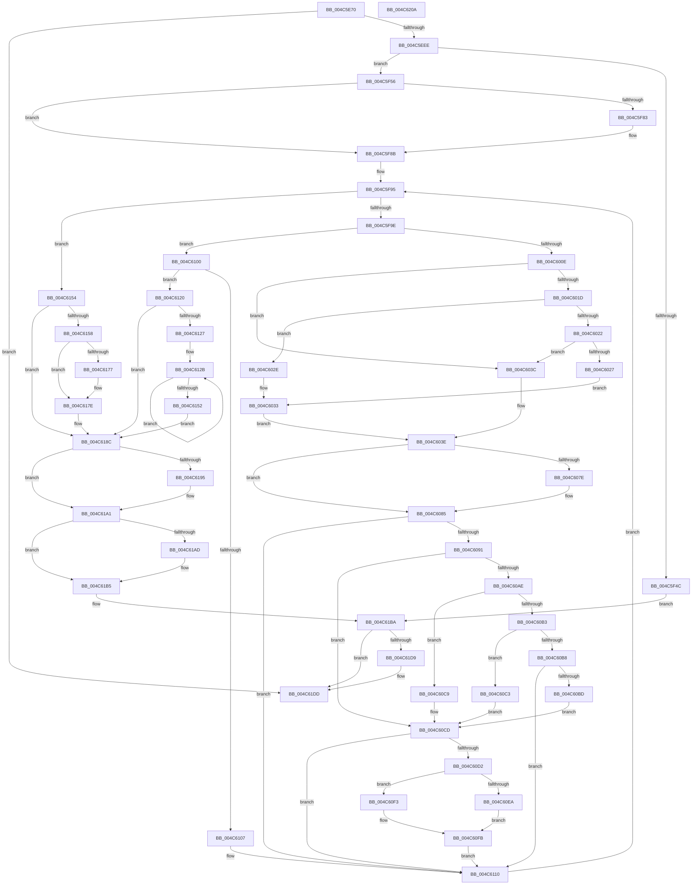

# HalpAllocatePmcCounterSetEx

- RVA: `0x004C5E70`–`0x004C620B` (길이 `923` bytes)
- VA: `0x00000001404C5E70`
- 실행 섹션: `.text`
- PDB 이름 있음: `예`; PDB Function 태그: `아니요`
- unwind 정보 RVA: `0x000BCF2C`
- 디코드: `243`개 명령, `923/923` bytes 표시
- 미해석 바이트: `0` (있으면 어셈블리에 `.byte`로 보존)

> 이 문서는 커널 이미지의 기계어와 PDB 기호를 분석해 생성했습니다. 4번과 5번은 함수 원형과 자료형을 바이너리 사용 방식에서 추정한 C 해석이며 원본 소스 복구 결과는 아닙니다.

## 1. Dependencies

- 직접 호출 지점: **12**; 고유 호출 대상: **10**
- 직접 호출자로 확인된 함수: **1**
- RIP 상대 이미지 참조: **8**

### Outgoing calls
- `0x004C5EDC` → [HalpRequestPmuAccess](../../page/AD/HalpRequestPmuAccess_function_00ADB340.md) (function, `0x00ADB340`)
- `0x004C5F2B` → [KeSetSystemGroupAffinityThread](../39/KeSetSystemGroupAffinityThread_function_00399140.md) (function, `0x00399140`)
- `0x004C5F3F` → [HalpMmAllocCtxAlloc](../3E/HalpMmAllocCtxAlloc_function_003E10B8.md) (function, `0x003E10B8`)
- `0x004C5F5E` → [memset](../6C/memset_function_006C6C40.md) (function, `0x006C6C40`)
- `0x004C5F86` → [KiRaiseIrqlProcessIrqlFlags](../4F/KiRaiseIrqlProcessIrqlFlags_function_004F56FC.md) (function, `0x004F56FC`)
- `0x004C5FFF` → [guard_dispatch_icall](../6B/guard_dispatch_icall_function_006BAAD0.md) (function, `0x006BAAD0`)
- `0x004C6068` → [guard_dispatch_icall](../6B/guard_dispatch_icall_function_006BAAD0.md) (function, `0x006BAAD0`)
- `0x004C613C` → [guard_dispatch_icall](../6B/guard_dispatch_icall_function_006BAAD0.md) (function, `0x006BAAD0`)
- `0x004C619C` → [KiLowerIrqlProcessIrqlFlags](../4F/KiLowerIrqlProcessIrqlFlags_function_004F5698.md) (function, `0x004F5698`)
- `0x004C61B0` → [HalpMmAllocCtxFree](../3E/HalpMmAllocCtxFree_function_003E1904.md) (function, `0x003E1904`)
- `0x004C61C2` → [KeRevertToUserGroupAffinityThread](../39/KeRevertToUserGroupAffinityThread_function_00398EC0.md) (function, `0x00398EC0`)
- `0x004C61EA` → [_security_check_cookie](../6A/_security_check_cookie_function_006AC640.md) (function, `0x006AC640`)

### Direct callers
- [HalpAllocatePmcCounterSet](../54/HalpAllocatePmcCounterSet_function_00546D10.md) at `0x00546D22`

### Static image references
- `0x004C5E89` → RVA `0x00E0A740` (`.data`; read)
- `0x004C5EEE` → RVA `0x00F231B0` (`.data`; read)
- `0x004C5F7A` → RVA `0x00FC6D20` (`ALMOSTRO`; read)
- `0x004C5FE7` → RVA `0x00E03B20` (`.data`; read)
- `0x004C600E` → RVA `0x00FC2B4C` (`.data`; read/write)
- `0x004C6099` → RVA `0x00FC8C40` (`ALMOSTRO`; read)
- `0x004C6158` → RVA `0x00FC2C30` (`.data`; read)
- `0x004C61CC` → RVA `0x00FC2B48` (`.data`; read)

## 2. Other-region calls and transfers

- 다른 실행 섹션으로 향하는 call: **1**
  - `0x004C5EDC` → [HalpRequestPmuAccess](../../page/AD/HalpRequestPmuAccess_function_00ADB340.md) (`.text` → `PAGE`)
- 별도 외부 분기/꼬리 이동을 확인하지 못했습니다.

## 3. Assembly (complete function range)

```asm
004C5E70  4C 8B DC                        mov r11, rsp
004C5E73  49 89 5B 10                     mov qword ptr [r11 + 0x10], rbx
004C5E77  55                              push rbp
004C5E78  56                              push rsi
004C5E79  57                              push rdi
004C5E7A  41 54                           push r12
004C5E7C  41 55                           push r13
004C5E7E  41 56                           push r14
004C5E80  41 57                           push r15
004C5E82  48 81 EC B0 00 00 00            sub rsp, 0xb0
004C5E89  48 8B 05 B0 48 94 00            mov rax, qword ptr [rip + 0x9448b0]
004C5E90  48 33 C4                        xor rax, rsp
004C5E93  48 89 84 24 A0 00 00 00         mov qword ptr [rsp + 0xa0], rax
004C5E9B  48 8B AC 24 10 01 00 00         mov rbp, qword ptr [rsp + 0x110]
004C5EA3  0F 57 C0                        xorps xmm0, xmm0
004C5EA6  4C 8B BC 24 18 01 00 00         mov r15, qword ptr [rsp + 0x118]
004C5EAE  0F 57 C9                        xorps xmm1, xmm1
004C5EB1  48 89 6C 24 50                  mov qword ptr [rsp + 0x50], rbp
004C5EB6  45 8B F0                        mov r14d, r8d
004C5EB9  4C 89 7C 24 78                  mov qword ptr [rsp + 0x78], r15
004C5EBE  0F 11 44 24 58                  movups xmmword ptr [rsp + 0x58], xmm0
004C5EC3  4C 89 8C 24 88 00 00 00         mov qword ptr [rsp + 0x88], r9
004C5ECB  41 0F 11 4B A8                  movups xmmword ptr [r11 - 0x58], xmm1
004C5ED0  44 89 44 24 44                  mov dword ptr [rsp + 0x44], r8d
004C5ED5  48 89 54 24 68                  mov qword ptr [rsp + 0x68], rdx
004C5EDA  8B F1                           mov esi, ecx
004C5EDC  E8 5F 54 61 00                  call 0x140adb340
004C5EE1  45 33 FF                        xor r15d, r15d
004C5EE4  8B F8                           mov edi, eax
004C5EE6  85 C0                           test eax, eax
004C5EE8  0F 88 EF 02 00 00               js 0x1404c61dd
004C5EEE  48 8B 05 BB D2 A5 00            mov rax, qword ptr [rip + 0xa5d2bb]
004C5EF5  33 D2                           xor edx, edx
004C5EF7  89 54 24 62                     mov dword ptr [rsp + 0x62], edx
004C5EFB  44 8B EE                        mov r13d, esi
004C5EFE  66 89 54 24 66                  mov word ptr [rsp + 0x66], dx
004C5F03  8B 0C B0                        mov ecx, dword ptr [rax + rsi*4]
004C5F06  8B C1                           mov eax, ecx
004C5F08  C1 E8 06                        shr eax, 6
004C5F0B  83 E1 3F                        and ecx, 0x3f
004C5F0E  66 89 44 24 60                  mov word ptr [rsp + 0x60], ax
004C5F13  8D 42 01                        lea eax, [rdx + 1]
004C5F16  48 D3 E0                        shl rax, cl
004C5F19  48 8D 94 24 90 00 00 00         lea rdx, [rsp + 0x90]
004C5F21  48 8D 4C 24 58                  lea rcx, [rsp + 0x58]
004C5F26  48 89 44 24 58                  mov qword ptr [rsp + 0x58], rax
004C5F2B  E8 10 32 ED FF                  call 0x140399140
004C5F30  43 8D 04 B6                     lea eax, [r14 + r14*4]
004C5F34  8D 04 C5 18 00 00 00            lea eax, [rax*8 + 0x18]
004C5F3B  8B D0                           mov edx, eax
004C5F3D  8B F8                           mov edi, eax
004C5F3F  E8 74 B1 F1 FF                  call 0x1403e10b8
004C5F44  48 8B D8                        mov rbx, rax
004C5F47  48 85 C0                        test rax, rax
004C5F4A  75 0A                           jne 0x1404c5f56
004C5F4C  BF 17 00 00 C0                  mov edi, 0xc0000017
004C5F51  E9 64 02 00 00                  jmp 0x1404c61ba
004C5F56  4C 8B C7                        mov r8, rdi
004C5F59  33 D2                           xor edx, edx
004C5F5B  48 8B CB                        mov rcx, rbx
004C5F5E  E8 DD 0C 20 00                  call 0x1406c6c40
004C5F63  44 89 73 14                     mov dword ptr [rbx + 0x14], r14d
004C5F67  41 8B FF                        mov edi, r15d
004C5F6A  89 73 10                        mov dword ptr [rbx + 0x10], esi
004C5F6D  45 0F 20 C4                     mov r12, cr8
004C5F71  BA 0F 00 00 00                  mov edx, 0xf
004C5F76  44 0F 22 C2                     mov cr8, rdx
004C5F7A  44 39 3D 9F 0D B0 00            cmp dword ptr [rip + 0xb00d9f], r15d
004C5F81  74 08                           je 0x1404c5f8b
004C5F83  41 8A CC                        mov cl, r12b
004C5F86  E8 71 F7 02 00                  call 0x1404f56fc
004C5F8B  41 8B C7                        mov eax, r15d
004C5F8E  41 8B F7                        mov esi, r15d
004C5F91  89 44 24 40                     mov dword ptr [rsp + 0x40], eax
004C5F95  41 3B F6                        cmp esi, r14d
004C5F98  0F 83 B6 01 00 00               jae 0x1404c6154
004C5F9E  48 8B 4C 24 68                  mov rcx, qword ptr [rsp + 0x68]
004C5FA3  48 8D 04 80                     lea rax, [rax + rax*4]
004C5FA7  4C 8D 34 C3                     lea r14, [rbx + rax*8]
004C5FAB  48 89 44 24 70                  mov qword ptr [rsp + 0x70], rax
004C5FB0  8B EE                           mov ebp, esi
004C5FB2  4C 8D 43 38                     lea r8, [rbx + 0x38]
004C5FB6  4D 8D 04 C0                     lea r8, [r8 + rax*8]
004C5FBA  4C 89 44 24 28                  mov qword ptr [rsp + 0x28], r8
004C5FBF  4C 8D 7B 30                     lea r15, [rbx + 0x30]
004C5FC3  4D 8D 3C C7                     lea r15, [r15 + rax*8]
004C5FC7  4C 89 84 24 80 00 00 00         mov qword ptr [rsp + 0x80], r8
004C5FCF  8B 14 A9                        mov edx, dword ptr [rcx + rbp*4]
004C5FD2  4D 8D 46 2C                     lea r8, [r14 + 0x2c]
004C5FD6  89 54 C3 28                     mov dword ptr [rbx + rax*8 + 0x28], edx
004C5FDA  48 8D 4B 34                     lea rcx, [rbx + 0x34]
004C5FDE  48 8D 0C C1                     lea rcx, [rcx + rax*8]
004C5FE2  4C 89 7C 24 20                  mov qword ptr [rsp + 0x20], r15
004C5FE7  48 8B 05 32 DB 93 00            mov rax, qword ptr [rip + 0x93db32]
004C5FEE  4C 8B C9                        mov r9, rcx
004C5FF1  48 89 4C 24 48                  mov qword ptr [rsp + 0x48], rcx
004C5FF6  B9 01 00 00 00                  mov ecx, 1
004C5FFB  48 8B 40 08                     mov rax, qword ptr [rax + 8]
004C5FFF  E8 CC 4A 1F 00                  call 0x1406baad0
004C6004  8B F8                           mov edi, eax
004C6006  85 C0                           test eax, eax
004C6008  0F 88 F2 00 00 00               js 0x1404c6100
004C600E  F0 FF 05 37 CB AF 00            lock inc dword ptr [rip + 0xafcb37]
004C6015  41 8B 4E 2C                     mov ecx, dword ptr [r14 + 0x2c]
004C6019  85 C9                           test ecx, ecx
004C601B  74 1F                           je 0x1404c603c
004C601D  83 E9 01                        sub ecx, 1
004C6020  74 0C                           je 0x1404c602e
004C6022  83 F9 01                        cmp ecx, 1
004C6025  75 15                           jne 0x1404c603c
004C6027  41 8B 0F                        mov ecx, dword ptr [r15]
004C602A  0F 32                           rdmsr
004C602C  EB 05                           jmp 0x1404c6033
004C602E  41 8B 0F                        mov ecx, dword ptr [r15]
004C6031  0F 33                           rdpmc
004C6033  48 C1 E2 20                     shl rdx, 0x20
004C6037  48 0B C2                        or rax, rdx
004C603A  EB 02                           jmp 0x1404c603e
004C603C  33 C0                           xor eax, eax
004C603E  48 8B 4C 24 70                  mov rcx, qword ptr [rsp + 0x70]
004C6043  FF 44 24 40                     inc dword ptr [rsp + 0x40]
004C6047  48 89 44 CB 18                  mov qword ptr [rbx + rcx*8 + 0x18], rax
004C604C  48 8D 14 CD 3C 00 00 00         lea rdx, [rcx*8 + 0x3c]
004C6054  48 8B 05 C5 DA 93 00            mov rax, qword ptr [rip + 0x93dac5]
004C605B  48 03 D3                        add rdx, rbx
004C605E  41 8B 0F                        mov ecx, dword ptr [r15]
004C6061  48 8B 80 88 00 00 00            mov rax, qword ptr [rax + 0x88]
004C6068  E8 63 4A 1F 00                  call 0x1406baad0
004C606D  4C 8B 7C 24 78                  mov r15, qword ptr [rsp + 0x78]
004C6072  8B F8                           mov edi, eax
004C6074  4C 8B 44 24 48                  mov r8, qword ptr [rsp + 0x48]
004C6079  4D 85 FF                        test r15, r15
004C607C  74 07                           je 0x1404c6085
004C607E  41 8B 00                        mov eax, dword ptr [r8]
004C6081  41 89 04 AF                     mov dword ptr [r15 + rbp*4], eax
004C6085  45 8B 00                        mov r8d, dword ptr [r8]
004C6088  45 33 FF                        xor r15d, r15d
004C608B  41 83 F8 FF                     cmp r8d, -1
004C608F  74 7F                           je 0x1404c6110
004C6091  48 8B 94 24 80 00 00 00         mov rdx, qword ptr [rsp + 0x80]
004C6099  48 8D 05 A0 2B B0 00            lea rax, [rip + 0xb02ba0]
004C60A0  4A 8B 04 E8                     mov rax, qword ptr [rax + r13*8]
004C60A4  8B 12                           mov edx, dword ptr [rdx]
004C60A6  48 8B 48 58                     mov rcx, qword ptr [rax + 0x58]
004C60AA  85 D2                           test edx, edx
004C60AC  74 1F                           je 0x1404c60cd
004C60AE  83 EA 01                        sub edx, 1
004C60B1  74 16                           je 0x1404c60c9
004C60B3  83 EA 63                        sub edx, 0x63
004C60B6  74 0B                           je 0x1404c60c3
004C60B8  83 FA 01                        cmp edx, 1
004C60BB  75 53                           jne 0x1404c6110
004C60BD  48 83 C1 48                     add rcx, 0x48
004C60C1  EB 0A                           jmp 0x1404c60cd
004C60C3  48 83 C1 30                     add rcx, 0x30
004C60C7  EB 04                           jmp 0x1404c60cd
004C60C9  48 83 C1 18                     add rcx, 0x18
004C60CD  48 85 C9                        test rcx, rcx
004C60D0  74 3E                           je 0x1404c6110
004C60D2  48 8B 51 10                     mov rdx, qword ptr [rcx + 0x10]
004C60D6  4B 8D 0C 40                     lea rcx, [r8 + r8*2]
004C60DA  4C 8B BC 24 88 00 00 00         mov r15, qword ptr [rsp + 0x88]
004C60E2  48 03 C9                        add rcx, rcx
004C60E5  4D 85 FF                        test r15, r15
004C60E8  74 09                           je 0x1404c60f3
004C60EA  41 8B 07                        mov eax, dword ptr [r15]
004C60ED  89 44 CA 20                     mov dword ptr [rdx + rcx*8 + 0x20], eax
004C60F1  EB 08                           jmp 0x1404c60fb
004C60F3  C7 44 CA 20 4E 6F 6E 65         mov dword ptr [rdx + rcx*8 + 0x20], 0x656e6f4e
004C60FB  45 33 FF                        xor r15d, r15d
004C60FE  EB 10                           jmp 0x1404c6110
004C6100  3D BB 00 00 C0                  cmp eax, 0xc00000bb
004C6105  75 19                           jne 0x1404c6120
004C6107  FF 4B 14                        dec dword ptr [rbx + 0x14]
004C610A  45 33 FF                        xor r15d, r15d
004C610D  41 8B FF                        mov edi, r15d
004C6110  44 8B 74 24 44                  mov r14d, dword ptr [rsp + 0x44]
004C6115  FF C6                           inc esi
004C6117  8B 44 24 40                     mov eax, dword ptr [rsp + 0x40]
004C611B  E9 75 FE FF FF                  jmp 0x1404c5f95
004C6120  45 33 FF                        xor r15d, r15d
004C6123  85 F6                           test esi, esi
004C6125  74 65                           je 0x1404c618c
004C6127  48 8D 73 28                     lea rsi, [rbx + 0x28]
004C612B  48 8B 05 EE D9 93 00            mov rax, qword ptr [rip + 0x93d9ee]
004C6132  48 8D 56 08                     lea rdx, [rsi + 8]
004C6136  8B 0E                           mov ecx, dword ptr [rsi]
004C6138  48 8B 40 10                     mov rax, qword ptr [rax + 0x10]
004C613C  E8 8F 49 1F 00                  call 0x1406baad0
004C6141  F0 FF 0D 04 CA AF 00            lock dec dword ptr [rip + 0xafca04]
004C6148  48 8D 76 28                     lea rsi, [rsi + 0x28]
004C614C  48 83 ED 01                     sub rbp, 1
004C6150  75 D9                           jne 0x1404c612b
004C6152  EB 38                           jmp 0x1404c618c
004C6154  85 FF                           test edi, edi
004C6156  78 34                           js 0x1404c618c
004C6158  48 8B 05 D1 CA AF 00            mov rax, qword ptr [rip + 0xafcad1]
004C615F  4A 8D 0C 6D 00 00 00 00         lea rcx, [r13*2]
004C6167  49 03 CD                        add rcx, r13
004C616A  48 8D 14 C8                     lea rdx, [rax + rcx*8]
004C616E  48 8B 02                        mov rax, qword ptr [rdx]
004C6171  48 39 50 08                     cmp qword ptr [rax + 8], rdx
004C6175  74 07                           je 0x1404c617e
004C6177  B9 03 00 00 00                  mov ecx, 3
004C617C  CD 29                           int 0x29
004C617E  48 89 03                        mov qword ptr [rbx], rax
004C6181  48 89 53 08                     mov qword ptr [rbx + 8], rdx
004C6185  48 89 58 08                     mov qword ptr [rax + 8], rbx
004C6189  48 89 1A                        mov qword ptr [rdx], rbx
004C618C  44 39 3D 8D 0B B0 00            cmp dword ptr [rip + 0xb00b8d], r15d
004C6193  74 0C                           je 0x1404c61a1
004C6195  44 0F 20 C1                     mov rcx, cr8
004C6199  41 8A D4                        mov dl, r12b
004C619C  E8 F7 F4 02 00                  call 0x1404f5698
004C61A1  41 0F B6 CC                     movzx ecx, r12b
004C61A5  44 0F 22 C1                     mov cr8, rcx
004C61A9  85 FF                           test edi, edi
004C61AB  79 08                           jns 0x1404c61b5
004C61AD  48 8B D3                        mov rdx, rbx
004C61B0  E8 4F B7 F1 FF                  call 0x1403e1904
004C61B5  48 8B 6C 24 50                  mov rbp, qword ptr [rsp + 0x50]
004C61BA  48 8D 8C 24 90 00 00 00         lea rcx, [rsp + 0x90]
004C61C2  E8 F9 2C ED FF                  call 0x140398ec0
004C61C7  B8 01 00 00 00                  mov eax, 1
004C61CC  F0 44 0F B1 3D 73 C9 AF 00      lock cmpxchg dword ptr [rip + 0xafc973], r15d
004C61D5  85 FF                           test edi, edi
004C61D7  78 04                           js 0x1404c61dd
004C61D9  48 89 5D 00                     mov qword ptr [rbp], rbx
004C61DD  8B C7                           mov eax, edi
004C61DF  48 8B 8C 24 A0 00 00 00         mov rcx, qword ptr [rsp + 0xa0]
004C61E7  48 33 CC                        xor rcx, rsp
004C61EA  E8 51 64 1E 00                  call 0x1406ac640
004C61EF  48 8B 9C 24 F8 00 00 00         mov rbx, qword ptr [rsp + 0xf8]
004C61F7  48 81 C4 B0 00 00 00            add rsp, 0xb0
004C61FE  41 5F                           pop r15
004C6200  41 5E                           pop r14
004C6202  41 5D                           pop r13
004C6204  41 5C                           pop r12
004C6206  5F                              pop rdi
004C6207  5E                              pop rsi
004C6208  5D                              pop rbp
004C6209  C3                              ret
004C620A  CC                              int3
```

## 4. C-style interpretation (structured pseudocode)

```c
__int64 __fastcall HalpAllocatePmcCounterSetEx(int a1, __int64 a2, int a3, __int64 a4, __int64 a5, __int64 a6)
{
    __int64 result;
    __int64 v_r15;
    __int64 v_rbp;
    __int64 v_rsi;
    __int64 v_rsp;
    unsigned __int64 v_stack_m48;
    unsigned __int64 v_stack_m58;
    unsigned __int64 v_stack_m60;
    unsigned __int64 v_stack_m68;
    unsigned __int64 v_stack_m70;
    unsigned __int64 v_stack_m78;
    unsigned __int64 v_stack_m80;
    unsigned __int16 v_stack_m82;
    unsigned int v_stack_m86;
    unsigned __int16 v_stack_m88;
    unsigned __int64 v_stack_m90;
    unsigned __int64 v_stack_m98;
    unsigned __int64 v_stack_mA0;
    unsigned int v_stack_mA4;
    unsigned int v_stack_mA8;
    unsigned __int64 v_stack_mC0;
    unsigned __int64 v_stack_mC8;
    unsigned __int64 v_stack_p10;

    *(unsigned __int64 *)(v_rsp + 16) = v_rbx;
    v_rsp = (v_rsp) - (176);
    result = (*(unsigned __int64 *)(v_rip + 9717936)) ^ (v_rsp);
    v_stack_m48 = result;
    v_stack_m98 = a5;
    v_stack_m70 = a6;
    v_stack_m90 = v_xmm0;
    v_stack_m60 = a4;
    *(unsigned __int64 *)(v_rsp - 88) = v_xmm1;
    v_stack_mA4 = a3;
    v_stack_m80 = a2;
    result = HalpRequestPmuAccess(a1, a2, a3, a4);
    v_r15 = 0;
    if (sign_flag) goto loc_004C61DD;
    a2 = 0;
    v_stack_m86 = 0;
    v_stack_m82 = 0;
    result = (unsigned int)(((unsigned int)((unsigned int)((unsigned int)(*(unsigned int *)(*(unsigned __int64 *)(v_rip + 10867387) + (unsigned int)(a1) * 4))))) >> (6));
    a1 = (unsigned int)(((unsigned int)(*(unsigned int *)(*(unsigned __int64 *)(v_rip + 10867387) + (unsigned int)(a1) * 4))) & (63));
    v_stack_m88 = (unsigned __int16)(result);
    result = (a2 + 1) << ((unsigned __int8)(a1));
    v_stack_m90 = result;
    result = KeSetSystemGroupAffinityThread(v_stack_m90, v_stack_m58, a3, a4);
    result = HalpMmAllocCtxAlloc(v_stack_m90, (unsigned int)((unsigned int)((unsigned int)(a3) + (unsigned int)(a3) * 4 * 8 + 24)), a3, a4);
    if (result != 0) goto loc_004C5F56;
    goto loc_004C61BA;
loc_004C5F56:
    a2 = 0;
    result = memset(result, a2, (unsigned int)(0xC0000017ULL), a4);
    *(unsigned int *)(result + 20) = (unsigned int)((unsigned int)(a3));
    *(unsigned int *)(result + 16) = (unsigned int)((unsigned int)(a1));
    if ((*(unsigned int *)(v_rip + 11537823)) != 0) {
        a1 = (unsigned __int8)(v_cr8);
        result = KiRaiseIrqlProcessIrqlFlags(a1, 15, (unsigned int)(0xC0000017ULL), a4);
    }
    v_stack_mA8 = 0;
loc_004C5F95:
    if (0 >= ((unsigned int)((unsigned int)(a3)))) goto loc_004C6154;
    v_stack_m78 = 0 + 0 * 4;
    v_stack_mC0 = result + 56 + 0 + 0 * 4 * 8;
    v_stack_m68 = result + 56 + 0 + 0 * 4 * 8;
    *(unsigned int *)(result + 0 + 0 * 4 * 8 + 40) = (unsigned int)((unsigned int)(*(unsigned int *)(v_stack_m80 + 0 * 4)));
    v_stack_mC8 = result + 48 + 0 + 0 * 4 * 8;
    v_stack_mA0 = result + 52 + 0 + 0 * 4 * 8;
    result = guard_dispatch_icall(1, (unsigned int)(*(unsigned int *)(v_stack_m80 + 0 * 4)), result + 0 + 0 * 4 * 8 + 44, result + 52 + 0 + 0 * 4 * 8);
    if (sign_flag) goto loc_004C6100;
    if ((unsigned int)((unsigned int)(*(unsigned int *)(result + 0 + 0 * 4 * 8 + 44))) == 0) goto loc_004C603C;
    a1 = (unsigned int)(((unsigned int)(*(unsigned int *)(result + 0 + 0 * 4 * 8 + 44))) - (1));
    if (condition_is_equal) goto loc_004C602E;
    if (a1 != 1) goto loc_004C603C;
    goto loc_004C6033;
loc_004C602E:
loc_004C6033:
    a2 = ((unsigned int)(*(unsigned int *)(v_stack_m80 + 0 * 4))) << (32);
    result = (result) | (a2);
    goto loc_004C603E;
loc_004C603C:
    result = 0;
loc_004C603E:
    *(unsigned __int64 *)(result + v_stack_m78 * 8 + 24) = 0;
    a2 = (v_stack_m78 * 8 + 60) + (0);
    result = guard_dispatch_icall((unsigned int)(*(unsigned int *)(result + 48 + 0 + 0 * 4 * 8)), a2, result + 0 + 0 * 4 * 8 + 44, result + 52 + 0 + 0 * 4 * 8);
    if (v_stack_m70 != 0) {
        result = *(unsigned int *)(v_stack_mA0);
        *(unsigned int *)(v_stack_m70 + 0 * 4) = (unsigned int)(result);
    }
    v_r15 = 0;
    if (((unsigned int)((unsigned int)(*(unsigned int *)(v_stack_mA0)))) == -1) goto loc_004C6110;
    if ((unsigned int)((unsigned int)(*(unsigned int *)(v_stack_m68))) == 0) goto loc_004C60CD;
    a2 = (unsigned int)(((unsigned int)(*(unsigned int *)(v_stack_m68))) - (1));
    if (condition_is_equal) goto loc_004C60C9;
    a2 = (unsigned int)((a2) - (99));
    if (condition_is_equal) goto loc_004C60C3;
    if (((unsigned int)(a2)) != 1) goto loc_004C6110;
    a1 = (*(unsigned __int64 *)(*(unsigned __int64 *)(v_rip + 11545504 + (unsigned int)((unsigned int)((unsigned int)(a1))) * 8) + 88)) + (72);
    goto loc_004C60CD;
loc_004C60C3:
    a1 = (a1) + (48);
    goto loc_004C60CD;
loc_004C60C9:
    a1 = (a1) + (24);
loc_004C60CD:
    if (a1 == 0) goto loc_004C6110;
    a1 = ((unsigned int)(*(unsigned int *)(v_stack_mA0)) + (unsigned int)(*(unsigned int *)(v_stack_mA0)) * 2) + ((unsigned int)(*(unsigned int *)(v_stack_mA0)) + (unsigned int)(*(unsigned int *)(v_stack_mA0)) * 2);
    if (v_stack_m60 == 0) goto loc_004C60F3;
    *(unsigned int *)(*(unsigned __int64 *)(a1 + 16) + a1 * 8 + 32) = (unsigned int)((unsigned int)(*(unsigned int *)(v_stack_m60)));
    goto loc_004C60FB;
loc_004C60F3:
    *(unsigned int *)(*(unsigned __int64 *)(a1 + 16) + a1 * 8 + 32) = 0x656E6F4EULL;
loc_004C60FB:
    v_r15 = 0;
    goto loc_004C6110;
loc_004C6100:
    if (((unsigned int)((unsigned int)(*(unsigned int *)(v_stack_m60)))) != 0xC00000BBULL) goto loc_004C6120;
    v_r15 = 0;
loc_004C6110:
    v_rsi = (unsigned int)((0) + 1);
    goto loc_004C5F95;
loc_004C6120:
    v_r15 = 0;
    if ((unsigned int)(v_rsi) == 0) goto loc_004C618C;
loc_004C612B:
    result = guard_dispatch_icall((unsigned int)(*(unsigned int *)(result + 40)), result + 40 + 8, (unsigned int)(*(unsigned int *)(v_stack_mA0)), result + 52 + 0 + 0 * 4 * 8);
    v_rbp = (0) - (1);
    if (condition_is_not_equal) goto loc_004C612B;
    goto loc_004C618C;
loc_004C6154:
    if (sign_flag) goto loc_004C618C;
    a1 = ((unsigned int)((unsigned int)((unsigned int)(a1))) * 2) + ((unsigned int)((unsigned int)((unsigned int)(a1))));
    if ((*(unsigned __int64 *)(*(unsigned __int64 *)(*(unsigned __int64 *)(v_rip + 11520721) + a1 * 8) + 8)) != (*(unsigned __int64 *)(v_rip + 11520721) + a1 * 8)) {
        a1 = 3;
    }
    *(unsigned __int64 *)(result) = *(unsigned __int64 *)(*(unsigned __int64 *)(v_rip + 11520721) + a1 * 8);
    *(unsigned __int64 *)(result + 8) = *(unsigned __int64 *)(v_rip + 11520721) + a1 * 8;
    *(unsigned __int64 *)(*(unsigned __int64 *)(*(unsigned __int64 *)(v_rip + 11520721) + a1 * 8) + 8) = result;
    *(unsigned __int64 *)(*(unsigned __int64 *)(v_rip + 11520721) + a1 * 8) = result;
loc_004C618C:
    result = *(unsigned __int64 *)(*(unsigned __int64 *)(v_rip + 11520721) + a1 * 8);
    if ((*(unsigned int *)(v_rip + 11537293)) != 0) {
        a1 = 15;
        a2 = (unsigned __int8)(v_cr8);
        result = KiLowerIrqlProcessIrqlFlags(a1, a2, (unsigned int)(*(unsigned int *)(v_stack_mA0)), result + 52 + 0 + 0 * 4 * 8);
    }
    if (sign_flag) {
        a2 = result;
        result = HalpMmAllocCtxFree((unsigned __int8)(v_cr8), a2, (unsigned int)(*(unsigned int *)(v_stack_mA0)), result + 52 + 0 + 0 * 4 * 8);
    }
loc_004C61BA:
    result = KeRevertToUserGroupAffinityThread(v_stack_m58, a2, (unsigned int)(*(unsigned int *)(v_stack_mA0)), result + 52 + 0 + 0 * 4 * 8);
    if (!(sign_flag)) {
        *(unsigned __int64 *)(v_stack_m98) = result;
    }
    a1 = (v_stack_m48) ^ (v_rsp);
    result = _security_check_cookie(a1, a2, (unsigned int)(*(unsigned int *)(v_stack_mA0)), result + 52 + 0 + 0 * 4 * 8);
    v_rsp = (v_rsp) + (176);
    return result;
}
```

## 5. (Beta) C Style

```c
int64_t HalpAllocatePmcCounterSetEx(int32_t Arg1, int64_t Arg2, void *Arg3, int64_t Arg4, int64_t Arg5, int64_t Arg6)
{
    uint8_t *arg3 = (uint8_t *)Arg3;

    int64_t result;
    int64_t local_r15;
    int64_t local_rbp;
    int64_t local_rsi;
    int64_t local_rsp;
    uint64_t v_stack_m48;
    uint64_t v_stack_m58;
    uint64_t v_stack_m60;
    uint64_t v_stack_m68;
    uint64_t v_stack_m70;
    uint64_t v_stack_m78;
    uint64_t v_stack_m80;
    uint16_t v_stack_m82;
    uint32_t v_stack_m86;
    uint16_t v_stack_m88;
    uint64_t v_stack_m90;
    uint64_t v_stack_m98;
    uint64_t v_stack_mA0;
    uint32_t v_stack_mA4;
    uint32_t v_stack_mA8;
    uint64_t v_stack_mC0;
    uint64_t v_stack_mC8;
    uint64_t v_stack_p10;

    *(uint64_t *)(local_rsp + 0x10) = local_rbx;
    local_rsp = (local_rsp) - (176);
    result = (*(uint64_t *)(v_rip + 0x9448B0)) ^ (local_rsp);
    v_stack_m48 = result;
    v_stack_m98 = Arg5;
    v_stack_m70 = Arg6;
    v_stack_m90 = v_xmm0;
    v_stack_m60 = Arg4;
    *(uint64_t *)(local_rsp - 0x58) = v_xmm1;
    v_stack_mA4 = Arg3;
    v_stack_m80 = Arg2;
    result = HalpRequestPmuAccess(Arg1, Arg2, Arg3, Arg4);
    local_r15 = 0;
    if (sign_flag) goto loc_004C61DD;
    Arg2 = 0;
    v_stack_m86 = 0;
    v_stack_m82 = 0;
    result = (uint32_t)(((uint32_t)((uint32_t)((uint32_t)(*(uint32_t *)(*(uint64_t *)(v_rip + 0xA5D2BB) + (uint32_t)(Arg1) * 4))))) >> (6));
    Arg1 = (uint32_t)(((uint32_t)(*(uint32_t *)(*(uint64_t *)(v_rip + 0xA5D2BB) + (uint32_t)(Arg1) * 4))) & (63));
    v_stack_m88 = (uint16_t)(result);
    result = (Arg2 + 1) << ((uint8_t)(Arg1));
    v_stack_m90 = result;
    result = KeSetSystemGroupAffinityThread(v_stack_m90, v_stack_m58, Arg3, Arg4);
    result = HalpMmAllocCtxAlloc(v_stack_m90, (uint32_t)((uint32_t)((uint32_t)(Arg3) + (uint32_t)(Arg3) * 4 * 8 + 24)), Arg3, Arg4);
    if (result != 0) goto loc_004C5F56;
    goto loc_004C61BA;
loc_004C5F56:
    Arg2 = 0;
    result = memset(result, Arg2, (uint32_t)(0xC0000017ULL), Arg4);
    *(uint32_t *)(result + 0x14) = (uint32_t)((uint32_t)(Arg3));
    *(uint32_t *)(result + 0x10) = (uint32_t)((uint32_t)(Arg1));
    if ((*(uint32_t *)(v_rip + 0xB00D9F)) != 0) {
        Arg1 = (uint8_t)(v_cr8);
        result = KiRaiseIrqlProcessIrqlFlags(Arg1, 15, (uint32_t)(0xC0000017ULL), Arg4);
    }
    v_stack_mA8 = 0;
loc_004C5F95:
    if (0 >= ((uint32_t)((uint32_t)(Arg3)))) goto loc_004C6154;
    v_stack_m78 = 0 + 0 * 4;
    v_stack_mC0 = result + 56 + 0 + 0 * 4 * 8;
    v_stack_m68 = result + 56 + 0 + 0 * 4 * 8;
    *(uint32_t *)(result + 0x0 + 0x0 * 4 * 8 + 0x28) = (uint32_t)((uint32_t)(*(uint32_t *)(v_stack_m80 + 0x0 * 4)));
    v_stack_mC8 = result + 48 + 0 + 0 * 4 * 8;
    v_stack_mA0 = result + 52 + 0 + 0 * 4 * 8;
    result = guard_dispatch_icall(1, (uint32_t)(*(uint32_t *)(v_stack_m80 + 0x0 * 4)), result + 0 + 0 * 4 * 8 + 44, result + 52 + 0 + 0 * 4 * 8);
    if (sign_flag) goto loc_004C6100;
    if ((uint32_t)((uint32_t)(*(uint32_t *)(result + 0x0 + 0x0 * 4 * 8 + 0x2C))) == 0) goto loc_004C603C;
    Arg1 = (uint32_t)(((uint32_t)(*(uint32_t *)(result + 0x0 + 0x0 * 4 * 8 + 0x2C))) - (1));
    if (condition_is_equal) goto loc_004C602E;
    if (Arg1 != 1) goto loc_004C603C;
    goto loc_004C6033;
loc_004C602E:
loc_004C6033:
    Arg2 = ((uint32_t)(*(uint32_t *)(v_stack_m80 + 0x0 * 4))) << (32);
    result = (result) | (Arg2);
    goto loc_004C603E;
loc_004C603C:
    result = 0;
loc_004C603E:
    *(uint64_t *)(result + v_stack_m78 * 8 + 0x18) = 0;
    Arg2 = (v_stack_m78 * 8 + 60) + (0);
    result = guard_dispatch_icall((uint32_t)(*(uint32_t *)(result + 0x30 + 0x0 + 0x0 * 4 * 8)), Arg2, result + 0 + 0 * 4 * 8 + 44, result + 52 + 0 + 0 * 4 * 8);
    if (v_stack_m70 != 0) {
        result = *(uint32_t *)(v_stack_mA0);
        *(uint32_t *)(v_stack_m70 + 0x0 * 4) = (uint32_t)(result);
    }
    local_r15 = 0;
    if (((uint32_t)((uint32_t)(*(uint32_t *)(v_stack_mA0)))) == -1) goto loc_004C6110;
    if ((uint32_t)((uint32_t)(*(uint32_t *)(v_stack_m68))) == 0) goto loc_004C60CD;
    Arg2 = (uint32_t)(((uint32_t)(*(uint32_t *)(v_stack_m68))) - (1));
    if (condition_is_equal) goto loc_004C60C9;
    Arg2 = (uint32_t)((Arg2) - (99));
    if (condition_is_equal) goto loc_004C60C3;
    if (((uint32_t)(Arg2)) != 1) goto loc_004C6110;
    Arg1 = (*(uint64_t *)(*(uint64_t *)(v_rip + 0xB02BA0 + (uint32_t)((uint32_t)((uint32_t)(Arg1))) * 8) + 0x58)) + (72);
    goto loc_004C60CD;
loc_004C60C3:
    Arg1 = (Arg1) + (48);
    goto loc_004C60CD;
loc_004C60C9:
    Arg1 = (Arg1) + (24);
loc_004C60CD:
    if (Arg1 == 0) goto loc_004C6110;
    Arg1 = ((uint32_t)(*(uint32_t *)(v_stack_mA0)) + (uint32_t)(*(uint32_t *)(v_stack_mA0)) * 2) + ((uint32_t)(*(uint32_t *)(v_stack_mA0)) + (uint32_t)(*(uint32_t *)(v_stack_mA0)) * 2);
    if (v_stack_m60 == 0) goto loc_004C60F3;
    *(uint32_t *)(*(uint64_t *)(Arg1 + 0x10) + Arg1 * 8 + 0x20) = (uint32_t)((uint32_t)(*(uint32_t *)(v_stack_m60)));
    goto loc_004C60FB;
loc_004C60F3:
    *(uint32_t *)(*(uint64_t *)(Arg1 + 0x10) + Arg1 * 8 + 0x20) = 0x656E6F4EULL;
loc_004C60FB:
    local_r15 = 0;
    goto loc_004C6110;
loc_004C6100:
    if (((uint32_t)((uint32_t)(*(uint32_t *)(v_stack_m60)))) != 0xC00000BBULL) goto loc_004C6120;
    local_r15 = 0;
loc_004C6110:
    local_rsi = (uint32_t)((0) + 1);
    goto loc_004C5F95;
loc_004C6120:
    local_r15 = 0;
    if ((uint32_t)(local_rsi) == 0) goto loc_004C618C;
loc_004C612B:
    result = guard_dispatch_icall((uint32_t)(*(uint32_t *)(result + 0x28)), result + 40 + 8, (uint32_t)(*(uint32_t *)(v_stack_mA0)), result + 52 + 0 + 0 * 4 * 8);
    local_rbp = (0) - (1);
    if (condition_is_not_equal) goto loc_004C612B;
    goto loc_004C618C;
loc_004C6154:
    if (sign_flag) goto loc_004C618C;
    Arg1 = ((uint32_t)((uint32_t)((uint32_t)(Arg1))) * 2) + ((uint32_t)((uint32_t)((uint32_t)(Arg1))));
    if ((*(uint64_t *)(*(uint64_t *)(*(uint64_t *)(v_rip + 0xAFCAD1) + Arg1 * 8) + 0x8)) != (*(uint64_t *)(v_rip + 0xAFCAD1) + Arg1 * 8)) {
        Arg1 = 3;
    }
    *(uint64_t *)(result) = *(uint64_t *)(*(uint64_t *)(v_rip + 0xAFCAD1) + Arg1 * 8);
    *(uint64_t *)(result + 0x8) = *(uint64_t *)(v_rip + 0xAFCAD1) + Arg1 * 8;
    *(uint64_t *)(*(uint64_t *)(*(uint64_t *)(v_rip + 0xAFCAD1) + Arg1 * 8) + 0x8) = result;
    *(uint64_t *)(*(uint64_t *)(v_rip + 0xAFCAD1) + Arg1 * 8) = result;
loc_004C618C:
    result = *(uint64_t *)(*(uint64_t *)(v_rip + 0xAFCAD1) + Arg1 * 8);
    if ((*(uint32_t *)(v_rip + 0xB00B8D)) != 0) {
        Arg1 = 15;
        Arg2 = (uint8_t)(v_cr8);
        result = KiLowerIrqlProcessIrqlFlags(Arg1, Arg2, (uint32_t)(*(uint32_t *)(v_stack_mA0)), result + 52 + 0 + 0 * 4 * 8);
    }
    if (sign_flag) {
        Arg2 = result;
        result = HalpMmAllocCtxFree((uint8_t)(v_cr8), Arg2, (uint32_t)(*(uint32_t *)(v_stack_mA0)), result + 52 + 0 + 0 * 4 * 8);
    }
loc_004C61BA:
    result = KeRevertToUserGroupAffinityThread(v_stack_m58, Arg2, (uint32_t)(*(uint32_t *)(v_stack_mA0)), result + 52 + 0 + 0 * 4 * 8);
    if (!(sign_flag)) {
        *(uint64_t *)(v_stack_m98) = result;
    }
    Arg1 = (v_stack_m48) ^ (local_rsp);
    result = _security_check_cookie(Arg1, Arg2, (uint32_t)(*(uint32_t *)(v_stack_mA0)), result + 52 + 0 + 0 * 4 * 8);
    local_rsp = (local_rsp) + (176);
    return result;
}
```

### 관측된 메모리 오프셋

구조체 형식이 확인되지 않은 접근은 인자 기준의 오프셋으로만 기록했습니다.

| 기준 인자 | 오프셋 표현 | 폭 (bit) | 접근 |
|---|---:|---:|---|
| `Arg3` | `+ 0x0 + r14*4` | `32` | `R` |

## 6. Execution-region graph

[열기: 2D/3D 그래프와 함수 탐색 컨트롤 패널](../../../control-panel.html?section=text&rva=0x004C5E70&view=graph)

- 2D 그래프는 위에서 아래로 흐르고, 3D 그래프는 빈 공간을 드래그해 회전합니다. Shift+드래그는 이동, 휠은 확대·축소, 함수 노드 선택은 대상 보고서 이동입니다.

### Static fallback


