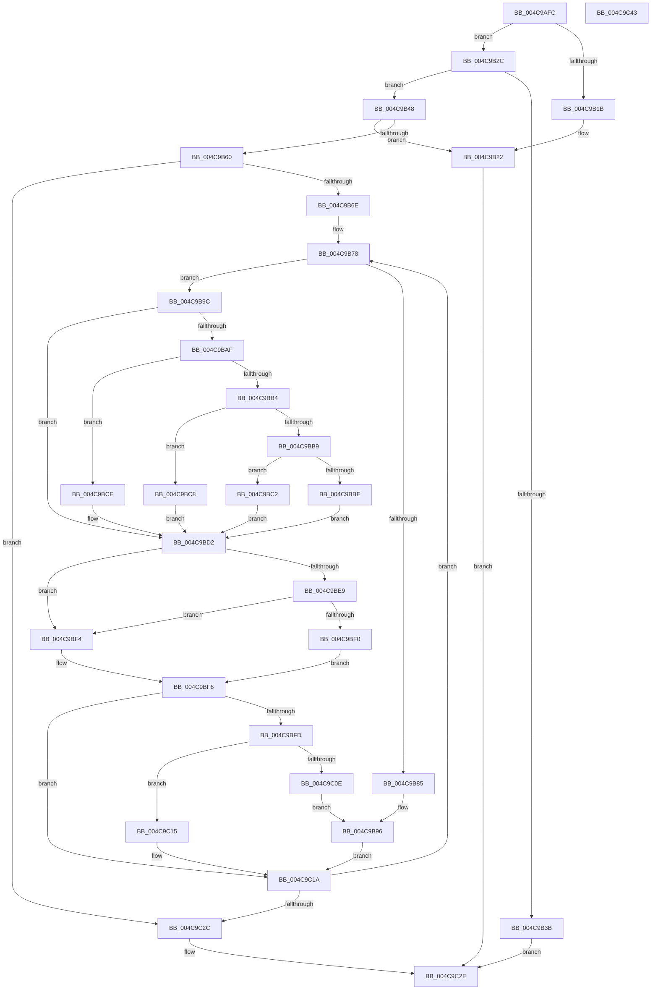

# HalpCollectProfileCorruptionStatus

- RVA: `0x004C9AFC`–`0x004C9C44` (길이 `328` bytes)
- VA: `0x00000001404C9AFC`
- 실행 섹션: `.text`
- PDB 이름 있음: `예`; PDB Function 태그: `아니요`
- unwind 정보 RVA: `0x0005C954`
- 디코드: `99`개 명령, `328/328` bytes 표시
- 미해석 바이트: `0` (있으면 어셈블리에 `.byte`로 보존)

> 이 문서는 커널 이미지의 기계어와 PDB 기호를 분석해 생성했습니다. 4번과 5번은 함수 원형과 자료형을 바이너리 사용 방식에서 추정한 C 해석이며 원본 소스 복구 결과는 아닙니다.

## 1. Dependencies

- 직접 호출 지점: **2**; 고유 호출 대상: **2**
- 직접 호출자로 확인된 함수: **1**
- RIP 상대 이미지 참조: **2**

### Outgoing calls
- `0x004C9B3E` → [HalpCollectSamplingProfileCorruptionStatus](../54/HalpCollectSamplingProfileCorruptionStatus_function_005470AC.md) (function, `0x005470AC`)
- `0x004C9B91` → [KeQueryPerformanceCounter](../37/KeQueryPerformanceCounter_function_0037E7E0.md) (function, `0x0037E7E0`)

### Direct callers
- [HalpQueryProfileInformation](../../page/AD/HalpQueryProfileInformation_function_00AD621C.md) at `0x00AD6292`

### Static image references
- `0x004C9B2F` → RVA `0x00FC2BE0` (`.data`; read)
- `0x004C9B9C` → RVA `0x00FC8C40` (`ALMOSTRO`; read)

## 2. Other-region calls and transfers

- 다른 실행 섹션으로 향하는 call: **0**
- 별도 외부 분기/꼬리 이동을 확인하지 못했습니다.

## 3. Assembly (complete function range)

```asm
004C9AFC  48 89 5C 24 08                  mov qword ptr [rsp + 8], rbx
004C9B01  48 89 6C 24 10                  mov qword ptr [rsp + 0x10], rbp
004C9B06  48 89 74 24 18                  mov qword ptr [rsp + 0x18], rsi
004C9B0B  57                              push rdi
004C9B0C  48 83 EC 20                     sub rsp, 0x20
004C9B10  4D 8B C8                        mov r9, r8
004C9B13  44 8B D2                        mov r10d, edx
004C9B16  83 FA 08                        cmp edx, 8
004C9B19  73 11                           jae 0x1404c9b2c
004C9B1B  41 C7 00 08 00 00 00            mov dword ptr [r8], 8
004C9B22  B8 04 00 00 C0                  mov eax, 0xc0000004
004C9B27  E9 02 01 00 00                  jmp 0x1404c9c2e
004C9B2C  4C 8B 01                        mov r8, qword ptr [rcx]
004C9B2F  48 8D 05 AA 90 AF 00            lea rax, [rip + 0xaf90aa]
004C9B36  4C 3B C0                        cmp r8, rax
004C9B39  75 0D                           jne 0x1404c9b48
004C9B3B  4D 8B C1                        mov r8, r9
004C9B3E  E8 69 D5 07 00                  call 0x1405470ac
004C9B43  E9 E6 00 00 00                  jmp 0x1404c9c2e
004C9B48  41 8B 50 14                     mov edx, dword ptr [r8 + 0x14]
004C9B4C  41 8B 68 10                     mov ebp, dword ptr [r8 + 0x10]
004C9B50  8B C2                           mov eax, edx
004C9B52  C1 E0 04                        shl eax, 4
004C9B55  83 C0 18                        add eax, 0x18
004C9B58  41 89 01                        mov dword ptr [r9], eax
004C9B5B  44 3B D0                        cmp r10d, eax
004C9B5E  72 C2                           jb 0x1404c9b22
004C9B60  89 51 10                        mov dword ptr [rcx + 0x10], edx
004C9B63  89 69 08                        mov dword ptr [rcx + 8], ebp
004C9B66  85 D2                           test edx, edx
004C9B68  0F 84 BE 00 00 00               je 0x1404c9c2c
004C9B6E  49 8D 78 28                     lea rdi, [r8 + 0x28]
004C9B72  8B F2                           mov esi, edx
004C9B74  48 8D 59 20                     lea rbx, [rcx + 0x20]
004C9B78  44 8B 4F 0C                     mov r9d, dword ptr [rdi + 0xc]
004C9B7C  8B 4F 10                        mov ecx, dword ptr [rdi + 0x10]
004C9B7F  41 83 F9 FF                     cmp r9d, -1
004C9B83  75 17                           jne 0x1404c9b9c
004C9B85  66 C7 43 04 00 01               mov word ptr [rbx + 4], 0x100
004C9B8B  33 C9                           xor ecx, ecx
004C9B8D  8B 07                           mov eax, dword ptr [rdi]
004C9B8F  89 03                           mov dword ptr [rbx], eax
004C9B91  E8 4A 4C EB FF                  call 0x14037e7e0
004C9B96  48 89 43 F8                     mov qword ptr [rbx - 8], rax
004C9B9A  EB 7E                           jmp 0x1404c9c1a
004C9B9C  48 8D 15 9D F0 AF 00            lea rdx, [rip + 0xaff09d]
004C9BA3  48 8B 04 EA                     mov rax, qword ptr [rdx + rbp*8]
004C9BA7  48 8B 50 58                     mov rdx, qword ptr [rax + 0x58]
004C9BAB  85 C9                           test ecx, ecx
004C9BAD  74 23                           je 0x1404c9bd2
004C9BAF  83 E9 01                        sub ecx, 1
004C9BB2  74 1A                           je 0x1404c9bce
004C9BB4  83 E9 63                        sub ecx, 0x63
004C9BB7  74 0F                           je 0x1404c9bc8
004C9BB9  83 F9 01                        cmp ecx, 1
004C9BBC  74 04                           je 0x1404c9bc2
004C9BBE  33 D2                           xor edx, edx
004C9BC0  EB 10                           jmp 0x1404c9bd2
004C9BC2  48 83 C2 48                     add rdx, 0x48
004C9BC6  EB 0A                           jmp 0x1404c9bd2
004C9BC8  48 83 C2 30                     add rdx, 0x30
004C9BCC  EB 04                           jmp 0x1404c9bd2
004C9BCE  48 83 C2 18                     add rdx, 0x18
004C9BD2  4C 8B 42 10                     mov r8, qword ptr [rdx + 0x10]
004C9BD6  4B 8D 14 49                     lea rdx, [r9 + r9*2]
004C9BDA  48 03 D2                        add rdx, rdx
004C9BDD  41 83 7C D0 18 01               cmp dword ptr [r8 + rdx*8 + 0x18], 1
004C9BE3  49 8D 0C D0                     lea rcx, [r8 + rdx*8]
004C9BE7  75 0B                           jne 0x1404c9bf4
004C9BE9  8B 07                           mov eax, dword ptr [rdi]
004C9BEB  39 41 24                        cmp dword ptr [rcx + 0x24], eax
004C9BEE  75 04                           jne 0x1404c9bf4
004C9BF0  B0 01                           mov al, 1
004C9BF2  EB 02                           jmp 0x1404c9bf6
004C9BF4  32 C0                           xor al, al
004C9BF6  88 43 05                        mov byte ptr [rbx + 5], al
004C9BF9  84 C0                           test al, al
004C9BFB  74 1D                           je 0x1404c9c1a
004C9BFD  8B 41 24                        mov eax, dword ptr [rcx + 0x24]
004C9C00  89 03                           mov dword ptr [rbx], eax
004C9C02  41 8A 44 D0 28                  mov al, byte ptr [r8 + rdx*8 + 0x28]
004C9C07  88 43 04                        mov byte ptr [rbx + 4], al
004C9C0A  84 C0                           test al, al
004C9C0C  74 07                           je 0x1404c9c15
004C9C0E  49 8B 44 D0 08                  mov rax, qword ptr [r8 + rdx*8 + 8]
004C9C13  EB 81                           jmp 0x1404c9b96
004C9C15  48 83 63 F8 00                  and qword ptr [rbx - 8], 0
004C9C1A  48 83 C3 10                     add rbx, 0x10
004C9C1E  48 83 C7 28                     add rdi, 0x28
004C9C22  48 83 EE 01                     sub rsi, 1
004C9C26  0F 85 4C FF FF FF               jne 0x1404c9b78
004C9C2C  33 C0                           xor eax, eax
004C9C2E  48 8B 5C 24 30                  mov rbx, qword ptr [rsp + 0x30]
004C9C33  48 8B 6C 24 38                  mov rbp, qword ptr [rsp + 0x38]
004C9C38  48 8B 74 24 40                  mov rsi, qword ptr [rsp + 0x40]
004C9C3D  48 83 C4 20                     add rsp, 0x20
004C9C41  5F                              pop rdi
004C9C42  C3                              ret
004C9C43  CC                              int3
```

## 4. C-style interpretation (structured pseudocode)

```c
__int64 __fastcall HalpCollectProfileCorruptionStatus(__int64 a1, int a2, __int64 a3)
{
    __int64 result;
    __int64 v_rbx;
    __int64 v_rdi;
    __int64 v_rsi;
    __int64 v_rsp;
    unsigned __int64 v_stack_p10;
    unsigned __int64 v_stack_p18;
    unsigned __int64 v_stack_p8;

    v_stack_p8 = v_rbx;
    v_stack_p10 = v_rbp;
    v_stack_p18 = v_rsi;
    v_rsp = (v_rsp) - (32);
    if (a2 >= 8) goto loc_004C9B2C;
    *(unsigned int *)(a3) = 8;
loc_004C9B22:
    goto loc_004C9C2E;
loc_004C9B2C:
    if ((*(unsigned __int64 *)(a1)) != (v_rip + 11505834)) goto loc_004C9B48;
    result = HalpCollectSamplingProfileCorruptionStatus(a1, a2, a3, a3);
    goto loc_004C9C2E;
loc_004C9B48:
    result = (unsigned int)(((unsigned int)((unsigned int)((unsigned int)(*(unsigned int *)(a3 + 20))))) << (4));
    result = (unsigned int)((result) + (24));
    *(unsigned int *)(a3) = (unsigned int)(result);
    if (((unsigned int)((unsigned int)(a2))) < ((unsigned int)(result))) goto loc_004C9B22;
    *(unsigned int *)(a1 + 16) = (unsigned int)((unsigned int)(*(unsigned int *)(a3 + 20)));
    *(unsigned int *)(a1 + 8) = (unsigned int)((unsigned int)(*(unsigned int *)(a3 + 16)));
    if ((unsigned int)((unsigned int)(*(unsigned int *)(a3 + 20))) == 0) goto loc_004C9C2C;
loc_004C9B78:
    if (((unsigned int)((unsigned int)(*(unsigned int *)(a3 + 40 + 12)))) != -1) goto loc_004C9B9C;
    *(unsigned __int16 *)(a1 + 32 + 4) = 256;
    a1 = 0;
    *(unsigned int *)(a1 + 32) = (unsigned int)((unsigned int)(*(unsigned int *)(a3 + 40)));
    result = KeQueryPerformanceCounter(a1, (unsigned int)(*(unsigned int *)(a3 + 20)), a3, (unsigned int)(*(unsigned int *)(a3 + 40 + 12)));
loc_004C9B96:
    *(unsigned __int64 *)(a1 + 32 - 8) = result;
    goto loc_004C9C1A;
loc_004C9B9C:
    if (0 == 0) goto loc_004C9BD2;
    a1 = (unsigned int)((a1) - (1));
    if (condition_is_equal) goto loc_004C9BCE;
    a1 = (unsigned int)((a1) - (99));
    if (condition_is_equal) goto loc_004C9BC8;
    if (((unsigned int)(a1)) == 1) goto loc_004C9BC2;
    a2 = 0;
    goto loc_004C9BD2;
loc_004C9BC2:
    a2 = (a2) + (72);
    goto loc_004C9BD2;
loc_004C9BC8:
    a2 = (a2) + (48);
    goto loc_004C9BD2;
loc_004C9BCE:
    a2 = (a2) + (24);
loc_004C9BD2:
    a2 = ((unsigned int)(*(unsigned int *)(a3 + 40 + 12)) + (unsigned int)(*(unsigned int *)(a3 + 40 + 12)) * 2) + ((unsigned int)(*(unsigned int *)(a3 + 40 + 12)) + (unsigned int)(*(unsigned int *)(a3 + 40 + 12)) * 2);
    if ((*(unsigned int *)(*(unsigned __int64 *)(a2 + 16) + a2 * 8 + 24)) != 1) goto loc_004C9BF4;
    if ((*(unsigned int *)(*(unsigned __int64 *)(a2 + 16) + a2 * 8 + 36)) != ((unsigned int)((unsigned int)(*(unsigned int *)(a3 + 40))))) goto loc_004C9BF4;
    goto loc_004C9BF6;
loc_004C9BF4:
    result = 0;
loc_004C9BF6:
    *(unsigned __int8 *)(a1 + 32 + 5) = 0;
    if (0 == 0) goto loc_004C9C1A;
    *(unsigned int *)(a1 + 32) = (unsigned int)((unsigned int)(*(unsigned int *)(*(unsigned __int64 *)(a2 + 16) + a2 * 8 + 36)));
    *(unsigned __int8 *)(a1 + 32 + 4) = (unsigned __int8)(*(unsigned __int8 *)(*(unsigned __int64 *)(a2 + 16) + a2 * 8 + 40));
    if ((unsigned __int8)(*(unsigned __int8 *)(*(unsigned __int64 *)(a2 + 16) + a2 * 8 + 40)) == 0) goto loc_004C9C15;
    goto loc_004C9B96;
loc_004C9C15:
loc_004C9C1A:
    v_rbx = (a1 + 32) + (16);
    v_rdi = (a3 + 40) + (40);
    v_rsi = ((unsigned int)((unsigned int)((unsigned int)(*(unsigned int *)(a3 + 20))))) - (1);
    if (condition_is_not_equal) goto loc_004C9B78;
loc_004C9C2C:
    result = 0;
loc_004C9C2E:
    v_rsp = (v_rsp) + (32);
    return result;
}
```

## 5. (Beta) C Style

```c
int64_t HalpCollectProfileCorruptionStatus(void *Arg1, int32_t Arg2, void *Arg3)
{
    uint8_t *arg1 = (uint8_t *)Arg1;
    uint8_t *arg3 = (uint8_t *)Arg3;

    int64_t result;
    int64_t local_rbx;
    int64_t local_rdi;
    int64_t local_rsi;
    int64_t local_rsp;
    uint64_t v_stack_p10;
    uint64_t v_stack_p18;
    uint64_t v_stack_p8;

    v_stack_p8 = local_rbx;
    v_stack_p10 = local_rbp;
    v_stack_p18 = local_rsi;
    local_rsp = (local_rsp) - (32);
    if (Arg2 >= 8) goto loc_004C9B2C;
    *(uint32_t *)(arg3) = 8;
loc_004C9B22:
    goto loc_004C9C2E;
loc_004C9B2C:
    if ((*(uint64_t *)(arg1)) != (v_rip + 11505834)) goto loc_004C9B48;
    result = HalpCollectSamplingProfileCorruptionStatus(Arg1, Arg2, Arg3, Arg3);
    goto loc_004C9C2E;
loc_004C9B48:
    result = (uint32_t)(((uint32_t)((uint32_t)((uint32_t)(*(uint32_t *)(arg3 + 0x14))))) << (4));
    result = (uint32_t)((result) + (24));
    *(uint32_t *)(arg3) = (uint32_t)(result);
    if (((uint32_t)((uint32_t)(Arg2))) < ((uint32_t)(result))) goto loc_004C9B22;
    *(uint32_t *)(arg1 + 0x10) = (uint32_t)((uint32_t)(*(uint32_t *)(arg3 + 0x14)));
    *(uint32_t *)(arg1 + 0x8) = (uint32_t)((uint32_t)(*(uint32_t *)(arg3 + 0x10)));
    if ((uint32_t)((uint32_t)(*(uint32_t *)(arg3 + 0x14))) == 0) goto loc_004C9C2C;
loc_004C9B78:
    if (((uint32_t)((uint32_t)(*(uint32_t *)(arg3 + 0x28 + 0xC)))) != -1) goto loc_004C9B9C;
    *(uint16_t *)(arg1 + 0x20 + 0x4) = 256;
    Arg1 = 0;
    *(uint32_t *)(arg1 + 0x20) = (uint32_t)((uint32_t)(*(uint32_t *)(arg3 + 0x28)));
    result = KeQueryPerformanceCounter(Arg1, (uint32_t)(*(uint32_t *)(arg3 + 0x14)), Arg3, (uint32_t)(*(uint32_t *)(arg3 + 0x28 + 0xC)));
loc_004C9B96:
    *(uint64_t *)(arg1 + 0x20 - 0x8) = result;
    goto loc_004C9C1A;
loc_004C9B9C:
    if (0 == 0) goto loc_004C9BD2;
    Arg1 = (uint32_t)((Arg1) - (1));
    if (condition_is_equal) goto loc_004C9BCE;
    Arg1 = (uint32_t)((Arg1) - (99));
    if (condition_is_equal) goto loc_004C9BC8;
    if (((uint32_t)(Arg1)) == 1) goto loc_004C9BC2;
    Arg2 = 0;
    goto loc_004C9BD2;
loc_004C9BC2:
    Arg2 = (Arg2) + (72);
    goto loc_004C9BD2;
loc_004C9BC8:
    Arg2 = (Arg2) + (48);
    goto loc_004C9BD2;
loc_004C9BCE:
    Arg2 = (Arg2) + (24);
loc_004C9BD2:
    Arg2 = ((uint32_t)(*(uint32_t *)(arg3 + 0x28 + 0xC)) + (uint32_t)(*(uint32_t *)(arg3 + 0x28 + 0xC)) * 2) + ((uint32_t)(*(uint32_t *)(arg3 + 0x28 + 0xC)) + (uint32_t)(*(uint32_t *)(arg3 + 0x28 + 0xC)) * 2);
    if ((*(uint32_t *)(*(uint64_t *)(Arg2 + 0x10) + Arg2 * 8 + 0x18)) != 1) goto loc_004C9BF4;
    if ((*(uint32_t *)(*(uint64_t *)(Arg2 + 0x10) + Arg2 * 8 + 0x24)) != ((uint32_t)((uint32_t)(*(uint32_t *)(arg3 + 0x28))))) goto loc_004C9BF4;
    goto loc_004C9BF6;
loc_004C9BF4:
    result = 0;
loc_004C9BF6:
    *(uint8_t *)(arg1 + 0x20 + 0x5) = 0;
    if (0 == 0) goto loc_004C9C1A;
    *(uint32_t *)(arg1 + 0x20) = (uint32_t)((uint32_t)(*(uint32_t *)(*(uint64_t *)(Arg2 + 0x10) + Arg2 * 8 + 0x24)));
    *(uint8_t *)(arg1 + 0x20 + 0x4) = (uint8_t)(*(uint8_t *)(*(uint64_t *)(Arg2 + 0x10) + Arg2 * 8 + 0x28));
    if ((uint8_t)(*(uint8_t *)(*(uint64_t *)(Arg2 + 0x10) + Arg2 * 8 + 0x28)) == 0) goto loc_004C9C15;
    goto loc_004C9B96;
loc_004C9C15:
loc_004C9C1A:
    local_rbx = (Arg1 + 32) + (16);
    local_rdi = (Arg3 + 40) + (40);
    local_rsi = ((uint32_t)((uint32_t)((uint32_t)(*(uint32_t *)(arg3 + 0x14))))) - (1);
    if (condition_is_not_equal) goto loc_004C9B78;
loc_004C9C2C:
    result = 0;
loc_004C9C2E:
    local_rsp = (local_rsp) + (32);
    return result;
}
```

### 관측된 메모리 오프셋

구조체 형식이 확인되지 않은 접근은 인자 기준의 오프셋으로만 기록했습니다.

| 기준 인자 | 오프셋 표현 | 폭 (bit) | 접근 |
|---|---:|---:|---|
| `Arg1` | `- 0x8` | `64` | `R/W` |
| `Arg1` | `- 0x8` | `64` | `W` |
| `Arg1` | `+ 0x0` | `32` | `W` |
| `Arg1` | `+ 0x0` | `64` | `R` |
| `Arg1` | `+ 0x4` | `8` | `W` |
| `Arg1` | `+ 0x4` | `16` | `W` |
| `Arg1` | `+ 0x5` | `8` | `W` |
| `Arg1` | `+ 0x8` | `32` | `W` |
| `Arg1` | `+ 0x10` | `32` | `W` |
| `Arg1` | `+ 0x20` | `64` | `R` |
| `Arg3` | `+ 0x0` | `32` | `W` |

## 6. Execution-region graph

[열기: 2D/3D 그래프와 함수 탐색 컨트롤 패널](../../../control-panel.html?section=text&rva=0x004C9AFC&view=graph)

- 2D 그래프는 위에서 아래로 흐르고, 3D 그래프는 빈 공간을 드래그해 회전합니다. Shift+드래그는 이동, 휠은 확대·축소, 함수 노드 선택은 대상 보고서 이동입니다.

### Static fallback


