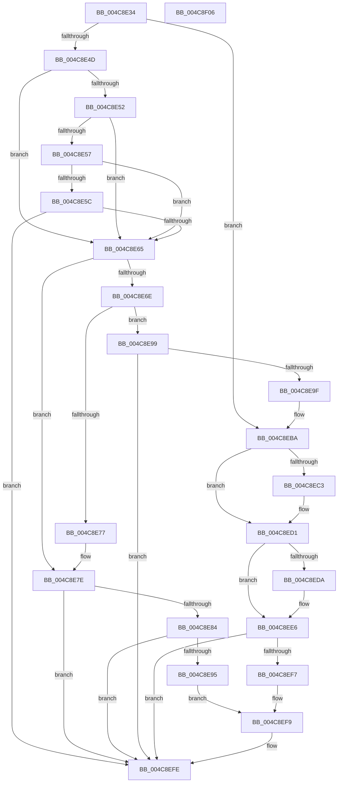

# HalpDispatchSystemStateTransition

- RVA: `0x004C8E34`–`0x004C8F07` (길이 `211` bytes)
- VA: `0x00000001404C8E34`
- 실행 섹션: `.text`
- PDB 이름 있음: `예`; PDB Function 태그: `아니요`
- unwind 정보 RVA: `0x000BD408`
- 디코드: `59`개 명령, `211/211` bytes 표시
- 미해석 바이트: `0` (있으면 어셈블리에 `.byte`로 보존)

> 이 문서는 커널 이미지의 기계어와 PDB 기호를 분석해 생성했습니다. 4번과 5번은 함수 원형과 자료형을 바이너리 사용 방식에서 추정한 C 해석이며 원본 소스 복구 결과는 아닙니다.

## 1. Dependencies

- 직접 호출 지점: **6**; 고유 호출 대상: **5**
- 직접 호출자로 확인된 함수: **1**
- RIP 상대 이미지 참조: **6**

### Outgoing calls
- `0x004C8E6E` → [HalpBuildResumeStructures](../../pagelk/B5/HalpBuildResumeStructures_function_00B5D0F0.md) (function, `0x00B5D0F0`)
- `0x004C8E86` → [HalpEfiLockOutRuntimeCallsForSystemSleep](../4A/HalpEfiLockOutRuntimeCallsForSystemSleep_function_004AC91C.md) (function, `0x004AC91C`)
- `0x004C8EB4` → [KeBugCheckEx](../4F/KeBugCheckEx_function_004FD660.md) (function, `0x004FD660`)
- `0x004C8EDA` → [HalpFreeResumeStructures](../../pagelk/B5/HalpFreeResumeStructures_function_00B5D16C.md) (function, `0x00B5D16C`)
- `0x004C8EE8` → [HalpEfiLockOutRuntimeCallsForSystemSleep](../4A/HalpEfiLockOutRuntimeCallsForSystemSleep_function_004AC91C.md) (function, `0x004AC91C`)
- `0x004C8EF9` → [HalpInterruptMaskAcpi](../../pagelk/B7/HalpInterruptMaskAcpi_function_00B7C128.md) (function, `0x00B7C128`)

### Direct callers
- [sub_00B811F2](../../pagelk/B8/Unknown_function_00B811F2.md) at `0x00B811FD`

### Static image references
- `0x004C8E65` → RVA `0x00FC1C20` (`.data`; read)
- `0x004C8E77` → RVA `0x00FC1C20` (`.data`; write)
- `0x004C8E8B` → RVA `0x00E0A808` (`.data`; read)
- `0x004C8EBA` → RVA `0x00E10381` (`.data`; read)
- `0x004C8EC3` → RVA `0x00FC22C0` (`.data`; write)
- `0x004C8ECA` → RVA `0x00E10381` (`.data`; write)

## 2. Other-region calls and transfers

- 다른 실행 섹션으로 향하는 call: **3**
  - `0x004C8E6E` → [HalpBuildResumeStructures](../../pagelk/B5/HalpBuildResumeStructures_function_00B5D0F0.md) (`.text` → `PAGELK`)
  - `0x004C8EDA` → [HalpFreeResumeStructures](../../pagelk/B5/HalpFreeResumeStructures_function_00B5D16C.md) (`.text` → `PAGELK`)
  - `0x004C8EF9` → [HalpInterruptMaskAcpi](../../pagelk/B7/HalpInterruptMaskAcpi_function_00B7C128.md) (`.text` → `PAGELK`)
- 별도 외부 분기/꼬리 이동을 확인하지 못했습니다.

## 3. Assembly (complete function range)

```asm
004C8E34  40 57                           push rdi
004C8E36  48 83 EC 30                     sub rsp, 0x30
004C8E3A  48 8B 91 B8 00 00 00            mov rdx, qword ptr [rcx + 0xb8]
004C8E41  8B 4A 18                        mov ecx, dword ptr [rdx + 0x18]
004C8E44  40 8A 7A 01                     mov dil, byte ptr [rdx + 1]
004C8E48  83 E9 01                        sub ecx, 1
004C8E4B  74 6D                           je 0x1404c8eba
004C8E4D  83 E9 01                        sub ecx, 1
004C8E50  74 13                           je 0x1404c8e65
004C8E52  83 E9 01                        sub ecx, 1
004C8E55  74 0E                           je 0x1404c8e65
004C8E57  83 E9 01                        sub ecx, 1
004C8E5A  74 09                           je 0x1404c8e65
004C8E5C  83 F9 01                        cmp ecx, 1
004C8E5F  0F 85 99 00 00 00               jne 0x1404c8efe
004C8E65  80 3D B4 8D AF 00 00            cmp byte ptr [rip + 0xaf8db4], 0
004C8E6C  75 10                           jne 0x1404c8e7e
004C8E6E  E8 7D 42 69 00                  call 0x140b5d0f0
004C8E73  85 C0                           test eax, eax
004C8E75  78 22                           js 0x1404c8e99
004C8E77  C6 05 A2 8D AF 00 01            mov byte ptr [rip + 0xaf8da2], 1
004C8E7E  40 80 FF 02                     cmp dil, 2
004C8E82  75 7A                           jne 0x1404c8efe
004C8E84  33 C9                           xor ecx, ecx
004C8E86  E8 91 3A FE FF                  call 0x1404ac91c
004C8E8B  8B 05 77 19 94 00               mov eax, dword ptr [rip + 0x941977]
004C8E91  A8 01                           test al, 1
004C8E93  74 69                           je 0x1404c8efe
004C8E95  33 C9                           xor ecx, ecx
004C8E97  EB 60                           jmp 0x1404c8ef9
004C8E99  40 80 FF 02                     cmp dil, 2
004C8E9D  75 5F                           jne 0x1404c8efe
004C8E9F  48 83 64 24 20 00               and qword ptr [rsp + 0x20], 0
004C8EA5  45 33 C9                        xor r9d, r9d
004C8EA8  4C 63 C0                        movsxd r8, eax
004C8EAB  BA 0C 01 00 00                  mov edx, 0x10c
004C8EB0  41 8D 49 5C                     lea ecx, [r9 + 0x5c]
004C8EB4  E8 A7 47 03 00                  call 0x1404fd660
004C8EB9  CC                              int3
004C8EBA  80 3D C0 74 94 00 00            cmp byte ptr [rip + 0x9474c0], 0
004C8EC1  74 0E                           je 0x1404c8ed1
004C8EC3  C6 05 F6 93 AF 00 01            mov byte ptr [rip + 0xaf93f6], 1
004C8ECA  C6 05 B0 74 94 00 00            mov byte ptr [rip + 0x9474b0], 0
004C8ED1  80 3D 48 8D AF 00 00            cmp byte ptr [rip + 0xaf8d48], 0
004C8ED8  74 0C                           je 0x1404c8ee6
004C8EDA  E8 8D 42 69 00                  call 0x140b5d16c
004C8EDF  C6 05 3A 8D AF 00 00            mov byte ptr [rip + 0xaf8d3a], 0
004C8EE6  B1 01                           mov cl, 1
004C8EE8  E8 2F 3A FE FF                  call 0x1404ac91c
004C8EED  8B 05 15 19 94 00               mov eax, dword ptr [rip + 0x941915]
004C8EF3  A8 01                           test al, 1
004C8EF5  74 07                           je 0x1404c8efe
004C8EF7  B1 01                           mov cl, 1
004C8EF9  E8 2A 32 6B 00                  call 0x140b7c128
004C8EFE  33 C0                           xor eax, eax
004C8F00  48 83 C4 30                     add rsp, 0x30
004C8F04  5F                              pop rdi
004C8F05  C3                              ret
004C8F06  CC                              int3
```

## 4. C-style interpretation (structured pseudocode)

```c
__int64 __fastcall HalpDispatchSystemStateTransition(__int64 a1, __int64 a2, __int64 a3, int a4)
{
    __int64 result;
    __int64 v_rsp;
    unsigned __int64 v_stack_m18;

    v_rsp = (v_rsp) - (48);
    a1 = (unsigned int)(((unsigned int)(*(unsigned int *)(*(unsigned __int64 *)(a1 + 184) + 24))) - (1));
    if (condition_is_equal) goto loc_004C8EBA;
    a1 = (unsigned int)((a1) - (1));
    if (condition_is_equal) goto loc_004C8E65;
    a1 = (unsigned int)((a1) - (1));
    if (condition_is_equal) goto loc_004C8E65;
    a1 = (unsigned int)((a1) - (1));
    if (condition_is_equal) goto loc_004C8E65;
    if (((unsigned int)(a1)) != 1) goto loc_004C8EFE;
loc_004C8E65:
    if ((*(unsigned __int8 *)(v_rip + 11505076)) != 0) goto loc_004C8E7E;
    result = HalpBuildResumeStructures(a1, *(unsigned __int64 *)(a1 + 184), a3, a4);
    if (sign_flag) goto loc_004C8E99;
    *(unsigned __int8 *)(v_rip + 11505058) = 1;
loc_004C8E7E:
    if (((unsigned __int8)(*(unsigned __int8 *)(*(unsigned __int64 *)(a1 + 184) + 1))) != 2) goto loc_004C8EFE;
    a1 = 0;
    result = HalpEfiLockOutRuntimeCallsForSystemSleep(a1, *(unsigned __int64 *)(a1 + 184), a3, a4);
    if ((((unsigned __int8)((unsigned int)(*(unsigned int *)(v_rip + 9705847)))) & (1)) == 0) goto loc_004C8EFE;
    a1 = 0;
    goto loc_004C8EF9;
loc_004C8E99:
    if (((unsigned __int8)(*(unsigned __int8 *)(*(unsigned __int64 *)(a1 + 184) + 1))) != 2) goto loc_004C8EFE;
    a4 = 0;
    result = KeBugCheckEx(a4 + 92, 268, (int)((unsigned int)((unsigned int)(*(unsigned int *)(v_rip + 9705847)))), a4);
loc_004C8EBA:
    if ((*(unsigned __int8 *)(v_rip + 9729216)) != 0) {
        *(unsigned __int8 *)(v_rip + 11506678) = 1;
        *(unsigned __int8 *)(v_rip + 9729200) = 0;
    }
    if ((*(unsigned __int8 *)(v_rip + 11504968)) != 0) {
        result = HalpFreeResumeStructures(a4 + 92, 268, (int)((unsigned int)((unsigned int)(*(unsigned int *)(v_rip + 9705847)))), a4);
        *(unsigned __int8 *)(v_rip + 11504954) = 0;
    }
    result = HalpEfiLockOutRuntimeCallsForSystemSleep(1, 268, (int)((unsigned int)((unsigned int)(*(unsigned int *)(v_rip + 9705847)))), a4);
    if ((((unsigned __int8)((unsigned int)(*(unsigned int *)(v_rip + 9705749)))) & (1)) == 0) goto loc_004C8EFE;
loc_004C8EF9:
    result = HalpInterruptMaskAcpi(1, 268, (int)((unsigned int)((unsigned int)(*(unsigned int *)(v_rip + 9705847)))), a4);
loc_004C8EFE:
    result = 0;
    v_rsp = (v_rsp) + (48);
    return result;
}
```

## 5. (Beta) C Style

```c
int64_t HalpDispatchSystemStateTransition(void *Arg1, int64_t Arg2, int64_t Arg3, int32_t Arg4)
{
    uint8_t *arg1 = (uint8_t *)Arg1;

    int64_t result;
    int64_t local_rsp;
    uint64_t v_stack_m18;

    local_rsp = (local_rsp) - (48);
    Arg1 = (uint32_t)(((uint32_t)(*(uint32_t *)(*(uint64_t *)(arg1 + 0xB8) + 0x18))) - (1));
    if (condition_is_equal) goto loc_004C8EBA;
    Arg1 = (uint32_t)((Arg1) - (1));
    if (condition_is_equal) goto loc_004C8E65;
    Arg1 = (uint32_t)((Arg1) - (1));
    if (condition_is_equal) goto loc_004C8E65;
    Arg1 = (uint32_t)((Arg1) - (1));
    if (condition_is_equal) goto loc_004C8E65;
    if (((uint32_t)(Arg1)) != 1) goto loc_004C8EFE;
loc_004C8E65:
    if ((*(uint8_t *)(v_rip + 0xAF8DB4)) != 0) goto loc_004C8E7E;
    result = HalpBuildResumeStructures(Arg1, *(uint64_t *)(arg1 + 0xB8), Arg3, Arg4);
    if (sign_flag) goto loc_004C8E99;
    *(uint8_t *)(v_rip + 0xAF8DA2) = 1;
loc_004C8E7E:
    if (((uint8_t)(*(uint8_t *)(*(uint64_t *)(arg1 + 0xB8) + 0x1))) != 2) goto loc_004C8EFE;
    Arg1 = 0;
    result = HalpEfiLockOutRuntimeCallsForSystemSleep(Arg1, *(uint64_t *)(arg1 + 0xB8), Arg3, Arg4);
    if ((((uint8_t)((uint32_t)(*(uint32_t *)(v_rip + 0x941977)))) & (1)) == 0) goto loc_004C8EFE;
    Arg1 = 0;
    goto loc_004C8EF9;
loc_004C8E99:
    if (((uint8_t)(*(uint8_t *)(*(uint64_t *)(arg1 + 0xB8) + 0x1))) != 2) goto loc_004C8EFE;
    Arg4 = 0;
    result = KeBugCheckEx(Arg4 + 92, 268, (int32_t)((uint32_t)((uint32_t)(*(uint32_t *)(v_rip + 0x941977)))), Arg4);
loc_004C8EBA:
    if ((*(uint8_t *)(v_rip + 0x9474C0)) != 0) {
        *(uint8_t *)(v_rip + 0xAF93F6) = 1;
        *(uint8_t *)(v_rip + 0x9474B0) = 0;
    }
    if ((*(uint8_t *)(v_rip + 0xAF8D48)) != 0) {
        result = HalpFreeResumeStructures(Arg4 + 92, 268, (int32_t)((uint32_t)((uint32_t)(*(uint32_t *)(v_rip + 0x941977)))), Arg4);
        *(uint8_t *)(v_rip + 0xAF8D3A) = 0;
    }
    result = HalpEfiLockOutRuntimeCallsForSystemSleep(1, 268, (int32_t)((uint32_t)((uint32_t)(*(uint32_t *)(v_rip + 0x941977)))), Arg4);
    if ((((uint8_t)((uint32_t)(*(uint32_t *)(v_rip + 0x941915)))) & (1)) == 0) goto loc_004C8EFE;
loc_004C8EF9:
    result = HalpInterruptMaskAcpi(1, 268, (int32_t)((uint32_t)((uint32_t)(*(uint32_t *)(v_rip + 0x941977)))), Arg4);
loc_004C8EFE:
    result = 0;
    local_rsp = (local_rsp) + (48);
    return result;
}
```

### 관측된 메모리 오프셋

구조체 형식이 확인되지 않은 접근은 인자 기준의 오프셋으로만 기록했습니다.

| 기준 인자 | 오프셋 표현 | 폭 (bit) | 접근 |
|---|---:|---:|---|
| `Arg1` | `+ 0xB8` | `64` | `R` |

## 6. Execution-region graph

[열기: 2D/3D 그래프와 함수 탐색 컨트롤 패널](../../../control-panel.html?section=text&rva=0x004C8E34&view=graph)

- 2D 그래프는 위에서 아래로 흐르고, 3D 그래프는 빈 공간을 드래그해 회전합니다. Shift+드래그는 이동, 휠은 확대·축소, 함수 노드 선택은 대상 보고서 이동입니다.

### Static fallback


