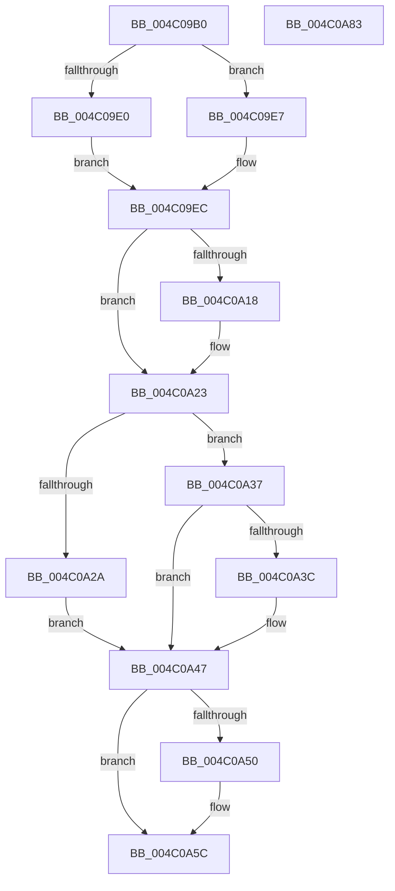

# HalpGrowMapBufferWorker

- RVA: `0x004C09B0`–`0x004C0A84` (길이 `212` bytes)
- VA: `0x00000001404C09B0`
- 실행 섹션: `.text`
- PDB 이름 있음: `예`; PDB Function 태그: `아니요`
- unwind 정보 RVA: `0x0005C954`
- 디코드: `60`개 명령, `212/212` bytes 표시
- 미해석 바이트: `0` (있으면 어셈블리에 `.byte`로 보존)

> 이 문서는 커널 이미지의 기계어와 PDB 기호를 분석해 생성했습니다. 4번과 5번은 함수 원형과 자료형을 바이너리 사용 방식에서 추정한 C 해석이며 원본 소스 복구 결과는 아닙니다.

## 1. Dependencies

- 직접 호출 지점: **7**; 고유 호출 대상: **7**
- 직접 호출자로 확인된 함수: **0**
- RIP 상대 이미지 참조: **2**

### Outgoing calls
- `0x004C09E0` → [HalpDmaGrowContiguousMapBuffers](../../page/AD/HalpDmaGrowContiguousMapBuffers_function_00AD6D14.md) (function, `0x00AD6D14`)
- `0x004C09E7` → [HalpDmaGrowScatterMapBuffers](../../page/AA/HalpDmaGrowScatterMapBuffers_function_00AA2CF0.md) (function, `0x00AA2CF0`)
- `0x004C0A1E` → [KiRaiseIrqlProcessIrqlFlags](../4F/KiRaiseIrqlProcessIrqlFlags_function_004F56FC.md) (function, `0x004F56FC`)
- `0x004C0A30` → [HalpDmaProcessMapRegisterQueueV2](../3D/HalpDmaProcessMapRegisterQueueV2_function_003DF50C.md) (function, `0x003DF50C`)
- `0x004C0A42` → [HalpDmaProcessMapRegisterQueueV3](../3D/HalpDmaProcessMapRegisterQueueV3_function_003DA780.md) (function, `0x003DA780`)
- `0x004C0A57` → [KiLowerIrqlProcessIrqlFlags](../4F/KiLowerIrqlProcessIrqlFlags_function_004F5698.md) (function, `0x004F5698`)
- `0x004C0A69` → [ExFreePoolWithTag](../../poolcode/B8/ExFreePoolWithTag_function_00B82870.md) (function, `0x00B82870`)

### Direct callers
- 이 함수 시작 RVA로 연결되는 직접 call은 확인되지 않았습니다. 간접 호출은 완전히 역산할 수 없습니다.

### Static image references
- `0x004C09F1` → RVA `0x00FC3E90` (`.data`; read)
- `0x004C0A0F` → RVA `0x00FC6D20` (`ALMOSTRO`; read)

## 2. Other-region calls and transfers

- 다른 실행 섹션으로 향하는 call: **3**
  - `0x004C09E0` → [HalpDmaGrowContiguousMapBuffers](../../page/AD/HalpDmaGrowContiguousMapBuffers_function_00AD6D14.md) (`.text` → `PAGE`)
  - `0x004C09E7` → [HalpDmaGrowScatterMapBuffers](../../page/AA/HalpDmaGrowScatterMapBuffers_function_00AA2CF0.md) (`.text` → `PAGE`)
  - `0x004C0A69` → [ExFreePoolWithTag](../../poolcode/B8/ExFreePoolWithTag_function_00B82870.md) (`.text` → `POOLCODE`)
- 별도 외부 분기/꼬리 이동을 확인하지 못했습니다.

## 3. Assembly (complete function range)

```asm
004C09B0  48 89 5C 24 08                  mov qword ptr [rsp + 8], rbx
004C09B5  48 89 6C 24 10                  mov qword ptr [rsp + 0x10], rbp
004C09BA  48 89 74 24 18                  mov qword ptr [rsp + 0x18], rsi
004C09BF  57                              push rdi
004C09C0  48 83 EC 20                     sub rsp, 0x20
004C09C4  8B 51 2C                        mov edx, dword ptr [rcx + 0x2c]
004C09C7  48 8B D9                        mov rbx, rcx
004C09CA  48 8B 79 20                     mov rdi, qword ptr [rcx + 0x20]
004C09CE  83 C2 10                        add edx, 0x10
004C09D1  C1 E2 0C                        shl edx, 0xc
004C09D4  C1 EA 0C                        shr edx, 0xc
004C09D7  80 79 28 00                     cmp byte ptr [rcx + 0x28], 0
004C09DB  48 8B CF                        mov rcx, rdi
004C09DE  75 07                           jne 0x1404c09e7
004C09E0  E8 2F 63 61 00                  call 0x140ad6d14
004C09E5  EB 05                           jmp 0x1404c09ec
004C09E7  E8 04 23 5E 00                  call 0x140aa2cf0
004C09EC  8A 43 28                        mov al, byte ptr [rbx + 0x28]
004C09EF  F6 D8                           neg al
004C09F1  48 8D 05 98 34 B0 00            lea rax, [rip + 0xb03498]
004C09F8  48 1B C9                        sbb rcx, rcx
004C09FB  83 E1 04                        and ecx, 4
004C09FE  83 24 01 00                     and dword ptr [rcx + rax], 0
004C0A02  44 0F 20 C6                     mov rsi, cr8
004C0A06  BD 02 00 00 00                  mov ebp, 2
004C0A0B  44 0F 22 C5                     mov cr8, rbp
004C0A0F  83 3D 0A 63 B0 00 00            cmp dword ptr [rip + 0xb0630a], 0
004C0A16  74 0B                           je 0x1404c0a23
004C0A18  40 8A D5                        mov dl, bpl
004C0A1B  40 8A CE                        mov cl, sil
004C0A1E  E8 D9 4C 03 00                  call 0x1404f56fc
004C0A23  8B 43 30                        mov eax, dword ptr [rbx + 0x30]
004C0A26  3B C5                           cmp eax, ebp
004C0A28  75 0D                           jne 0x1404c0a37
004C0A2A  8A 53 28                        mov dl, byte ptr [rbx + 0x28]
004C0A2D  48 8B CF                        mov rcx, rdi
004C0A30  E8 D7 EA F1 FF                  call 0x1403df50c
004C0A35  EB 10                           jmp 0x1404c0a47
004C0A37  83 F8 03                        cmp eax, 3
004C0A3A  75 0B                           jne 0x1404c0a47
004C0A3C  8A 53 28                        mov dl, byte ptr [rbx + 0x28]
004C0A3F  48 8B CF                        mov rcx, rdi
004C0A42  E8 39 9D F1 FF                  call 0x1403da780
004C0A47  83 3D D2 62 B0 00 00            cmp dword ptr [rip + 0xb062d2], 0
004C0A4E  74 0C                           je 0x1404c0a5c
004C0A50  44 0F 20 C1                     mov rcx, cr8
004C0A54  40 8A D6                        mov dl, sil
004C0A57  E8 3C 4C 03 00                  call 0x1404f5698
004C0A5C  40 0F B6 C6                     movzx eax, sil
004C0A60  44 0F 22 C0                     mov cr8, rax
004C0A64  33 D2                           xor edx, edx
004C0A66  48 8B CB                        mov rcx, rbx
004C0A69  E8 02 1E 6C 00                  call 0x140b82870
004C0A6E  48 8B 5C 24 30                  mov rbx, qword ptr [rsp + 0x30]
004C0A73  48 8B 6C 24 38                  mov rbp, qword ptr [rsp + 0x38]
004C0A78  48 8B 74 24 40                  mov rsi, qword ptr [rsp + 0x40]
004C0A7D  48 83 C4 20                     add rsp, 0x20
004C0A81  5F                              pop rdi
004C0A82  C3                              ret
004C0A83  CC                              int3
```

## 4. C-style interpretation (structured pseudocode)

```c
__int64 __fastcall HalpGrowMapBufferWorker(__int64 a1)
{
    __int64 result;
    __int64 v_rsp;
    unsigned __int64 v_stack_p10;
    unsigned __int64 v_stack_p18;
    unsigned __int64 v_stack_p8;

    v_stack_p8 = v_rbx;
    v_stack_p10 = v_rbp;
    v_stack_p18 = v_rsi;
    v_rsp = (v_rsp) - (32);
    a2 = (unsigned int)(((unsigned int)(*(unsigned int *)(a1 + 44))) + (16));
    a2 = (unsigned int)((a2) << (12));
    a2 = (unsigned int)((a2) >> (12));
    if ((*(unsigned __int8 *)(a1 + 40)) != 0) goto loc_004C09E7;
    result = HalpDmaGrowContiguousMapBuffers(*(unsigned __int64 *)(a1 + 32), a2, a3, a4);
    goto loc_004C09EC;
loc_004C09E7:
    result = HalpDmaGrowScatterMapBuffers(*(unsigned __int64 *)(a1 + 32), a2, a3, a4);
loc_004C09EC:
    result = (unsigned __int8)(-(*(unsigned __int8 *)(a1 + 40)));
    a1 = (unsigned int)((*(unsigned __int64 *)(a1 + 32)) & (4));
    result = v_rip + 11547800;
    if ((*(unsigned int *)(v_rip + 11559690)) != 0) {
        a2 = 2;
        a1 = (unsigned __int8)(v_cr8);
        result = KiRaiseIrqlProcessIrqlFlags(a1, a2, a3, a4);
    }
    if (((unsigned int)((unsigned int)(*(unsigned int *)(a1 + 48)))) != 2) goto loc_004C0A37;
    result = HalpDmaProcessMapRegisterQueueV2(*(unsigned __int64 *)(a1 + 32), *(unsigned __int8 *)(a1 + 40), a3, a4);
    goto loc_004C0A47;
loc_004C0A37:
    if (((unsigned int)(result)) == 3) {
        a2 = *(unsigned __int8 *)(a1 + 40);
        a1 = *(unsigned __int64 *)(a1 + 32);
        result = HalpDmaProcessMapRegisterQueueV3(a1, a2, a3, a4);
    }
    if ((*(unsigned int *)(v_rip + 11559634)) != 0) {
        a1 = 2;
        a2 = (unsigned __int8)(v_cr8);
        result = KiLowerIrqlProcessIrqlFlags(a1, a2, a3, a4);
    }
    a2 = 0;
    result = ExFreePoolWithTag(a1, a2, a3, a4);
    v_rsp = (v_rsp) + (32);
    return result;
}
```

## 5. (Beta) C Style

```c
int64_t HalpGrowMapBufferWorker(void *Arg1)
{
    uint8_t *arg1 = (uint8_t *)Arg1;

    int64_t result;
    int64_t local_rsp;
    uint64_t v_stack_p10;
    uint64_t v_stack_p18;
    uint64_t v_stack_p8;

    v_stack_p8 = local_rbx;
    v_stack_p10 = local_rbp;
    v_stack_p18 = local_rsi;
    local_rsp = (local_rsp) - (32);
    a2 = (uint32_t)(((uint32_t)(*(uint32_t *)(arg1 + 0x2C))) + (16));
    a2 = (uint32_t)((a2) << (12));
    a2 = (uint32_t)((a2) >> (12));
    if ((*(uint8_t *)(arg1 + 0x28)) != 0) goto loc_004C09E7;
    result = HalpDmaGrowContiguousMapBuffers(*(uint64_t *)(arg1 + 0x20), a2, a3, a4);
    goto loc_004C09EC;
loc_004C09E7:
    result = HalpDmaGrowScatterMapBuffers(*(uint64_t *)(arg1 + 0x20), a2, a3, a4);
loc_004C09EC:
    result = (uint8_t)(-(*(uint8_t *)(arg1 + 0x28)));
    Arg1 = (uint32_t)((*(uint64_t *)(arg1 + 0x20)) & (4));
    result = v_rip + 11547800;
    if ((*(uint32_t *)(v_rip + 0xB0630A)) != 0) {
        a2 = 2;
        Arg1 = (uint8_t)(v_cr8);
        result = KiRaiseIrqlProcessIrqlFlags(Arg1, a2, a3, a4);
    }
    if (((uint32_t)((uint32_t)(*(uint32_t *)(arg1 + 0x30)))) != 2) goto loc_004C0A37;
    result = HalpDmaProcessMapRegisterQueueV2(*(uint64_t *)(arg1 + 0x20), *(uint8_t *)(arg1 + 0x28), a3, a4);
    goto loc_004C0A47;
loc_004C0A37:
    if (((uint32_t)(result)) == 3) {
        a2 = *(uint8_t *)(arg1 + 0x28);
        Arg1 = *(uint64_t *)(arg1 + 0x20);
        result = HalpDmaProcessMapRegisterQueueV3(Arg1, a2, a3, a4);
    }
    if ((*(uint32_t *)(v_rip + 0xB062D2)) != 0) {
        Arg1 = 2;
        a2 = (uint8_t)(v_cr8);
        result = KiLowerIrqlProcessIrqlFlags(Arg1, a2, a3, a4);
    }
    a2 = 0;
    result = ExFreePoolWithTag(Arg1, a2, a3, a4);
    local_rsp = (local_rsp) + (32);
    return result;
}
```

### 관측된 메모리 오프셋

구조체 형식이 확인되지 않은 접근은 인자 기준의 오프셋으로만 기록했습니다.

| 기준 인자 | 오프셋 표현 | 폭 (bit) | 접근 |
|---|---:|---:|---|
| `Arg1` | `+ 0x20` | `64` | `R` |
| `Arg1` | `+ 0x28` | `8` | `R` |
| `Arg1` | `+ 0x2C` | `32` | `R` |
| `Arg1` | `+ 0x30` | `32` | `R` |

## 6. Execution-region graph

[열기: 2D/3D 그래프와 함수 탐색 컨트롤 패널](../../../control-panel.html?section=text&rva=0x004C09B0&view=graph)

- 2D 그래프는 위에서 아래로 흐르고, 3D 그래프는 빈 공간을 드래그해 회전합니다. Shift+드래그는 이동, 휠은 확대·축소, 함수 노드 선택은 대상 보고서 이동입니다.

### Static fallback


