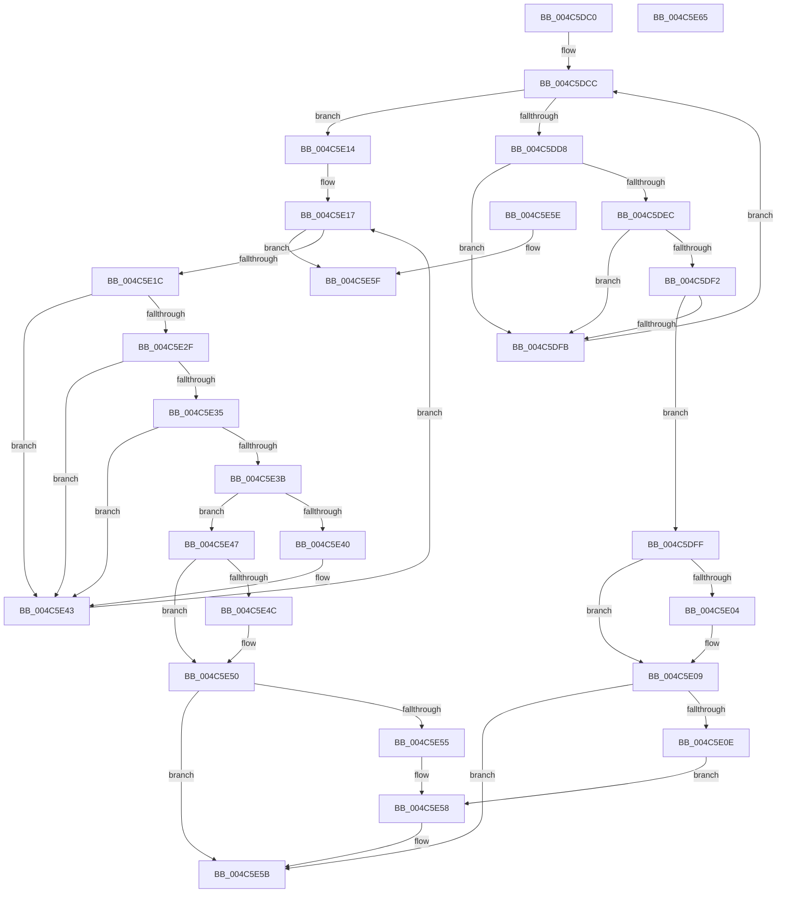

# HalpInterruptGetIdentifiers

- RVA: `0x004C5DC0`–`0x004C5E66` (길이 `166` bytes)
- VA: `0x00000001404C5DC0`
- 실행 섹션: `.text`
- PDB 이름 있음: `예`; PDB Function 태그: `아니요`
- unwind 정보 RVA: `0x000DB714`
- 디코드: `58`개 명령, `166/166` bytes 표시
- 미해석 바이트: `0` (있으면 어셈블리에 `.byte`로 보존)

> 이 문서는 커널 이미지의 기계어와 PDB 기호를 분석해 생성했습니다. 4번과 5번은 함수 원형과 자료형을 바이너리 사용 방식에서 추정한 C 해석이며 원본 소스 복구 결과는 아닙니다.

## 1. Dependencies

- 직접 호출 지점: **0**; 고유 호출 대상: **0**
- 직접 호출자로 확인된 함수: **6**
- RIP 상대 이미지 참조: **2**

### Outgoing calls
- 직접 디코드된 call 명령이 없습니다.

### Direct callers
- [HalpConnectThermalInterrupt](../55/HalpConnectThermalInterrupt_function_00557310.md) at `0x00557346`
- [HalpNumaQueryProcessorNode](../55/HalpNumaQueryProcessorNode_function_00559690.md) at `0x005596BB`
- [HalpNumaSwapP0NodeToFront](../55/HalpNumaSwapP0NodeToFront_function_00559D80.md) at `0x00559DE0`
- [HalpMcLoadMicrocodeWorker](../55/HalpMcLoadMicrocodeWorker_function_0055B0B0.md) at `0x0055B0DE`
- [Amd64InitializeCacheStatusEnhanced](../56/Amd64InitializeCacheStatusEnhanced_function_0056C804.md) at `0x0056C8CD`
- [Amd64InitializeCacheStatusOriginal](../56/Amd64InitializeCacheStatusOriginal_function_0056CA40.md) at `0x0056CAFF`

### Static image references
- `0x004C5DCC` → RVA `0x00E10200` (`.data`; read)
- `0x004C5DDF` → RVA `0x00FC3E30` (`.data`; read)

## 2. Other-region calls and transfers

- 다른 실행 섹션으로 향하는 call: **0**
- 별도 외부 분기/꼬리 이동을 확인하지 못했습니다.

## 3. Assembly (complete function range)

```asm
004C5DC0  45 33 DB                        xor r11d, r11d
004C5DC3  4D 8B C8                        mov r9, r8
004C5DC6  41 8B C3                        mov eax, r11d
004C5DC9  44 8B D1                        mov r10d, ecx
004C5DCC  44 8B 05 2D A4 94 00            mov r8d, dword ptr [rip + 0x94a42d]
004C5DD3  41 3B C0                        cmp eax, r8d
004C5DD6  73 3C                           jae 0x1404c5e14
004C5DD8  44 8B C0                        mov r8d, eax
004C5DDB  49 C1 E0 06                     shl r8, 6
004C5DDF  4C 03 05 4A E0 AF 00            add r8, qword ptr [rip + 0xafe04a]
004C5DE6  45 38 58 38                     cmp byte ptr [r8 + 0x38], r11b
004C5DEA  75 0F                           jne 0x1404c5dfb
004C5DEC  45 38 58 0D                     cmp byte ptr [r8 + 0xd], r11b
004C5DF0  74 09                           je 0x1404c5dfb
004C5DF2  41 FF CA                        dec r10d
004C5DF5  41 39 48 14                     cmp dword ptr [r8 + 0x14], ecx
004C5DF9  74 04                           je 0x1404c5dff
004C5DFB  FF C0                           inc eax
004C5DFD  EB CD                           jmp 0x1404c5dcc
004C5DFF  48 85 D2                        test rdx, rdx
004C5E02  74 05                           je 0x1404c5e09
004C5E04  41 8B 00                        mov eax, dword ptr [r8]
004C5E07  89 02                           mov dword ptr [rdx], eax
004C5E09  4D 85 C9                        test r9, r9
004C5E0C  74 4D                           je 0x1404c5e5b
004C5E0E  41 8B 40 04                     mov eax, dword ptr [r8 + 4]
004C5E12  EB 44                           jmp 0x1404c5e58
004C5E14  41 8B C3                        mov eax, r11d
004C5E17  41 3B C0                        cmp eax, r8d
004C5E1A  73 43                           jae 0x1404c5e5f
004C5E1C  8B C8                           mov ecx, eax
004C5E1E  48 C1 E1 06                     shl rcx, 6
004C5E22  48 03 0D 07 E0 AF 00            add rcx, qword ptr [rip + 0xafe007]
004C5E29  44 38 59 0D                     cmp byte ptr [rcx + 0xd], r11b
004C5E2D  75 14                           jne 0x1404c5e43
004C5E2F  44 38 59 0C                     cmp byte ptr [rcx + 0xc], r11b
004C5E33  75 0E                           jne 0x1404c5e43
004C5E35  44 38 59 38                     cmp byte ptr [rcx + 0x38], r11b
004C5E39  75 08                           jne 0x1404c5e43
004C5E3B  45 85 D2                        test r10d, r10d
004C5E3E  74 07                           je 0x1404c5e47
004C5E40  41 FF CA                        dec r10d
004C5E43  FF C0                           inc eax
004C5E45  EB D0                           jmp 0x1404c5e17
004C5E47  48 85 D2                        test rdx, rdx
004C5E4A  74 04                           je 0x1404c5e50
004C5E4C  8B 01                           mov eax, dword ptr [rcx]
004C5E4E  89 02                           mov dword ptr [rdx], eax
004C5E50  4D 85 C9                        test r9, r9
004C5E53  74 06                           je 0x1404c5e5b
004C5E55  8B 41 04                        mov eax, dword ptr [rcx + 4]
004C5E58  41 89 01                        mov dword ptr [r9], eax
004C5E5B  33 C0                           xor eax, eax
004C5E5D  C3                              ret
004C5E5E  CC                              int3
004C5E5F  B8 25 02 00 C0                  mov eax, 0xc0000225
004C5E64  C3                              ret
004C5E65  CC                              int3
```

## 4. C-style interpretation (structured pseudocode)

```c
__int64 __fastcall HalpInterruptGetIdentifiers(int a1, __int64 a2, __int64 a3)
{
    __int64 result;
    __int64 v_r10;
    __int64 v_r11;

    v_r11 = 0;
loc_004C5DCC:
    if (0 >= ((unsigned int)((unsigned int)(*(unsigned int *)(v_rip + 9741357))))) goto loc_004C5E14;
    a3 = (0) << (6);
    a3 = (a3) + (*(unsigned __int64 *)(v_rip + 11526218));
    if ((*(unsigned __int8 *)(a3 + 56)) != 0) goto loc_004C5DFB;
    if ((*(unsigned __int8 *)(a3 + 13)) == 0) goto loc_004C5DFB;
    v_r10 = (unsigned int)(((unsigned int)(a1)) - 1);
    if ((*(unsigned int *)(a3 + 20)) == a1) goto loc_004C5DFF;
loc_004C5DFB:
    result = (unsigned int)((0) + 1);
    goto loc_004C5DCC;
loc_004C5DFF:
    if (a2 != 0) {
        result = *(unsigned int *)(a3);
        *(unsigned int *)(a2) = (unsigned int)(result);
    }
    if (a3 == 0) goto loc_004C5E5B;
    goto loc_004C5E58;
loc_004C5E14:
loc_004C5E17:
    if (0 >= ((unsigned int)(a3))) goto loc_004C5E5F;
    a1 = (0) << (6);
    a1 = (a1) + (*(unsigned __int64 *)(v_rip + 11526151));
    if ((*(unsigned __int8 *)(a1 + 13)) != 0) goto loc_004C5E43;
    if ((*(unsigned __int8 *)(a1 + 12)) != 0) goto loc_004C5E43;
    if ((*(unsigned __int8 *)(a1 + 56)) != 0) goto loc_004C5E43;
    if ((unsigned int)(v_r10) == 0) goto loc_004C5E47;
    v_r10 = (unsigned int)((v_r10) - 1);
loc_004C5E43:
    result = (unsigned int)((0) + 1);
    goto loc_004C5E17;
loc_004C5E47:
    if (a2 != 0) {
        result = *(unsigned int *)(a1);
        *(unsigned int *)(a2) = (unsigned int)(result);
    }
    if (a3 == 0) goto loc_004C5E5B;
loc_004C5E58:
    *(unsigned int *)(a3) = (unsigned int)((unsigned int)(*(unsigned int *)(a1 + 4)));
loc_004C5E5B:
    result = 0;
    return result;
loc_004C5E5F:
    return (unsigned int)(0xC0000225ULL);
}
```

## 5. (Beta) C Style

```c
int64_t HalpInterruptGetIdentifiers(int32_t Arg1, int64_t Arg2, int64_t Arg3)
{
    int64_t result;
    int64_t local_r10;
    int64_t local_r11;

    local_r11 = 0;
loc_004C5DCC:
    if (0 >= ((uint32_t)((uint32_t)(*(uint32_t *)(v_rip + 0x94A42D))))) goto loc_004C5E14;
    Arg3 = (0) << (6);
    Arg3 = (Arg3) + (*(uint64_t *)(v_rip + 0xAFE04A));
    if ((*(uint8_t *)(Arg3 + 0x38)) != 0) goto loc_004C5DFB;
    if ((*(uint8_t *)(Arg3 + 0xD)) == 0) goto loc_004C5DFB;
    local_r10 = (uint32_t)(((uint32_t)(Arg1)) - 1);
    if ((*(uint32_t *)(Arg3 + 0x14)) == Arg1) goto loc_004C5DFF;
loc_004C5DFB:
    result = (uint32_t)((0) + 1);
    goto loc_004C5DCC;
loc_004C5DFF:
    if (Arg2 != 0) {
        result = *(uint32_t *)(Arg3);
        *(uint32_t *)(Arg2) = (uint32_t)(result);
    }
    if (Arg3 == 0) goto loc_004C5E5B;
    goto loc_004C5E58;
loc_004C5E14:
loc_004C5E17:
    if (0 >= ((uint32_t)(Arg3))) goto loc_004C5E5F;
    Arg1 = (0) << (6);
    Arg1 = (Arg1) + (*(uint64_t *)(v_rip + 0xAFE007));
    if ((*(uint8_t *)(Arg1 + 0xD)) != 0) goto loc_004C5E43;
    if ((*(uint8_t *)(Arg1 + 0xC)) != 0) goto loc_004C5E43;
    if ((*(uint8_t *)(Arg1 + 0x38)) != 0) goto loc_004C5E43;
    if ((uint32_t)(local_r10) == 0) goto loc_004C5E47;
    local_r10 = (uint32_t)((local_r10) - 1);
loc_004C5E43:
    result = (uint32_t)((0) + 1);
    goto loc_004C5E17;
loc_004C5E47:
    if (Arg2 != 0) {
        result = *(uint32_t *)(Arg1);
        *(uint32_t *)(Arg2) = (uint32_t)(result);
    }
    if (Arg3 == 0) goto loc_004C5E5B;
loc_004C5E58:
    *(uint32_t *)(Arg3) = (uint32_t)((uint32_t)(*(uint32_t *)(Arg1 + 0x4)));
loc_004C5E5B:
    result = 0;
    return result;
loc_004C5E5F:
    return (uint32_t)(0xC0000225ULL);
}
```

## 6. Execution-region graph

[열기: 2D/3D 그래프와 함수 탐색 컨트롤 패널](../../../control-panel.html?section=text&rva=0x004C5DC0&view=graph)

- 2D 그래프는 위에서 아래로 흐르고, 3D 그래프는 빈 공간을 드래그해 회전합니다. Shift+드래그는 이동, 휠은 확대·축소, 함수 노드 선택은 대상 보고서 이동입니다.

### Static fallback


