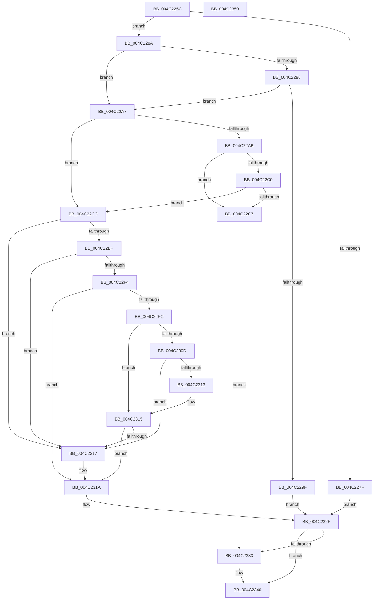

# HalpInterruptIsMsiSupported

- RVA: `0x004C225C`–`0x004C2351` (길이 `245` bytes)
- VA: `0x00000001404C225C`
- 실행 섹션: `.text`
- PDB 이름 있음: `예`; PDB Function 태그: `아니요`
- unwind 정보 RVA: `0x0005FD94`
- 디코드: `71`개 명령, `245/245` bytes 표시
- 미해석 바이트: `0` (있으면 어셈블리에 `.byte`로 보존)

> 이 문서는 커널 이미지의 기계어와 PDB 기호를 분석해 생성했습니다. 4번과 5번은 함수 원형과 자료형을 바이너리 사용 방식에서 추정한 C 해석이며 원본 소스 복구 결과는 아닙니다.

## 1. Dependencies

- 직접 호출 지점: **2**; 고유 호출 대상: **2**
- 직접 호출자로 확인된 함수: **3**
- RIP 상대 이미지 참조: **7**

### Outgoing calls
- `0x004C22B7` → [EmClientQueryRuleState](../../pagelk/B7/EmClientQueryRuleState_function_00B77D70.md) (function, `0x00B77D70`)
- `0x004C22DD` → [HalpGetCpuInfo](../49/HalpGetCpuInfo_function_00498A70.md) (function, `0x00498A70`)

### Direct callers
- [HalGetInterruptTargetInformation](HalGetInterruptTargetInformation_function_004C20F0.md) at `0x004C218A`
- [HalpTimerConfigureInterrupt](../54/HalpTimerConfigureInterrupt_function_00548AB0.md) at `0x00548BC3`
- [HalpIommuConfigureInterrupt](../55/HalpIommuConfigureInterrupt_function_00553464.md) at `0x0055351C`

### Static image references
- `0x004C226F` → RVA `0x00E101D4` (`.data`; read)
- `0x004C227F` → RVA `0x00E101B8` (`.data`; read)
- `0x004C228A` → RVA `0x00E101F0` (`.data`; read)
- `0x004C22B0` → RVA `0x00023C20` (`.rdata`; read)
- `0x004C231A` → RVA `0x00E101CC` (`.data`; read)
- `0x004C2333` → RVA `0x00E101B8` (`.data`; write)
- `0x004C2339` → RVA `0x00E101D4` (`.data`; write)

## 2. Other-region calls and transfers

- 다른 실행 섹션으로 향하는 call: **1**
  - `0x004C22B7` → [EmClientQueryRuleState](../../pagelk/B7/EmClientQueryRuleState_function_00B77D70.md) (`.text` → `PAGELK`)
- 별도 외부 분기/꼬리 이동을 확인하지 못했습니다.

## 3. Assembly (complete function range)

```asm
004C225C  48 89 5C 24 10                  mov qword ptr [rsp + 0x10], rbx
004C2261  48 89 74 24 18                  mov qword ptr [rsp + 0x18], rsi
004C2266  57                              push rdi
004C2267  48 83 EC 20                     sub rsp, 0x20
004C226B  33 FF                           xor edi, edi
004C226D  8A D9                           mov bl, cl
004C226F  40 38 3D 5E DF 94 00            cmp byte ptr [rip + 0x94df5e], dil
004C2276  89 7C 24 30                     mov dword ptr [rsp + 0x30], edi
004C227A  8D 77 01                        lea esi, [rdi + 1]
004C227D  74 0B                           je 0x1404c228a
004C227F  8A 05 33 DF 94 00               mov al, byte ptr [rip + 0x94df33]
004C2285  E9 A5 00 00 00                  jmp 0x1404c232f
004C228A  48 8B 05 5F DF 94 00            mov rax, qword ptr [rip + 0x94df5f]
004C2291  48 85 C0                        test rax, rax
004C2294  74 11                           je 0x1404c22a7
004C2296  48 39 B8 88 00 00 00            cmp qword ptr [rax + 0x88], rdi
004C229D  75 08                           jne 0x1404c22a7
004C229F  40 8A C7                        mov al, dil
004C22A2  E9 88 00 00 00                  jmp 0x1404c232f
004C22A7  84 DB                           test bl, bl
004C22A9  75 21                           jne 0x1404c22cc
004C22AB  48 8D 54 24 30                  lea rdx, [rsp + 0x30]
004C22B0  48 8D 0D 69 19 B6 FF            lea rcx, [rip - 0x49e697]
004C22B7  E8 B4 5A 6B 00                  call 0x140b77d70
004C22BC  85 C0                           test eax, eax
004C22BE  78 07                           js 0x1404c22c7
004C22C0  83 7C 24 30 02                  cmp dword ptr [rsp + 0x30], 2
004C22C5  75 05                           jne 0x1404c22cc
004C22C7  40 8A C7                        mov al, dil
004C22CA  EB 67                           jmp 0x1404c2333
004C22CC  4C 8D 4C 24 30                  lea r9, [rsp + 0x30]
004C22D1  40 88 7C 24 30                  mov byte ptr [rsp + 0x30], dil
004C22D6  45 33 C0                        xor r8d, r8d
004C22D9  33 D2                           xor edx, edx
004C22DB  33 C9                           xor ecx, ecx
004C22DD  E8 8E 67 FD FF                  call 0x140498a70
004C22E2  F6 D8                           neg al
004C22E4  1A C9                           sbb cl, cl
004C22E6  22 4C 24 30                     and cl, byte ptr [rsp + 0x30]
004C22EA  80 F9 02                        cmp cl, 2
004C22ED  74 28                           je 0x1404c2317
004C22EF  40 3A CE                        cmp cl, sil
004C22F2  74 23                           je 0x1404c2317
004C22F4  40 8A C7                        mov al, dil
004C22F7  80 F9 03                        cmp cl, 3
004C22FA  75 1E                           jne 0x1404c231a
004C22FC  65 48 8B 0C 25 20 00 00 00      mov rcx, qword ptr gs:[0x20]
004C2305  8A 51 40                        mov dl, byte ptr [rcx + 0x40]
004C2308  80 FA 06                        cmp dl, 6
004C230B  75 08                           jne 0x1404c2315
004C230D  80 79 43 0A                     cmp byte ptr [rcx + 0x43], 0xa
004C2311  73 04                           jae 0x1404c2317
004C2313  3A D2                           cmp dl, dl
004C2315  76 03                           jbe 0x1404c231a
004C2317  40 8A C6                        mov al, sil
004C231A  8B 0D AC DE 94 00               mov ecx, dword ptr [rip + 0x94deac]
004C2320  40 84 CE                        test sil, cl
004C2323  0F 45 C6                        cmovne eax, esi
004C2326  F6 C1 02                        test cl, 2
004C2329  0F B6 C0                        movzx eax, al
004C232C  0F 45 C7                        cmovne eax, edi
004C232F  84 DB                           test bl, bl
004C2331  75 0D                           jne 0x1404c2340
004C2333  88 05 7F DE 94 00               mov byte ptr [rip + 0x94de7f], al
004C2339  40 88 35 94 DE 94 00            mov byte ptr [rip + 0x94de94], sil
004C2340  48 8B 5C 24 38                  mov rbx, qword ptr [rsp + 0x38]
004C2345  48 8B 74 24 40                  mov rsi, qword ptr [rsp + 0x40]
004C234A  48 83 C4 20                     add rsp, 0x20
004C234E  5F                              pop rdi
004C234F  C3                              ret
004C2350  CC                              int3
```

## 4. C-style interpretation (structured pseudocode)

```c
__int64 __fastcall HalpInterruptIsMsiSupported(unsigned __int8 a1, __int64 a2, int a3)
{
    __int64 result;
    __int64 v_rdi;
    __int64 v_rsp;
    unsigned __int64 v_stack_p10;
    unsigned __int64 v_stack_p18;
    unsigned int v_stack_p8;

    v_stack_p10 = v_rbx;
    v_stack_p18 = v_rsi;
    v_rsp = (v_rsp) - (32);
    v_rdi = 0;
    v_stack_p8 = 0;
    if ((*(unsigned __int8 *)(v_rip + 9756510)) == 0) goto loc_004C228A;
    goto loc_004C232F;
loc_004C228A:
    if (*(unsigned __int64 *)(v_rip + 9756511) == 0) goto loc_004C22A7;
    if ((*(unsigned __int64 *)(*(unsigned __int64 *)(v_rip + 9756511) + 136)) != 0) goto loc_004C22A7;
    goto loc_004C232F;
loc_004C22A7:
    if (a1 != 0) goto loc_004C22CC;
    result = EmClientQueryRuleState(v_rip - 4843159, v_stack_p8, a3, a4);
    if (sign_flag) goto loc_004C22C7;
    if (v_stack_p8 != 2) goto loc_004C22CC;
loc_004C22C7:
    goto loc_004C2333;
loc_004C22CC:
    v_stack_p8 = 0;
    a3 = 0;
    a2 = 0;
    a1 = 0;
    result = HalpGetCpuInfo(a1, a2, a3, v_stack_p8);
    result = (unsigned __int8)(-(result));
    a1 = (unsigned __int8)((a1) & (v_stack_p8));
    if (a1 == 2) goto loc_004C2317;
    if (a1 == ((unsigned __int8)(v_rdi + 1))) goto loc_004C2317;
    if (a1 != 3) goto loc_004C231A;
    if (((unsigned __int8)(*(unsigned __int8 *)(*(unsigned __int64 *)(gs_base + (0 + 32)) + 64))) != 6) goto loc_004C2315;
    if ((*(unsigned __int8 *)(*(unsigned __int64 *)(gs_base + (0 + 32)) + 67)) >= 10) goto loc_004C2317;
loc_004C2315:
    result = 0;
    if (((unsigned __int8)(*(unsigned __int8 *)(*(unsigned __int64 *)(gs_base + (0 + 32)) + 64))) >= = ((unsigned __int8)(*(unsigned __int8 *)(*(unsigned __int64 *)(gs_base + (0 + 32)) + 64)))) {
        result = (unsigned __int8)(v_rdi + 1);
    }
    if ((((unsigned __int8)(v_rdi + 1)) & ((unsigned __int8)((unsigned int)(*(unsigned int *)(v_rip + 9756332))))) != 0) { result = (unsigned int)(v_rdi + 1); }
    result = (unsigned __int8)(result);
    if ((((unsigned __int8)((unsigned int)(*(unsigned int *)(v_rip + 9756332)))) & (2)) != 0) { result = 0; }
loc_004C232F:
    if (a1 == 0) {
        *(unsigned __int8 *)(v_rip + 9756287) = (unsigned __int8)(result);
        *(unsigned __int8 *)(v_rip + 9756308) = (unsigned __int8)(v_rdi + 1);
    }
    v_rsp = (v_rsp) + (32);
    return result;
}
```

## 5. (Beta) C Style

```c
int64_t HalpInterruptIsMsiSupported(uint8_t Arg1, int64_t Arg2, int32_t Arg3)
{
    int64_t result;
    int64_t local_rdi;
    int64_t local_rsp;
    uint64_t v_stack_p10;
    uint64_t v_stack_p18;
    uint32_t v_stack_p8;

    v_stack_p10 = local_rbx;
    v_stack_p18 = local_rsi;
    local_rsp = (local_rsp) - (32);
    local_rdi = 0;
    v_stack_p8 = 0;
    if ((*(uint8_t *)(v_rip + 0x94DF5E)) == 0) goto loc_004C228A;
    goto loc_004C232F;
loc_004C228A:
    if (*(uint64_t *)(v_rip + 0x94DF5F) == 0) goto loc_004C22A7;
    if ((*(uint64_t *)(*(uint64_t *)(v_rip + 0x94DF5F) + 0x88)) != 0) goto loc_004C22A7;
    goto loc_004C232F;
loc_004C22A7:
    if (Arg1 != 0) goto loc_004C22CC;
    result = EmClientQueryRuleState(v_rip - 4843159, v_stack_p8, Arg3, a4);
    if (sign_flag) goto loc_004C22C7;
    if (v_stack_p8 != 2) goto loc_004C22CC;
loc_004C22C7:
    goto loc_004C2333;
loc_004C22CC:
    v_stack_p8 = 0;
    Arg3 = 0;
    Arg2 = 0;
    Arg1 = 0;
    result = HalpGetCpuInfo(Arg1, Arg2, Arg3, v_stack_p8);
    result = (uint8_t)(-(result));
    Arg1 = (uint8_t)((Arg1) & (v_stack_p8));
    if (Arg1 == 2) goto loc_004C2317;
    if (Arg1 == ((uint8_t)(local_rdi + 1))) goto loc_004C2317;
    if (Arg1 != 3) goto loc_004C231A;
    if (((uint8_t)(*(uint8_t *)(*(uint64_t *)(gs_base + (0 + 0x20)) + 0x40))) != 6) goto loc_004C2315;
    if ((*(uint8_t *)(*(uint64_t *)(gs_base + (0 + 0x20)) + 0x43)) >= 10) goto loc_004C2317;
loc_004C2315:
    result = 0;
    if (((uint8_t)(*(uint8_t *)(*(uint64_t *)(gs_base + (0 + 0x20)) + 0x40))) >= = ((uint8_t)(*(uint8_t *)(*(uint64_t *)(gs_base + (0 + 0x20)) + 0x40)))) {
        result = (uint8_t)(local_rdi + 1);
    }
    if ((((uint8_t)(local_rdi + 1)) & ((uint8_t)((uint32_t)(*(uint32_t *)(v_rip + 0x94DEAC))))) != 0) { result = (uint32_t)(local_rdi + 1); }
    result = (uint8_t)(result);
    if ((((uint8_t)((uint32_t)(*(uint32_t *)(v_rip + 0x94DEAC)))) & (2)) != 0) { result = 0; }
loc_004C232F:
    if (Arg1 == 0) {
        *(uint8_t *)(v_rip + 0x94DE7F) = (uint8_t)(result);
        *(uint8_t *)(v_rip + 0x94DE94) = (uint8_t)(local_rdi + 1);
    }
    local_rsp = (local_rsp) + (32);
    return result;
}
```

## 6. Execution-region graph

[열기: 2D/3D 그래프와 함수 탐색 컨트롤 패널](../../../control-panel.html?section=text&rva=0x004C225C&view=graph)

- 2D 그래프는 위에서 아래로 흐르고, 3D 그래프는 빈 공간을 드래그해 회전합니다. Shift+드래그는 이동, 휠은 확대·축소, 함수 노드 선택은 대상 보고서 이동입니다.

### Static fallback


