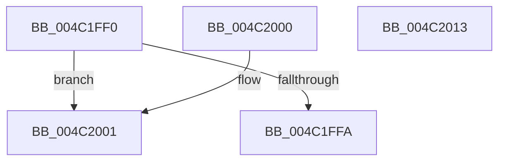

# HalpInterruptVectorDataToGsiv

- RVA: `0x004C1FF0`–`0x004C2014` (길이 `36` bytes)
- VA: `0x00000001404C1FF0`
- 실행 섹션: `.text`
- PDB 이름 있음: `예`; PDB Function 태그: `아니요`
- unwind 정보 RVA: `0x000DB714`
- 디코드: `14`개 명령, `36/36` bytes 표시
- 미해석 바이트: `0` (있으면 어셈블리에 `.byte`로 보존)

> 이 문서는 커널 이미지의 기계어와 PDB 기호를 분석해 생성했습니다. 4번과 5번은 함수 원형과 자료형을 바이너리 사용 방식에서 추정한 C 해석이며 원본 소스 복구 결과는 아닙니다.

## 1. Dependencies

- 직접 호출 지점: **0**; 고유 호출 대상: **0**
- 직접 호출자로 확인된 함수: **0**
- RIP 상대 이미지 참조: **0**

### Outgoing calls
- 직접 디코드된 call 명령이 없습니다.

### Direct callers
- 이 함수 시작 RVA로 연결되는 직접 call은 확인되지 않았습니다. 간접 호출은 완전히 역산할 수 없습니다.

### Static image references
- 디코드된 RIP-relative 메모리 참조가 없습니다.

## 2. Other-region calls and transfers

- 다른 실행 섹션으로 향하는 call: **0**
- 별도 외부 분기/꼬리 이동을 확인하지 못했습니다.

## 3. Assembly (complete function range)

```asm
004C1FF0  44 8B 01                        mov r8d, dword ptr [rcx]
004C1FF3  33 C0                           xor eax, eax
004C1FF5  45 85 C0                        test r8d, r8d
004C1FF8  75 07                           jne 0x1404c2001
004C1FFA  8B 49 38                        mov ecx, dword ptr [rcx + 0x38]
004C1FFD  89 0A                           mov dword ptr [rdx], ecx
004C1FFF  C3                              ret
004C2000  CC                              int3
004C2001  41 83 F8 03                     cmp r8d, 3
004C2005  B8 BB 00 00 C0                  mov eax, 0xc00000bb
004C200A  B9 01 00 00 C0                  mov ecx, 0xc0000001
004C200F  0F 45 C1                        cmovne eax, ecx
004C2012  C3                              ret
004C2013  CC                              int3
```

## 4. C-style interpretation (structured pseudocode)

```c
__int64 __fastcall HalpInterruptVectorDataToGsiv(__int64 a1, __int64 a2)
{
    __int64 result;

    result = 0;
    if ((unsigned int)((unsigned int)(*(unsigned int *)(a1))) != 0) goto loc_004C2001;
    *(unsigned int *)(a2) = (unsigned int)((unsigned int)(*(unsigned int *)(a1 + 56)));
    return result;
loc_004C2001:
    result = (unsigned int)(0xC00000BBULL);
    if (((unsigned int)((unsigned int)(*(unsigned int *)(a1)))) != 3) { result = (unsigned int)((unsigned int)(0xC0000001ULL)); }
    return result;
}
```

## 5. (Beta) C Style

```c
int64_t HalpInterruptVectorDataToGsiv(void *Arg1, void *Arg2)
{
    uint8_t *arg1 = (uint8_t *)Arg1;
    uint8_t *arg2 = (uint8_t *)Arg2;

    int64_t result;

    result = 0;
    if ((uint32_t)((uint32_t)(*(uint32_t *)(arg1))) != 0) goto loc_004C2001;
    *(uint32_t *)(arg2) = (uint32_t)((uint32_t)(*(uint32_t *)(arg1 + 0x38)));
    return result;
loc_004C2001:
    result = (uint32_t)(0xC00000BBULL);
    if (((uint32_t)((uint32_t)(*(uint32_t *)(arg1)))) != 3) { result = (uint32_t)((uint32_t)(0xC0000001ULL)); }
    return result;
}
```

### 관측된 메모리 오프셋

구조체 형식이 확인되지 않은 접근은 인자 기준의 오프셋으로만 기록했습니다.

| 기준 인자 | 오프셋 표현 | 폭 (bit) | 접근 |
|---|---:|---:|---|
| `Arg1` | `+ 0x0` | `32` | `R` |
| `Arg1` | `+ 0x38` | `32` | `R` |
| `Arg2` | `+ 0x0` | `32` | `W` |

## 6. Execution-region graph

[열기: 2D/3D 그래프와 함수 탐색 컨트롤 패널](../../../control-panel.html?section=text&rva=0x004C1FF0&view=graph)

- 2D 그래프는 위에서 아래로 흐르고, 3D 그래프는 빈 공간을 드래그해 회전합니다. Shift+드래그는 이동, 휠은 확대·축소, 함수 노드 선택은 대상 보고서 이동입니다.

### Static fallback


