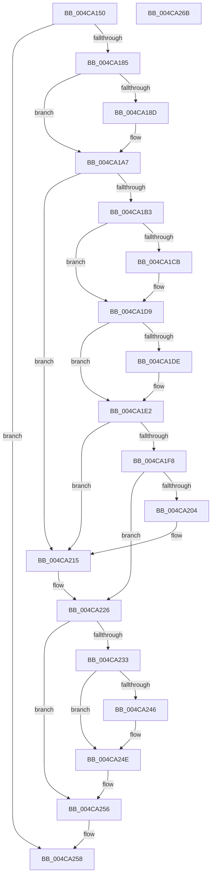

# HalpIommuBlockDevice

- RVA: `0x004CA150`–`0x004CA26C` (길이 `284` bytes)
- VA: `0x00000001404CA150`
- 실행 섹션: `.text`
- PDB 이름 있음: `예`; PDB Function 태그: `아니요`
- unwind 정보 RVA: `0x00099F28`
- 디코드: `83`개 명령, `284/284` bytes 표시
- 미해석 바이트: `0` (있으면 어셈블리에 `.byte`로 보존)

> 이 문서는 커널 이미지의 기계어와 PDB 기호를 분석해 생성했습니다. 4번과 5번은 함수 원형과 자료형을 바이너리 사용 방식에서 추정한 C 해석이며 원본 소스 복구 결과는 아닙니다.

## 1. Dependencies

- 직접 호출 지점: **10**; 고유 호출 대상: **9**
- 직접 호출자로 확인된 함수: **0**
- RIP 상대 이미지 참조: **3**

### Outgoing calls
- `0x004CA194` → [HalpIommuQueryAcpiDeviceMapping](../4B/HalpIommuQueryAcpiDeviceMapping_function_004BC784.md) (function, `0x004BC784`)
- `0x004CA1BB` → [KeAbPreAcquire](../21/KeAbPreAcquire_function_00210230.md) (function, `0x00210230`)
- `0x004CA1D4` → [ExfAcquirePushLockExclusiveEx](../20/ExfAcquirePushLockExclusiveEx_function_0020FC90.md) (function, `0x0020FC90`)
- `0x004CA1ED` → [HalpIommuDecreaseAliasTrack](../55/HalpIommuDecreaseAliasTrack_function_00554DBC.md) (function, `0x00554DBC`)
- `0x004CA208` → [HalpMmAllocCtxFree](../3E/HalpMmAllocCtxFree_function_003E1904.md) (function, `0x003E1904`)
- `0x004CA210` → [HalpMmAllocCtxFree](../3E/HalpMmAllocCtxFree_function_003E1904.md) (function, `0x003E1904`)
- `0x004CA21F` → [HalpIommuLeaveDmaDomain](../4B/HalpIommuLeaveDmaDomain_function_004BF220.md) (function, `0x004BF220`)
- `0x004CA229` → [HalpIommuDeleteDevice](../54/HalpIommuDeleteDevice_function_0054F368.md) (function, `0x0054F368`)
- `0x004CA249` → [ExfTryToWakePushLock](../26/ExfTryToWakePushLock_function_00265DD0.md) (function, `0x00265DD0`)
- `0x004CA251` → [KeAbPostRelease](../2E/KeAbPostRelease_function_002E1600.md) (function, `0x002E1600`)

### Direct callers
- 이 함수 시작 RVA로 연결되는 직접 call은 확인되지 않았습니다. 간접 호출은 완전히 역산할 수 없습니다.

### Static image references
- `0x004CA1AA` → RVA `0x00FC18B8` (`.data`; read)
- `0x004CA215` → RVA `0x00FC16B0` (`.data`; read)
- `0x004CA237` → RVA `0x00FC18B8` (`.data`; read/write)

## 2. Other-region calls and transfers

- 다른 실행 섹션으로 향하는 call: **0**
- 별도 외부 분기/꼬리 이동을 확인하지 못했습니다.

## 3. Assembly (complete function range)

```asm
004CA150  4C 8B DC                        mov r11, rsp
004CA153  49 89 5B 10                     mov qword ptr [r11 + 0x10], rbx
004CA157  49 89 6B 18                     mov qword ptr [r11 + 0x18], rbp
004CA15B  56                              push rsi
004CA15C  57                              push rdi
004CA15D  41 56                           push r14
004CA15F  48 83 EC 40                     sub rsp, 0x40
004CA163  49 83 63 08 00                  and qword ptr [r11 + 8], 0
004CA168  33 C0                           xor eax, eax
004CA16A  0F 57 C0                        xorps xmm0, xmm0
004CA16D  40 32 ED                        xor bpl, bpl
004CA170  48 8B F9                        mov rdi, rcx
004CA173  0F 11 44 24 20                  movups xmmword ptr [rsp + 0x20], xmm0
004CA178  49 89 43 D8                     mov qword ptr [r11 - 0x28], rax
004CA17C  48 85 C9                        test rcx, rcx
004CA17F  0F 84 D3 00 00 00               je 0x1404ca258
004CA185  48 8B 19                        mov rbx, qword ptr [rcx]
004CA188  83 3B 02                        cmp dword ptr [rbx], 2
004CA18B  75 1A                           jne 0x1404ca1a7
004CA18D  49 8D 53 C8                     lea rdx, [r11 - 0x38]
004CA191  48 8B CB                        mov rcx, rbx
004CA194  E8 EB 25 FF FF                  call 0x1404bc784
004CA199  85 C0                           test eax, eax
004CA19B  48 8D 4C 24 20                  lea rcx, [rsp + 0x20]
004CA1A0  48 0F 48 CB                     cmovs rcx, rbx
004CA1A4  48 8B D9                        mov rbx, rcx
004CA1A7  83 3B 01                        cmp dword ptr [rbx], 1
004CA1AA  4C 8D 35 07 77 AF 00            lea r14, [rip + 0xaf7707]
004CA1B1  75 62                           jne 0x1404ca215
004CA1B3  45 33 C0                        xor r8d, r8d
004CA1B6  33 D2                           xor edx, edx
004CA1B8  49 8B CE                        mov rcx, r14
004CA1BB  E8 70 60 D4 FF                  call 0x140210230
004CA1C0  F0 49 0F BA 2E 00               lock bts qword ptr [r14], 0
004CA1C6  48 8B F0                        mov rsi, rax
004CA1C9  73 0E                           jae 0x1404ca1d9
004CA1CB  4D 8B C6                        mov r8, r14
004CA1CE  48 8B D0                        mov rdx, rax
004CA1D1  49 8B CE                        mov rcx, r14
004CA1D4  E8 B7 5A D4 FF                  call 0x14020fc90
004CA1D9  48 85 F6                        test rsi, rsi
004CA1DC  74 04                           je 0x1404ca1e2
004CA1DE  C6 46 0A 01                     mov byte ptr [rsi + 0xa], 1
004CA1E2  48 8D 54 24 60                  lea rdx, [rsp + 0x60]
004CA1E7  48 8B CB                        mov rcx, rbx
004CA1EA  40 B5 01                        mov bpl, 1
004CA1ED  E8 CA AB 08 00                  call 0x140554dbc
004CA1F2  8B F0                           mov esi, eax
004CA1F4  85 C0                           test eax, eax
004CA1F6  78 1D                           js 0x1404ca215
004CA1F8  48 8B 5C 24 60                  mov rbx, qword ptr [rsp + 0x60]
004CA1FD  48 83 7B 18 00                  cmp qword ptr [rbx + 0x18], 0
004CA202  7F 22                           jg 0x1404ca226
004CA204  48 8B 53 10                     mov rdx, qword ptr [rbx + 0x10]
004CA208  E8 F7 76 F1 FF                  call 0x1403e1904
004CA20D  48 8B D3                        mov rdx, rbx
004CA210  E8 EF 76 F1 FF                  call 0x1403e1904
004CA215  48 8B 15 94 74 AF 00            mov rdx, qword ptr [rip + 0xaf7494]
004CA21C  48 8B CF                        mov rcx, rdi
004CA21F  E8 FC 4F FF FF                  call 0x1404bf220
004CA224  8B F0                           mov esi, eax
004CA226  48 8B CF                        mov rcx, rdi
004CA229  E8 3A 51 08 00                  call 0x14054f368
004CA22E  40 84 ED                        test bpl, bpl
004CA231  74 23                           je 0x1404ca256
004CA233  48 83 C8 FF                     or rax, 0xffffffffffffffff
004CA237  F0 48 0F C1 05 78 76 AF 00      lock xadd qword ptr [rip + 0xaf7678], rax
004CA240  24 06                           and al, 6
004CA242  3C 02                           cmp al, 2
004CA244  75 08                           jne 0x1404ca24e
004CA246  49 8B CE                        mov rcx, r14
004CA249  E8 82 BB D9 FF                  call 0x140265dd0
004CA24E  49 8B CE                        mov rcx, r14
004CA251  E8 AA 73 E1 FF                  call 0x1402e1600
004CA256  8B C6                           mov eax, esi
004CA258  48 8B 5C 24 68                  mov rbx, qword ptr [rsp + 0x68]
004CA25D  48 8B 6C 24 70                  mov rbp, qword ptr [rsp + 0x70]
004CA262  48 83 C4 40                     add rsp, 0x40
004CA266  41 5E                           pop r14
004CA268  5F                              pop rdi
004CA269  5E                              pop rsi
004CA26A  C3                              ret
004CA26B  CC                              int3
```

## 4. C-style interpretation (structured pseudocode)

```c
__int64 __fastcall HalpIommuBlockDevice(__int64 a1, __int64 a2, int a3)
{
    __int64 result;
    __int64 v_rbp;
    __int64 v_rbx;
    __int64 v_rsp;
    unsigned __int64 v_stack_m38;
    unsigned __int64 v_stack_p10;
    unsigned __int64 v_stack_p18;
    unsigned __int64 v_stack_p8;

    *(unsigned __int64 *)(v_rsp + 16) = v_rbx;
    *(unsigned __int64 *)(v_rsp + 24) = v_rbp;
    v_rsp = (v_rsp) - (64);
    result = 0;
    v_rbp = 0;
    v_stack_m38 = v_xmm0;
    *(unsigned __int64 *)(v_rsp - 40) = 0;
    if (a1 == 0) goto loc_004CA258;
    v_rbx = *(unsigned __int64 *)(a1);
    if ((*(unsigned int *)(*(unsigned __int64 *)(a1))) == 2) {
        a2 = v_rsp - 56;
        a1 = *(unsigned __int64 *)(a1);
        result = HalpIommuQueryAcpiDeviceMapping(a1, a2, a3, a4);
        a1 = v_stack_m38;
        if (sign_flag) { a1 = *(unsigned __int64 *)(a1); }
        v_rbx = a1;
    }
    if ((*(unsigned int *)(v_rbx)) != 1) goto loc_004CA215;
    a3 = 0;
    a2 = 0;
    result = KeAbPreAcquire(v_rip + 11499271, a2, a3, a4);
    if (!(condition_is_above_or_equal)) {
        a3 = v_rip + 11499271;
        a2 = result;
        a1 = v_rip + 11499271;
        result = ExfAcquirePushLockExclusiveEx(a1, a2, a3, a4);
    }
    if (result != 0) {
        *(unsigned __int8 *)(result + 10) = 1;
    }
    result = HalpIommuDecreaseAliasTrack(v_rbx, v_stack_p8, a3, a4);
    if (sign_flag) goto loc_004CA215;
    if ((*(unsigned __int64 *)(v_stack_p8 + 24)) > 0) goto loc_004CA226;
    result = HalpMmAllocCtxFree(v_rbx, *(unsigned __int64 *)(v_stack_p8 + 16), a3, a4);
    result = HalpMmAllocCtxFree(v_rbx, v_stack_p8, a3, a4);
loc_004CA215:
    result = HalpIommuLeaveDmaDomain(a1, *(unsigned __int64 *)(v_rip + 11498644), a3, a4);
loc_004CA226:
    result = HalpIommuDeleteDevice(a1, *(unsigned __int64 *)(v_rip + 11498644), a3, a4);
    if (1 == 0) goto loc_004CA256;
    result = (result) | (-1);
    result = (unsigned __int8)((result) & (6));
    if (((unsigned __int8)(result)) == 2) {
        a1 = v_rip + 11499271;
        result = ExfTryToWakePushLock(a1, *(unsigned __int64 *)(v_rip + 11498644), a3, a4);
    }
    result = KeAbPostRelease(v_rip + 11499271, *(unsigned __int64 *)(v_rip + 11498644), a3, a4);
loc_004CA256:
loc_004CA258:
    v_rsp = (v_rsp) + (64);
    return (unsigned int)((unsigned int)((unsigned int)((unsigned int)(result))));
}
```

## 5. (Beta) C Style

```c
int64_t HalpIommuBlockDevice(int64_t Arg1, int64_t Arg2, int32_t Arg3)
{
    int64_t result;
    int64_t local_rbp;
    int64_t local_rbx;
    int64_t local_rsp;
    uint64_t v_stack_m38;
    uint64_t v_stack_p10;
    uint64_t v_stack_p18;
    uint64_t v_stack_p8;

    *(uint64_t *)(local_rsp + 0x10) = local_rbx;
    *(uint64_t *)(local_rsp + 0x18) = local_rbp;
    local_rsp = (local_rsp) - (64);
    result = 0;
    local_rbp = 0;
    v_stack_m38 = v_xmm0;
    *(uint64_t *)(local_rsp - 0x28) = 0;
    if (Arg1 == 0) goto loc_004CA258;
    local_rbx = *(uint64_t *)(Arg1);
    if ((*(uint32_t *)(*(uint64_t *)(Arg1))) == 2) {
        Arg2 = local_rsp - 56;
        Arg1 = *(uint64_t *)(Arg1);
        result = HalpIommuQueryAcpiDeviceMapping(Arg1, Arg2, Arg3, a4);
        Arg1 = v_stack_m38;
        if (sign_flag) { Arg1 = *(uint64_t *)(Arg1); }
        local_rbx = Arg1;
    }
    if ((*(uint32_t *)(local_rbx)) != 1) goto loc_004CA215;
    Arg3 = 0;
    Arg2 = 0;
    result = KeAbPreAcquire(v_rip + 11499271, Arg2, Arg3, a4);
    if (!(condition_is_above_or_equal)) {
        Arg3 = v_rip + 11499271;
        Arg2 = result;
        Arg1 = v_rip + 11499271;
        result = ExfAcquirePushLockExclusiveEx(Arg1, Arg2, Arg3, a4);
    }
    if (result != 0) {
        *(uint8_t *)(result + 0xA) = 1;
    }
    result = HalpIommuDecreaseAliasTrack(local_rbx, v_stack_p8, Arg3, a4);
    if (sign_flag) goto loc_004CA215;
    if ((*(uint64_t *)(v_stack_p8 + 0x18)) > 0) goto loc_004CA226;
    result = HalpMmAllocCtxFree(local_rbx, *(uint64_t *)(v_stack_p8 + 0x10), Arg3, a4);
    result = HalpMmAllocCtxFree(local_rbx, v_stack_p8, Arg3, a4);
loc_004CA215:
    result = HalpIommuLeaveDmaDomain(Arg1, *(uint64_t *)(v_rip + 0xAF7494), Arg3, a4);
loc_004CA226:
    result = HalpIommuDeleteDevice(Arg1, *(uint64_t *)(v_rip + 0xAF7494), Arg3, a4);
    if (1 == 0) goto loc_004CA256;
    result = (result) | (-1);
    result = (uint8_t)((result) & (6));
    if (((uint8_t)(result)) == 2) {
        Arg1 = v_rip + 11499271;
        result = ExfTryToWakePushLock(Arg1, *(uint64_t *)(v_rip + 0xAF7494), Arg3, a4);
    }
    result = KeAbPostRelease(v_rip + 11499271, *(uint64_t *)(v_rip + 0xAF7494), Arg3, a4);
loc_004CA256:
loc_004CA258:
    local_rsp = (local_rsp) + (64);
    return (uint32_t)((uint32_t)((uint32_t)((uint32_t)(result))));
}
```

## 6. Execution-region graph

[열기: 2D/3D 그래프와 함수 탐색 컨트롤 패널](../../../control-panel.html?section=text&rva=0x004CA150&view=graph)

- 2D 그래프는 위에서 아래로 흐르고, 3D 그래프는 빈 공간을 드래그해 회전합니다. Shift+드래그는 이동, 휠은 확대·축소, 함수 노드 선택은 대상 보고서 이동입니다.

### Static fallback


