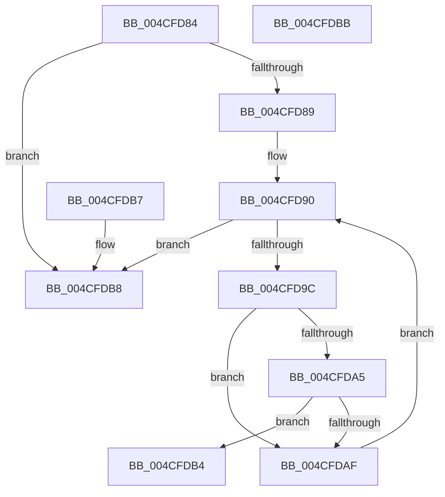

# HalpIommuCheckExceptionList

- RVA: `0x004CFD84`–`0x004CFDBC` (길이 `56` bytes)
- VA: `0x00000001404CFD84`
- 실행 섹션: `.text`
- PDB 이름 있음: `예`; PDB Function 태그: `아니요`
- unwind 정보 RVA: `0x000DB714`
- 디코드: `20`개 명령, `56/56` bytes 표시
- 미해석 바이트: `0` (있으면 어셈블리에 `.byte`로 보존)

> 이 문서는 커널 이미지의 기계어와 PDB 기호를 분석해 생성했습니다. 4번과 5번은 함수 원형과 자료형을 바이너리 사용 방식에서 추정한 C 해석이며 원본 소스 복구 결과는 아닙니다.

## 1. Dependencies

- 직접 호출 지점: **0**; 고유 호출 대상: **0**
- 직접 호출자로 확인된 함수: **2**
- RIP 상대 이미지 참조: **1**

### Outgoing calls
- 직접 디코드된 call 명령이 없습니다.

### Direct callers
- [HalpIommuUnblockDevice](HalpIommuUnblockDevice_function_004C6250.md) at `0x004C62A4`
- [HalpDmaAllocateChildAdapterV3](../../page/70/HalpDmaAllocateChildAdapterV3_function_007066A0.md) at `0x00706B38`

### Static image references
- `0x004CFD89` → RVA `0x00FC1720` (`.data`; read)

## 2. Other-region calls and transfers

- 다른 실행 섹션으로 향하는 call: **0**
- 별도 외부 분기/꼬리 이동을 확인하지 못했습니다.

## 3. Assembly (complete function range)

```asm
004CFD84  83 39 01                        cmp dword ptr [rcx], 1
004CFD87  75 2F                           jne 0x1404cfdb8
004CFD89  48 8B 15 90 19 AF 00            mov rdx, qword ptr [rip + 0xaf1990]
004CFD90  48 8D 05 89 19 AF 00            lea rax, [rip + 0xaf1989]
004CFD97  48 3B D0                        cmp rdx, rax
004CFD9A  74 1C                           je 0x1404cfdb8
004CFD9C  0F B7 41 08                     movzx eax, word ptr [rcx + 8]
004CFDA0  39 42 10                        cmp dword ptr [rdx + 0x10], eax
004CFDA3  75 0A                           jne 0x1404cfdaf
004CFDA5  0F B7 41 0C                     movzx eax, word ptr [rcx + 0xc]
004CFDA9  48 39 42 18                     cmp qword ptr [rdx + 0x18], rax
004CFDAD  74 05                           je 0x1404cfdb4
004CFDAF  48 8B 12                        mov rdx, qword ptr [rdx]
004CFDB2  EB DC                           jmp 0x1404cfd90
004CFDB4  B0 01                           mov al, 1
004CFDB6  C3                              ret
004CFDB7  CC                              int3
004CFDB8  32 C0                           xor al, al
004CFDBA  C3                              ret
004CFDBB  CC                              int3
```

## 4. C-style interpretation (structured pseudocode)

```c
__int64 __fastcall HalpIommuCheckExceptionList(__int64 a1)
{
    __int64 result;

    if ((*(unsigned int *)(a1)) != 1) goto loc_004CFDB8;
loc_004CFD90:
    if ((*(unsigned __int64 *)(v_rip + 11475344)) == (v_rip + 11475337)) goto loc_004CFDB8;
    if ((*(unsigned int *)(*(unsigned __int64 *)(v_rip + 11475344) + 16)) != ((unsigned int)(*(unsigned __int16 *)(a1 + 8)))) goto loc_004CFDAF;
    if ((*(unsigned __int64 *)(*(unsigned __int64 *)(v_rip + 11475344) + 24)) == (*(unsigned __int16 *)(a1 + 12))) goto loc_004CFDB4;
loc_004CFDAF:
    goto loc_004CFD90;
loc_004CFDB4:
    return 1;
loc_004CFDB8:
    result = 0;
    return result;
}
```

## 5. (Beta) C Style

```c
int64_t HalpIommuCheckExceptionList(void *Arg1)
{
    uint8_t *arg1 = (uint8_t *)Arg1;

    int64_t result;

    if ((*(uint32_t *)(arg1)) != 1) goto loc_004CFDB8;
loc_004CFD90:
    if ((*(uint64_t *)(v_rip + 0xAF1990)) == (v_rip + 11475337)) goto loc_004CFDB8;
    if ((*(uint32_t *)(*(uint64_t *)(v_rip + 0xAF1990) + 0x10)) != ((uint32_t)(*(uint16_t *)(arg1 + 0x8)))) goto loc_004CFDAF;
    if ((*(uint64_t *)(*(uint64_t *)(v_rip + 0xAF1990) + 0x18)) == (*(uint16_t *)(arg1 + 0xC))) goto loc_004CFDB4;
loc_004CFDAF:
    goto loc_004CFD90;
loc_004CFDB4:
    return 1;
loc_004CFDB8:
    result = 0;
    return result;
}
```

### 관측된 메모리 오프셋

구조체 형식이 확인되지 않은 접근은 인자 기준의 오프셋으로만 기록했습니다.

| 기준 인자 | 오프셋 표현 | 폭 (bit) | 접근 |
|---|---:|---:|---|
| `Arg1` | `+ 0x0` | `32` | `R` |
| `Arg1` | `+ 0x8` | `16` | `R` |
| `Arg1` | `+ 0xC` | `16` | `R` |

## 6. Execution-region graph

[열기: 2D/3D 그래프와 함수 탐색 컨트롤 패널](../../../control-panel.html?section=text&rva=0x004CFD84&view=graph)

- 2D 그래프는 위에서 아래로 흐르고, 3D 그래프는 빈 공간을 드래그해 회전합니다. Shift+드래그는 이동, 휠은 확대·축소, 함수 노드 선택은 대상 보고서 이동입니다.

### Static fallback


