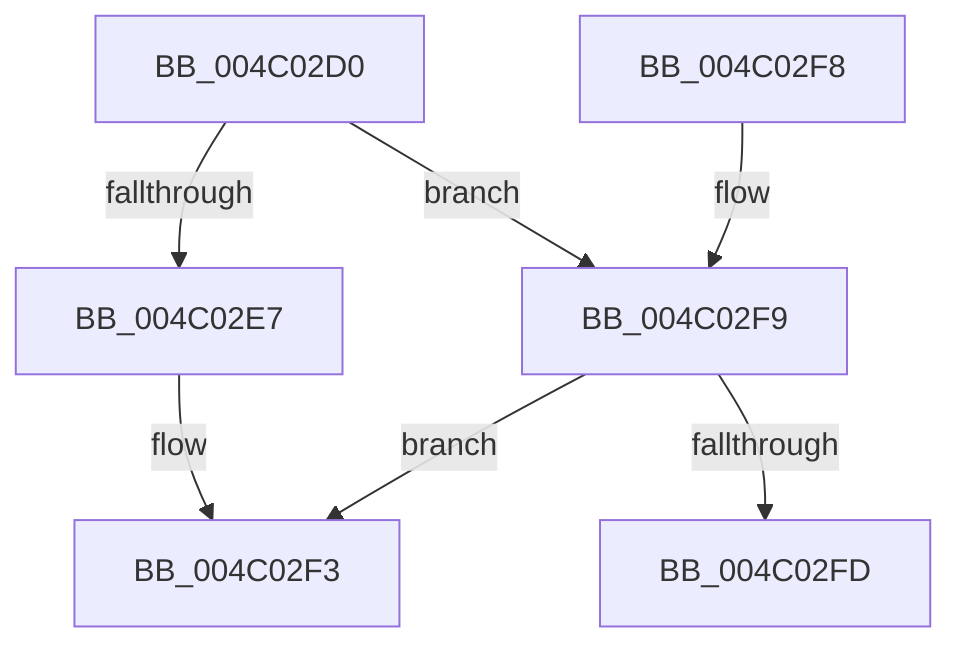

# HalpIommuReportIommuFault

- RVA: `0x004C02D0`–`0x004C0316` (길이 `70` bytes)
- VA: `0x00000001404C02D0`
- 실행 섹션: `.text`
- PDB 이름 있음: `예`; PDB Function 태그: `아니요`
- unwind 정보 RVA: `0x000A82A0`
- 디코드: `21`개 명령, `70/70` bytes 표시
- 미해석 바이트: `0` (있으면 어셈블리에 `.byte`로 보존)

> 이 문서는 커널 이미지의 기계어와 PDB 기호를 분석해 생성했습니다. 4번과 5번은 함수 원형과 자료형을 바이너리 사용 방식에서 추정한 C 해석이며 원본 소스 복구 결과는 아닙니다.

## 1. Dependencies

- 직접 호출 지점: **2**; 고유 호출 대상: **2**
- 직접 호출자로 확인된 함수: **0**
- RIP 상대 이미지 참조: **1**

### Outgoing calls
- `0x004C02EE` → [HalpIommuTraceFault](HalpIommuTraceFault_function_004C031C.md) (function, `0x004C031C`)
- `0x004C0310` → [KeBugCheckEx](../4F/KeBugCheckEx_function_004FD660.md) (function, `0x004FD660`)

### Direct callers
- 이 함수 시작 RVA로 연결되는 직접 call은 확인되지 않았습니다. 간접 호출은 완전히 역산할 수 없습니다.

### Static image references
- `0x004C02D4` → RVA `0x00FC18E8` (`.data`; read)

## 2. Other-region calls and transfers

- 다른 실행 섹션으로 향하는 call: **0**
- 별도 외부 분기/꼬리 이동을 확인하지 못했습니다.

## 3. Assembly (complete function range)

```asm
004C02D0  48 83 EC 38                     sub rsp, 0x38
004C02D4  8B 05 0E 16 B0 00               mov eax, dword ptr [rip + 0xb0160e]
004C02DA  44 8B 42 1C                     mov r8d, dword ptr [rdx + 0x1c]
004C02DE  4C 8B 52 10                     mov r10, qword ptr [rdx + 0x10]
004C02E2  83 F8 01                        cmp eax, 1
004C02E5  75 12                           jne 0x1404c02f9
004C02E7  44 8B 4A 28                     mov r9d, dword ptr [rdx + 0x28]
004C02EB  49 8B D2                        mov rdx, r10
004C02EE  E8 29 00 00 00                  call 0x1404c031c
004C02F3  48 83 C4 38                     add rsp, 0x38
004C02F7  C3                              ret
004C02F8  CC                              int3
004C02F9  85 C0                           test eax, eax
004C02FB  75 F6                           jne 0x1404c02f3
004C02FD  4C 89 44 24 20                  mov qword ptr [rsp + 0x20], r8
004C0302  8D 50 26                        lea edx, [rax + 0x26]
004C0305  4C 8B C1                        mov r8, rcx
004C0308  4D 8B CA                        mov r9, r10
004C030B  B9 E6 00 00 00                  mov ecx, 0xe6
004C0310  E8 4B D3 03 00                  call 0x1404fd660
004C0315  CC                              int3
```

## 4. C-style interpretation (structured pseudocode)

```c
__int64 __fastcall HalpIommuReportIommuFault(__int64 a1, __int64 a2)
{
    __int64 result;
    __int64 v_rsp;
    unsigned __int64 v_stack_p20;

    v_rsp = (v_rsp) - (56);
    if (((unsigned int)((unsigned int)(*(unsigned int *)(v_rip + 11539982)))) != 1) goto loc_004C02F9;
    result = HalpIommuTraceFault(a1, *(unsigned __int64 *)(a2 + 16), (unsigned int)(*(unsigned int *)(a2 + 28)), (unsigned int)(*(unsigned int *)(a2 + 40)));
loc_004C02F3:
    v_rsp = (v_rsp) + (56);
    return result;
loc_004C02F9:
    if ((unsigned int)(result) != 0) goto loc_004C02F3;
    v_stack_p20 = (unsigned int)(*(unsigned int *)(a2 + 28));
    result = KeBugCheckEx(230, result + 38, a1, *(unsigned __int64 *)(a2 + 16));
    return result;
}
```

## 5. (Beta) C Style

```c
int64_t HalpIommuReportIommuFault(int64_t Arg1, void *Arg2)
{
    uint8_t *arg2 = (uint8_t *)Arg2;

    int64_t result;
    int64_t local_rsp;
    uint64_t v_stack_p20;

    local_rsp = (local_rsp) - (56);
    if (((uint32_t)((uint32_t)(*(uint32_t *)(v_rip + 0xB0160E)))) != 1) goto loc_004C02F9;
    result = HalpIommuTraceFault(Arg1, *(uint64_t *)(arg2 + 0x10), (uint32_t)(*(uint32_t *)(arg2 + 0x1C)), (uint32_t)(*(uint32_t *)(arg2 + 0x28)));
loc_004C02F3:
    local_rsp = (local_rsp) + (56);
    return result;
loc_004C02F9:
    if ((uint32_t)(result) != 0) goto loc_004C02F3;
    v_stack_p20 = (uint32_t)(*(uint32_t *)(arg2 + 0x1C));
    result = KeBugCheckEx(230, result + 38, Arg1, *(uint64_t *)(arg2 + 0x10));
    return result;
}
```

### 관측된 메모리 오프셋

구조체 형식이 확인되지 않은 접근은 인자 기준의 오프셋으로만 기록했습니다.

| 기준 인자 | 오프셋 표현 | 폭 (bit) | 접근 |
|---|---:|---:|---|
| `Arg2` | `+ 0x10` | `64` | `R` |
| `Arg2` | `+ 0x1C` | `32` | `R` |
| `Arg2` | `+ 0x28` | `32` | `R` |

## 6. Execution-region graph

[열기: 2D/3D 그래프와 함수 탐색 컨트롤 패널](../../../control-panel.html?section=text&rva=0x004C02D0&view=graph)

- 2D 그래프는 위에서 아래로 흐르고, 3D 그래프는 빈 공간을 드래그해 회전합니다. Shift+드래그는 이동, 휠은 확대·축소, 함수 노드 선택은 대상 보고서 이동입니다.

### Static fallback


