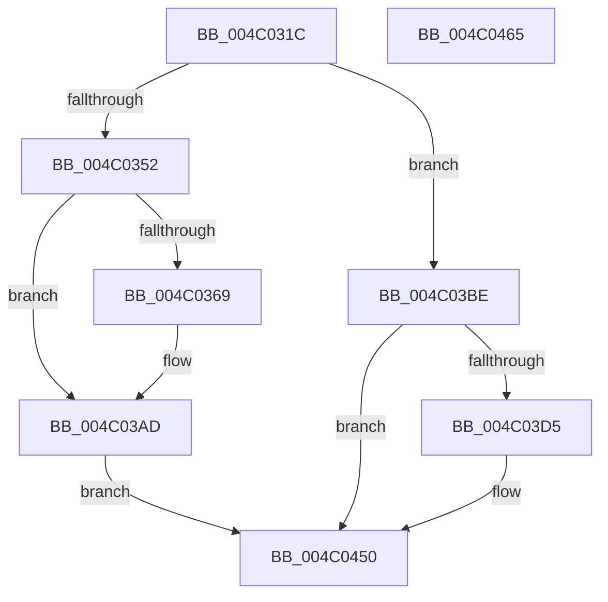

# HalpIommuTraceFault

- RVA: `0x004C031C`–`0x004C0466` (길이 `330` bytes)
- VA: `0x00000001404C031C`
- 실행 섹션: `.text`
- PDB 이름 있음: `예`; PDB Function 태그: `아니요`
- unwind 정보 RVA: `0x000BC734`
- 디코드: `75`개 명령, `330/330` bytes 표시
- 미해석 바이트: `0` (있으면 어셈블리에 `.byte`로 보존)

> 이 문서는 커널 이미지의 기계어와 PDB 기호를 분석해 생성했습니다. 4번과 5번은 함수 원형과 자료형을 바이너리 사용 방식에서 추정한 C 해석이며 원본 소스 복구 결과는 아닙니다.

## 1. Dependencies

- 직접 호출 지점: **6**; 고유 호출 대상: **6**
- 직접 호출자로 확인된 함수: **1**
- RIP 상대 이미지 참조: **12**

### Outgoing calls
- `0x004C0359` → [KeAcquireSpinLockAtDpcLevel](../20/KeAcquireSpinLockAtDpcLevel_function_00208430.md) (function, `0x00208430`)
- `0x004C03A8` → [KeInsertQueueDpc](../20/KeInsertQueueDpc_function_00207C50.md) (function, `0x00207C50`)
- `0x004C03B4` → [KxReleaseSpinLock](../20/KxReleaseSpinLock_function_00206670.md) (function, `0x00206670`)
- `0x004C03CC` → [EtwEventEnabled](../39/EtwEventEnabled_function_00392450.md) (function, `0x00392450`)
- `0x004C044B` → [EtwWriteEx](../25/EtwWriteEx_function_0025F0D0.md) (function, `0x0025F0D0`)
- `0x004C0457` → [_security_check_cookie](../6A/_security_check_cookie_function_006AC640.md) (function, `0x006AC640`)

### Direct callers
- [HalpIommuReportIommuFault](HalpIommuReportIommuFault_function_004C02D0.md) at `0x004C02EE`

### Static image references
- `0x004C033B` → RVA `0x00E0A740` (`.data`; read)
- `0x004C0349` → RVA `0x00FC22C0` (`.data`; read)
- `0x004C0352` → RVA `0x00FC16E0` (`.data`; read)
- `0x004C035E` → RVA `0x00FC16C0` (`.data`; read)
- `0x004C036D` → RVA `0x00FC1920` (`.data`; read)
- `0x004C0374` → RVA `0x00FC16C8` (`.data`; write)
- `0x004C0385` → RVA `0x00FC16D0` (`.data`; write)
- `0x004C038F` → RVA `0x00FC16C4` (`.data`; write)
- `0x004C0399` → RVA `0x00FC16C0` (`.data`; write)
- `0x004C03A1` → RVA `0x00FC16D8` (`.data`; write)
- `0x004C03BE` → RVA `0x00FC22B8` (`.data`; read)
- `0x004C03C5` → RVA `0x0001E1A8` (`.rdata`; read)

## 2. Other-region calls and transfers

- 다른 실행 섹션으로 향하는 call: **0**
- 별도 외부 분기/꼬리 이동을 확인하지 못했습니다.

## 3. Assembly (complete function range)

```asm
004C031C  48 8B C4                        mov rax, rsp
004C031F  4C 89 48 20                     mov qword ptr [rax + 0x20], r9
004C0323  44 89 40 18                     mov dword ptr [rax + 0x18], r8d
004C0327  48 89 50 10                     mov qword ptr [rax + 0x10], rdx
004C032B  48 89 48 08                     mov qword ptr [rax + 8], rcx
004C032F  55                              push rbp
004C0330  48 8D 68 A1                     lea rbp, [rax - 0x5f]
004C0334  48 81 EC 90 00 00 00            sub rsp, 0x90
004C033B  48 8B 05 FE A3 94 00            mov rax, qword ptr [rip + 0x94a3fe]
004C0342  48 33 C4                        xor rax, rsp
004C0345  48 89 45 47                     mov qword ptr [rbp + 0x47], rax
004C0349  80 3D 70 1F B0 00 00            cmp byte ptr [rip + 0xb01f70], 0
004C0350  75 6C                           jne 0x1404c03be
004C0352  48 8D 0D 87 13 B0 00            lea rcx, [rip + 0xb01387]
004C0359  E8 D2 80 D4 FF                  call 0x140208430
004C035E  8B 15 5C 13 B0 00               mov edx, dword ptr [rip + 0xb0135c]
004C0364  F6 C2 01                        test dl, 1
004C0367  75 44                           jne 0x1404c03ad
004C0369  48 8B 45 67                     mov rax, qword ptr [rbp + 0x67]
004C036D  48 8D 0D AC 15 B0 00            lea rcx, [rip + 0xb015ac]
004C0374  48 89 05 4D 13 B0 00            mov qword ptr [rip + 0xb0134d], rax
004C037B  83 CA 01                        or edx, 1
004C037E  48 8B 45 6F                     mov rax, qword ptr [rbp + 0x6f]
004C0382  45 33 C0                        xor r8d, r8d
004C0385  48 89 05 44 13 B0 00            mov qword ptr [rip + 0xb01344], rax
004C038C  8B 45 77                        mov eax, dword ptr [rbp + 0x77]
004C038F  89 05 2F 13 B0 00               mov dword ptr [rip + 0xb0132f], eax
004C0395  48 8B 45 7F                     mov rax, qword ptr [rbp + 0x7f]
004C0399  89 15 21 13 B0 00               mov dword ptr [rip + 0xb01321], edx
004C039F  33 D2                           xor edx, edx
004C03A1  48 89 05 30 13 B0 00            mov qword ptr [rip + 0xb01330], rax
004C03A8  E8 A3 78 D4 FF                  call 0x140207c50
004C03AD  48 8D 0D 2C 13 B0 00            lea rcx, [rip + 0xb0132c]
004C03B4  E8 B7 62 D4 FF                  call 0x140206670
004C03B9  E9 92 00 00 00                  jmp 0x1404c0450
004C03BE  48 8B 0D F3 1E B0 00            mov rcx, qword ptr [rip + 0xb01ef3]
004C03C5  48 8D 15 DC DD B5 FF            lea rdx, [rip - 0x4a2224]
004C03CC  E8 7F 20 ED FF                  call 0x140392450
004C03D1  84 C0                           test al, al
004C03D3  74 7B                           je 0x1404c0450
004C03D5  83 65 13 00                     and dword ptr [rbp + 0x13], 0
004C03D9  48 8D 45 67                     lea rax, [rbp + 0x67]
004C03DD  83 65 23 00                     and dword ptr [rbp + 0x23], 0
004C03E1  48 8D 15 C0 DD B5 FF            lea rdx, [rip - 0x4a2240]
004C03E8  83 65 33 00                     and dword ptr [rbp + 0x33], 0
004C03EC  41 B8 08 00 00 00               mov r8d, 8
004C03F2  83 65 43 00                     and dword ptr [rbp + 0x43], 0
004C03F6  45 33 C9                        xor r9d, r9d
004C03F9  48 89 45 07                     mov qword ptr [rbp + 7], rax
004C03FD  48 8D 45 6F                     lea rax, [rbp + 0x6f]
004C0401  48 89 45 17                     mov qword ptr [rbp + 0x17], rax
004C0405  48 8D 45 77                     lea rax, [rbp + 0x77]
004C0409  41 8D 48 FC                     lea ecx, [r8 - 4]
004C040D  48 89 45 27                     mov qword ptr [rbp + 0x27], rax
004C0411  48 8D 45 7F                     lea rax, [rbp + 0x7f]
004C0415  44 89 45 0F                     mov dword ptr [rbp + 0xf], r8d
004C0419  48 89 45 37                     mov qword ptr [rbp + 0x37], rax
004C041D  48 8D 45 07                     lea rax, [rbp + 7]
004C0421  48 89 44 24 38                  mov qword ptr [rsp + 0x38], rax
004C0426  89 4C 24 30                     mov dword ptr [rsp + 0x30], ecx
004C042A  48 83 64 24 28 00               and qword ptr [rsp + 0x28], 0
004C0430  48 83 64 24 20 00               and qword ptr [rsp + 0x20], 0
004C0436  44 89 45 1F                     mov dword ptr [rbp + 0x1f], r8d
004C043A  89 4D 2F                        mov dword ptr [rbp + 0x2f], ecx
004C043D  48 8B 0D 74 1E B0 00            mov rcx, qword ptr [rip + 0xb01e74]
004C0444  44 89 45 3F                     mov dword ptr [rbp + 0x3f], r8d
004C0448  45 33 C0                        xor r8d, r8d
004C044B  E8 80 EC D9 FF                  call 0x14025f0d0
004C0450  48 8B 4D 47                     mov rcx, qword ptr [rbp + 0x47]
004C0454  48 33 CC                        xor rcx, rsp
004C0457  E8 E4 C1 1E 00                  call 0x1406ac640
004C045C  48 81 C4 90 00 00 00            add rsp, 0x90
004C0463  5D                              pop rbp
004C0464  C3                              ret
004C0465  CC                              int3
```

## 4. C-style interpretation (structured pseudocode)

```c
__int64 __fastcall HalpIommuTraceFault(__int64 a1, __int64 a2, int a3, __int64 a4)
{
    __int64 result;
    __int64 v_rsp;
    unsigned __int64 v_stack_m60;
    unsigned int v_stack_m68;
    unsigned __int64 v_stack_m70;
    unsigned __int64 v_stack_m78;

    *(unsigned __int64 *)(v_rsp + 32) = a4;
    *(unsigned int *)(v_rsp + 24) = a3;
    *(unsigned __int64 *)(v_rsp + 16) = a2;
    *(unsigned __int64 *)(v_rsp + 8) = a1;
    v_rsp = (v_rsp) - (144);
    result = (*(unsigned __int64 *)(v_rip + 9741310)) ^ (v_rsp);
    *(unsigned __int64 *)(v_rsp - 95 + 71) = result;
    if ((*(unsigned __int8 *)(v_rip + 11542384)) != 0) goto loc_004C03BE;
    result = KeAcquireSpinLockAtDpcLevel(v_rip + 11539335, a2, a3, a4);
    if ((((unsigned __int8)((unsigned int)(*(unsigned int *)(v_rip + 11539292)))) & (1)) == 0) {
        result = *(unsigned __int64 *)(v_rsp - 95 + 103);
        a1 = v_rip + 11539884;
        *(unsigned __int64 *)(v_rip + 11539277) = result;
        a2 = (unsigned int)(((unsigned int)(*(unsigned int *)(v_rip + 11539292))) | (1));
        result = *(unsigned __int64 *)(v_rsp - 95 + 111);
        a3 = 0;
        *(unsigned __int64 *)(v_rip + 11539268) = result;
        result = *(unsigned int *)(v_rsp - 95 + 119);
        *(unsigned int *)(v_rip + 11539247) = (unsigned int)(result);
        result = *(unsigned __int64 *)(v_rsp - 95 + 127);
        *(unsigned int *)(v_rip + 11539233) = (unsigned int)(a2);
        a2 = 0;
        *(unsigned __int64 *)(v_rip + 11539248) = result;
        result = KeInsertQueueDpc(a1, a2, a3, a4);
    }
    result = KxReleaseSpinLock(v_rip + 11539244, a2, a3, a4);
    goto loc_004C0450;
loc_004C03BE:
    result = EtwEventEnabled(*(unsigned __int64 *)(v_rip + 11542259), v_rip - 4858404, a3, a4);
    if ((unsigned __int8)(result) != 0) {
        result = v_rsp - 95 + 103;
        a2 = v_rip - 4858432;
        a3 = 8;
        a4 = 0;
        *(unsigned __int64 *)(v_rsp - 95 + 7) = result;
        result = v_rsp - 95 + 111;
        *(unsigned __int64 *)(v_rsp - 95 + 23) = result;
        result = v_rsp - 95 + 119;
        a1 = a3 - 4;
        *(unsigned __int64 *)(v_rsp - 95 + 39) = result;
        result = v_rsp - 95 + 127;
        *(unsigned int *)(v_rsp - 95 + 15) = a3;
        *(unsigned __int64 *)(v_rsp - 95 + 55) = result;
        result = v_rsp - 95 + 7;
        v_stack_m60 = result;
        v_stack_m68 = (unsigned int)(a1);
        *(unsigned int *)(v_rsp - 95 + 31) = a3;
        *(unsigned int *)(v_rsp - 95 + 47) = (unsigned int)(a1);
        a1 = *(unsigned __int64 *)(v_rip + 11542132);
        *(unsigned int *)(v_rsp - 95 + 63) = a3;
        a3 = 0;
        result = EtwWriteEx(a1, a2, a3, a4);
    }
    a1 = (*(unsigned __int64 *)(v_rsp - 95 + 71)) ^ (v_rsp);
    result = _security_check_cookie(a1, a2, a3, a4);
    v_rsp = (v_rsp) + (144);
    return result;
}
```

## 5. (Beta) C Style

```c
int64_t HalpIommuTraceFault(int64_t Arg1, int64_t Arg2, int32_t Arg3, int64_t Arg4)
{
    int64_t result;
    int64_t local_rsp;
    uint64_t v_stack_m60;
    uint32_t v_stack_m68;
    uint64_t v_stack_m70;
    uint64_t v_stack_m78;

    *(uint64_t *)(local_rsp + 0x20) = Arg4;
    *(uint32_t *)(local_rsp + 0x18) = Arg3;
    *(uint64_t *)(local_rsp + 0x10) = Arg2;
    *(uint64_t *)(local_rsp + 0x8) = Arg1;
    local_rsp = (local_rsp) - (144);
    result = (*(uint64_t *)(v_rip + 0x94A3FE)) ^ (local_rsp);
    *(uint64_t *)(local_rsp - 0x5F + 0x47) = result;
    if ((*(uint8_t *)(v_rip + 0xB01F70)) != 0) goto loc_004C03BE;
    result = KeAcquireSpinLockAtDpcLevel(v_rip + 11539335, Arg2, Arg3, Arg4);
    if ((((uint8_t)((uint32_t)(*(uint32_t *)(v_rip + 0xB0135C)))) & (1)) == 0) {
        result = *(uint64_t *)(local_rsp - 0x5F + 0x67);
        Arg1 = v_rip + 11539884;
        *(uint64_t *)(v_rip + 0xB0134D) = result;
        Arg2 = (uint32_t)(((uint32_t)(*(uint32_t *)(v_rip + 0xB0135C))) | (1));
        result = *(uint64_t *)(local_rsp - 0x5F + 0x6F);
        Arg3 = 0;
        *(uint64_t *)(v_rip + 0xB01344) = result;
        result = *(uint32_t *)(local_rsp - 0x5F + 0x77);
        *(uint32_t *)(v_rip + 0xB0132F) = (uint32_t)(result);
        result = *(uint64_t *)(local_rsp - 0x5F + 0x7F);
        *(uint32_t *)(v_rip + 0xB01321) = (uint32_t)(Arg2);
        Arg2 = 0;
        *(uint64_t *)(v_rip + 0xB01330) = result;
        result = KeInsertQueueDpc(Arg1, Arg2, Arg3, Arg4);
    }
    result = KxReleaseSpinLock(v_rip + 11539244, Arg2, Arg3, Arg4);
    goto loc_004C0450;
loc_004C03BE:
    result = EtwEventEnabled(*(uint64_t *)(v_rip + 0xB01EF3), v_rip - 4858404, Arg3, Arg4);
    if ((uint8_t)(result) != 0) {
        result = local_rsp - 95 + 103;
        Arg2 = v_rip - 4858432;
        Arg3 = 8;
        Arg4 = 0;
        *(uint64_t *)(local_rsp - 0x5F + 0x7) = result;
        result = local_rsp - 95 + 111;
        *(uint64_t *)(local_rsp - 0x5F + 0x17) = result;
        result = local_rsp - 95 + 119;
        Arg1 = Arg3 - 4;
        *(uint64_t *)(local_rsp - 0x5F + 0x27) = result;
        result = local_rsp - 95 + 127;
        *(uint32_t *)(local_rsp - 0x5F + 0xF) = Arg3;
        *(uint64_t *)(local_rsp - 0x5F + 0x37) = result;
        result = local_rsp - 95 + 7;
        v_stack_m60 = result;
        v_stack_m68 = (uint32_t)(Arg1);
        *(uint32_t *)(local_rsp - 0x5F + 0x1F) = Arg3;
        *(uint32_t *)(local_rsp - 0x5F + 0x2F) = (uint32_t)(Arg1);
        Arg1 = *(uint64_t *)(v_rip + 0xB01E74);
        *(uint32_t *)(local_rsp - 0x5F + 0x3F) = Arg3;
        Arg3 = 0;
        result = EtwWriteEx(Arg1, Arg2, Arg3, Arg4);
    }
    Arg1 = (*(uint64_t *)(local_rsp - 0x5F + 0x47)) ^ (local_rsp);
    result = _security_check_cookie(Arg1, Arg2, Arg3, Arg4);
    local_rsp = (local_rsp) + (144);
    return result;
}
```

## 6. Execution-region graph

[열기: 2D/3D 그래프와 함수 탐색 컨트롤 패널](../../../control-panel.html?section=text&rva=0x004C031C&view=graph)

- 2D 그래프는 위에서 아래로 흐르고, 3D 그래프는 빈 공간을 드래그해 회전합니다. Shift+드래그는 이동, 휠은 확대·축소, 함수 노드 선택은 대상 보고서 이동입니다.

### Static fallback


