# HalpIommuUnblockDevice

- RVA: `0x004C6250`–`0x004C646F` (길이 `543` bytes)
- VA: `0x00000001404C6250`
- 실행 섹션: `.text`
- PDB 이름 있음: `예`; PDB Function 태그: `아니요`
- unwind 정보 RVA: `0x000BC9BC`
- 디코드: `156`개 명령, `543/543` bytes 표시
- 미해석 바이트: `0` (있으면 어셈블리에 `.byte`로 보존)

> 이 문서는 커널 이미지의 기계어와 PDB 기호를 분석해 생성했습니다. 4번과 5번은 함수 원형과 자료형을 바이너리 사용 방식에서 추정한 C 해석이며 원본 소스 복구 결과는 아닙니다.

## 1. Dependencies

- 직접 호출 지점: **16**; 고유 호출 대상: **14**
- 직접 호출자로 확인된 함수: **0**
- RIP 상대 이미지 참조: **5**

### Outgoing calls
- `0x004C6297` → [HalpIommuCheckDpptException](HalpIommuCheckDpptException_function_004C6478.md) (function, `0x004C6478`)
- `0x004C62A4` → [HalpIommuCheckExceptionList](HalpIommuCheckExceptionList_function_004CFD84.md) (function, `0x004CFD84`)
- `0x004C62D6` → [HalpIommuQueryAcpiDeviceMapping](../4B/HalpIommuQueryAcpiDeviceMapping_function_004BC784.md) (function, `0x004BC784`)
- `0x004C6300` → [HalpIommuCreateDevice](../54/HalpIommuCreateDevice_function_0054ED60.md) (function, `0x0054ED60`)
- `0x004C6324` → [HalpIommuGetAcpiDeviceMapCount](../55/HalpIommuGetAcpiDeviceMapCount_function_005551BC.md) (function, `0x005551BC`)
- `0x004C633F` → [KeAbPreAcquire](../21/KeAbPreAcquire_function_00210230.md) (function, `0x00210230`)
- `0x004C6364` → [ExfAcquirePushLockExclusiveEx](../20/ExfAcquirePushLockExclusiveEx_function_0020FC90.md) (function, `0x0020FC90`)
- `0x004C637C` → [HalpIommuCreateIncreaseAliasTrack](../55/HalpIommuCreateIncreaseAliasTrack_function_00554CB0.md) (function, `0x00554CB0`)
- `0x004C63A7` → [IommupHvAttachDeviceDomain](../56/IommupHvAttachDeviceDomain_function_00566ABC.md) (function, `0x00566ABC`)
- `0x004C63BE` → [HalpIommuJoinDmaDomain](../55/HalpIommuJoinDmaDomain_function_005554E8.md) (function, `0x005554E8`)
- `0x004C63D7` → [HalpIommuDeleteDevice](../54/HalpIommuDeleteDevice_function_0054F368.md) (function, `0x0054F368`)
- `0x004C6404` → [ExfTryToWakePushLock](../26/ExfTryToWakePushLock_function_00265DD0.md) (function, `0x00265DD0`)
- `0x004C6410` → [KeAbPostRelease](../2E/KeAbPostRelease_function_002E1600.md) (function, `0x002E1600`)
- `0x004C6429` → [HalpIommuDeleteDevice](../54/HalpIommuDeleteDevice_function_0054F368.md) (function, `0x0054F368`)
- `0x004C643C` → [HalpMmAllocCtxFree](../3E/HalpMmAllocCtxFree_function_003E1904.md) (function, `0x003E1904`)
- `0x004C6444` → [HalpMmAllocCtxFree](../3E/HalpMmAllocCtxFree_function_003E1904.md) (function, `0x003E1904`)

### Direct callers
- 이 함수 시작 RVA로 연결되는 직접 call은 확인되지 않았습니다. 간접 호출은 완전히 역산할 수 없습니다.

### Static image references
- `0x004C62B1` → RVA `0x00FC1710` (`.data`; read)
- `0x004C62BA` → RVA `0x00FC1712` (`.data`; read)
- `0x004C6336` → RVA `0x00FC18B8` (`.data`; read)
- `0x004C6344` → RVA `0x00FC18B8` (`.data`; read/write)
- `0x004C63B0` → RVA `0x00FC16B0` (`.data`; read)

## 2. Other-region calls and transfers

- 다른 실행 섹션으로 향하는 call: **0**
- 별도 외부 분기/꼬리 이동을 확인하지 못했습니다.

## 3. Assembly (complete function range)

```asm
004C6250  48 89 5C 24 08                  mov qword ptr [rsp + 8], rbx
004C6255  48 89 74 24 10                  mov qword ptr [rsp + 0x10], rsi
004C625A  55                              push rbp
004C625B  57                              push rdi
004C625C  41 54                           push r12
004C625E  41 56                           push r14
004C6260  41 57                           push r15
004C6262  48 8B EC                        mov rbp, rsp
004C6265  48 83 EC 50                     sub rsp, 0x50
004C6269  33 C0                           xor eax, eax
004C626B  C6 45 40 00                     mov byte ptr [rbp + 0x40], 0
004C626F  49 21 00                        and qword ptr [r8], rax
004C6272  0F 57 C0                        xorps xmm0, xmm0
004C6275  48 21 45 48                     and qword ptr [rbp + 0x48], rax
004C6279  45 33 F6                        xor r14d, r14d
004C627C  0F 11 45 E8                     movups xmmword ptr [rbp - 0x18], xmm0
004C6280  48 89 45 F8                     mov qword ptr [rbp - 8], rax
004C6284  4D 8B E0                        mov r12, r8
004C6287  4C 89 75 E0                     mov qword ptr [rbp - 0x20], r14
004C628B  48 8B FA                        mov rdi, rdx
004C628E  48 8B D9                        mov rbx, rcx
004C6291  40 32 F6                        xor sil, sil
004C6294  45 32 FF                        xor r15b, r15b
004C6297  E8 DC 01 00 00                  call 0x1404c6478
004C629C  84 C0                           test al, al
004C629E  0F 85 AF 01 00 00               jne 0x1404c6453
004C62A4  E8 DB 9A 00 00                  call 0x1404cfd84
004C62A9  84 C0                           test al, al
004C62AB  0F 85 A2 01 00 00               jne 0x1404c6453
004C62B1  40 38 35 58 B4 AF 00            cmp byte ptr [rip + 0xafb458], sil
004C62B8  74 13                           je 0x1404c62cd
004C62BA  40 38 35 51 B4 AF 00            cmp byte ptr [rip + 0xafb451], sil
004C62C1  75 0A                           jne 0x1404c62cd
004C62C3  B8 BB 00 00 C0                  mov eax, 0xc00000bb
004C62C8  E9 88 01 00 00                  jmp 0x1404c6455
004C62CD  83 39 02                        cmp dword ptr [rcx], 2
004C62D0  75 16                           jne 0x1404c62e8
004C62D2  48 8D 55 E8                     lea rdx, [rbp - 0x18]
004C62D6  E8 A9 64 FF FF                  call 0x1404bc784
004C62DB  85 C0                           test eax, eax
004C62DD  48 8D 4D E8                     lea rcx, [rbp - 0x18]
004C62E1  48 0F 48 CB                     cmovs rcx, rbx
004C62E5  48 8B D9                        mov rbx, rcx
004C62E8  48 8D 45 48                     lea rax, [rbp + 0x48]
004C62EC  41 B9 02 00 00 00               mov r9d, 2
004C62F2  45 33 C0                        xor r8d, r8d
004C62F5  48 89 44 24 20                  mov qword ptr [rsp + 0x20], rax
004C62FA  48 8B D7                        mov rdx, rdi
004C62FD  48 8B CB                        mov rcx, rbx
004C6300  E8 5B 8A 08 00                  call 0x14054ed60
004C6305  85 C0                           test eax, eax
004C6307  79 0F                           jns 0x1404c6318
004C6309  33 FF                           xor edi, edi
004C630B  3D 25 02 00 C0                  cmp eax, 0xc0000225
004C6310  0F 45 F8                        cmovne edi, eax
004C6313  E9 01 01 00 00                  jmp 0x1404c6419
004C6318  BE 01 00 00 00                  mov esi, 1
004C631D  39 33                           cmp dword ptr [rbx], esi
004C631F  75 70                           jne 0x1404c6391
004C6321  48 8B CB                        mov rcx, rbx
004C6324  E8 93 EE 08 00                  call 0x1405551bc
004C6329  3B C6                           cmp eax, esi
004C632B  77 06                           ja 0x1404c6333
004C632D  40 84 73 04                     test byte ptr [rbx + 4], sil
004C6331  74 5E                           je 0x1404c6391
004C6333  45 33 C0                        xor r8d, r8d
004C6336  48 8D 0D 7B B5 AF 00            lea rcx, [rip + 0xafb57b]
004C633D  33 D2                           xor edx, edx
004C633F  E8 EC 9E D4 FF                  call 0x140210230
004C6344  F0 48 0F BA 2D 6A B5 AF 00 00   lock bts qword ptr [rip + 0xafb56a], 0
004C634E  48 8B F8                        mov rdi, rax
004C6351  73 16                           jae 0x1404c6369
004C6353  4C 8D 05 5E B5 AF 00            lea r8, [rip + 0xafb55e]
004C635A  48 8B D0                        mov rdx, rax
004C635D  48 8D 0D 54 B5 AF 00            lea rcx, [rip + 0xafb554]
004C6364  E8 27 99 D4 FF                  call 0x14020fc90
004C6369  48 85 FF                        test rdi, rdi
004C636C  74 04                           je 0x1404c6372
004C636E  40 88 77 0A                     mov byte ptr [rdi + 0xa], sil
004C6372  48 8D 55 E0                     lea rdx, [rbp - 0x20]
004C6376  48 8B CB                        mov rcx, rbx
004C6379  44 8A FE                        mov r15b, sil
004C637C  E8 2F E9 08 00                  call 0x140554cb0
004C6381  8B F8                           mov edi, eax
004C6383  85 C0                           test eax, eax
004C6385  78 63                           js 0x1404c63ea
004C6387  4C 8B 75 E0                     mov r14, qword ptr [rbp - 0x20]
004C638B  49 39 76 18                     cmp qword ptr [r14 + 0x18], rsi
004C638F  7F 59                           jg 0x1404c63ea
004C6391  80 3D 78 B3 AF 00 00            cmp byte ptr [rip + 0xafb378], 0
004C6398  48 8B 5D 48                     mov rbx, qword ptr [rbp + 0x48]
004C639C  74 12                           je 0x1404c63b0
004C639E  48 8B 4B 20                     mov rcx, qword ptr [rbx + 0x20]
004C63A2  45 33 C0                        xor r8d, r8d
004C63A5  33 D2                           xor edx, edx
004C63A7  E8 10 07 0A 00                  call 0x140566abc
004C63AC  8B F8                           mov edi, eax
004C63AE  EB 35                           jmp 0x1404c63e5
004C63B0  48 8B 15 F9 B2 AF 00            mov rdx, qword ptr [rip + 0xafb2f9]
004C63B7  4C 8D 45 40                     lea r8, [rbp + 0x40]
004C63BB  48 8B CB                        mov rcx, rbx
004C63BE  E8 25 F1 08 00                  call 0x1405554e8
004C63C3  8B F8                           mov edi, eax
004C63C5  3D 30 00 00 C0                  cmp eax, 0xc0000030
004C63CA  75 19                           jne 0x1404c63e5
004C63CC  40 84 75 40                     test byte ptr [rbp + 0x40], sil
004C63D0  74 13                           je 0x1404c63e5
004C63D2  48 8B CB                        mov rcx, rbx
004C63D5  33 FF                           xor edi, edi
004C63D7  E8 8C 8F 08 00                  call 0x14054f368
004C63DC  33 DB                           xor ebx, ebx
004C63DE  48 89 5D 48                     mov qword ptr [rbp + 0x48], rbx
004C63E2  40 32 F6                        xor sil, sil
004C63E5  45 84 FF                        test r15b, r15b
004C63E8  74 33                           je 0x1404c641d
004C63EA  48 83 C8 FF                     or rax, 0xffffffffffffffff
004C63EE  F0 48 0F C1 05 C1 B4 AF 00      lock xadd qword ptr [rip + 0xafb4c1], rax
004C63F7  24 06                           and al, 6
004C63F9  3C 02                           cmp al, 2
004C63FB  75 0C                           jne 0x1404c6409
004C63FD  48 8D 0D B4 B4 AF 00            lea rcx, [rip + 0xafb4b4]
004C6404  E8 C7 F9 D9 FF                  call 0x140265dd0
004C6409  48 8D 0D A8 B4 AF 00            lea rcx, [rip + 0xafb4a8]
004C6410  E8 EB B1 E1 FF                  call 0x1402e1600
004C6415  4C 8B 75 E0                     mov r14, qword ptr [rbp - 0x20]
004C6419  48 8B 5D 48                     mov rbx, qword ptr [rbp + 0x48]
004C641D  85 FF                           test edi, edi
004C641F  79 2A                           jns 0x1404c644b
004C6421  40 84 F6                        test sil, sil
004C6424  74 08                           je 0x1404c642e
004C6426  48 8B CB                        mov rcx, rbx
004C6429  E8 3A 8F 08 00                  call 0x14054f368
004C642E  4D 85 F6                        test r14, r14
004C6431  74 1C                           je 0x1404c644f
004C6433  49 8B 56 10                     mov rdx, qword ptr [r14 + 0x10]
004C6437  48 85 D2                        test rdx, rdx
004C643A  74 05                           je 0x1404c6441
004C643C  E8 C3 B4 F1 FF                  call 0x1403e1904
004C6441  49 8B D6                        mov rdx, r14
004C6444  E8 BB B4 F1 FF                  call 0x1403e1904
004C6449  EB 04                           jmp 0x1404c644f
004C644B  49 89 1C 24                     mov qword ptr [r12], rbx
004C644F  8B C7                           mov eax, edi
004C6451  EB 02                           jmp 0x1404c6455
004C6453  33 C0                           xor eax, eax
004C6455  4C 8D 5C 24 50                  lea r11, [rsp + 0x50]
004C645A  49 8B 5B 30                     mov rbx, qword ptr [r11 + 0x30]
004C645E  49 8B 73 38                     mov rsi, qword ptr [r11 + 0x38]
004C6462  49 8B E3                        mov rsp, r11
004C6465  41 5F                           pop r15
004C6467  41 5E                           pop r14
004C6469  41 5C                           pop r12
004C646B  5F                              pop rdi
004C646C  5D                              pop rbp
004C646D  C3                              ret
004C646E  CC                              int3
```

## 4. C-style interpretation (structured pseudocode)

```c
__int64 __fastcall HalpIommuUnblockDevice(__int64 a1, __int64 a2, __int64 a3)
{
    __int64 result;
    __int64 v_r14;
    __int64 v_r15;
    __int64 v_rbx;
    __int64 v_rdi;
    __int64 v_rsi;
    __int64 v_rsp;
    unsigned __int64 v_stack_m28;
    unsigned __int64 v_stack_m30;
    unsigned __int64 v_stack_m40;
    unsigned __int64 v_stack_m48;
    unsigned __int64 v_stack_m58;
    unsigned __int64 v_stack_p10;
    unsigned __int8 v_stack_p18;
    unsigned __int64 v_stack_p20;
    unsigned __int64 v_stack_p8;

    v_stack_p8 = v_rbx;
    v_stack_p10 = v_rsi;
    v_rsp = (v_rsp) - (80);
    result = 0;
    v_stack_p18 = 0;
    v_r14 = 0;
    v_stack_m40 = v_xmm0;
    v_stack_m30 = 0;
    v_stack_m48 = 0;
    v_rsi = 0;
    v_r15 = 0;
    result = HalpIommuCheckDpptException(a1, a2, a3, a4);
    if ((unsigned __int8)(result) != 0) goto loc_004C6453;
    result = HalpIommuCheckExceptionList(a1, a2, a3, a4);
    if ((unsigned __int8)(result) != 0) goto loc_004C6453;
    if ((*(unsigned __int8 *)(v_rip + 11514968)) == 0) goto loc_004C62CD;
    if ((*(unsigned __int8 *)(v_rip + 11514961)) != 0) goto loc_004C62CD;
    goto loc_004C6455;
loc_004C62CD:
    result = (unsigned int)(0xC00000BBULL);
    v_rbx = a1;
    if ((*(unsigned int *)(a1)) == 2) {
        a2 = v_stack_m40;
        result = HalpIommuQueryAcpiDeviceMapping(a1, a2, a3, a4);
        a1 = v_stack_m40;
        if (sign_flag) { a1 = a1; }
        v_rbx = a1;
    }
    a3 = 0;
    v_stack_m58 = v_stack_p20;
    result = HalpIommuCreateDevice(v_rbx, a2, a3, 2);
    if (!sign_flag) goto loc_004C6318;
    v_rdi = 0;
    if (((unsigned int)(result)) != 0xC0000225ULL) { v_rdi = (unsigned int)(result); }
    goto loc_004C6419;
loc_004C6318:
    if ((*(unsigned int *)(v_rbx)) != 1) goto loc_004C6391;
    result = HalpIommuGetAcpiDeviceMapCount(v_rbx, a2, a3, 2);
    if (((unsigned int)(result)) > 1) goto loc_004C6333;
    if (((*(unsigned __int8 *)(v_rbx + 4)) & (1)) == 0) goto loc_004C6391;
loc_004C6333:
    a3 = 0;
    a2 = 0;
    result = KeAbPreAcquire(v_rip + 11515259, a2, a3, 2);
    if (!(condition_is_above_or_equal)) {
        a3 = v_rip + 11515230;
        a2 = result;
        a1 = v_rip + 11515220;
        result = ExfAcquirePushLockExclusiveEx(a1, a2, a3, 2);
    }
    if (result != 0) {
        *(unsigned __int8 *)(result + 10) = 1;
    }
    result = HalpIommuCreateIncreaseAliasTrack(v_rbx, v_stack_m48, a3, 2);
    if (sign_flag) goto loc_004C63EA;
    if ((*(unsigned __int64 *)(v_stack_m48 + 24)) > 1) goto loc_004C63EA;
loc_004C6391:
    if ((*(unsigned __int8 *)(v_rip + 11514744)) == 0) goto loc_004C63B0;
    a3 = 0;
    a2 = 0;
    result = IommupHvAttachDeviceDomain(*(unsigned __int64 *)(v_stack_p20 + 32), a2, a3, 2);
    goto loc_004C63E5;
loc_004C63B0:
    result = HalpIommuJoinDmaDomain(v_stack_p20, *(unsigned __int64 *)(v_rip + 11514617), v_stack_p18, 2);
    if (((unsigned int)(result)) != 0xC0000030ULL) goto loc_004C63E5;
    v_rbx = v_stack_p20;
    v_rsi = 1;
    v_rdi = (unsigned int)((unsigned int)(result));
    if (((v_stack_p18) & (1)) != 0) {
        a1 = v_stack_p20;
        v_rdi = 0;
        result = HalpIommuDeleteDevice(a1, *(unsigned __int64 *)(v_rip + 11514617), v_stack_p18, 2);
        v_rbx = 0;
        v_stack_p20 = 0;
        v_rsi = 0;
    }
    if (1 == 0) goto loc_004C641D;
loc_004C63EA:
    result = (result) | (-1);
    result = (unsigned __int8)((result) & (6));
    if (((unsigned __int8)(result)) == 2) {
        a1 = v_rip + 11515060;
        result = ExfTryToWakePushLock(a1, *(unsigned __int64 *)(v_rip + 11514617), v_stack_p18, 2);
    }
    result = KeAbPostRelease(v_rip + 11515048, *(unsigned __int64 *)(v_rip + 11514617), v_stack_p18, 2);
loc_004C6419:
loc_004C641D:
    if (!sign_flag) goto loc_004C644B;
    if (0 != 0) {
        a1 = v_stack_p20;
        result = HalpIommuDeleteDevice(a1, *(unsigned __int64 *)(v_rip + 11514617), v_stack_p18, 2);
    }
    if (v_stack_m48 == 0) goto loc_004C644F;
    if (*(unsigned __int64 *)(v_stack_m48 + 16) != 0) {
        result = HalpMmAllocCtxFree(a1, *(unsigned __int64 *)(v_stack_m48 + 16), v_stack_p18, 2);
    }
    result = HalpMmAllocCtxFree(a1, v_stack_m48, v_stack_p18, 2);
    goto loc_004C644F;
loc_004C644B:
    *(unsigned __int64 *)(a3) = v_stack_p20;
loc_004C644F:
    goto loc_004C6455;
loc_004C6453:
    result = 0;
loc_004C6455:
    return result;
}
```

## 5. (Beta) C Style

```c
int64_t HalpIommuUnblockDevice(int64_t Arg1, int64_t Arg2, void *Arg3)
{
    uint8_t *arg3 = (uint8_t *)Arg3;

    int64_t result;
    int64_t local_r14;
    int64_t local_r15;
    int64_t local_rbx;
    int64_t local_rdi;
    int64_t local_rsi;
    int64_t local_rsp;
    uint64_t v_stack_m28;
    uint64_t v_stack_m30;
    uint64_t v_stack_m40;
    uint64_t v_stack_m48;
    uint64_t v_stack_m58;
    uint64_t v_stack_p10;
    uint8_t v_stack_p18;
    uint64_t v_stack_p20;
    uint64_t v_stack_p8;

    v_stack_p8 = local_rbx;
    v_stack_p10 = local_rsi;
    local_rsp = (local_rsp) - (80);
    result = 0;
    v_stack_p18 = 0;
    local_r14 = 0;
    v_stack_m40 = v_xmm0;
    v_stack_m30 = 0;
    v_stack_m48 = 0;
    local_rsi = 0;
    local_r15 = 0;
    result = HalpIommuCheckDpptException(Arg1, Arg2, Arg3, a4);
    if ((uint8_t)(result) != 0) goto loc_004C6453;
    result = HalpIommuCheckExceptionList(Arg1, Arg2, Arg3, a4);
    if ((uint8_t)(result) != 0) goto loc_004C6453;
    if ((*(uint8_t *)(v_rip + 0xAFB458)) == 0) goto loc_004C62CD;
    if ((*(uint8_t *)(v_rip + 0xAFB451)) != 0) goto loc_004C62CD;
    goto loc_004C6455;
loc_004C62CD:
    result = (uint32_t)(0xC00000BBULL);
    local_rbx = Arg1;
    if ((*(uint32_t *)(Arg1)) == 2) {
        Arg2 = v_stack_m40;
        result = HalpIommuQueryAcpiDeviceMapping(Arg1, Arg2, Arg3, a4);
        Arg1 = v_stack_m40;
        if (sign_flag) { Arg1 = Arg1; }
        local_rbx = Arg1;
    }
    Arg3 = 0;
    v_stack_m58 = v_stack_p20;
    result = HalpIommuCreateDevice(local_rbx, Arg2, Arg3, 2);
    if (!sign_flag) goto loc_004C6318;
    local_rdi = 0;
    if (((uint32_t)(result)) != 0xC0000225ULL) { local_rdi = (uint32_t)(result); }
    goto loc_004C6419;
loc_004C6318:
    if ((*(uint32_t *)(local_rbx)) != 1) goto loc_004C6391;
    result = HalpIommuGetAcpiDeviceMapCount(local_rbx, Arg2, Arg3, 2);
    if (((uint32_t)(result)) > 1) goto loc_004C6333;
    if (((*(uint8_t *)(local_rbx + 0x4)) & (1)) == 0) goto loc_004C6391;
loc_004C6333:
    Arg3 = 0;
    Arg2 = 0;
    result = KeAbPreAcquire(v_rip + 11515259, Arg2, Arg3, 2);
    if (!(condition_is_above_or_equal)) {
        Arg3 = v_rip + 11515230;
        Arg2 = result;
        Arg1 = v_rip + 11515220;
        result = ExfAcquirePushLockExclusiveEx(Arg1, Arg2, Arg3, 2);
    }
    if (result != 0) {
        *(uint8_t *)(result + 0xA) = 1;
    }
    result = HalpIommuCreateIncreaseAliasTrack(local_rbx, v_stack_m48, Arg3, 2);
    if (sign_flag) goto loc_004C63EA;
    if ((*(uint64_t *)(v_stack_m48 + 0x18)) > 1) goto loc_004C63EA;
loc_004C6391:
    if ((*(uint8_t *)(v_rip + 0xAFB378)) == 0) goto loc_004C63B0;
    Arg3 = 0;
    Arg2 = 0;
    result = IommupHvAttachDeviceDomain(*(uint64_t *)(v_stack_p20 + 0x20), Arg2, Arg3, 2);
    goto loc_004C63E5;
loc_004C63B0:
    result = HalpIommuJoinDmaDomain(v_stack_p20, *(uint64_t *)(v_rip + 0xAFB2F9), v_stack_p18, 2);
    if (((uint32_t)(result)) != 0xC0000030ULL) goto loc_004C63E5;
    local_rbx = v_stack_p20;
    local_rsi = 1;
    local_rdi = (uint32_t)((uint32_t)(result));
    if (((v_stack_p18) & (1)) != 0) {
        Arg1 = v_stack_p20;
        local_rdi = 0;
        result = HalpIommuDeleteDevice(Arg1, *(uint64_t *)(v_rip + 0xAFB2F9), v_stack_p18, 2);
        local_rbx = 0;
        v_stack_p20 = 0;
        local_rsi = 0;
    }
    if (1 == 0) goto loc_004C641D;
loc_004C63EA:
    result = (result) | (-1);
    result = (uint8_t)((result) & (6));
    if (((uint8_t)(result)) == 2) {
        Arg1 = v_rip + 11515060;
        result = ExfTryToWakePushLock(Arg1, *(uint64_t *)(v_rip + 0xAFB2F9), v_stack_p18, 2);
    }
    result = KeAbPostRelease(v_rip + 11515048, *(uint64_t *)(v_rip + 0xAFB2F9), v_stack_p18, 2);
loc_004C6419:
loc_004C641D:
    if (!sign_flag) goto loc_004C644B;
    if (0 != 0) {
        Arg1 = v_stack_p20;
        result = HalpIommuDeleteDevice(Arg1, *(uint64_t *)(v_rip + 0xAFB2F9), v_stack_p18, 2);
    }
    if (v_stack_m48 == 0) goto loc_004C644F;
    if (*(uint64_t *)(v_stack_m48 + 0x10) != 0) {
        result = HalpMmAllocCtxFree(Arg1, *(uint64_t *)(v_stack_m48 + 0x10), v_stack_p18, 2);
    }
    result = HalpMmAllocCtxFree(Arg1, v_stack_m48, v_stack_p18, 2);
    goto loc_004C644F;
loc_004C644B:
    *(uint64_t *)(arg3) = v_stack_p20;
loc_004C644F:
    goto loc_004C6455;
loc_004C6453:
    result = 0;
loc_004C6455:
    return result;
}
```

### 관측된 메모리 오프셋

구조체 형식이 확인되지 않은 접근은 인자 기준의 오프셋으로만 기록했습니다.

| 기준 인자 | 오프셋 표현 | 폭 (bit) | 접근 |
|---|---:|---:|---|
| `Arg3` | `+ 0x0` | `64` | `R/W` |
| `Arg3` | `+ 0x0` | `64` | `W` |

## 6. Execution-region graph

[열기: 2D/3D 그래프와 함수 탐색 컨트롤 패널](../../../control-panel.html?section=text&rva=0x004C6250&view=graph)

- 2D 그래프는 위에서 아래로 흐르고, 3D 그래프는 빈 공간을 드래그해 회전합니다. Shift+드래그는 이동, 휠은 확대·축소, 함수 노드 선택은 대상 보고서 이동입니다.

### Static fallback

```mermaid
flowchart TD
  bb_004C6250[BB_004C6250]
  bb_004C62A4[BB_004C62A4]
  bb_004C62B1[BB_004C62B1]
  bb_004C62BA[BB_004C62BA]
  bb_004C62C3[BB_004C62C3]
  bb_004C62CD[BB_004C62CD]
  bb_004C62D2[BB_004C62D2]
  bb_004C62E8[BB_004C62E8]
  bb_004C6309[BB_004C6309]
  bb_004C6318[BB_004C6318]
  bb_004C6321[BB_004C6321]
  bb_004C632D[BB_004C632D]
  bb_004C6333[BB_004C6333]
  bb_004C6353[BB_004C6353]
  bb_004C6369[BB_004C6369]
  bb_004C636E[BB_004C636E]
  bb_004C6372[BB_004C6372]
  bb_004C6387[BB_004C6387]
  bb_004C6391[BB_004C6391]
  bb_004C639E[BB_004C639E]
  bb_004C63B0[BB_004C63B0]
  bb_004C63CC[BB_004C63CC]
  bb_004C63D2[BB_004C63D2]
  bb_004C63E5[BB_004C63E5]
  bb_004C63EA[BB_004C63EA]
  bb_004C63FD[BB_004C63FD]
  bb_004C6409[BB_004C6409]
  bb_004C6419[BB_004C6419]
  bb_004C641D[BB_004C641D]
  bb_004C6421[BB_004C6421]
  bb_004C6426[BB_004C6426]
  bb_004C642E[BB_004C642E]
  bb_004C6433[BB_004C6433]
  bb_004C643C[BB_004C643C]
  bb_004C6441[BB_004C6441]
  bb_004C644B[BB_004C644B]
  bb_004C644F[BB_004C644F]
  bb_004C6453[BB_004C6453]
  bb_004C6455[BB_004C6455]
  bb_004C646E[BB_004C646E]
  bb_004C6250 -->|branch| bb_004C6453
  bb_004C6250 -->|fallthrough| bb_004C62A4
  bb_004C62A4 -->|branch| bb_004C6453
  bb_004C62A4 -->|fallthrough| bb_004C62B1
  bb_004C62B1 -->|branch| bb_004C62CD
  bb_004C62B1 -->|fallthrough| bb_004C62BA
  bb_004C62BA -->|branch| bb_004C62CD
  bb_004C62BA -->|fallthrough| bb_004C62C3
  bb_004C62C3 -->|branch| bb_004C6455
  bb_004C62CD -->|branch| bb_004C62E8
  bb_004C62CD -->|fallthrough| bb_004C62D2
  bb_004C62D2 -->|flow| bb_004C62E8
  bb_004C62E8 -->|branch| bb_004C6318
  bb_004C62E8 -->|fallthrough| bb_004C6309
  bb_004C6309 -->|branch| bb_004C6419
  bb_004C6318 -->|branch| bb_004C6391
  bb_004C6318 -->|fallthrough| bb_004C6321
  bb_004C6321 -->|branch| bb_004C6333
  bb_004C6321 -->|fallthrough| bb_004C632D
  bb_004C632D -->|branch| bb_004C6391
  bb_004C632D -->|fallthrough| bb_004C6333
  bb_004C6333 -->|branch| bb_004C6369
  bb_004C6333 -->|fallthrough| bb_004C6353
  bb_004C6353 -->|flow| bb_004C6369
  bb_004C6369 -->|branch| bb_004C6372
  bb_004C6369 -->|fallthrough| bb_004C636E
  bb_004C636E -->|flow| bb_004C6372
  bb_004C6372 -->|branch| bb_004C63EA
  bb_004C6372 -->|fallthrough| bb_004C6387
  bb_004C6387 -->|branch| bb_004C63EA
  bb_004C6387 -->|fallthrough| bb_004C6391
  bb_004C6391 -->|branch| bb_004C63B0
  bb_004C6391 -->|fallthrough| bb_004C639E
  bb_004C639E -->|branch| bb_004C63E5
  bb_004C63B0 -->|branch| bb_004C63E5
  bb_004C63B0 -->|fallthrough| bb_004C63CC
  bb_004C63CC -->|branch| bb_004C63E5
  bb_004C63CC -->|fallthrough| bb_004C63D2
  bb_004C63D2 -->|flow| bb_004C63E5
  bb_004C63E5 -->|branch| bb_004C641D
  bb_004C63E5 -->|fallthrough| bb_004C63EA
  bb_004C63EA -->|branch| bb_004C6409
  bb_004C63EA -->|fallthrough| bb_004C63FD
  bb_004C63FD -->|flow| bb_004C6409
  bb_004C6409 -->|flow| bb_004C6419
  bb_004C6419 -->|flow| bb_004C641D
  bb_004C641D -->|branch| bb_004C644B
  bb_004C641D -->|fallthrough| bb_004C6421
  bb_004C6421 -->|branch| bb_004C642E
  bb_004C6421 -->|fallthrough| bb_004C6426
  bb_004C6426 -->|flow| bb_004C642E
  bb_004C642E -->|branch| bb_004C644F
  bb_004C642E -->|fallthrough| bb_004C6433
  bb_004C6433 -->|branch| bb_004C6441
  bb_004C6433 -->|fallthrough| bb_004C643C
  bb_004C643C -->|flow| bb_004C6441
  bb_004C6441 -->|branch| bb_004C644F
  bb_004C644B -->|flow| bb_004C644F
  bb_004C644F -->|branch| bb_004C6455
  bb_004C6453 -->|flow| bb_004C6455
```


