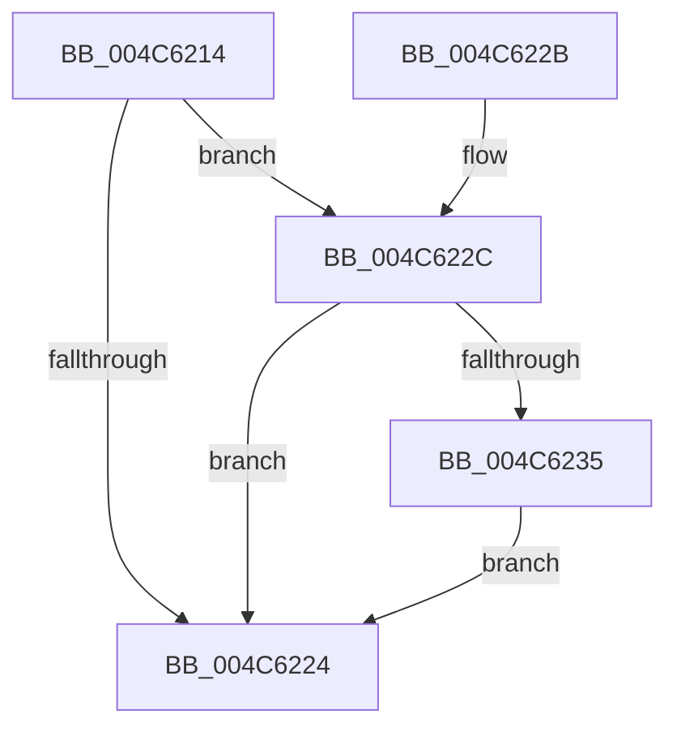

# HalpMcUpdateLock

- RVA: `0x004C6214`–`0x004C6242` (길이 `46` bytes)
- VA: `0x00000001404C6214`
- 실행 섹션: `.text`
- PDB 이름 있음: `예`; PDB Function 태그: `아니요`
- unwind 정보 RVA: `0x00068370`
- 디코드: `13`개 명령, `46/46` bytes 표시
- 미해석 바이트: `0` (있으면 어셈블리에 `.byte`로 보존)

> 이 문서는 커널 이미지의 기계어와 PDB 기호를 분석해 생성했습니다. 4번과 5번은 함수 원형과 자료형을 바이너리 사용 방식에서 추정한 C 해석이며 원본 소스 복구 결과는 아닙니다.

## 1. Dependencies

- 직접 호출 지점: **1**; 고유 호출 대상: **1**
- 직접 호출자로 확인된 함수: **3**
- RIP 상대 이미지 참조: **3**

### Outgoing calls
- `0x004C623B` → [MmLockPreChargedPagedPool](../../page/AD/MmLockPreChargedPagedPool_function_00AD6E20.md) (function, `0x00AD6E20`)

### Direct callers
- [HalpPowerStateCallback](../4B/HalpPowerStateCallback_function_004B8150.md) at `0x004B81CA`
- [HalStartDynamicProcessor](../54/HalStartDynamicProcessor_function_00543300.md) at `0x0054337C`
- [HalpLoadMicrocode](../../page/70/HalpLoadMicrocode_function_0070B200.md) at `0x0070B39F`

### Static image references
- `0x004C6218` → RVA `0x00FC19F8` (`.data`; read)
- `0x004C622C` → RVA `0x00F90532` (`.data`; read)
- `0x004C6235` → RVA `0x00FC19F0` (`.data`; read)

## 2. Other-region calls and transfers

- 다른 실행 섹션으로 향하는 call: **1**
  - `0x004C623B` → [MmLockPreChargedPagedPool](../../page/AD/MmLockPreChargedPagedPool_function_00AD6E20.md) (`.text` → `PAGE`)
- 별도 외부 분기/꼬리 이동을 확인하지 못했습니다.

## 3. Assembly (complete function range)

```asm
004C6214  48 83 EC 28                     sub rsp, 0x28
004C6218  48 8B 0D D9 B7 AF 00            mov rcx, qword ptr [rip + 0xafb7d9]
004C621F  48 85 C9                        test rcx, rcx
004C6222  75 08                           jne 0x1404c622c
004C6224  33 C0                           xor eax, eax
004C6226  48 83 C4 28                     add rsp, 0x28
004C622A  C3                              ret
004C622B  CC                              int3
004C622C  80 3D FF A2 AC 00 00            cmp byte ptr [rip + 0xaca2ff], 0
004C6233  74 EF                           je 0x1404c6224
004C6235  8B 15 B5 B7 AF 00               mov edx, dword ptr [rip + 0xafb7b5]
004C623B  E8 E0 0B 61 00                  call 0x140ad6e20
004C6240  EB E2                           jmp 0x1404c6224
```

## 4. C-style interpretation (structured pseudocode)

```c
__int64 __fastcall HalpMcUpdateLock(void)
{
    __int64 result;
    __int64 v_rsp;

    v_rsp = (v_rsp) - (40);
    if (*(unsigned __int64 *)(v_rip + 11515865) != 0) goto loc_004C622C;
loc_004C6224:
    result = 0;
    v_rsp = (v_rsp) + (40);
    return result;
loc_004C622C:
    if ((*(unsigned __int8 *)(v_rip + 11313919)) == 0) goto loc_004C6224;
    result = MmLockPreChargedPagedPool(*(unsigned __int64 *)(v_rip + 11515865), (unsigned int)(*(unsigned int *)(v_rip + 11515829)), a3, a4);
    goto loc_004C6224;
}
```

## 5. (Beta) C Style

```c
void HalpMcUpdateLock(void)
{
    int64_t result;
    int64_t local_rsp;

    local_rsp = (local_rsp) - (40);
    if (*(uint64_t *)(v_rip + 0xAFB7D9) != 0) goto loc_004C622C;
loc_004C6224:
    result = 0;
    local_rsp = (local_rsp) + (40);
    return result;
loc_004C622C:
    if ((*(uint8_t *)(v_rip + 0xACA2FF)) == 0) goto loc_004C6224;
    result = MmLockPreChargedPagedPool(*(uint64_t *)(v_rip + 0xAFB7D9), (uint32_t)(*(uint32_t *)(v_rip + 0xAFB7B5)), a3, a4);
    goto loc_004C6224;
}
```

## 6. Execution-region graph

[열기: 2D/3D 그래프와 함수 탐색 컨트롤 패널](../../../control-panel.html?section=text&rva=0x004C6214&view=graph)

- 2D 그래프는 위에서 아래로 흐르고, 3D 그래프는 빈 공간을 드래그해 회전합니다. Shift+드래그는 이동, 휠은 확대·축소, 함수 노드 선택은 대상 보고서 이동입니다.

### Static fallback


