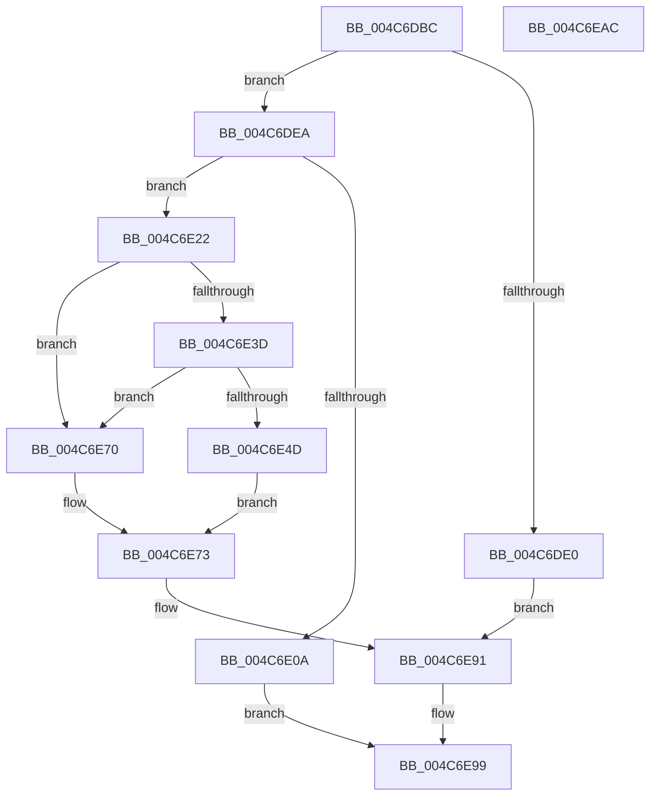

# HalpQueryProfileSource

- RVA: `0x004C6DBC`–`0x004C6EAD` (길이 `241` bytes)
- VA: `0x00000001404C6DBC`
- 실행 섹션: `.text`
- PDB 이름 있음: `예`; PDB Function 태그: `아니요`
- unwind 정보 RVA: `0x000BD140`
- 디코드: `63`개 명령, `241/241` bytes 표시
- 미해석 바이트: `0` (있으면 어셈블리에 `.byte`로 보존)

> 이 문서는 커널 이미지의 기계어와 PDB 기호를 분석해 생성했습니다. 4번과 5번은 함수 원형과 자료형을 바이너리 사용 방식에서 추정한 C 해석이며 원본 소스 복구 결과는 아닙니다.

## 1. Dependencies

- 직접 호출 지점: **5**; 고유 호출 대상: **4**
- 직접 호출자로 확인된 함수: **1**
- RIP 상대 이미지 참조: **4**

### Outgoing calls
- `0x004C6DF1` → [HalpAcquireHighLevelLock](../2D/HalpAcquireHighLevelLock_function_002D2390.md) (function, `0x002D2390`)
- `0x004C6E01` → [HalpGetProfileDescriptor](../4B/HalpGetProfileDescriptor_function_004BB170.md) (function, `0x004BB170`)
- `0x004C6E14` → [HalpReleaseHighLevelLock](../2D/HalpReleaseHighLevelLock_function_002D1C58.md) (function, `0x002D1C58`)
- `0x004C6E2B` → [KeIsEmptyAffinityEx](../2D/KeIsEmptyAffinityEx_function_002D1580.md) (function, `0x002D1580`)
- `0x004C6E8C` → [HalpReleaseHighLevelLock](../2D/HalpReleaseHighLevelLock_function_002D1C58.md) (function, `0x002D1C58`)

### Direct callers
- [HalpQueryProfileInformation](../../page/AD/HalpQueryProfileInformation_function_00AD621C.md) at `0x00AD63CB`

### Static image references
- `0x004C6DEA` → RVA `0x00FC2BD0` (`.data`; read)
- `0x004C6E3D` → RVA `0x000071E0` (`.rdata`; read)
- `0x004C6E44` → RVA `0x00E03B20` (`.data`; read)
- `0x004C6E5C` → RVA `0x00FC21E8` (`.data`; read)

## 2. Other-region calls and transfers

- 다른 실행 섹션으로 향하는 call: **0**
- 별도 외부 분기/꼬리 이동을 확인하지 못했습니다.

## 3. Assembly (complete function range)

```asm
004C6DBC  48 89 5C 24 08                  mov qword ptr [rsp + 8], rbx
004C6DC1  48 89 6C 24 10                  mov qword ptr [rsp + 0x10], rbp
004C6DC6  56                              push rsi
004C6DC7  57                              push rdi
004C6DC8  41 56                           push r14
004C6DCA  48 83 EC 20                     sub rsp, 0x20
004C6DCE  33 DB                           xor ebx, ebx
004C6DD0  49 8B F0                        mov rsi, r8
004C6DD3  48 89 5C 24 58                  mov qword ptr [rsp + 0x58], rbx
004C6DD8  4C 8B F2                        mov r14, rdx
004C6DDB  83 F9 18                        cmp ecx, 0x18
004C6DDE  73 0A                           jae 0x1404c6dea
004C6DE0  BB 04 00 00 C0                  mov ebx, 0xc0000004
004C6DE5  E9 A7 00 00 00                  jmp 0x1404c6e91
004C6DEA  48 8D 0D DF BD AF 00            lea rcx, [rip + 0xafbddf]
004C6DF1  E8 9A B5 E0 FF                  call 0x1402d2390
004C6DF6  41 8B 0E                        mov ecx, dword ptr [r14]
004C6DF9  4C 8D 44 24 58                  lea r8, [rsp + 0x58]
004C6DFE  40 8A E8                        mov bpl, al
004C6E01  E8 6A 43 FF FF                  call 0x1404bb170
004C6E06  85 C0                           test eax, eax
004C6E08  79 18                           jns 0x1404c6e22
004C6E0A  40 8A D5                        mov dl, bpl
004C6E0D  48 8D 0D BC BD AF 00            lea rcx, [rip + 0xafbdbc]
004C6E14  E8 3F AE E0 FF                  call 0x1402d1c58
004C6E19  B8 BB 00 00 C0                  mov eax, 0xc00000bb
004C6E1E  89 1E                           mov dword ptr [rsi], ebx
004C6E20  EB 77                           jmp 0x1404c6e99
004C6E22  48 8B 7C 24 58                  mov rdi, qword ptr [rsp + 0x58]
004C6E27  48 8D 4F 20                     lea rcx, [rdi + 0x20]
004C6E2B  E8 50 A7 E0 FF                  call 0x1402d1580
004C6E30  85 C0                           test eax, eax
004C6E32  0F 94 C0                        sete al
004C6E35  41 88 46 04                     mov byte ptr [r14 + 4], al
004C6E39  39 1F                           cmp dword ptr [rdi], ebx
004C6E3B  75 33                           jne 0x1404c6e70
004C6E3D  48 8D 05 9C 03 B4 FF            lea rax, [rip - 0x4bfc64]
004C6E44  48 39 05 D5 CC 93 00            cmp qword ptr [rip + 0x93ccd5], rax
004C6E4B  74 23                           je 0x1404c6e70
004C6E4D  65 8B 04 25 A4 01 00 00         mov eax, dword ptr gs:[0x1a4]
004C6E55  48 8B 7C 24 58                  mov rdi, qword ptr [rsp + 0x58]
004C6E5A  8B C8                           mov ecx, eax
004C6E5C  48 8B 05 85 B3 AF 00            mov rax, qword ptr [rip + 0xafb385]
004C6E63  48 69 D1 28 01 00 00            imul rdx, rcx, 0x128
004C6E6A  8B 4C 02 18                     mov ecx, dword ptr [rdx + rax + 0x18]
004C6E6E  EB 03                           jmp 0x1404c6e73
004C6E70  8B 4F 18                        mov ecx, dword ptr [rdi + 0x18]
004C6E73  41 89 4E 08                     mov dword ptr [r14 + 8], ecx
004C6E77  40 8A D5                        mov dl, bpl
004C6E7A  48 8B 8F 28 01 00 00            mov rcx, qword ptr [rdi + 0x128]
004C6E81  49 89 4E 10                     mov qword ptr [r14 + 0x10], rcx
004C6E85  48 8D 0D 44 BD AF 00            lea rcx, [rip + 0xafbd44]
004C6E8C  E8 C7 AD E0 FF                  call 0x1402d1c58
004C6E91  C7 06 18 00 00 00               mov dword ptr [rsi], 0x18
004C6E97  8B C3                           mov eax, ebx
004C6E99  48 8B 5C 24 40                  mov rbx, qword ptr [rsp + 0x40]
004C6E9E  48 8B 6C 24 48                  mov rbp, qword ptr [rsp + 0x48]
004C6EA3  48 83 C4 20                     add rsp, 0x20
004C6EA7  41 5E                           pop r14
004C6EA9  5F                              pop rdi
004C6EAA  5E                              pop rsi
004C6EAB  C3                              ret
004C6EAC  CC                              int3
```

## 4. C-style interpretation (structured pseudocode)

```c
__int64 __fastcall HalpQueryProfileSource(int a1, __int64 a2, __int64 a3)
{
    __int64 result;
    __int64 v_rbx;
    __int64 v_rsp;
    unsigned __int64 v_stack_p10;
    unsigned __int64 v_stack_p20;
    unsigned __int64 v_stack_p8;

    v_stack_p8 = v_rbx;
    v_stack_p10 = v_rbp;
    v_rsp = (v_rsp) - (32);
    v_rbx = 0;
    v_stack_p20 = 0;
    if (a1 >= 24) goto loc_004C6DEA;
    goto loc_004C6E91;
loc_004C6DEA:
    result = HalpAcquireHighLevelLock(v_rip + 11517407, a2, a3, a4);
    result = HalpGetProfileDescriptor((unsigned int)(*(unsigned int *)(a2)), a2, v_stack_p20, a4);
    if (!sign_flag) goto loc_004C6E22;
    result = HalpReleaseHighLevelLock(v_rip + 11517372, (unsigned __int8)((unsigned __int8)(result)), v_stack_p20, a4);
    *(unsigned int *)(a3) = (unsigned int)((unsigned int)(0xC0000004ULL));
    goto loc_004C6E99;
loc_004C6E22:
    result = KeIsEmptyAffinityEx(v_stack_p20 + 32, (unsigned __int8)((unsigned __int8)(result)), v_stack_p20, a4);
    result = ((unsigned int)(result) == 0) ? 1 : 0;
    *(unsigned __int8 *)(a2 + 4) = (unsigned __int8)(result);
    if ((*(unsigned int *)(v_stack_p20)) != ((unsigned int)((unsigned int)(0xC0000004ULL)))) goto loc_004C6E70;
    if ((*(unsigned __int64 *)(v_rip + 9686229)) == (v_rip - 4979812)) goto loc_004C6E70;
    a2 = ((unsigned __int8)((unsigned __int8)(result))) * ((unsigned int)((unsigned int)((unsigned int)(*(unsigned int *)(gs_base + (0 + 420))))));
    goto loc_004C6E73;
loc_004C6E70:
loc_004C6E73:
    *(unsigned int *)(a2 + 8) = (unsigned int)((unsigned int)(*(unsigned int *)(v_stack_p20 + 24)));
    *(unsigned __int64 *)(a2 + 16) = *(unsigned __int64 *)(v_stack_p20 + 296);
    result = HalpReleaseHighLevelLock(v_rip + 11517252, (unsigned __int8)((unsigned __int8)(result)), v_stack_p20, a4);
loc_004C6E91:
    *(unsigned int *)(a3) = 24;
loc_004C6E99:
    v_rsp = (v_rsp) + (32);
    return (unsigned int)((unsigned int)((unsigned int)(0xC0000004ULL)));
}
```

## 5. (Beta) C Style

```c
int64_t HalpQueryProfileSource(int32_t Arg1, void *Arg2, void *Arg3)
{
    uint8_t *arg2 = (uint8_t *)Arg2;
    uint8_t *arg3 = (uint8_t *)Arg3;

    int64_t result;
    int64_t local_rbx;
    int64_t local_rsp;
    uint64_t v_stack_p10;
    uint64_t v_stack_p20;
    uint64_t v_stack_p8;

    v_stack_p8 = local_rbx;
    v_stack_p10 = local_rbp;
    local_rsp = (local_rsp) - (32);
    local_rbx = 0;
    v_stack_p20 = 0;
    if (Arg1 >= 24) goto loc_004C6DEA;
    goto loc_004C6E91;
loc_004C6DEA:
    result = HalpAcquireHighLevelLock(v_rip + 11517407, Arg2, Arg3, a4);
    result = HalpGetProfileDescriptor((uint32_t)(*(uint32_t *)(arg2)), Arg2, v_stack_p20, a4);
    if (!sign_flag) goto loc_004C6E22;
    result = HalpReleaseHighLevelLock(v_rip + 11517372, (uint8_t)((uint8_t)(result)), v_stack_p20, a4);
    *(uint32_t *)(arg3) = (uint32_t)((uint32_t)(0xC0000004ULL));
    goto loc_004C6E99;
loc_004C6E22:
    result = KeIsEmptyAffinityEx(v_stack_p20 + 32, (uint8_t)((uint8_t)(result)), v_stack_p20, a4);
    result = ((uint32_t)(result) == 0) ? 1 : 0;
    *(uint8_t *)(arg2 + 0x4) = (uint8_t)(result);
    if ((*(uint32_t *)(v_stack_p20)) != ((uint32_t)((uint32_t)(0xC0000004ULL)))) goto loc_004C6E70;
    if ((*(uint64_t *)(v_rip + 0x93CCD5)) == (v_rip - 4979812)) goto loc_004C6E70;
    Arg2 = ((uint8_t)((uint8_t)(result))) * ((uint32_t)((uint32_t)((uint32_t)(*(uint32_t *)(gs_base + (0 + 0x1A4))))));
    goto loc_004C6E73;
loc_004C6E70:
loc_004C6E73:
    *(uint32_t *)(arg2 + 0x8) = (uint32_t)((uint32_t)(*(uint32_t *)(v_stack_p20 + 0x18)));
    *(uint64_t *)(arg2 + 0x10) = *(uint64_t *)(v_stack_p20 + 0x128);
    result = HalpReleaseHighLevelLock(v_rip + 11517252, (uint8_t)((uint8_t)(result)), v_stack_p20, a4);
loc_004C6E91:
    *(uint32_t *)(arg3) = 24;
loc_004C6E99:
    local_rsp = (local_rsp) + (32);
    return (uint32_t)((uint32_t)((uint32_t)(0xC0000004ULL)));
}
```

### 관측된 메모리 오프셋

구조체 형식이 확인되지 않은 접근은 인자 기준의 오프셋으로만 기록했습니다.

| 기준 인자 | 오프셋 표현 | 폭 (bit) | 접근 |
|---|---:|---:|---|
| `Arg2` | `+ 0x0` | `32` | `R` |
| `Arg2` | `+ 0x4` | `8` | `W` |
| `Arg2` | `+ 0x8` | `32` | `W` |
| `Arg2` | `+ 0x10` | `64` | `W` |
| `Arg3` | `+ 0x0` | `32` | `W` |

## 6. Execution-region graph

[열기: 2D/3D 그래프와 함수 탐색 컨트롤 패널](../../../control-panel.html?section=text&rva=0x004C6DBC&view=graph)

- 2D 그래프는 위에서 아래로 흐르고, 3D 그래프는 빈 공간을 드래그해 회전합니다. Shift+드래그는 이동, 휠은 확대·축소, 함수 노드 선택은 대상 보고서 이동입니다.

### Static fallback


