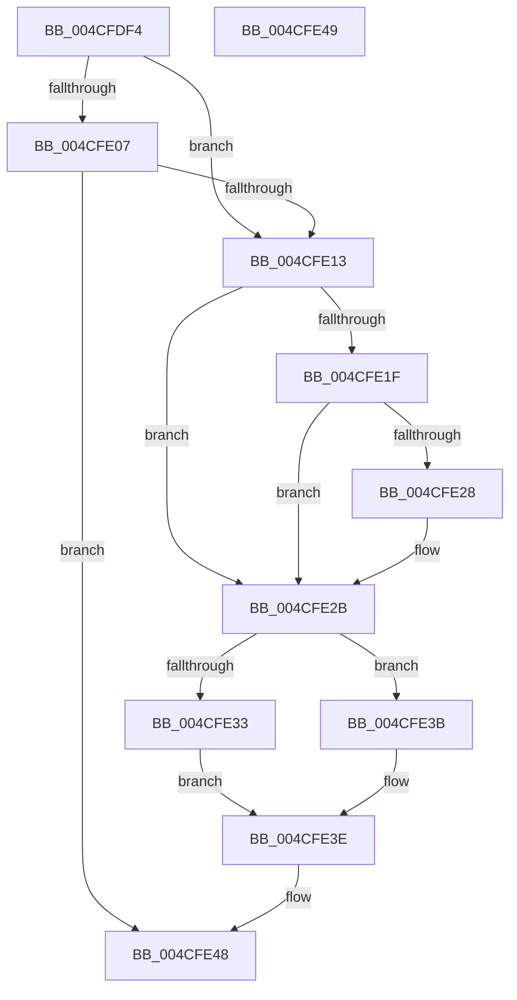

# HalpTimerWatchdogWakeSetDueTime

- RVA: `0x004CFDF4`–`0x004CFE4A` (길이 `86` bytes)
- VA: `0x00000001404CFDF4`
- 실행 섹션: `.text`
- PDB 이름 있음: `예`; PDB Function 태그: `아니요`
- unwind 정보 RVA: `0x000DB714`
- 디코드: `21`개 명령, `86/86` bytes 표시
- 미해석 바이트: `0` (있으면 어셈블리에 `.byte`로 보존)

> 이 문서는 커널 이미지의 기계어와 PDB 기호를 분석해 생성했습니다. 4번과 5번은 함수 원형과 자료형을 바이너리 사용 방식에서 추정한 C 해석이며 원본 소스 복구 결과는 아닙니다.

## 1. Dependencies

- 직접 호출 지점: **0**; 고유 호출 대상: **0**
- 직접 호출자로 확인된 함수: **2**
- RIP 상대 이미지 참조: **4**

### Outgoing calls
- 직접 디코드된 call 명령이 없습니다.

### Direct callers
- [HalpTimerWatchdogResetCountdown](../39/HalpTimerWatchdogResetCountdown_function_0039B3B0.md) at `0x0039B3FB`
- [HalpTimerWatchdogStart](../54/HalpTimerWatchdogStart_function_0054C710.md) at `0x0054C78B`

### Static image references
- `0x004CFDF4` → RVA `0x00FC4028` (`.data`; read)
- `0x004CFDFB` → RVA `0x00FC2188` (`.data`; read)
- `0x004CFE13` → RVA `0x00FC2168` (`.data`; read)
- `0x004CFE41` → RVA `0x00FC2190` (`.data`; write)

## 2. Other-region calls and transfers

- 다른 실행 섹션으로 향하는 call: **0**
- 별도 외부 분기/꼬리 이동을 확인하지 못했습니다.

## 3. Assembly (complete function range)

```asm
004CFDF4  48 8B 0D 2D 42 AF 00            mov rcx, qword ptr [rip + 0xaf422d]
004CFDFB  48 8B 15 86 23 AF 00            mov rdx, qword ptr [rip + 0xaf2386]
004CFE02  48 85 C9                        test rcx, rcx
004CFE05  74 0C                           je 0x1404cfe13
004CFE07  F7 81 E0 00 00 00 00 00 08 00   test dword ptr [rcx + 0xe0], 0x80000
004CFE11  75 35                           jne 0x1404cfe48
004CFE13  48 8B 05 4E 23 AF 00            mov rax, qword ptr [rip + 0xaf234e]
004CFE1A  48 85 C9                        test rcx, rcx
004CFE1D  74 0C                           je 0x1404cfe2b
004CFE1F  83 B9 E4 00 00 00 08            cmp dword ptr [rcx + 0xe4], 8
004CFE26  75 03                           jne 0x1404cfe2b
004CFE28  48 D1 E8                        shr rax, 1
004CFE2B  48 3D 00 08 AF 2F               cmp rax, 0x2faf0800
004CFE31  76 08                           jbe 0x1404cfe3b
004CFE33  48 05 00 BA 3C DC               add rax, -0x23c34600
004CFE39  EB 03                           jmp 0x1404cfe3e
004CFE3B  48 D1 E8                        shr rax, 1
004CFE3E  48 03 C2                        add rax, rdx
004CFE41  48 89 05 48 23 AF 00            mov qword ptr [rip + 0xaf2348], rax
004CFE48  C3                              ret
004CFE49  CC                              int3
```

## 4. C-style interpretation (structured pseudocode)

```c
__int64 __fastcall HalpTimerWatchdogWakeSetDueTime(void)
{
    __int64 result;

    if (*(unsigned __int64 *)(v_rip + 11485741) == 0) goto loc_004CFE13;
    if (((*(unsigned int *)(*(unsigned __int64 *)(v_rip + 11485741) + 224)) & (0x80000ULL)) != 0) goto loc_004CFE48;
loc_004CFE13:
    if (*(unsigned __int64 *)(v_rip + 11485741) == 0) goto loc_004CFE2B;
    result = *(unsigned __int64 *)(v_rip + 11477838);
    if ((*(unsigned int *)(*(unsigned __int64 *)(v_rip + 11485741) + 228)) == 8) {
        result = (*(unsigned __int64 *)(v_rip + 11477838)) >> (1);
    }
    if (result <= 0x2FAF0800ULL) goto loc_004CFE3B;
    result = (result) + (0xFFFFFFFFDC3CBA00ULL);
    goto loc_004CFE3E;
loc_004CFE3B:
    result = (result) >> (1);
loc_004CFE3E:
    result = (result) + (*(unsigned __int64 *)(v_rip + 11477894));
    *(unsigned __int64 *)(v_rip + 11477832) = result;
loc_004CFE48:
    return result;
}
```

## 5. (Beta) C Style

```c
void HalpTimerWatchdogWakeSetDueTime(void)
{
    int64_t result;

    if (*(uint64_t *)(v_rip + 0xAF422D) == 0) goto loc_004CFE13;
    if (((*(uint32_t *)(*(uint64_t *)(v_rip + 0xAF422D) + 0xE0)) & (0x80000ULL)) != 0) goto loc_004CFE48;
loc_004CFE13:
    if (*(uint64_t *)(v_rip + 0xAF422D) == 0) goto loc_004CFE2B;
    result = *(uint64_t *)(v_rip + 0xAF234E);
    if ((*(uint32_t *)(*(uint64_t *)(v_rip + 0xAF422D) + 0xE4)) == 8) {
        result = (*(uint64_t *)(v_rip + 0xAF234E)) >> (1);
    }
    if (result <= 0x2FAF0800ULL) goto loc_004CFE3B;
    result = (result) + (0xFFFFFFFFDC3CBA00ULL);
    goto loc_004CFE3E;
loc_004CFE3B:
    result = (result) >> (1);
loc_004CFE3E:
    result = (result) + (*(uint64_t *)(v_rip + 0xAF2386));
    *(uint64_t *)(v_rip + 0xAF2348) = result;
loc_004CFE48:
    return result;
}
```

## 6. Execution-region graph

[열기: 2D/3D 그래프와 함수 탐색 컨트롤 패널](../../../control-panel.html?section=text&rva=0x004CFDF4&view=graph)

- 2D 그래프는 위에서 아래로 흐르고, 3D 그래프는 빈 공간을 드래그해 회전합니다. Shift+드래그는 이동, 휠은 확대·축소, 함수 노드 선택은 대상 보고서 이동입니다.

### Static fallback


