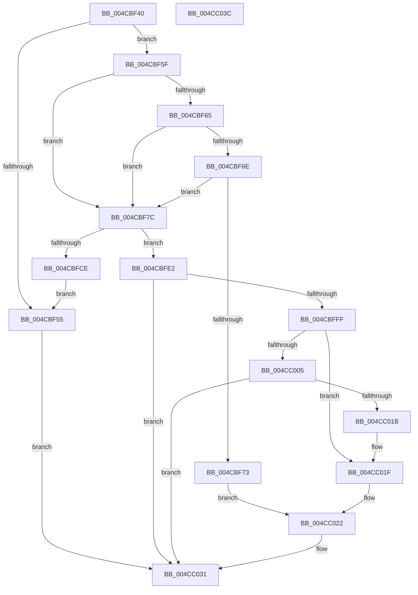

# HalpWdatArmTimer

- RVA: `0x004CBF40`–`0x004CC03D` (길이 `253` bytes)
- VA: `0x00000001404CBF40`
- 실행 섹션: `.text`
- PDB 이름 있음: `예`; PDB Function 태그: `아니요`
- unwind 정보 RVA: `0x0006E5F8`
- 디코드: `73`개 명령, `253/253` bytes 표시
- 미해석 바이트: `0` (있으면 어셈블리에 `.byte`로 보존)

> 이 문서는 커널 이미지의 기계어와 PDB 기호를 분석해 생성했습니다. 4번과 5번은 함수 원형과 자료형을 바이너리 사용 방식에서 추정한 C 해석이며 원본 소스 복구 결과는 아닙니다.

## 1. Dependencies

- 직접 호출 지점: **4**; 고유 호출 대상: **1**
- 직접 호출자로 확인된 함수: **0**
- RIP 상대 이미지 참조: **0**

### Outgoing calls
- `0x004CBFD8` → [WdInstrExecuteAction](../4D/WdInstrExecuteAction_function_004D0928.md) (function, `0x004D0928`)
- `0x004CBFF6` → [WdInstrExecuteAction](../4D/WdInstrExecuteAction_function_004D0928.md) (function, `0x004D0928`)
- `0x004CC012` → [WdInstrExecuteAction](../4D/WdInstrExecuteAction_function_004D0928.md) (function, `0x004D0928`)
- `0x004CC02C` → [WdInstrExecuteAction](../4D/WdInstrExecuteAction_function_004D0928.md) (function, `0x004D0928`)

### Direct callers
- 이 함수 시작 RVA로 연결되는 직접 call은 확인되지 않았습니다. 간접 호출은 완전히 역산할 수 없습니다.

### Static image references
- 디코드된 RIP-relative 메모리 참조가 없습니다.

## 2. Other-region calls and transfers

- 다른 실행 섹션으로 향하는 call: **0**
- 별도 외부 분기/꼬리 이동을 확인하지 못했습니다.

## 3. Assembly (complete function range)

```asm
004CBF40  48 89 5C 24 08                  mov qword ptr [rsp + 8], rbx
004CBF45  57                              push rdi
004CBF46  48 83 EC 30                     sub rsp, 0x30
004CBF4A  4D 8B C8                        mov r9, r8
004CBF4D  48 8B D9                        mov rbx, rcx
004CBF50  83 FA 03                        cmp edx, 3
004CBF53  74 0A                           je 0x1404cbf5f
004CBF55  B8 0D 00 00 C0                  mov eax, 0xc000000d
004CBF5A  E9 D2 00 00 00                  jmp 0x1404cc031
004CBF5F  80 79 28 00                     cmp byte ptr [rcx + 0x28], 0
004CBF63  74 17                           je 0x1404cbf7c
004CBF65  48 8B 41 20                     mov rax, qword ptr [rcx + 0x20]
004CBF69  48 85 C0                        test rax, rax
004CBF6C  74 0E                           je 0x1404cbf7c
004CBF6E  4C 3B C8                        cmp r9, rax
004CBF71  75 09                           jne 0x1404cbf7c
004CBF73  48 83 C1 30                     add rcx, 0x30
004CBF77  E9 A6 00 00 00                  jmp 0x1404cc022
004CBF7C  4C 89 49 20                     mov qword ptr [rcx + 0x20], r9
004CBF80  48 8D 7B 30                     lea rdi, [rbx + 0x30]
004CBF84  48 B8 CB 21 7B 17 E9 D7 39 25   movabs rax, 0x2539d7e9177b21cb
004CBF8E  49 F7 E1                        mul r9
004CBF91  4C 2B C2                        sub r8, rdx
004CBF94  49 D1 E8                        shr r8, 1
004CBF97  4C 03 C2                        add r8, rdx
004CBF9A  49 C1 E8 09                     shr r8, 9
004CBF9E  49 69 C8 7E 03 00 00            imul rcx, r8, 0x37e
004CBFA5  49 8D 40 01                     lea rax, [r8 + 1]
004CBFA9  4C 3B C9                        cmp r9, rcx
004CBFAC  8B 4B 18                        mov ecx, dword ptr [rbx + 0x18]
004CBFAF  49 0F 44 C0                     cmove rax, r8
004CBFB3  33 D2                           xor edx, edx
004CBFB5  48 F7 F1                        div rcx
004CBFB8  48 85 D2                        test rdx, rdx
004CBFBB  8B 53 2C                        mov edx, dword ptr [rbx + 0x2c]
004CBFBE  48 8D 48 01                     lea rcx, [rax + 1]
004CBFC2  48 0F 44 C8                     cmove rcx, rax
004CBFC6  8B 43 10                        mov eax, dword ptr [rbx + 0x10]
004CBFC9  48 3B C8                        cmp rcx, rax
004CBFCC  76 14                           jbe 0x1404cbfe2
004CBFCE  45 33 C9                        xor r9d, r9d
004CBFD1  48 8B CF                        mov rcx, rdi
004CBFD4  45 8D 41 0B                     lea r8d, [r9 + 0xb]
004CBFD8  E8 4B 49 00 00                  call 0x1404d0928
004CBFDD  E9 73 FF FF FF                  jmp 0x1404cbf55
004CBFE2  44 8B 4B 14                     mov r9d, dword ptr [rbx + 0x14]
004CBFE6  41 B8 06 00 00 00               mov r8d, 6
004CBFEC  49 3B C9                        cmp rcx, r9
004CBFEF  44 0F 43 C9                     cmovae r9d, ecx
004CBFF3  48 8B CF                        mov rcx, rdi
004CBFF6  E8 2D 49 00 00                  call 0x1404d0928
004CBFFB  85 C0                           test eax, eax
004CBFFD  78 32                           js 0x1404cc031
004CBFFF  80 7B 28 00                     cmp byte ptr [rbx + 0x28], 0
004CC003  75 1A                           jne 0x1404cc01f
004CC005  8B 53 2C                        mov edx, dword ptr [rbx + 0x2c]
004CC008  45 33 C9                        xor r9d, r9d
004CC00B  48 8B CF                        mov rcx, rdi
004CC00E  45 8D 41 09                     lea r8d, [r9 + 9]
004CC012  E8 11 49 00 00                  call 0x1404d0928
004CC017  85 C0                           test eax, eax
004CC019  78 16                           js 0x1404cc031
004CC01B  C6 43 28 01                     mov byte ptr [rbx + 0x28], 1
004CC01F  48 8B CF                        mov rcx, rdi
004CC022  8B 53 2C                        mov edx, dword ptr [rbx + 0x2c]
004CC025  45 33 C9                        xor r9d, r9d
004CC028  45 8D 41 01                     lea r8d, [r9 + 1]
004CC02C  E8 F7 48 00 00                  call 0x1404d0928
004CC031  48 8B 5C 24 40                  mov rbx, qword ptr [rsp + 0x40]
004CC036  48 83 C4 30                     add rsp, 0x30
004CC03A  5F                              pop rdi
004CC03B  C3                              ret
004CC03C  CC                              int3
```

## 4. C-style interpretation (structured pseudocode)

```c
__int64 __fastcall HalpWdatArmTimer(__int64 a1, __int64 a2, __int64 a3)
{
    __int64 result;
    __int64 v_rsp;
    unsigned __int64 v_stack_p8;

    v_stack_p8 = v_rbx;
    v_rsp = (v_rsp) - (48);
    if (((unsigned int)(a2)) == 3) goto loc_004CBF5F;
loc_004CBF55:
    goto loc_004CC031;
loc_004CBF5F:
    if ((*(unsigned __int8 *)(a1 + 40)) == 0) goto loc_004CBF7C;
    if (*(unsigned __int64 *)(a1 + 32) == 0) goto loc_004CBF7C;
    if (a3 != (*(unsigned __int64 *)(a1 + 32))) goto loc_004CBF7C;
    a1 = (a1) + (48);
    goto loc_004CC022;
loc_004CBF7C:
    *(unsigned __int64 *)(a1 + 32) = a3;
    a3 = (a3) - (a2);
    a3 = (a3) >> (1);
    a3 = (a3) + (a2);
    a3 = (a3) >> (9);
    a1 = (a1) * (a3);
    result = a3 + 1;
    if (a3 == a1) { result = a3; }
    a2 = 0;
    a1 = result + 1;
    if (0 == 0) { a1 = result; }
    if (a1 <= ((unsigned int)(*(unsigned int *)(a1 + 16)))) goto loc_004CBFE2;
    a4 = 0;
    result = WdInstrExecuteAction(a1 + 48, (unsigned int)(*(unsigned int *)(a1 + 44)), a4 + 11, a4);
    goto loc_004CBF55;
loc_004CBFE2:
    a4 = (unsigned int)(*(unsigned int *)(a1 + 20));
    if ((a1 + 48) >= ((unsigned int)(*(unsigned int *)(a1 + 20)))) { a4 = (unsigned int)(a1 + 48); }
    result = WdInstrExecuteAction(a1 + 48, (unsigned int)(*(unsigned int *)(a1 + 44)), 6, a4);
    if (sign_flag) goto loc_004CC031;
    if ((*(unsigned __int8 *)(a1 + 40)) != 0) goto loc_004CC01F;
    a4 = 0;
    result = WdInstrExecuteAction(a1 + 48, (unsigned int)(*(unsigned int *)(a1 + 44)), a4 + 9, a4);
    if (sign_flag) goto loc_004CC031;
    *(unsigned __int8 *)(a1 + 40) = 1;
loc_004CC01F:
loc_004CC022:
    a4 = 0;
    result = WdInstrExecuteAction(a1 + 48, (unsigned int)(*(unsigned int *)(a1 + 44)), a4 + 1, a4);
loc_004CC031:
    v_rsp = (v_rsp) + (48);
    return result;
}
```

## 5. (Beta) C Style

```c
int64_t HalpWdatArmTimer(void *Arg1, int64_t Arg2, int64_t Arg3)
{
    uint8_t *arg1 = (uint8_t *)Arg1;

    int64_t result;
    int64_t local_rsp;
    uint64_t v_stack_p8;

    v_stack_p8 = local_rbx;
    local_rsp = (local_rsp) - (48);
    if (((uint32_t)(Arg2)) == 3) goto loc_004CBF5F;
loc_004CBF55:
    goto loc_004CC031;
loc_004CBF5F:
    if ((*(uint8_t *)(arg1 + 0x28)) == 0) goto loc_004CBF7C;
    if (*(uint64_t *)(arg1 + 0x20) == 0) goto loc_004CBF7C;
    if (Arg3 != (*(uint64_t *)(arg1 + 0x20))) goto loc_004CBF7C;
    Arg1 = (Arg1) + (48);
    goto loc_004CC022;
loc_004CBF7C:
    *(uint64_t *)(arg1 + 0x20) = Arg3;
    Arg3 = (Arg3) - (Arg2);
    Arg3 = (Arg3) >> (1);
    Arg3 = (Arg3) + (Arg2);
    Arg3 = (Arg3) >> (9);
    Arg1 = (Arg1) * (Arg3);
    result = Arg3 + 1;
    if (Arg3 == Arg1) { result = Arg3; }
    Arg2 = 0;
    Arg1 = result + 1;
    if (0 == 0) { Arg1 = result; }
    if (Arg1 <= ((uint32_t)(*(uint32_t *)(arg1 + 0x10)))) goto loc_004CBFE2;
    a4 = 0;
    result = WdInstrExecuteAction(Arg1 + 48, (uint32_t)(*(uint32_t *)(arg1 + 0x2C)), a4 + 11, a4);
    goto loc_004CBF55;
loc_004CBFE2:
    a4 = (uint32_t)(*(uint32_t *)(arg1 + 0x14));
    if ((Arg1 + 48) >= ((uint32_t)(*(uint32_t *)(arg1 + 0x14)))) { a4 = (uint32_t)(Arg1 + 48); }
    result = WdInstrExecuteAction(Arg1 + 48, (uint32_t)(*(uint32_t *)(arg1 + 0x2C)), 6, a4);
    if (sign_flag) goto loc_004CC031;
    if ((*(uint8_t *)(arg1 + 0x28)) != 0) goto loc_004CC01F;
    a4 = 0;
    result = WdInstrExecuteAction(Arg1 + 48, (uint32_t)(*(uint32_t *)(arg1 + 0x2C)), a4 + 9, a4);
    if (sign_flag) goto loc_004CC031;
    *(uint8_t *)(arg1 + 0x28) = 1;
loc_004CC01F:
loc_004CC022:
    a4 = 0;
    result = WdInstrExecuteAction(Arg1 + 48, (uint32_t)(*(uint32_t *)(arg1 + 0x2C)), a4 + 1, a4);
loc_004CC031:
    local_rsp = (local_rsp) + (48);
    return result;
}
```

### 관측된 메모리 오프셋

구조체 형식이 확인되지 않은 접근은 인자 기준의 오프셋으로만 기록했습니다.

| 기준 인자 | 오프셋 표현 | 폭 (bit) | 접근 |
|---|---:|---:|---|
| `Arg1` | `+ 0x10` | `32` | `R` |
| `Arg1` | `+ 0x14` | `32` | `R` |
| `Arg1` | `+ 0x18` | `32` | `R` |
| `Arg1` | `+ 0x20` | `64` | `R` |
| `Arg1` | `+ 0x20` | `64` | `W` |
| `Arg1` | `+ 0x28` | `8` | `R` |
| `Arg1` | `+ 0x28` | `8` | `W` |
| `Arg1` | `+ 0x2C` | `32` | `R` |
| `Arg1` | `+ 0x30` | `64` | `R` |

## 6. Execution-region graph

[열기: 2D/3D 그래프와 함수 탐색 컨트롤 패널](../../../control-panel.html?section=text&rva=0x004CBF40&view=graph)

- 2D 그래프는 위에서 아래로 흐르고, 3D 그래프는 빈 공간을 드래그해 회전합니다. Shift+드래그는 이동, 휠은 확대·축소, 함수 노드 선택은 대상 보고서 이동입니다.

### Static fallback


