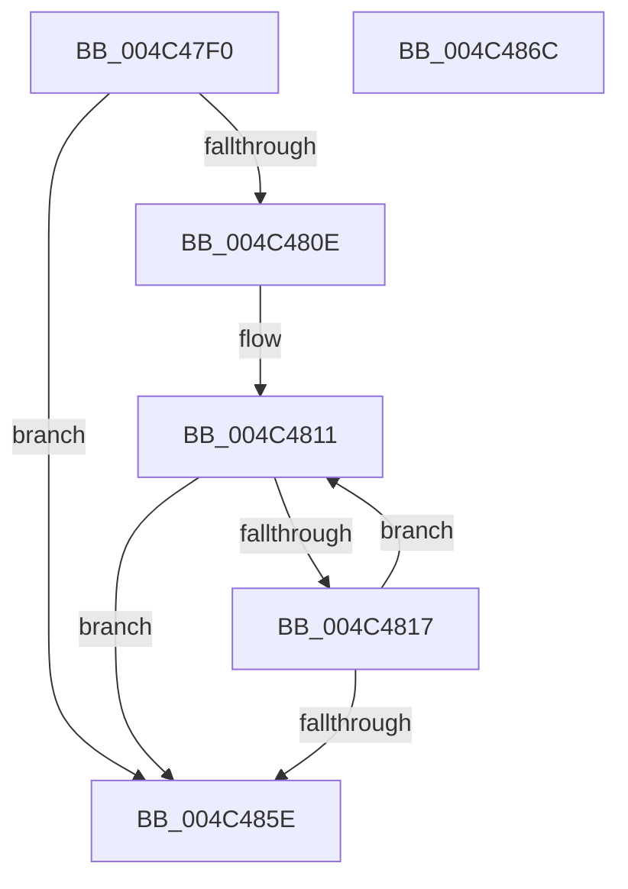

# HsaFlConfigureLeafPhysicalPfn

- RVA: `0x004C47F0`–`0x004C486D` (길이 `125` bytes)
- VA: `0x00000001404C47F0`
- 실행 섹션: `.text`
- PDB 이름 있음: `예`; PDB Function 태그: `아니요`
- unwind 정보 RVA: `0x000950EC`
- 디코드: `36`개 명령, `125/125` bytes 표시
- 미해석 바이트: `0` (있으면 어셈블리에 `.byte`로 보존)

> 이 문서는 커널 이미지의 기계어와 PDB 기호를 분석해 생성했습니다. 4번과 5번은 함수 원형과 자료형을 바이너리 사용 방식에서 추정한 C 해석이며 원본 소스 복구 결과는 아닙니다.

## 1. Dependencies

- 직접 호출 지점: **0**; 고유 호출 대상: **0**
- 직접 호출자로 확인된 함수: **0**
- RIP 상대 이미지 참조: **0**

### Outgoing calls
- 직접 디코드된 call 명령이 없습니다.

### Direct callers
- 이 함수 시작 RVA로 연결되는 직접 call은 확인되지 않았습니다. 간접 호출은 완전히 역산할 수 없습니다.

### Static image references
- 디코드된 RIP-relative 메모리 참조가 없습니다.

## 2. Other-region calls and transfers

- 다른 실행 섹션으로 향하는 call: **0**
- 별도 외부 분기/꼬리 이동을 확인하지 못했습니다.

## 3. Assembly (complete function range)

```asm
004C47F0  48 89 5C 24 08                  mov qword ptr [rsp + 8], rbx
004C47F5  48 89 7C 24 10                  mov qword ptr [rsp + 0x10], rdi
004C47FA  41 8B F8                        mov edi, r8d
004C47FD  45 33 DB                        xor r11d, r11d
004C4800  83 E7 02                        and edi, 2
004C4803  48 8B DA                        mov rbx, rdx
004C4806  4C 8B D1                        mov r10, rcx
004C4809  45 85 C9                        test r9d, r9d
004C480C  74 50                           je 0x1404c485e
004C480E  48 2B D9                        sub rbx, rcx
004C4811  49 83 3A 00                     cmp qword ptr [r10], 0
004C4815  75 47                           jne 0x1404c485e
004C4817  8B C7                           mov eax, edi
004C4819  F7 D8                           neg eax
004C481B  48 B8 FF 0F 00 00 00 00 F0 FF   movabs rax, 0xfff0000000000fff
004C4825  48 1B C9                        sbb rcx, rcx
004C4828  41 FF C3                        inc r11d
004C482B  83 E1 02                        and ecx, 2
004C482E  49 89 0A                        mov qword ptr [r10], rcx
004C4831  4A 8B 14 13                     mov rdx, qword ptr [rbx + r10]
004C4835  48 C1 E2 0C                     shl rdx, 0xc
004C4839  4C 8B C2                        mov r8, rdx
004C483C  4C 33 C1                        xor r8, rcx
004C483F  4C 23 C0                        and r8, rax
004C4842  48 B8 05 00 00 00 00 00 00 80   movabs rax, 0x8000000000000005
004C484C  4C 33 C2                        xor r8, rdx
004C484F  4C 0B C0                        or r8, rax
004C4852  4D 89 02                        mov qword ptr [r10], r8
004C4855  49 83 C2 08                     add r10, 8
004C4859  45 3B D9                        cmp r11d, r9d
004C485C  72 B3                           jb 0x1404c4811
004C485E  48 8B 5C 24 08                  mov rbx, qword ptr [rsp + 8]
004C4863  41 8B C3                        mov eax, r11d
004C4866  48 8B 7C 24 10                  mov rdi, qword ptr [rsp + 0x10]
004C486B  C3                              ret
004C486C  CC                              int3
```

## 4. C-style interpretation (structured pseudocode)

```c
__int64 __fastcall HsaFlConfigureLeafPhysicalPfn(__int64 a1, __int64 a2, int a3, int a4)
{
    __int64 result;
    __int64 v_r10;
    __int64 v_r11;
    __int64 v_rbx;
    __int64 v_rdi;
    unsigned __int64 v_stack_p10;
    unsigned __int64 v_stack_p8;

    v_stack_p8 = v_rbx;
    v_stack_p10 = v_rdi;
    v_r11 = 0;
    v_rdi = (unsigned int)(((unsigned int)(a3)) & (2));
    if (a4 == 0) goto loc_004C485E;
    v_rbx = (a2) - (a1);
loc_004C4811:
    if ((*(unsigned __int64 *)(a1)) != 0) goto loc_004C485E;
    result = (unsigned int)(-((unsigned int)((unsigned int)(v_rdi))));
    v_r11 = (unsigned int)((v_r11) + 1);
    a1 = (unsigned int)((a1) & (2));
    *(unsigned __int64 *)(a1) = a1;
    a2 = (*(unsigned __int64 *)(v_rbx + a1 * 1)) << (12);
    a3 = (a2) ^ (a1);
    a3 = (a3) & (result);
    a3 = (a3) ^ (a2);
    a3 = (a3) | (result);
    *(unsigned __int64 *)(a1) = a3;
    v_r10 = (a1) + (8);
    if (((unsigned int)(v_r11)) < a4) goto loc_004C4811;
loc_004C485E:
    return (unsigned int)((unsigned int)(v_r11));
}
```

## 5. (Beta) C Style

```c
int64_t HsaFlConfigureLeafPhysicalPfn(void *Arg1, void *Arg2, int32_t Arg3, int32_t Arg4)
{
    uint8_t *arg1 = (uint8_t *)Arg1;
    uint8_t *arg2 = (uint8_t *)Arg2;

    int64_t result;
    int64_t local_r10;
    int64_t local_r11;
    int64_t local_rbx;
    int64_t local_rdi;
    uint64_t v_stack_p10;
    uint64_t v_stack_p8;

    v_stack_p8 = local_rbx;
    v_stack_p10 = local_rdi;
    local_r11 = 0;
    local_rdi = (uint32_t)(((uint32_t)(Arg3)) & (2));
    if (Arg4 == 0) goto loc_004C485E;
    local_rbx = (Arg2) - (Arg1);
loc_004C4811:
    if ((*(uint64_t *)(arg1)) != 0) goto loc_004C485E;
    result = (uint32_t)(-((uint32_t)((uint32_t)(local_rdi))));
    local_r11 = (uint32_t)((local_r11) + 1);
    Arg1 = (uint32_t)((Arg1) & (2));
    *(void **)(arg1) = Arg1;
    Arg2 = (*(uint64_t *)(local_rbx + arg1 * 1)) << (12);
    Arg3 = (Arg2) ^ (Arg1);
    Arg3 = (Arg3) & (result);
    Arg3 = (Arg3) ^ (Arg2);
    Arg3 = (Arg3) | (result);
    *(uint64_t *)(arg1) = Arg3;
    local_r10 = (Arg1) + (8);
    if (((uint32_t)(local_r11)) < Arg4) goto loc_004C4811;
loc_004C485E:
    return (uint32_t)((uint32_t)(local_r11));
}
```

### 관측된 메모리 오프셋

구조체 형식이 확인되지 않은 접근은 인자 기준의 오프셋으로만 기록했습니다.

| 기준 인자 | 오프셋 표현 | 폭 (bit) | 접근 |
|---|---:|---:|---|
| `Arg1` | `+ 0x0` | `64` | `R` |
| `Arg1` | `+ 0x0` | `64` | `W` |
| `Arg2` | `+ 0x0 + r10*1` | `64` | `R` |

## 6. Execution-region graph

[열기: 2D/3D 그래프와 함수 탐색 컨트롤 패널](../../../control-panel.html?section=text&rva=0x004C47F0&view=graph)

- 2D 그래프는 위에서 아래로 흐르고, 3D 그래프는 빈 공간을 드래그해 회전합니다. Shift+드래그는 이동, 휠은 확대·축소, 함수 노드 선택은 대상 보고서 이동입니다.

### Static fallback


